<!-- source: DeepWiki mcp.deepwiki.com · repo ivy-llc/ivy · page 1.1 Key Features and Capabilities · fetched 2026-10-21 -->

# Key Features and Capabilities

Relevant source files

The following files were used as context for generating this wiki page:

- [.github/ISSUE_TEMPLATE/docs_bug_report.yml](.github/ISSUE_TEMPLATE/docs_bug_report.yml)
- [.github/pull_request_template.md](.github/pull_request_template.md)
- [.github/workflows/checklist_actions.yml](.github/workflows/checklist_actions.yml)
- [CONTRIBUTING.md](CONTRIBUTING.md)
- [README.md](README.md)
- [automation_tools/checklists/frontend_checklist.md](automation_tools/checklists/frontend_checklist.md)
- [automation_tools/checklists/reformat_checklist.md](automation_tools/checklists/reformat_checklist.md)
- [docs/overview/contributing.rst](docs/overview/contributing.rst)
- [ivy/functional/backends/jax/general.py](ivy/functional/backends/jax/general.py)
- [ivy/functional/backends/mxnet/general.py](ivy/functional/backends/mxnet/general.py)
- [ivy/functional/backends/numpy/general.py](ivy/functional/backends/numpy/general.py)
- [ivy/functional/backends/paddle/general.py](ivy/functional/backends/paddle/general.py)
- [ivy/functional/backends/tensorflow/general.py](ivy/functional/backends/tensorflow/general.py)
- [ivy/functional/backends/torch/general.py](ivy/functional/backends/torch/general.py)
- [ivy/functional/ivy/general.py](ivy/functional/ivy/general.py)
- [ivy_tests/test_ivy/test_functional/test_core/test_general.py](ivy_tests/test_ivy/test_functional/test_core/test_general.py)
- [scripts/backend_generation/tree_generation.py](scripts/backend_generation/tree_generation.py)

This page provides an overview of Ivy's core features and capabilities. Ivy is a framework designed to unify machine learning code across different backends (PyTorch, TensorFlow, JAX, NumPy, and Paddle), enabling seamless conversion between frameworks and optimized graph-based operations. For a high-level architectural overview, see [Architectural Overview](#1.2).

## Unified Framework Interface

Ivy provides a unified API that works across different machine learning frameworks, allowing code to be written once and run on any supported backend.

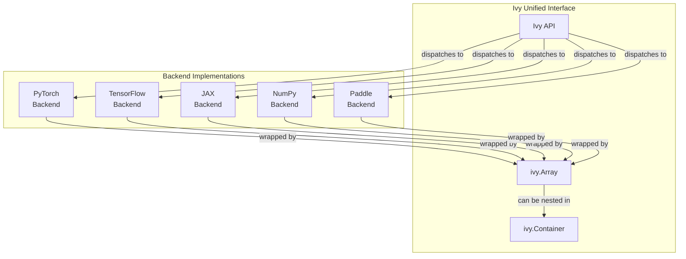

Sources:
- [ivy/functional/backends/tensorflow/general.py:1-96](/)
- [ivy/functional/backends/jax/general.py:1-72](/)
- [ivy/functional/backends/torch/general.py:1-57](/)
- [ivy/functional/backends/numpy/general.py:1-33](/)
- [ivy/functional/backends/paddle/general.py:1-62](/)

## Framework Transpilation

Ivy's transpilation capability (`ivy.transpile`) allows you to convert code from one framework to another while maintaining complete functionality.

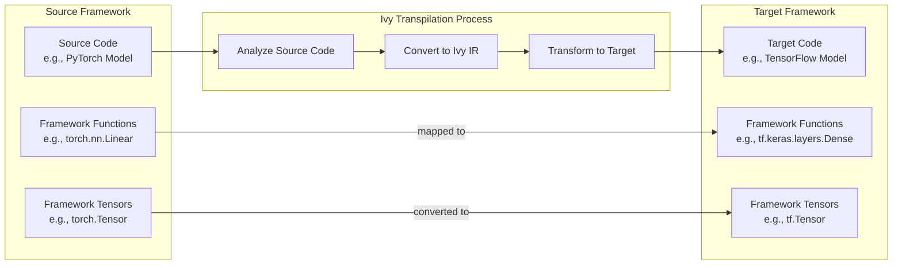

Sources:
- [README.md:80-82](/)
- [README.md:168-171](/)

## Graph Tracing

Ivy provides graph tracing capabilities (`ivy.trace_graph`) to optimize and analyze computational graphs from any backend.

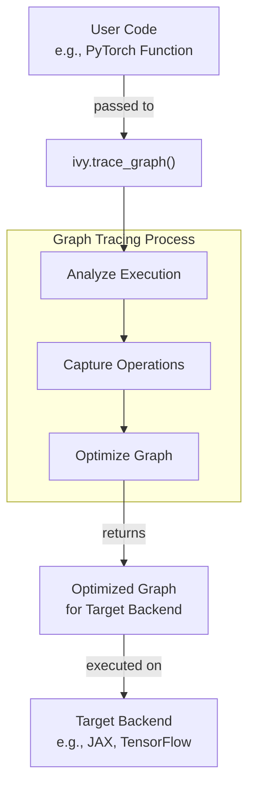

Sources:
- [README.md:82-82](/)
- [README.md:200-216](/)

## Backend System

The backend system enables seamless switching between different ML frameworks and handles the execution of functions on the appropriate backend.

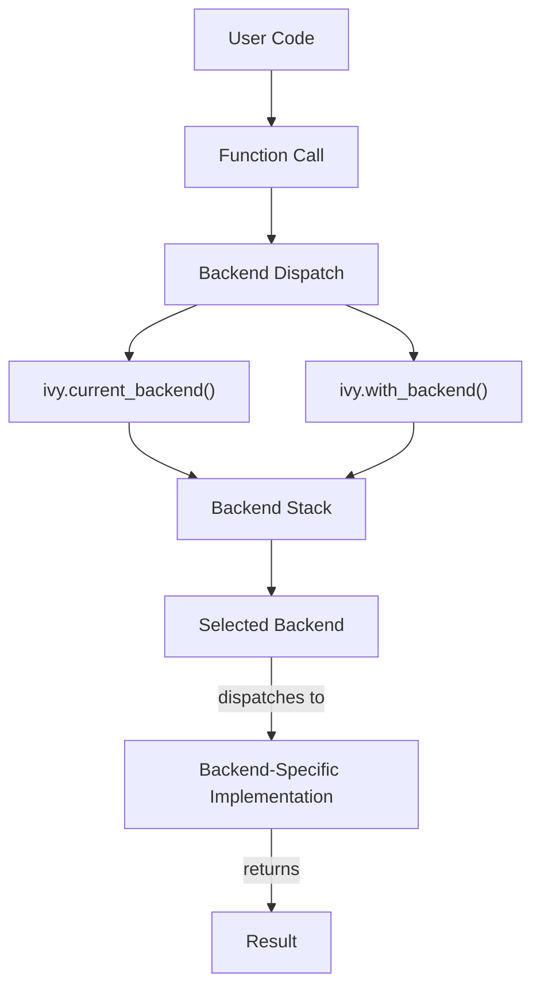

Sources:
- [ivy/functional/ivy/general.py:31-73](/)
- [ivy/functional/backends/tensorflow/general.py:50-52](/)
- [ivy/functional/backends/jax/general.py:49-51](/)
- [ivy/functional/backends/torch/general.py:68-70](/)
- [ivy/functional/backends/numpy/general.py:30-32](/)

## Function Wrapping System

Ivy uses a sophisticated function wrapping system to handle array conversion, device placement, and other aspects of function execution.

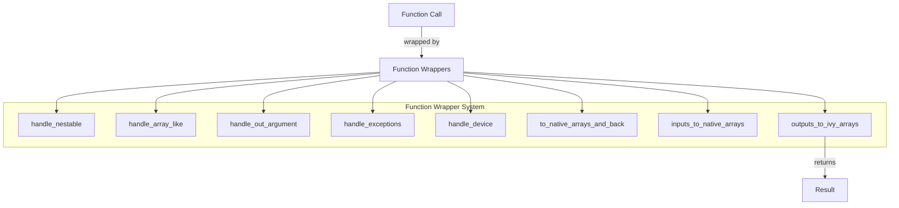

Sources:
- [ivy/functional/ivy/general.py:31-73](/)
- [ivy/func_wrapper.py:referenced in file](/)

## Array and Container System

Ivy provides `ivy.Array` and `ivy.Container` classes for working with arrays and nested collections across different backends.

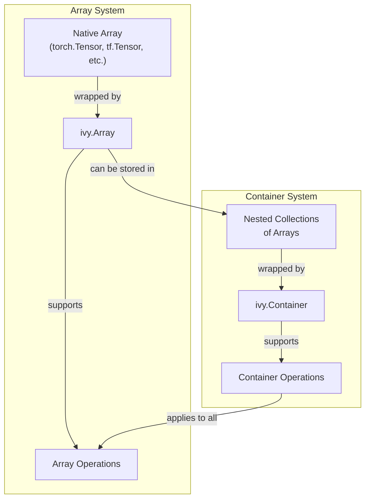

Sources:
- [ivy/functional/ivy/general.py:279-410](/)
- [ivy/functional/backends/tensorflow/general.py:27-35](/)
- [ivy/functional/backends/jax/general.py:53-71](/)
- [ivy/functional/backends/torch/general.py:50-56](/)
- [ivy/functional/backends/numpy/general.py:250-253](/)

## Backend-Agnostic Data Type System

Ivy provides a comprehensive system for handling different data types across frameworks.

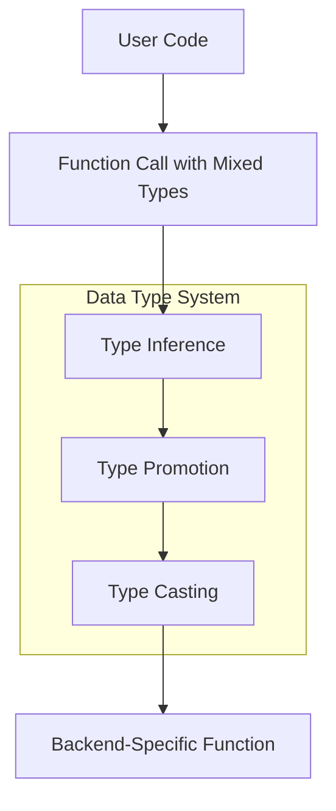

Sources:
- [ivy/functional/ivy/general.py:96-170](/)

## Core Functional API

The Core Functional API provides a comprehensive set of operations that are implemented across all supported backends.

| Category | Description | Examples |
|----------|-------------|----------|
| General Functions | Utility and common operations | `to_numpy`, `array_equal`, `get_item`, `set_item` |
| Elementwise Functions | Operations applied to each element | Math, logic, and comparison operations |
| Linear Algebra | Matrix and vector operations | Matrix multiplication, decompositions, solvers |
| Array Creation | Functions to create arrays | `zeros`, `ones`, `eye`, `linspace` |
| Array Manipulation | Shape and dimension operations | Reshape, concat, split, transpose |
| Neural Network Layers | Building blocks for neural networks | Linear, convolutional, pooling, normalization layers |

Sources:
- [ivy/functional/ivy/general.py:279-1335](/)
- [ivy/functional/backends/tensorflow/general.py:35-581](/)
- [ivy/functional/backends/jax/general.py:53-472](/)
- [ivy/functional/backends/torch/general.py:58-579](/)
- [ivy/functional/backends/numpy/general.py:22-469](/)

## Multi-Backend Mode Management

Ivy provides mechanisms to manage how code is executed across backends, including array mode, nestable mode, and exception handling.

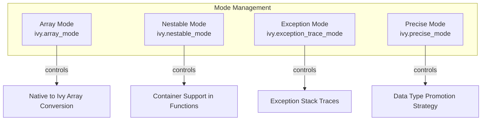

Sources:
- [ivy/functional/ivy/general.py:169-570](/)

## Inplace Operations Support

Ivy provides capabilities for inplace updates to arrays, which can be critical for memory efficiency in certain applications.

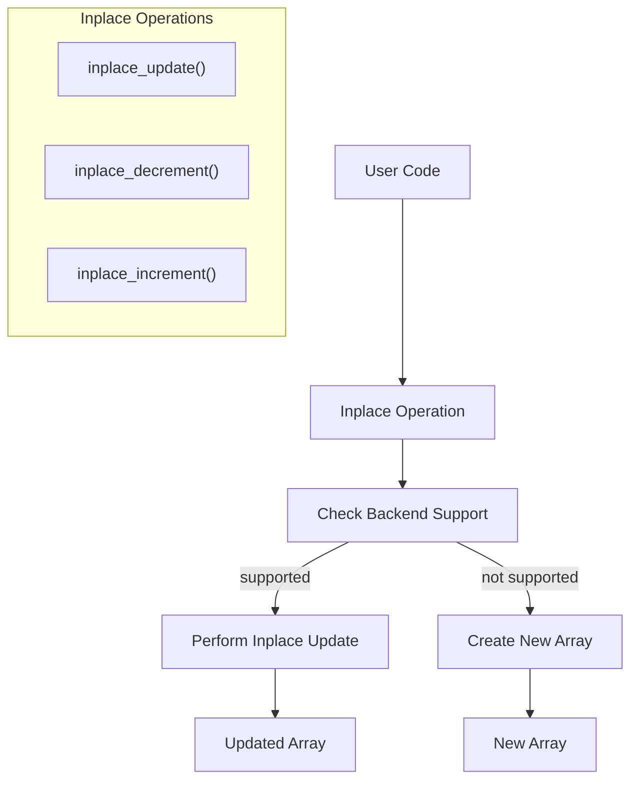

Sources:
- [ivy/functional/backends/tensorflow/general.py:239-337](/)
- [ivy/functional/backends/jax/general.py:258-337](/)
- [ivy/functional/backends/torch/general.py:368-396](/)
- [ivy/functional/backends/numpy/general.py:185-243](/)
- [ivy/functional/backends/paddle/general.py:350-466](/)

## Framework Frontend APIs

Ivy provides frontends that mimic the APIs of other frameworks, allowing code written for specific frameworks to run on any backend.

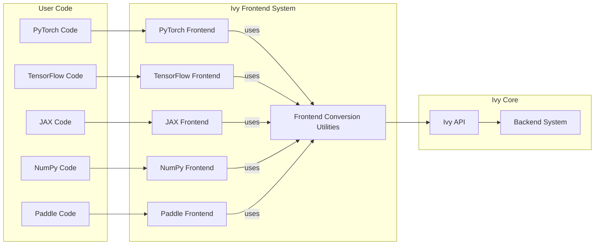

Sources:
- [README.md:155-159](/)

## Testing Framework

Ivy includes a comprehensive testing system to ensure compatibility and correctness across different backends.

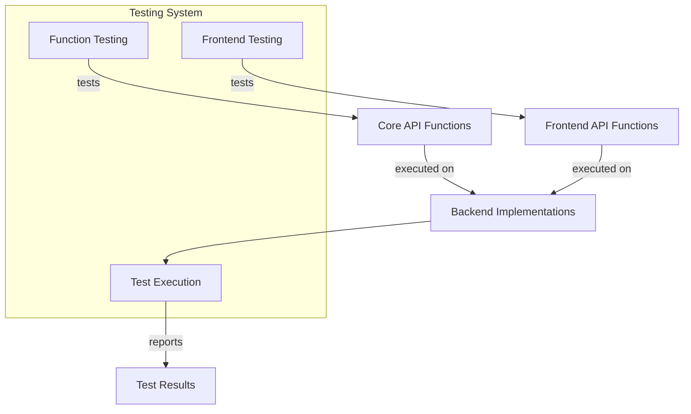

Sources:
- [ivy_tests/test_ivy/test_functional/test_core/test_general.py:1-67](/)

This overview covers the key features and capabilities of Ivy. Each of these components works together to provide a unified interface for machine learning across different frameworks, enabling code interoperability, optimization, and simplified development.

---

