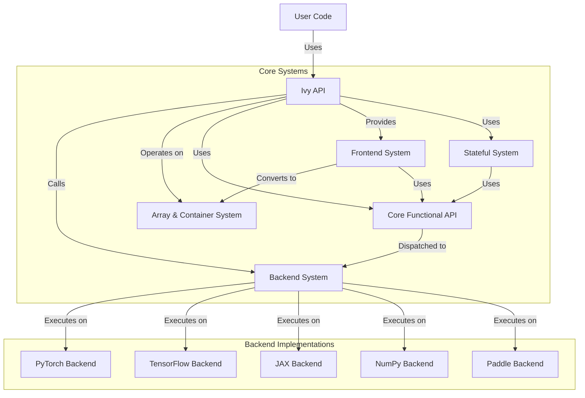
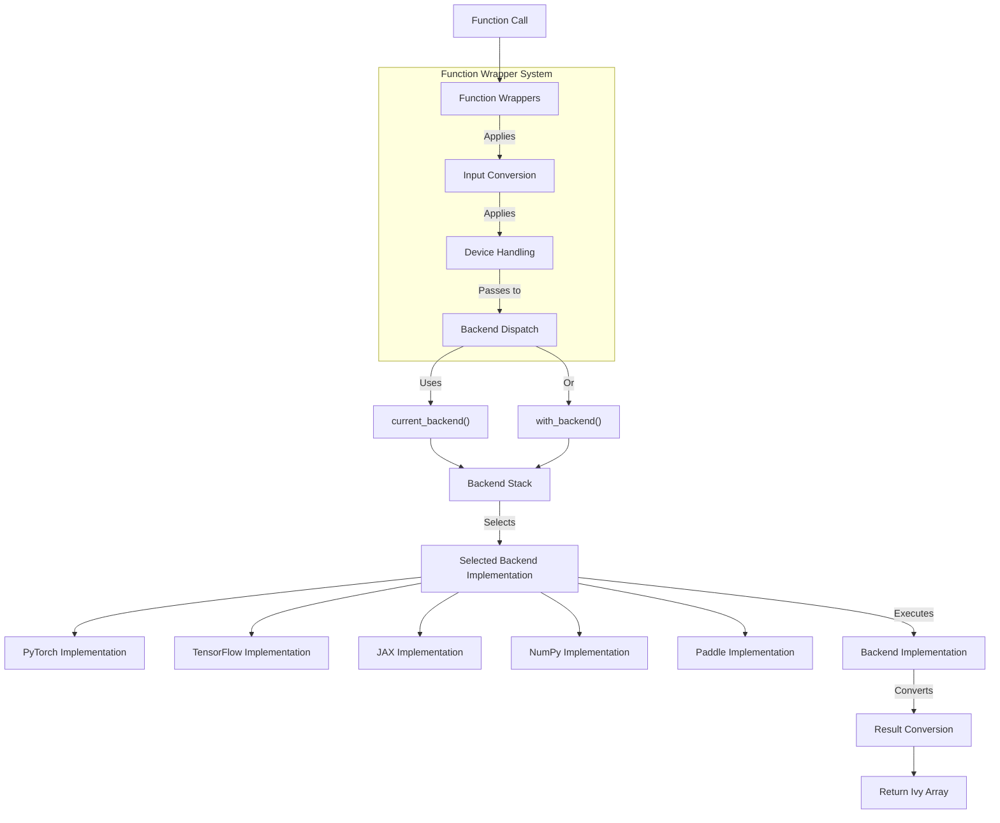
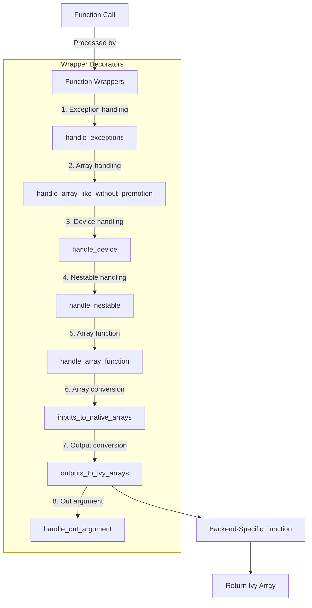
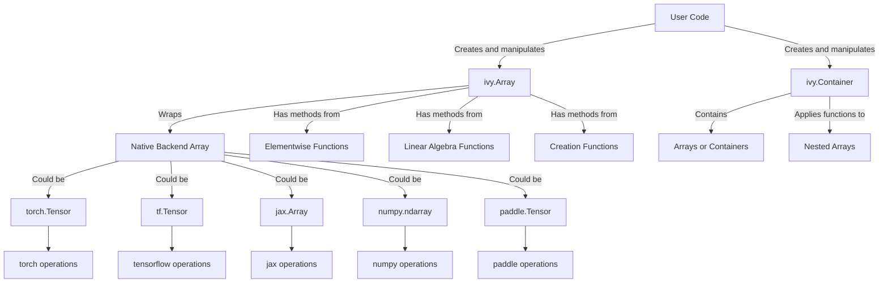
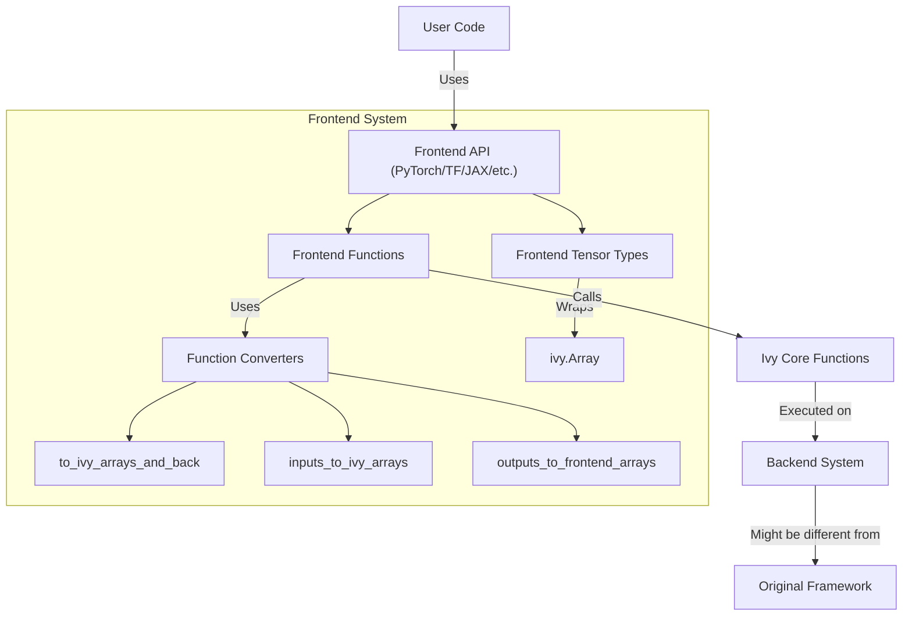
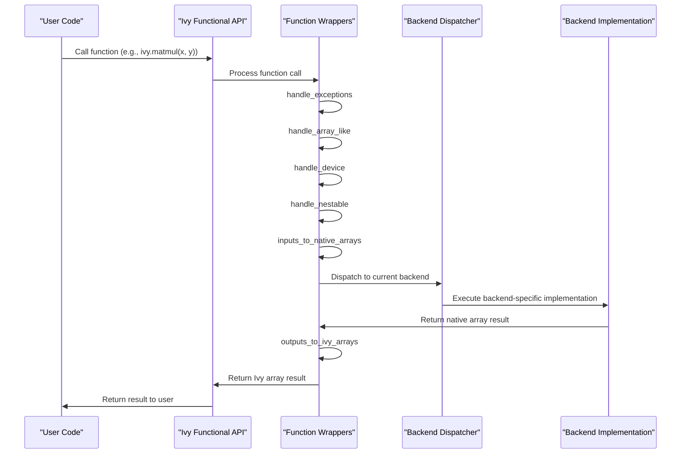

<!-- source: DeepWiki mcp.deepwiki.com · repo ivy-llc/ivy · page 1.2 Architectural Overview · fetched 2026-10-21 -->

# Architectural Overview

Relevant source files

The following files were used as context for generating this wiki page:

- [ivy/__init__.py](ivy/__init__.py)
- [ivy/func_wrapper.py](ivy/func_wrapper.py)
- [ivy/functional/backends/jax/__init__.py](ivy/functional/backends/jax/__init__.py)
- [ivy/functional/backends/jax/general.py](ivy/functional/backends/jax/general.py)
- [ivy/functional/backends/mxnet/__init__.py](ivy/functional/backends/mxnet/__init__.py)
- [ivy/functional/backends/mxnet/general.py](ivy/functional/backends/mxnet/general.py)
- [ivy/functional/backends/numpy/__init__.py](ivy/functional/backends/numpy/__init__.py)
- [ivy/functional/backends/numpy/general.py](ivy/functional/backends/numpy/general.py)
- [ivy/functional/backends/paddle/general.py](ivy/functional/backends/paddle/general.py)
- [ivy/functional/backends/tensorflow/__init__.py](ivy/functional/backends/tensorflow/__init__.py)
- [ivy/functional/backends/tensorflow/general.py](ivy/functional/backends/tensorflow/general.py)
- [ivy/functional/backends/torch/__init__.py](ivy/functional/backends/torch/__init__.py)
- [ivy/functional/backends/torch/general.py](ivy/functional/backends/torch/general.py)
- [ivy/functional/ivy/__init__.py](ivy/functional/ivy/__init__.py)
- [ivy/functional/ivy/general.py](ivy/functional/ivy/general.py)
- [ivy_tests/test_ivy/test_functional/test_core/test_general.py](ivy_tests/test_ivy/test_functional/test_core/test_general.py)

## Purpose and Scope

This document provides a comprehensive overview of Ivy's architecture, explaining how it unifies multiple machine learning frameworks under a single API. It covers the key architectural components, including the Backend System, Functional API, Function Wrapping System, Array and Container abstractions, and Frontend System.

For implementation details about specific subsystems, refer to more specialized documentation pages such as [Frontend System](#2), [Backend System](#3), and [Core Functional API](#4).

## High-Level Architecture

### Ivy Framework Architecture

The Ivy architecture consists of several key components that work together to provide a unified interface across multiple ML frameworks. The Backend System serves as the foundation, allowing operations to be executed on different backends like PyTorch, TensorFlow, JAX, NumPy, and Paddle. The Core Functional API provides framework-agnostic operations that are dispatched to the appropriate backend. The Array & Container System abstracts away backend-specific array implementations. The Frontend System allows users to write code in their familiar framework syntax while still leveraging Ivy's backend flexibility.

Sources:
- [ivy/__init__.py:1-892](ivy/__init__.py:1-892)
- [ivy/functional/ivy/__init__.py:1-58](ivy/functional/ivy/__init__.py:1-58)

## Backend System

### Backend Management Architecture

The Backend System manages multiple ML framework backends and dispatches function calls to the appropriate implementation. It maintains a backend stack that tracks the currently active backend. Functions like `current_backend()` and context managers like `with_backend()` allow querying and temporarily changing the active backend.

Each backend provides implementations for all core functions in the Ivy API, allowing consistent behavior regardless of which backend is being used. The backend system also handles conversion between different array types, ensuring that results are properly returned as Ivy arrays.

Sources:
- [ivy/utils/backend/handler.py](ivy/utils/backend/handler.py)
- [ivy/functional/backends/jax/__init__.py:1-196](ivy/functional/backends/jax/__init__.py:1-196)
- [ivy/functional/backends/torch/__init__.py:1-175](ivy/functional/backends/torch/__init__.py:1-175)
- [ivy/functional/backends/tensorflow/__init__.py:1-220](ivy/functional/backends/tensorflow/__init__.py:1-220)
- [ivy/functional/backends/numpy/__init__.py:1-148](ivy/functional/backends/numpy/__init__.py:1-148)
- [ivy/functional/backends/paddle/__init__.py](ivy/functional/backends/paddle/__init__.py)

## Function Wrapping System

### Function Wrapper Architecture

The Function Wrapping System is a key architectural component that processes and transforms function calls through a series of decorators. This system ensures consistent behavior across backends and handles various cross-cutting concerns.

The wrapper decorators are applied in a specific order, each handling a particular aspect:

1. **Exception handling**: Standardizes error handling
2. **Array handling**: Converts array-like inputs to arrays
3. **Device handling**: Manages device placement
4. **Nestable handling**: Processes container inputs
5. **Array function**: Handles special array methods
6. **Array conversion**: Converts inputs to native backend arrays
7. **Output conversion**: Converts backend outputs to Ivy arrays
8. **Out argument handling**: Manages in-place operations

This extensive wrapping system enables Ivy to provide a clean, consistent API despite the significant differences between underlying frameworks.

Sources:
- [ivy/func_wrapper.py:1-435](ivy/func_wrapper.py:1-435)
- [ivy/functional/ivy/general.py:76-188](ivy/functional/ivy/general.py:76-188)

## Array and Container System

### Array Abstraction System

The Array and Container System provides unified abstractions for working with arrays across different backends. It consists of two main classes:

1. **ivy.Array**: A wrapper around native backend arrays (torch.Tensor, tf.Tensor, jax.Array, numpy.ndarray, paddle.Tensor) that provides a consistent interface. It includes methods for all the functional operations in Ivy.

2. **ivy.Container**: A nested container structure that can hold Ivy arrays or other containers. It allows applying functions to all contained arrays simultaneously, enabling batch operations on complex data structures.

The system provides functions for converting between Ivy arrays and native arrays, as well as utilities for checking array types and properties. This abstraction layer is fundamental to Ivy's backend-agnostic approach.

Sources:
- [ivy/__init__.py:44-550](ivy/__init__.py:44-550)
- [ivy/functional/ivy/general.py:277-410](ivy/functional/ivy/general.py:277-410)

## Functional API

### Core Functional API Structure

```mermaid
graph TD
    IvyAPI["Ivy API"] --> FunctionalModules["Functional Modules"]
    
    FunctionalModules --> General["General Functions"]
    FunctionalModules --> Elementwise["Elementwise Functions"]
    FunctionalModules --> LinearAlgebra["Linear Algebra"]
    FunctionalModules --> Creation["Array Creation"]
    FunctionalModules --> DataType["Data Type System"]
    FunctionalModules --> Manipulation["Array Manipulation"]
    FunctionalModules --> NNLayers["Neural Network Layers"]
    
    General --> DeviceOps["Device Operations"]
    General --> TypeConversion["Type Conversion"]
    General --> BackendSelection["Backend Selection"]
    
    Elementwise --> Math["Mathematical Operations"]
    Elementwise --> Logic["Logical Operations"]
    
    LinearAlgebra --> MatrixOps["Matrix Operations"]
    LinearAlgebra --> Decompositions["Matrix Decompositions"]
    
    NNLayers --> Conv["Convolutional Layers"]
    NNLayers --> Linear["Linear Layers"]
    NNLayers --> Pooling["Pooling Layers"]
    NNLayers --> Activation["Activation Functions"]
    
    subgraph "Per-Backend Implementation"
        PyTorchBackend["PyTorch Backend"]
        TensorFlowBackend["TensorFlow Backend"]
        JAXBackend["JAX Backend"]
        NumPyBackend["NumPy Backend"]
        PaddleBackend["Paddle Backend"]
    end
    
    General --> PyTorchBackend
    Elementwise --> TensorFlowBackend
    LinearAlgebra --> JAXBackend
    Creation --> NumPyBackend
    Manipulation --> PaddleBackend
```

The Core Functional API forms the heart of Ivy, providing a comprehensive set of operations that work across different backends. The API is organized into logical modules:

1. **General Functions**: Utilities for array management, backend selection, device operations, and type conversions (e.g., `array_equal`, `to_numpy`, `is_array`)

2. **Elementwise Functions**: Mathematical operations acting element-by-element (e.g., `add`, `multiply`, `sin`, `exp`)

3. **Linear Algebra**: Matrix operations, decompositions, and solvers (e.g., `matmul`, `svd`, `solve`)

4. **Array Creation**: Functions to create arrays (e.g., `array`, `zeros`, `linspace`)

5. **Data Type System**: Type management and conversion (e.g., `astype`, `promote_types`)

6. **Array Manipulation**: Functions to reshape, concatenate, and slice arrays (e.g., `reshape`, `concat`, `stack`)

7. **Neural Network Layers**: Building blocks for deep learning (e.g., `conv2d`, `linear`, `max_pool2d`)

Each function in the API has specialized implementations for each supported backend, allowing the same code to run on different frameworks seamlessly.

Sources:
- [ivy/functional/ivy/general.py:75-1350](ivy/functional/ivy/general.py:75-1350)
- [ivy/functional/backends/jax/general.py:1-200](ivy/functional/backends/jax/general.py:1-200)
- [ivy/functional/backends/tensorflow/general.py:1-200](ivy/functional/backends/tensorflow/general.py:1-200)
- [ivy/functional/backends/torch/general.py:1-200](ivy/functional/backends/torch/general.py:1-200)
- [ivy/functional/backends/numpy/general.py:1-200](ivy/functional/backends/numpy/general.py:1-200)
- [ivy/functional/backends/paddle/general.py:1-200](ivy/functional/backends/paddle/general.py:1-200)

## Frontend System

### Frontend Architecture

The Frontend System allows users to write code using familiar framework APIs (PyTorch, TensorFlow, JAX, etc.) while executing on any supported backend. This enables framework interoperability and code transpilation.

The frontend system consists of:

1. **Frontend Tensor Types**: Wrappers around Ivy arrays that mimic the behavior of native framework tensors (e.g., torch.Tensor, tf.Tensor)

2. **Frontend Functions**: Implementations of framework-specific functions that internally use Ivy operations

3. **Function Converters**: Utilities that handle the conversion between frontend tensors and Ivy arrays, as well as converting inputs and outputs of functions

This architecture allows users to run PyTorch code on a TensorFlow backend, JAX code on a PyTorch backend, and so on, providing unparalleled flexibility in ML framework usage.

Sources:
- [ivy/func_wrapper.py:436-590](ivy/func_wrapper.py:436-590)

## Data Flow Through Ivy

### Function Execution Flow

This diagram illustrates the typical flow of a function call through the Ivy framework:

1. The user calls an Ivy function like `ivy.matmul(x, y)`
2. The call enters the Ivy Functional API
3. Function wrappers process the call:
   - Exception handling is set up
   - Array-like inputs are converted to arrays
   - Device handling is applied
   - Nestable handling processes containers
   - Inputs are converted to native arrays for the current backend
4. The call is dispatched to the current backend
5. The backend-specific implementation executes the operation
6. The native array result is converted back to an Ivy array
7. The Ivy array is returned to the user

This process ensures consistent behavior across backends while maximizing performance by using native operations internally.

Sources:
- [ivy/func_wrapper.py:270-330](ivy/func_wrapper.py:270-330)
- [ivy/functional/ivy/general.py:630-700](ivy/functional/ivy/general.py:630-700)

## Backend Functionality Requirements

Each backend implementation must provide a common set of functionality to be compatible with Ivy:

### Common Backend Functions Table

| Category | Required Functions | Purpose |
|----------|-------------------|---------|
| Type Checking | `is_native_array()` | Check if an object is a native array for this backend |
| Array Creation | `array()`, `zeros()`, `ones()` | Create arrays with specific values or shapes |
| Array Conversion | `to_numpy()`, `to_scalar()`, `to_list()` | Convert between array types |
| Array Information | `shape()`, `get_num_dims()` | Get information about array dimensions |
| Device Management | `device()`, `to_device()` | Manage and change device placement |
| Type Management | `astype()`, `dtype()` | Handle and change data types |
| General Operations | `array_equal()`, `gather()`, `scatter_nd()` | Basic array operations |
| In-place Support | `inplace_update()`, `inplace_arrays_supported()` | Support for in-place operations |
| Backend Info | `current_backend_str()` | Return backend identifier string |

Each backend must implement all these functions with consistent behavior to ensure that Ivy works properly regardless of which backend is in use.

Sources:
- [ivy/functional/backends/jax/general.py:52-246](ivy/functional/backends/jax/general.py:52-246)
- [ivy/functional/backends/tensorflow/general.py:26-150](ivy/functional/backends/tensorflow/general.py:26-150)
- [ivy/functional/backends/torch/general.py:51-166](ivy/functional/backends/torch/general.py:51-166)
- [ivy/functional/backends/numpy/general.py:23-177](ivy/functional/backends/numpy/general.py:23-177)
- [ivy/functional/backends/paddle/general.py:22-142](ivy/functional/backends/paddle/general.py:22-142)

## Summary

The Ivy architecture is designed to unify multiple machine learning frameworks under a consistent API. Key architectural components include:

1. **Backend System**: Manages different framework backends and dispatches operations
2. **Array and Container System**: Provides unified abstractions for arrays and nested structures
3. **Function Wrapping System**: Processes function calls through a series of decorators
4. **Core Functional API**: Provides a comprehensive set of operations implemented for each backend
5. **Frontend System**: Allows using familiar framework APIs while executing on any backend

This architecture enables framework interoperability, code transpilation, and a unified approach to machine learning development, regardless of which framework is used as the backend.

---

