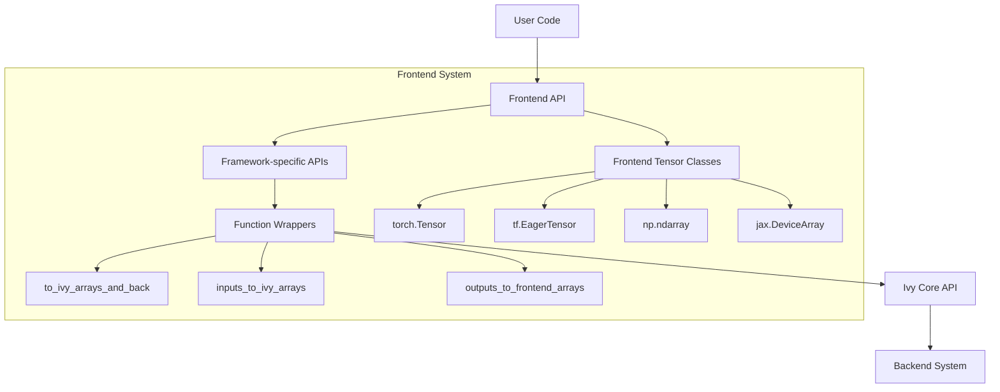
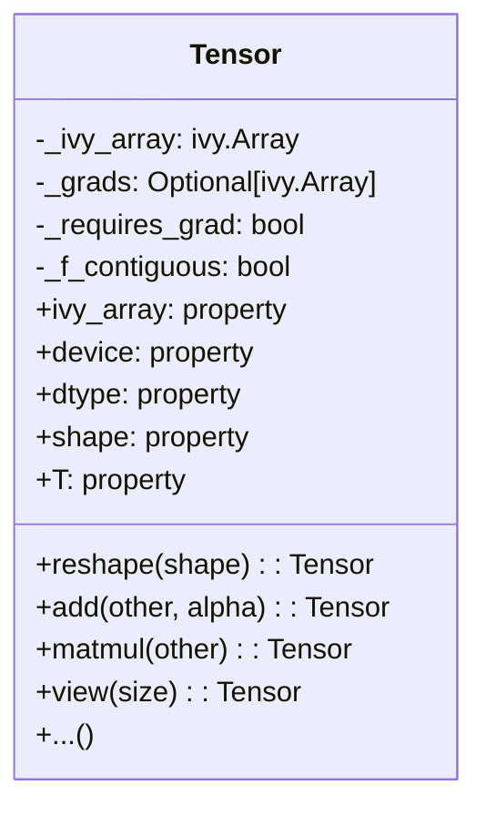
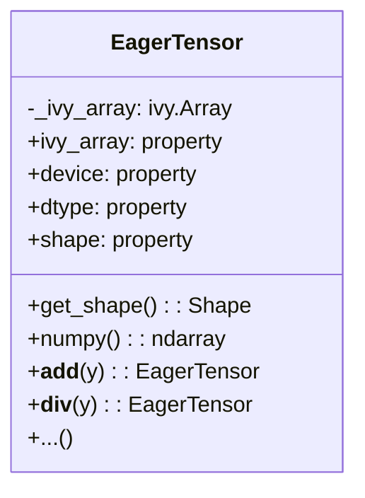
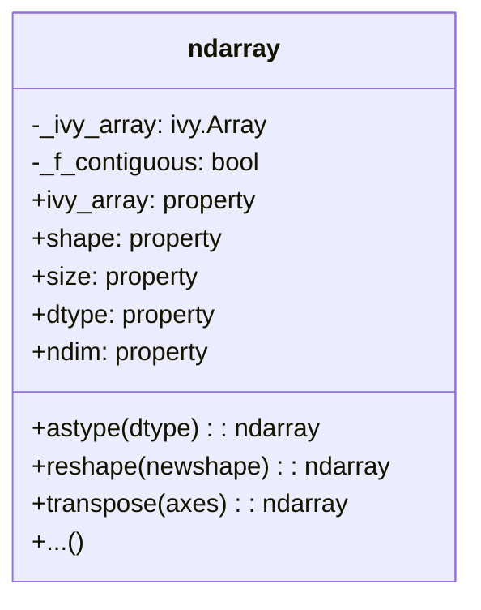
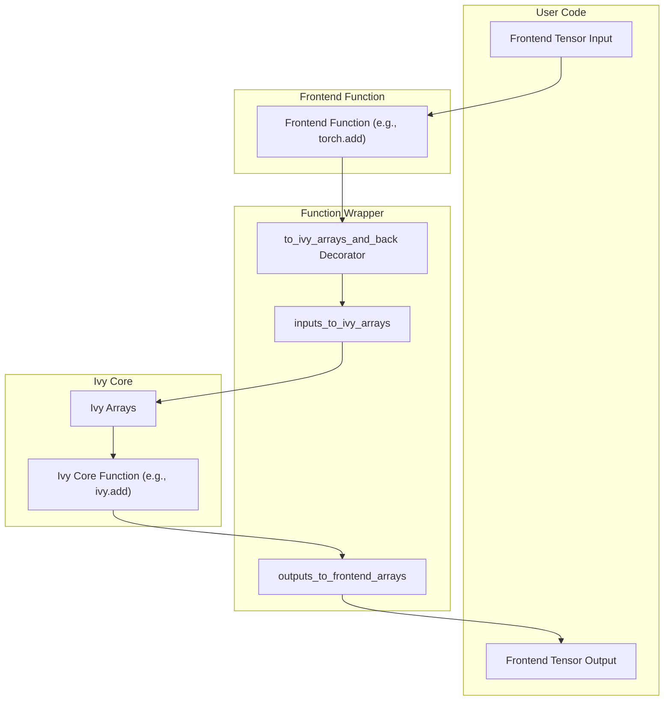
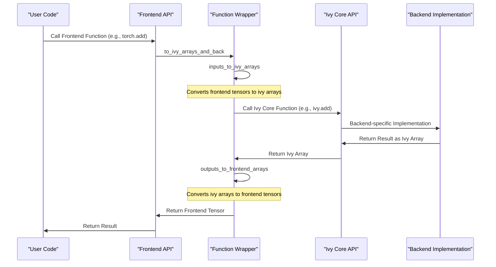

<!-- source: DeepWiki mcp.deepwiki.com · repo ivy-llc/ivy · page 2 Frontend System · fetched 2026-10-21 -->

# Frontend System

<details>
<summary>Relevant source files</summary>

The following files were used as context for generating this wiki page:

- [ivy/data_classes/container/conversions.py](ivy/data_classes/container/conversions.py)
- [ivy/functional/frontends/jax/func_wrapper.py](ivy/functional/frontends/jax/func_wrapper.py)
- [ivy/functional/frontends/numpy/func_wrapper.py](ivy/functional/frontends/numpy/func_wrapper.py)
- [ivy/functional/frontends/numpy/ndarray/ndarray.py](ivy/functional/frontends/numpy/ndarray/ndarray.py)
- [ivy/functional/frontends/onnx/func_wrapper.py](ivy/functional/frontends/onnx/func_wrapper.py)
- [ivy/functional/frontends/paddle/func_wrapper.py](ivy/functional/frontends/paddle/func_wrapper.py)
- [ivy/functional/frontends/tensorflow/compat/v1/nn.py](ivy/functional/frontends/tensorflow/compat/v1/nn.py)
- [ivy/functional/frontends/tensorflow/func_wrapper.py](ivy/functional/frontends/tensorflow/func_wrapper.py)
- [ivy/functional/frontends/tensorflow/general_functions.py](ivy/functional/frontends/tensorflow/general_functions.py)
- [ivy/functional/frontends/tensorflow/linalg.py](ivy/functional/frontends/tensorflow/linalg.py)
- [ivy/functional/frontends/tensorflow/math.py](ivy/functional/frontends/tensorflow/math.py)
- [ivy/functional/frontends/tensorflow/nn.py](ivy/functional/frontends/tensorflow/nn.py)
- [ivy/functional/frontends/tensorflow/raw_ops.py](ivy/functional/frontends/tensorflow/raw_ops.py)
- [ivy/functional/frontends/tensorflow/tensor.py](ivy/functional/frontends/tensorflow/tensor.py)
- [ivy/functional/frontends/torch/func_wrapper.py](ivy/functional/frontends/torch/func_wrapper.py)
- [ivy/functional/frontends/torch/tensor.py](ivy/functional/frontends/torch/tensor.py)
- [ivy_tests/test_ivy/test_frontends/test_jax/test_func_wrapper.py](ivy_tests/test_ivy/test_frontends/test_jax/test_func_wrapper.py)
- [ivy_tests/test_ivy/test_frontends/test_numpy/test_ndarray/test_ndarray.py](ivy_tests/test_ivy/test_frontends/test_numpy/test_ndarray/test_ndarray.py)
- [ivy_tests/test_ivy/test_frontends/test_tensorflow/test_compat/test_v1/test_nn.py](ivy_tests/test_ivy/test_frontends/test_tensorflow/test_compat/test_v1/test_nn.py)
- [ivy_tests/test_ivy/test_frontends/test_tensorflow/test_general_functions.py](ivy_tests/test_ivy/test_frontends/test_tensorflow/test_general_functions.py)
- [ivy_tests/test_ivy/test_frontends/test_tensorflow/test_linalg.py](ivy_tests/test_ivy/test_frontends/test_tensorflow/test_linalg.py)
- [ivy_tests/test_ivy/test_frontends/test_tensorflow/test_math.py](ivy_tests/test_ivy/test_frontends/test_tensorflow/test_math.py)
- [ivy_tests/test_ivy/test_frontends/test_tensorflow/test_nn.py](ivy_tests/test_ivy/test_frontends/test_tensorflow/test_nn.py)
- [ivy_tests/test_ivy/test_frontends/test_tensorflow/test_raw_ops.py](ivy_tests/test_ivy/test_frontends/test_tensorflow/test_raw_ops.py)
- [ivy_tests/test_ivy/test_frontends/test_tensorflow/test_tensor.py](ivy_tests/test_ivy/test_frontends/test_tensorflow/test_tensor.py)
- [ivy_tests/test_ivy/test_frontends/test_torch/test_tensor.py](ivy_tests/test_ivy/test_frontends/test_torch/test_tensor.py)

</details>


The Frontend System provides compatibility layers for popular machine learning frameworks (PyTorch, TensorFlow, JAX, NumPy, etc.) by implementing their APIs on top of Ivy's unified backend. This system allows users to write code using familiar framework syntax while leveraging Ivy's ability to run on any supported backend. For information about the backend systems that execute the actual computations, see [Backend System](#3).

## Architecture Overview

The Frontend System consists of three main components:

1. **Frontend Tensor Classes** - Classes that mimic the behavior of original framework tensor types
2. **Function Wrappers** - Utilities that handle conversion between frontend tensors and Ivy arrays
3. **Framework-specific APIs** - Implementations of each framework's functions using Ivy's unified operations



Sources: [ivy/functional/frontends/torch/tensor.py](), [ivy/functional/frontends/tensorflow/tensor.py](), [ivy/functional/frontends/numpy/ndarray/ndarray.py](), [ivy/functional/frontends/torch/func_wrapper.py](), [ivy/functional/frontends/tensorflow/func_wrapper.py](), [ivy/functional/frontends/numpy/func_wrapper.py](), [ivy/functional/frontends/jax/func_wrapper.py]()

## Frontend Tensor Classes

Each frontend implements a tensor class that wraps an Ivy array and provides methods that mimic the original framework's tensor type.

### PyTorch Tensor

The PyTorch frontend provides a `Tensor` class that wraps an Ivy array and implements methods that match the behavior of `torch.Tensor`:



Key attributes and methods include:
- `ivy_array`: The underlying Ivy array
- `shape`, `device`, `dtype`: Properties that delegate to the Ivy array
- Methods like `reshape`, `view`, `add`, `matmul`, etc. which delegate to equivalent Ivy operations

Sources: [ivy/functional/frontends/torch/tensor.py:20-1012]()

### TensorFlow EagerTensor

The TensorFlow frontend provides an `EagerTensor` class that mimics `tf.Tensor`:



Sources: [ivy/functional/frontends/tensorflow/tensor.py:11-289]()

### NumPy ndarray

The NumPy frontend provides an `ndarray` class that mimics `numpy.ndarray`:



Sources: [ivy/functional/frontends/numpy/ndarray/ndarray.py:18-717]()

## Function Wrappers

Function wrappers are key components that enable conversion between frontend tensors and Ivy arrays, ensuring seamless operation of the Frontend System.

### to_ivy_arrays_and_back

This decorator wraps framework-specific functions to handle conversion between frontend tensors and Ivy arrays:

```python
def to_ivy_arrays_and_back(fn):
    @functools.wraps(fn)
    def _wrapper(*args, **kwargs):
        # Convert inputs to Ivy arrays
        ivy_args, ivy_kwargs = inputs_to_ivy_arrays(*args, **kwargs)
        # Call the function with Ivy arrays
        ret = fn(*ivy_args, **ivy_kwargs)
        # Convert the results back to frontend tensors
        ret = outputs_to_frontend_arrays(ret)
        return ret
    return _wrapper
```

### inputs_to_ivy_arrays

This function converts all input arguments (including nested structures) from frontend tensors to Ivy arrays:

```python
def inputs_to_ivy_arrays(*args, **kwargs):
    ivy_args = ivy.nested_map(_to_ivy_array, args)
    ivy_kwargs = ivy.nested_map(_to_ivy_array, kwargs)
    return ivy_args, ivy_kwargs
```

### outputs_to_frontend_arrays

This function converts all results (including nested structures) from Ivy arrays to frontend tensors:

```python
def outputs_to_frontend_arrays(ret):
    return ivy.nested_map(_to_frontend_array, ret)
```

Sources: [ivy/functional/frontends/torch/func_wrapper.py:10-34](), [ivy/functional/frontends/tensorflow/func_wrapper.py:15-35](), [ivy/functional/frontends/numpy/func_wrapper.py:12-40](), [ivy/functional/frontends/jax/func_wrapper.py:16-30]()

## Conversion Process Diagram

The following diagram illustrates how tensors are converted between frontend formats and Ivy arrays:



Sources: [ivy/functional/frontends/torch/func_wrapper.py](), [ivy/functional/frontends/tensorflow/func_wrapper.py]()

## Framework-specific APIs

Each frontend implements functions that match the API of the corresponding framework using Ivy's unified backend operations.

### PyTorch API

```python
@to_ivy_arrays_and_back
def reshape(input, shape):
    return ivy.reshape(input, shape)

@to_ivy_arrays_and_back
def add(input, other, *, alpha=1):
    return ivy.add(input, ivy.multiply(other, alpha))
```

### TensorFlow API

```python
@to_ivy_arrays_and_back
def add(x, y, name=None):
    x, y = check_tensorflow_casting(x, y)
    return ivy.add(x, y)

@to_ivy_arrays_and_back
def relu(features, name=None):
    return ivy.relu(features)
```

Implementation details can be found in:
- TensorFlow mathematical functions: [ivy/functional/frontends/tensorflow/math.py:157-1242]()
- TensorFlow raw operations: [ivy/functional/frontends/tensorflow/raw_ops.py:329-915]()
- TensorFlow neural network functions: [ivy/functional/frontends/tensorflow/nn.py:72-114]()

## Operational Flow

The operational flow in the Frontend System is shown below:



Sources: [ivy/functional/frontends/torch/func_wrapper.py](), [ivy/functional/frontends/tensorflow/func_wrapper.py]()

## Usage Examples

Here are examples of using the Frontend System with different frameworks:

### PyTorch Frontend

```python
import ivy
import ivy.functional.frontends.torch as torch

# Set backend (e.g., TensorFlow, JAX, NumPy)
ivy.set_backend("tensorflow")

# Create PyTorch-like tensors
x = torch.tensor([1, 2, 3])
y = torch.tensor([4, 5, 6])

# Use PyTorch-like operations
z = torch.add(x, y)  # Method 1: Using function
w = x + y            # Method 2: Using operator overloading
reshaped = x.reshape([3, 1])  # Method 3: Using tensor method

# Switch backend dynamically
ivy.set_backend("jax")
# Operations now run on JAX backend
```

### TensorFlow Frontend

```python
import ivy
import ivy.functional.frontends.tensorflow as tf

# Create TensorFlow-like tensors
x = tf.constant([1, 2, 3])
y = tf.constant([4, 5, 6])

# Use TensorFlow-like operations
z = tf.math.add(x, y)
w = tf.reshape(x, [3, 1])
```

### NumPy Frontend

```python
import ivy
import ivy.functional.frontends.numpy as np

# Create NumPy-like arrays
x = np.array([1, 2, 3])
y = np.array([4, 5, 6])

# Use NumPy-like operations
z = np.add(x, y)
w = x.reshape([3, 1])
```

Sources: [ivy_tests/test_ivy/test_frontends/test_torch/test_tensor.py:490-516](), [ivy_tests/test_ivy/test_frontends/test_tensorflow/test_tensor.py:513-552](), [ivy_tests/test_ivy/test_frontends/test_numpy/test_ndarray/test_ndarray.py:212-238]()

## Testing Framework

The Frontend System is extensively tested to ensure compatibility with the original frameworks. Tests verify that:

1. Functions accept the same arguments as the original
2. Functions return the same types of outputs
3. Function behavior matches the original

Examples of frontend tests:

```python
@handle_frontend_method(
    class_tree=CLASS_TREE,
    init_tree="torch.tensor",
    method_name="__add__",
    dtype_and_x=helpers.dtype_and_values(
        available_dtypes=helpers.get_dtypes("float"),
        num_arrays=2,
        min_value=-1e04,
        max_value=1e04,
        allow_inf=False,
    ),
)
def test_torch___add__(
    dtype_and_x,
    frontend_method_data,
    init_flags,
    method_flags,
    frontend,
    on_device,
    backend_fw,
):
    input_dtype, x = dtype_and_x
    helpers.test_frontend_method(
        init_input_dtypes=input_dtype,
        backend_to_test=backend_fw,
        init_all_as_kwargs_np={
            "data": x[0],
        },
        method_input_dtypes=input_dtype,
        method_all_as_kwargs_np={
            "other": x[1],
        },
        frontend_method_data=frontend_method_data,
        init_flags=init_flags,
        method_flags=method_flags,
        frontend=frontend,
        on_device=on_device,
    )
```

Sources: [ivy_tests/test_ivy/test_frontends/test_torch/test_tensor.py:477-516](), [ivy_tests/test_ivy/test_frontends/test_tensorflow/test_raw_ops.py:446-464](), [ivy_tests/test_ivy/test_frontends/test_tensorflow/test_math.py:157-176]()

## Extending the Frontend System

To add support for a new framework, you would need to:

1. Create a frontend tensor class that wraps Ivy arrays
2. Implement function wrappers for conversion
3. Implement the framework's API using Ivy's unified backend

This follows the pattern established in existing frontends:

```python
# 1. Create a frontend tensor class
class NewFrameworkTensor:
    def __init__(self, array):
        self._ivy_array = array if isinstance(array, ivy.Array) else ivy.array(array)
    
    # Implement framework-specific methods
    def some_method(self, arg):
        return new_framework_frontend.some_function(self, arg)

# 2. Implement function wrappers
def _to_ivy_array(x):
    if isinstance(x, NewFrameworkTensor):
        return x.ivy_array
    return x

def _to_frontend_array(x):
    if isinstance(x, ivy.Array):
        return NewFrameworkTensor(x)
    return x

def to_ivy_arrays_and_back(fn):
    @functools.wraps(fn)
    def _wrapper(*args, **kwargs):
        # Convert to Ivy arrays
        # Call function
        # Convert back to frontend tensors
        return result
    return _wrapper

# 3. Implement framework API functions
@to_ivy_arrays_and_back
def some_function(tensor, arg):
    return ivy.some_operation(tensor, arg)
```

Sources: [ivy/functional/frontends/torch/func_wrapper.py](), [ivy/functional/frontends/tensorflow/func_wrapper.py](), [ivy/functional/frontends/numpy/func_wrapper.py](), [ivy/functional/frontends/jax/func_wrapper.py]()

---

