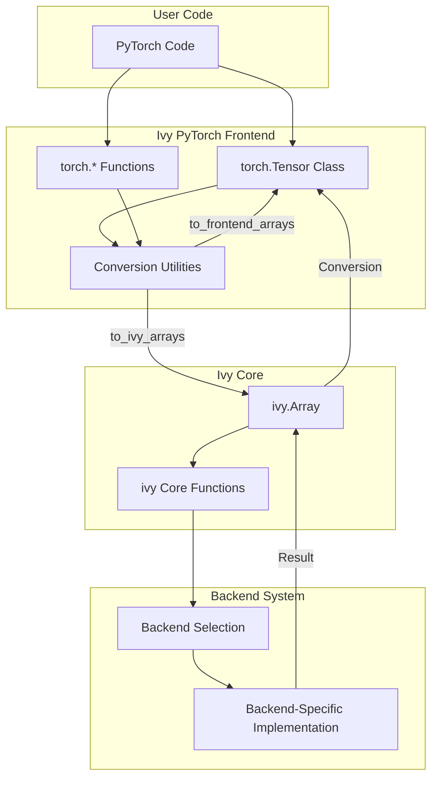
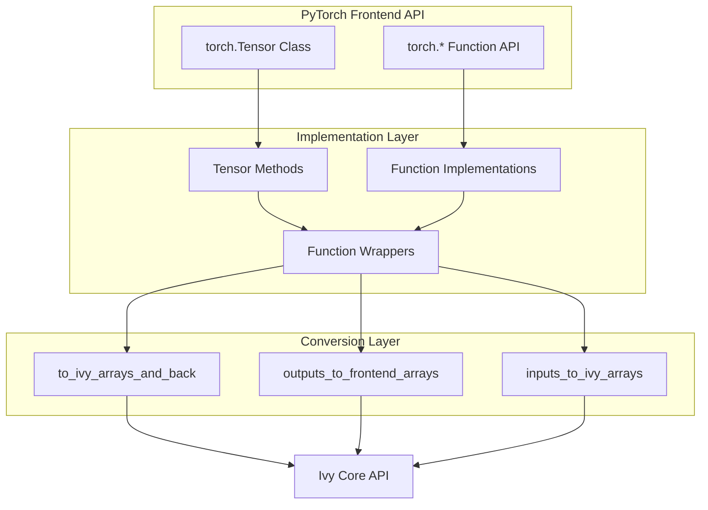
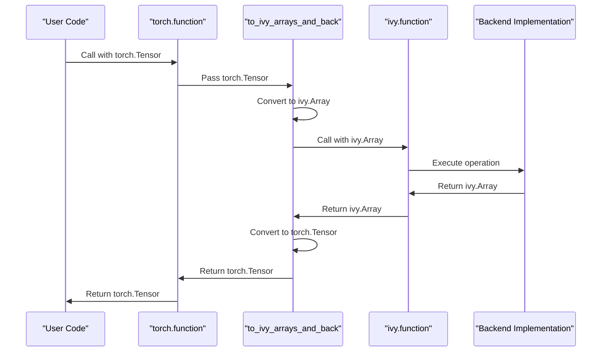
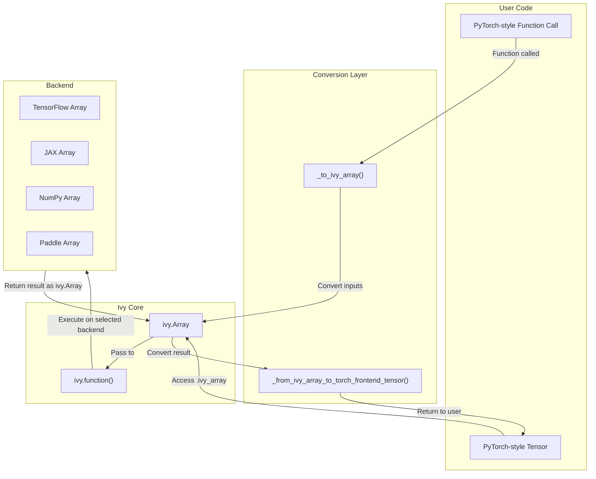

<!-- source: DeepWiki mcp.deepwiki.com · repo ivy-llc/ivy · page 2.1 PyTorch Frontend · fetched 2026-10-21 -->

# PyTorch Frontend

<details>
<summary>Relevant source files</summary>

The following files were used as context for generating this wiki page:

- [ivy/data_classes/container/conversions.py](ivy/data_classes/container/conversions.py)
- [ivy/functional/frontends/jax/func_wrapper.py](ivy/functional/frontends/jax/func_wrapper.py)
- [ivy/functional/frontends/numpy/func_wrapper.py](ivy/functional/frontends/numpy/func_wrapper.py)
- [ivy/functional/frontends/numpy/ndarray/ndarray.py](ivy/functional/frontends/numpy/ndarray/ndarray.py)
- [ivy/functional/frontends/onnx/func_wrapper.py](ivy/functional/frontends/onnx/func_wrapper.py)
- [ivy/functional/frontends/paddle/func_wrapper.py](ivy/functional/frontends/paddle/func_wrapper.py)
- [ivy/functional/frontends/tensorflow/func_wrapper.py](ivy/functional/frontends/tensorflow/func_wrapper.py)
- [ivy/functional/frontends/tensorflow/tensor.py](ivy/functional/frontends/tensorflow/tensor.py)
- [ivy/functional/frontends/torch/creation_ops.py](ivy/functional/frontends/torch/creation_ops.py)
- [ivy/functional/frontends/torch/func_wrapper.py](ivy/functional/frontends/torch/func_wrapper.py)
- [ivy/functional/frontends/torch/indexing_slicing_joining_mutating_ops.py](ivy/functional/frontends/torch/indexing_slicing_joining_mutating_ops.py)
- [ivy/functional/frontends/torch/miscellaneous_ops.py](ivy/functional/frontends/torch/miscellaneous_ops.py)
- [ivy/functional/frontends/torch/pointwise_ops.py](ivy/functional/frontends/torch/pointwise_ops.py)
- [ivy/functional/frontends/torch/reduction_ops.py](ivy/functional/frontends/torch/reduction_ops.py)
- [ivy/functional/frontends/torch/tensor.py](ivy/functional/frontends/torch/tensor.py)
- [ivy_tests/test_ivy/test_frontends/test_jax/test_func_wrapper.py](ivy_tests/test_ivy/test_frontends/test_jax/test_func_wrapper.py)
- [ivy_tests/test_ivy/test_frontends/test_numpy/test_ndarray/test_ndarray.py](ivy_tests/test_ivy/test_frontends/test_numpy/test_ndarray/test_ndarray.py)
- [ivy_tests/test_ivy/test_frontends/test_tensorflow/test_tensor.py](ivy_tests/test_ivy/test_frontends/test_tensorflow/test_tensor.py)
- [ivy_tests/test_ivy/test_frontends/test_torch/test_creation_ops.py](ivy_tests/test_ivy/test_frontends/test_torch/test_creation_ops.py)
- [ivy_tests/test_ivy/test_frontends/test_torch/test_indexing_slicing_joining_mutating_ops.py](ivy_tests/test_ivy/test_frontends/test_torch/test_indexing_slicing_joining_mutating_ops.py)
- [ivy_tests/test_ivy/test_frontends/test_torch/test_miscellaneous_ops.py](ivy_tests/test_ivy/test_frontends/test_torch/test_miscellaneous_ops.py)
- [ivy_tests/test_ivy/test_frontends/test_torch/test_pointwise_ops.py](ivy_tests/test_ivy/test_frontends/test_torch/test_pointwise_ops.py)
- [ivy_tests/test_ivy/test_frontends/test_torch/test_reduction_ops.py](ivy_tests/test_ivy/test_frontends/test_torch/test_reduction_ops.py)
- [ivy_tests/test_ivy/test_frontends/test_torch/test_tensor.py](ivy_tests/test_ivy/test_frontends/test_torch/test_tensor.py)

</details>


The PyTorch Frontend in Ivy provides a compatibility layer that allows developers to write code using PyTorch's familiar API while leveraging Ivy's unified backend system. This enables PyTorch code to run on any of Ivy's supported deep learning frameworks (TensorFlow, JAX, NumPy, and others) without requiring code rewrites.

This page covers the architecture and implementation of the PyTorch Frontend specifically. For information about the overall frontend system architecture, see [Frontend System](#2).

## Table of Contents

- [Architecture](#architecture)
- [Core Components](#core-components)
- [Implementation Details](#implementation-details)
  - [Tensor Class](#tensor-class)
  - [Function Wrapping](#function-wrapping)
  - [Operation Implementation](#operation-implementation)
- [Usage](#usage)

## Architecture

The PyTorch Frontend is implemented as part of Ivy's frontend system, which provides compatibility layers for various deep learning frameworks. The PyTorch Frontend specifically mimics the PyTorch API by implementing tensor objects and operations that match PyTorch's behavior but execute on Ivy's unified backend.



Sources:
- [ivy/functional/frontends/torch/tensor.py]()
- [ivy/functional/frontends/torch/func_wrapper.py]()
- [ivy/functional/frontends/torch/pointwise_ops.py]()

## Core Components

The PyTorch Frontend consists of several key components:

1. **Tensor Class**: A wrapper class that mimics PyTorch's `Tensor` behavior while operating on Ivy arrays internally.

2. **Function Wrappers**: Utilities that handle conversions between PyTorch tensor operations and Ivy's array operations.

3. **Operation Implementations**: Implementations of PyTorch's operations using Ivy's unified functional API.



Sources:
- [ivy/functional/frontends/torch/tensor.py]()
- [ivy/functional/frontends/torch/func_wrapper.py]()

## Implementation Details

### Tensor Class

The PyTorch Frontend's `Tensor` class is the core of the implementation. It wraps an Ivy array and provides an interface that matches PyTorch's `Tensor` class.

The `Tensor` class is implemented in `tensor.py` and provides:

1. **Properties**: Such as `shape`, `dtype`, `device`, `T`, `requires_grad`, etc.

2. **Methods**: Implementations of tensor operations like `reshape`, `add`, `matmul`, etc.

3. **Special Methods**: Python magic methods like `__add__`, `__mul__`, etc., to support operator overloading.

```python
# Key properties of the Tensor class
@property
def ivy_array(self):
    return self._ivy_array

@property
def dtype(self):
    return self.ivy_array.dtype

@property
def shape(self):
    return Size(self.ivy_array.shape)

# Methods for tensor operations
def reshape(self, *args, shape=None):
    # Implementation
    return torch_frontend.reshape(self, shape)

def add(self, other, *, alpha=1):
    return torch_frontend.add(self, other, alpha=alpha)
```

Sources:
- [ivy/functional/frontends/torch/tensor.py:20-1088]()

### Function Wrapping

Function wrapping is a critical part of the PyTorch Frontend implementation. It ensures that:

1. PyTorch-style function arguments are correctly translated to Ivy function arguments.
2. Input tensors are converted to Ivy arrays before computation.
3. Output Ivy arrays are converted back to PyTorch frontend tensors.

The primary function wrappers used in the PyTorch Frontend are:

- `to_ivy_arrays_and_back`: Decorator that converts input PyTorch tensors to Ivy arrays, calls the function, and converts the result back to PyTorch tensors.
- `numpy_to_torch_style_args`: Converts NumPy-style arguments (like `axis`) to PyTorch-style (like `dim`).



Sources:
- [ivy/functional/frontends/torch/func_wrapper.py]()

### Operation Implementation

The PyTorch Frontend implements a wide range of PyTorch operations using Ivy's unified API. These implementations are organized across multiple files:

1. **Pointwise Operations**: Basic element-wise operations like `abs`, `add`, `sin`, etc.
2. **Reduction Operations**: Operations that reduce dimensions, like `sum`, `mean`, `max`, etc.
3. **Indexing, Slicing, Joining Operations**: Operations for manipulating tensor structure.
4. **Creation Operations**: Functions for creating new tensors.
5. **Miscellaneous Operations**: Various other operations that don't fit into the above categories.

Example implementation of a pointwise operation:

```python
@to_ivy_arrays_and_back
def abs(input, *, out=None):
    return ivy.abs(input, out=out)

@with_unsupported_dtypes({"2.2 and below": ("float16",)}, "torch")
@to_ivy_arrays_and_back
def acos(input, *, out=None):
    return ivy.acos(input, out=out)
```

Sources:
- [ivy/functional/frontends/torch/pointwise_ops.py:16-582]()
- [ivy/functional/frontends/torch/reduction_ops.py]()
- [ivy/functional/frontends/torch/indexing_slicing_joining_mutating_ops.py]()
- [ivy/functional/frontends/torch/creation_ops.py]()
- [ivy/functional/frontends/torch/miscellaneous_ops.py]()

## Tensor Data Flow

Understanding how data flows through the PyTorch Frontend is essential. The diagram below illustrates how tensor data is converted and processed:



Sources:
- [ivy/functional/frontends/torch/tensor.py:51-62]()
- [ivy/functional/frontends/torch/func_wrapper.py]()

## Usage

The PyTorch Frontend is designed to be a drop-in replacement for PyTorch, allowing users to run existing PyTorch code on any of Ivy's supported backends. Here's how it's typically used:

1. Import Ivy's PyTorch frontend instead of PyTorch:
   ```python
   import ivy.functional.frontends.torch as torch
   ```

2. Write code using the PyTorch API:
   ```python
   # Create a tensor
   x = torch.tensor([1, 2, 3])
   
   # Perform operations
   y = torch.sin(x)
   z = x + y
   ```

3. The operations will be executed using Ivy's unified backend system, allowing the code to run on any supported backend.

The PyTorch Frontend supports a comprehensive subset of PyTorch's API, including:

- Tensor creation and manipulation
- Mathematical operations
- Reduction operations
- Indexing and slicing
- Neural network operations

This enables a wide range of PyTorch code to run without modification, simply by changing the import statement.

Sources:
- [ivy/functional/frontends/torch/tensor.py]()
- [ivy/functional/frontends/torch/pointwise_ops.py]()
- [ivy_tests/test_ivy/test_frontends/test_torch/test_tensor.py]()

---

