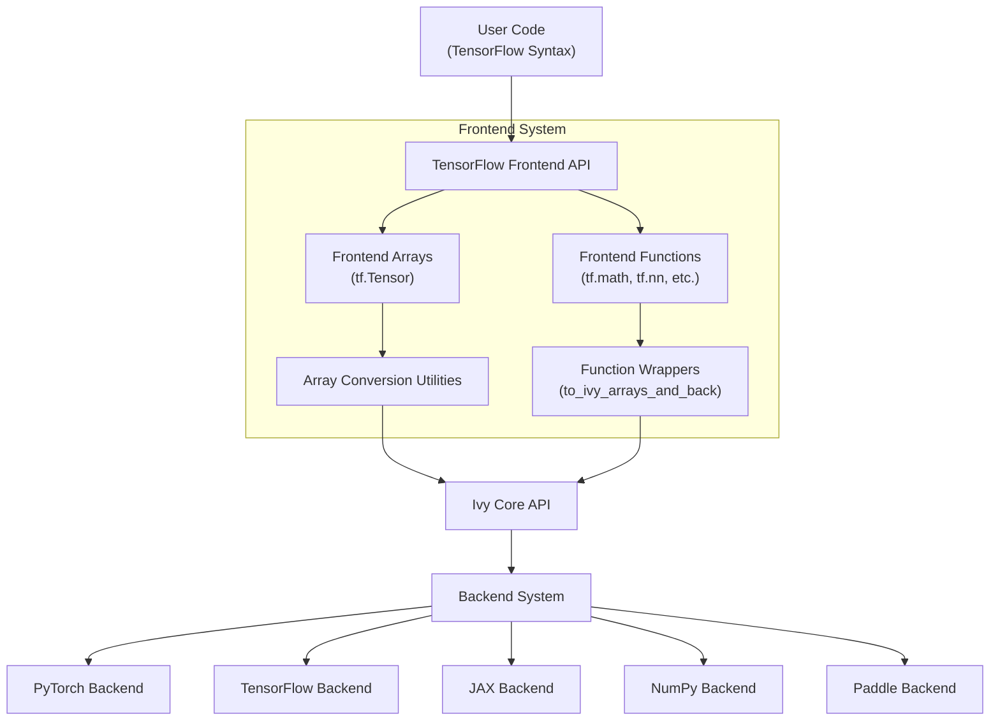
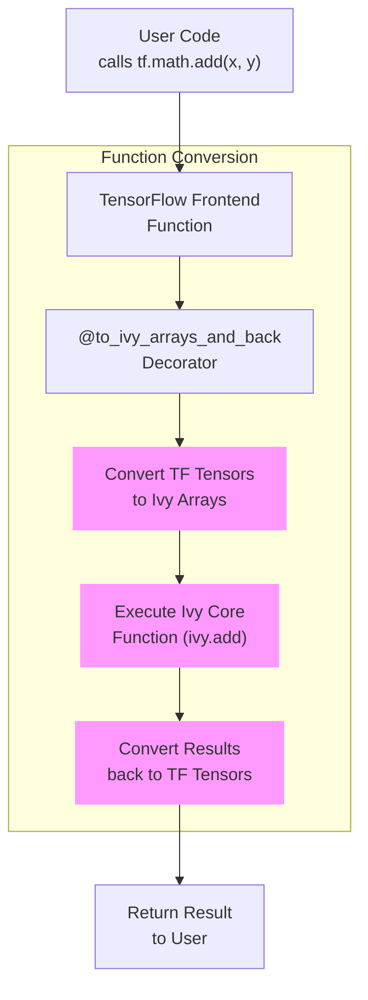
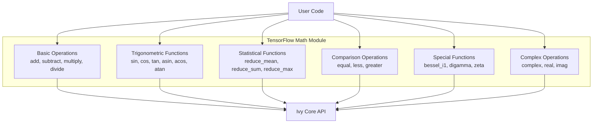
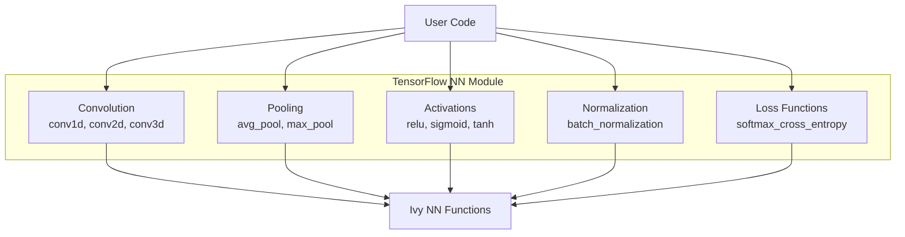

<!-- source: DeepWiki mcp.deepwiki.com · repo ivy-llc/ivy · page 2.2 TensorFlow Frontend · fetched 2026-10-21 -->

# TensorFlow Frontend

<details>
<summary>Relevant source files</summary>

The following files were used as context for generating this wiki page:

- [ivy/functional/frontends/tensorflow/compat/v1/nn.py](ivy/functional/frontends/tensorflow/compat/v1/nn.py)
- [ivy/functional/frontends/tensorflow/general_functions.py](ivy/functional/frontends/tensorflow/general_functions.py)
- [ivy/functional/frontends/tensorflow/linalg.py](ivy/functional/frontends/tensorflow/linalg.py)
- [ivy/functional/frontends/tensorflow/math.py](ivy/functional/frontends/tensorflow/math.py)
- [ivy/functional/frontends/tensorflow/nn.py](ivy/functional/frontends/tensorflow/nn.py)
- [ivy/functional/frontends/tensorflow/raw_ops.py](ivy/functional/frontends/tensorflow/raw_ops.py)
- [ivy_tests/test_ivy/test_frontends/test_tensorflow/test_compat/test_v1/test_nn.py](ivy_tests/test_ivy/test_frontends/test_tensorflow/test_compat/test_v1/test_nn.py)
- [ivy_tests/test_ivy/test_frontends/test_tensorflow/test_general_functions.py](ivy_tests/test_ivy/test_frontends/test_tensorflow/test_general_functions.py)
- [ivy_tests/test_ivy/test_frontends/test_tensorflow/test_linalg.py](ivy_tests/test_ivy/test_frontends/test_tensorflow/test_linalg.py)
- [ivy_tests/test_ivy/test_frontends/test_tensorflow/test_math.py](ivy_tests/test_ivy/test_frontends/test_tensorflow/test_math.py)
- [ivy_tests/test_ivy/test_frontends/test_tensorflow/test_nn.py](ivy_tests/test_ivy/test_frontends/test_tensorflow/test_nn.py)
- [ivy_tests/test_ivy/test_frontends/test_tensorflow/test_raw_ops.py](ivy_tests/test_ivy/test_frontends/test_tensorflow/test_raw_ops.py)

</details>


This document provides a comprehensive overview of the TensorFlow Frontend in Ivy. The TensorFlow Frontend enables users to write code using the TensorFlow API syntax while leveraging Ivy's backend-agnostic capabilities. This allows TensorFlow code to be executed on any supported backend (PyTorch, JAX, NumPy, etc.) without modifying the API calls.

## Architecture Overview

The TensorFlow Frontend is part of Ivy's broader Frontend System that provides familiar interfaces for popular ML frameworks. It translates TensorFlow API calls into Ivy's unified functional API, which then dispatches to the appropriate backend implementation.



Sources:
- [ivy/functional/frontends/tensorflow/func_wrapper.py]()
- [ivy/functional/frontends/tensorflow/tensor.py]()

## Key Components

The TensorFlow Frontend consists of several key modules that mirror TensorFlow's organization:

| Module | Description | Key Functionality |
|--------|-------------|-------------------|
| `raw_ops` | Low-level TensorFlow operations | Basic operations like `Add`, `MatMul`, `Reshape` |
| `math` | Mathematical operations | Functions like `add`, `subtract`, `reduce_mean` |
| `nn` | Neural network operations | Layers and activations like `conv2d`, `relu`, `batch_normalization` |
| `linalg` | Linear algebra operations | Matrix operations like `det`, `inv`, `norm` |
| `general_functions` | General utility functions | Operations like `reshape`, `concat`, `identity` |
| `compat.v1` | TensorFlow 1.x compatibility | Backward compatible operations |

Sources:
- [ivy/functional/frontends/tensorflow/raw_ops.py]()
- [ivy/functional/frontends/tensorflow/math.py]()
- [ivy/functional/frontends/tensorflow/nn.py]()
- [ivy/functional/frontends/tensorflow/linalg.py]()
- [ivy/functional/frontends/tensorflow/general_functions.py]()
- [ivy/functional/frontends/tensorflow/compat/v1/nn.py]()

## Function Conversion Mechanism

The TensorFlow Frontend uses a series of function wrappers to convert TensorFlow API calls to Ivy's unified API. This conversion process is critical for maintaining the expected behavior while enabling cross-framework execution.



### Key Wrapper Functions

The TensorFlow Frontend uses several key wrapper functions:

1. **to_ivy_arrays_and_back**: The main decorator that handles the conversion of TensorFlow tensors to Ivy arrays and back.

2. **handle_tf_dtype**: Handles TensorFlow data types and converts them to Ivy data types.

3. **map_raw_ops_alias**: Maps TensorFlow raw operations to their corresponding frontend functions.

Sources:
- [ivy/functional/frontends/tensorflow/func_wrapper.py]()

## TensorFlow Frontend Modules

### Raw Operations

The `raw_ops` module implements low-level TensorFlow operations. These operations are the building blocks for higher-level functions:

```python
# Example of raw operations implementation
Acos = to_ivy_arrays_and_back(map_raw_ops_alias(tf_frontend.math.acos))
Add = to_ivy_arrays_and_back(map_raw_ops_alias(tf_frontend.math.add))
MatMul = to_ivy_arrays_and_back(map_raw_ops_alias(tf_frontend.linalg.matmul))
```

Sources:
- [ivy/functional/frontends/tensorflow/raw_ops.py:15-297]()

### Mathematical Operations

The `math` module implements mathematical operations like arithmetic, trigonometric, and statistical functions:



Sources:
- [ivy/functional/frontends/tensorflow/math.py:155-1069]()

### Neural Network Operations

The `nn` module contains neural network operations, including convolution, pooling, and activation functions:



Sources:
- [ivy/functional/frontends/tensorflow/nn.py:71-626]()

### Linear Algebra Operations

The `linalg` module implements linear algebra operations:

```python
# Examples of linear algebra operations
@to_ivy_arrays_and_back
def det(input, name=None):
    return ivy.det(input)

@to_ivy_arrays_and_back
def inv(input, adjoint=False, name=None):
    return ivy.inv(input, adjoint=adjoint)
```

Sources:
- [ivy/functional/frontends/tensorflow/linalg.py:13-507]()

## Implementation Details

### Handling Data Types

The TensorFlow Frontend handles data type compatibility between TensorFlow and Ivy:

```python
@with_unsupported_dtypes({"2.15.0 and below": ("float16", "bfloat16")}, "tensorflow")
@to_ivy_arrays_and_back
def cholesky_solve(chol, rhs, name=None):
    chol, rhs = check_tensorflow_casting(chol, rhs)
    y = ivy.solve(chol, rhs)
    return ivy.solve(ivy.matrix_transpose(chol), y)
```

Sources:
- [ivy/functional/frontends/tensorflow/linalg.py:40-45]()

### Tensor Operations

TensorFlow tensor operations are mapped to corresponding Ivy functions:

```python
@to_ivy_arrays_and_back
def reshape(tensor, shape, name=None):
    shape = shape.to_list() if ivy.is_array(shape) else shape
    return ivy.reshape(tensor, shape=shape)
```

Sources:
- [ivy/functional/frontends/tensorflow/general_functions.py:376-379]()

### Neural Network Operations

Neural network operations are implemented using Ivy's unified API:

```python
@to_ivy_arrays_and_back
def conv2d(
    input, filters, strides, padding, data_format="NHWC", dilations=None, name=None
):
    dilations = 1 if dilations is None else dilations
    strides, dilations = _reduce_strides_dilations(2, strides, dilations)
    padding = _reduce_padding(padding, data_format)
    return ivy.conv2d(
        input, filters, strides, padding, data_format=data_format, dilations=dilations
    )
```

Sources:
- [ivy/functional/frontends/tensorflow/nn.py:176-185]()

## TensorFlow 1.x Compatibility

The TensorFlow Frontend also includes backward compatibility with TensorFlow 1.x through the `compat.v1` module:

```python
@with_unsupported_dtypes({"2.15.0 and below": ("float16",)}, "tensorflow")
def max_pool(value, ksize, strides, padding, data_format="NHWC", name=None, input=None):
    if input is not None and value is not None:
        raise ivy.utils.exceptions.IvyException(
            "Cannot specify both 'value' and 'input'."
        )
    return tf_nn.max_pool2d(
        input if input is not None else value,
        ksize,
        strides,
        padding,
        data_format=data_format,
    )
```

Sources:
- [ivy/functional/frontends/tensorflow/compat/v1/nn.py:107-122]()

## Testing

The TensorFlow Frontend includes comprehensive tests to ensure compatibility with the original TensorFlow API:

```python
@handle_frontend_test(
    fn_tree="tensorflow.math.add",
    dtype_and_x=helpers.dtype_and_values(
        available_dtypes=helpers.get_dtypes("numeric"),
        num_arrays=2,
        shared_dtype=True,
    ),
    test_with_out=st.just(False),
)
def test_tensorflow_add(
    *,
    dtype_and_x,
    frontend,
    test_flags,
    fn_tree,
    backend_fw,
    on_device,
):
    input_dtype, x = dtype_and_x
    helpers.test_frontend_function(
        input_dtypes=input_dtype,
        backend_to_test=backend_fw,
        frontend=frontend,
        test_flags=test_flags,
        fn_tree=fn_tree,
        on_device=on_device,
        x=x[0],
        y=x[1],
    )
```

Sources:
- [ivy_tests/test_ivy/test_frontends/test_tensorflow/test_math.py:147-176]()
- [ivy_tests/test_ivy/test_frontends/test_tensorflow/test_raw_ops.py:437-464]()
- [ivy_tests/test_ivy/test_frontends/test_tensorflow/test_nn.py:20-226]()

## Conclusion

The TensorFlow Frontend in Ivy provides a comprehensive implementation of the TensorFlow API that can be executed on any supported backend. It handles the conversion between TensorFlow tensors and Ivy arrays, maps TensorFlow functions to Ivy's unified API, and preserves the expected behavior of TensorFlow operations while enabling cross-framework execution.

---

