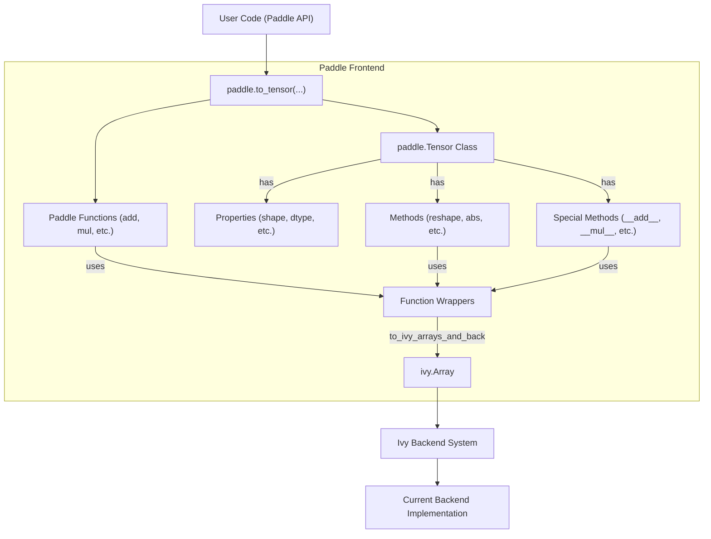
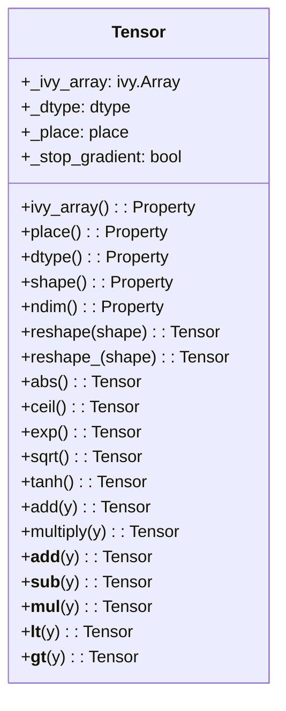
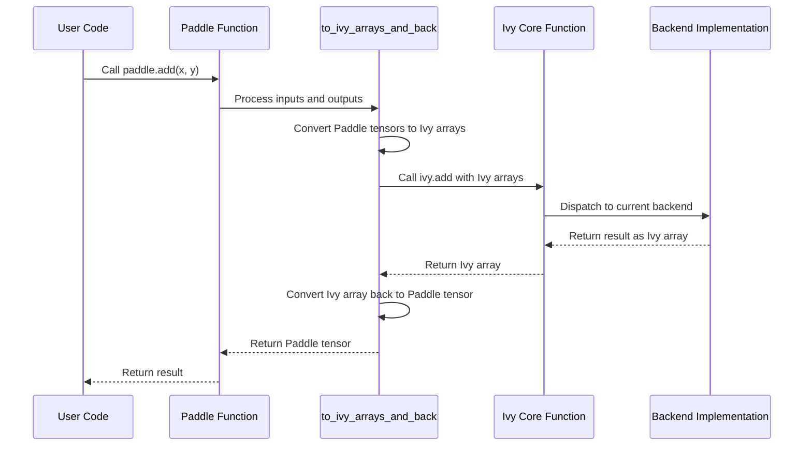

<!-- source: DeepWiki mcp.deepwiki.com · repo ivy-llc/ivy · page 2.3 Paddle Frontend · fetched 2026-10-21 -->

# Paddle Frontend

<details>
<summary>Relevant source files</summary>

The following files were used as context for generating this wiki page:

- [ivy/data_classes/array/array.py](ivy/data_classes/array/array.py)
- [ivy/functional/frontends/paddle/nn/functional/activation.py](ivy/functional/frontends/paddle/nn/functional/activation.py)
- [ivy/functional/frontends/paddle/tensor/manipulation.py](ivy/functional/frontends/paddle/tensor/manipulation.py)
- [ivy/functional/frontends/paddle/tensor/math.py](ivy/functional/frontends/paddle/tensor/math.py)
- [ivy/functional/frontends/paddle/tensor/random.py](ivy/functional/frontends/paddle/tensor/random.py)
- [ivy/functional/frontends/paddle/tensor/tensor.py](ivy/functional/frontends/paddle/tensor/tensor.py)
- [ivy_tests/test_ivy/test_frontends/test_paddle/test_nn/test_functional/test_activation.py](ivy_tests/test_ivy/test_frontends/test_paddle/test_nn/test_functional/test_activation.py)
- [ivy_tests/test_ivy/test_frontends/test_paddle/test_tensor/test_manipulation.py](ivy_tests/test_ivy/test_frontends/test_paddle/test_tensor/test_manipulation.py)
- [ivy_tests/test_ivy/test_frontends/test_paddle/test_tensor/test_math.py](ivy_tests/test_ivy/test_frontends/test_paddle/test_tensor/test_math.py)
- [ivy_tests/test_ivy/test_frontends/test_paddle/test_tensor/test_random.py](ivy_tests/test_ivy/test_frontends/test_paddle/test_tensor/test_random.py)
- [ivy_tests/test_ivy/test_frontends/test_paddle/test_tensor/test_tensor.py](ivy_tests/test_ivy/test_frontends/test_paddle/test_tensor/test_tensor.py)
- [ivy_tests/test_ivy/test_frontends/test_torch/test_nn/test_functional/test_non_linear_activation_functions.py](ivy_tests/test_ivy/test_frontends/test_torch/test_nn/test_functional/test_non_linear_activation_functions.py)
- [ivy_tests/test_ivy/test_misc/test_array.py](ivy_tests/test_ivy/test_misc/test_array.py)

</details>


This page documents the Paddle Frontend system in Ivy, which allows users to write code using PaddlePaddle's API syntax while leveraging Ivy's backend-agnostic execution capabilities. The Paddle Frontend translates PaddlePaddle operations to Ivy's unified API, enabling execution across different ML frameworks without code changes.

For general frontend information, see [Frontend System](#2). For other frontends like PyTorch or TensorFlow, see [PyTorch Frontend](#2.1) and [TensorFlow Frontend](#2.2).

## Architecture Overview

The Paddle Frontend implements the PaddlePaddle API interface while using Ivy's execution engine underneath. It consists of a `paddle.Tensor` class that wraps Ivy arrays and a collection of functions that mirror the Paddle API.



Sources: [ivy/functional/frontends/paddle/tensor/tensor.py:12-1075](), [ivy/functional/frontends/paddle/func_wrapper.py]()

## Paddle Tensor Class

The `Tensor` class is the core component of the Paddle Frontend, wrapping an Ivy array and providing a Paddle-compatible interface.



The `Tensor` class provides:

1. **Properties** for accessing tensor metadata:
   - `ivy_array`: The underlying Ivy array
   - `place`: Device information (similar to Paddle's device concept)
   - `dtype`: Data type of the tensor
   - `shape`: Dimensions of the tensor
   - `ndim`: Number of dimensions

2. **Methods** for tensor operations:
   - Mathematical operations (`abs`, `ceil`, `exp`, etc.)
   - Manipulation operations (`reshape`, `squeeze`, etc.)
   - Neural network functions

3. **Special methods** for operator overloading:
   - `__add__`, `__sub__`, `__mul__`, etc. for basic arithmetic
   - `__lt__`, `__gt__`, etc. for comparisons

Sources: [ivy/functional/frontends/paddle/tensor/tensor.py:12-146](), [ivy/functional/frontends/paddle/tensor/tensor.py:281-409]()

### In-Place Operations

The Paddle Frontend supports in-place operations that modify tensors directly. These operations typically have an underscore suffix:

| In-Place Operation | Description |
|-------------------|-------------|
| `reshape_`        | Reshapes tensor in-place |
| `add_`            | Adds in-place |
| `ceil_`           | Applies ceiling function in-place |
| `exp_`            | Applies exponential function in-place |
| `floor_`          | Applies floor function in-place |
| `sqrt_`           | Computes square root in-place |
| `tanh_`           | Applies hyperbolic tangent in-place |

Example of in-place operation usage:
```python
x = paddle.to_tensor([1.5, 2.3, 3.7])
x.ceil_()  # Modifies x in-place to [2.0, 3.0, 4.0]
```

Sources: [ivy/functional/frontends/paddle/tensor/math.py:13-91](), [ivy/functional/frontends/paddle/tensor/tensor.py:295-462]()

## Conversion Mechanism

A key component of the Paddle Frontend is the conversion between Paddle tensors and Ivy arrays. This is primarily handled by the `to_ivy_arrays_and_back` decorator and the `_to_ivy_array` function.



The conversion process:
1. User calls a Paddle function (e.g., `paddle.add`)
2. The function is decorated with `to_ivy_arrays_and_back`
3. The decorator converts input Paddle tensors to Ivy arrays
4. The core operation is performed using Ivy's backend
5. Results are converted back to Paddle tensors before returning

Sources: [ivy/functional/frontends/paddle/func_wrapper.py](), [ivy/functional/frontends/paddle/tensor/tensor.py:9-146]()

## Function Categories

The Paddle Frontend implements a wide range of functions organized into several categories:

### 1. Mathematical Operations

Basic and advanced mathematical operations such as:
- Arithmetic: `add`, `subtract`, `multiply`, `divide`
- Advanced math: `exp`, `log`, `sqrt`, `pow`
- Trigonometric: `sin`, `cos`, `tan`, `asin`
- Statistical: `mean`, `var`, `std`

Sources: [ivy/functional/frontends/paddle/tensor/tensor.py:398-462](), [ivy/functional/frontends/paddle/tensor/tensor.py:699-743]()

### 2. Tensor Manipulation

Functions for reshaping and manipulating tensors:
- `reshape`: Change tensor dimensions
- `squeeze`/`unsqueeze`: Remove/add dimensions of size 1
- `transpose`: Permute tensor dimensions
- `flatten`: Flatten tensor dimensions
- `clip`: Clamp tensor values

Sources: [ivy/functional/frontends/paddle/tensor/tensor.py:281-293](), [ivy/functional/frontends/paddle/tensor/tensor.py:400-429](), [ivy/functional/frontends/paddle/tensor/tensor.py:540-554]()

### 3. Neural Network Functions

Implementations of neural network operations:
- Activation functions: `relu`, `sigmoid`, `tanh`, `gelu`
- Advanced activations: `hardswish`, `hardsigmoid`, `leaky_relu`
- Loss functions
- Normalization operations

Sources: [ivy/functional/frontends/paddle/nn/functional/activation.py:8-284]()

### 4. Random Operations

Functions for random number generation:
- `exponential_`: Generate random numbers from exponential distribution
- `uniform_`: Generate random numbers from uniform distribution

Sources: [ivy/functional/frontends/paddle/tensor/random.py:19-32]()

## Usage Examples

### Basic Tensor Operations

```python
import ivy.frontends.paddle as paddle

# Create a tensor
x = paddle.to_tensor([1, 2, 3], dtype="float32")
y = paddle.to_tensor([4, 5, 6], dtype="float32")

# Basic arithmetic
z = x + y  # Uses __add__ method
z = paddle.add(x, y)  # Function call

# Reshaping
z_reshaped = z.reshape([3, 1])
z.reshape_([3, 1])  # In-place

# Math operations
result = paddle.sqrt(z)
z.sqrt_()  # In-place

# Neural network
activated = paddle.nn.functional.relu(z)
```

### Special Methods

The `Tensor` class implements many special methods for operator overloading:

```python
# Arithmetic operations
z = x + y  # __add__
z = x - y  # __sub__
z = x * y  # __mul__
z = x / y  # __truediv__

# Comparisons
mask = x > y  # __gt__
mask = x < y  # __lt__
mask = x >= y  # __ge__
mask = x <= y  # __le__

# Iteration
for val in x:  # __iter__
    print(val)

# Indexing
val = x[0]  # __getitem__
```

Sources: [ivy/functional/frontends/paddle/tensor/tensor.py:62-242]()

## Integration with Ivy

The Paddle Frontend integrates seamlessly with Ivy's array abstraction and backend system:

1. The `paddle.Tensor._ivy_array` attribute holds the underlying Ivy array
2. Operations are ultimately executed using the current active Ivy backend
3. Device placement is handled through Ivy's device management
4. Data types are mapped between Paddle and Ivy's type system

This allows code written using the Paddle API to run on any supported backend (PyTorch, TensorFlow, JAX, NumPy, or even Paddle itself) without changes.

Sources: [ivy/functional/frontends/paddle/tensor/tensor.py:12-42](), [ivy/data_classes/array/array.py:95-136]()

## Limitations and Special Considerations

1. **Data Types**: Some operations may have limited support for certain data types
2. **In-place Operations**: Some operations have different behavior between eager and graph mode
3. **API Coverage**: Not all Paddle functions may be implemented in the frontend
4. **Backend-specific Behavior**: Some operations may have slightly different behavior across backends

Sources: [ivy/functional/frontends/paddle/tensor/tensor.py:64-75](), [ivy/functional/frontends/paddle/tensor/tensor.py:203-242]()

---

