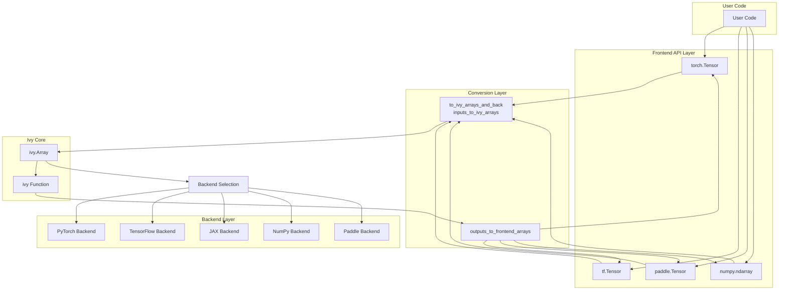
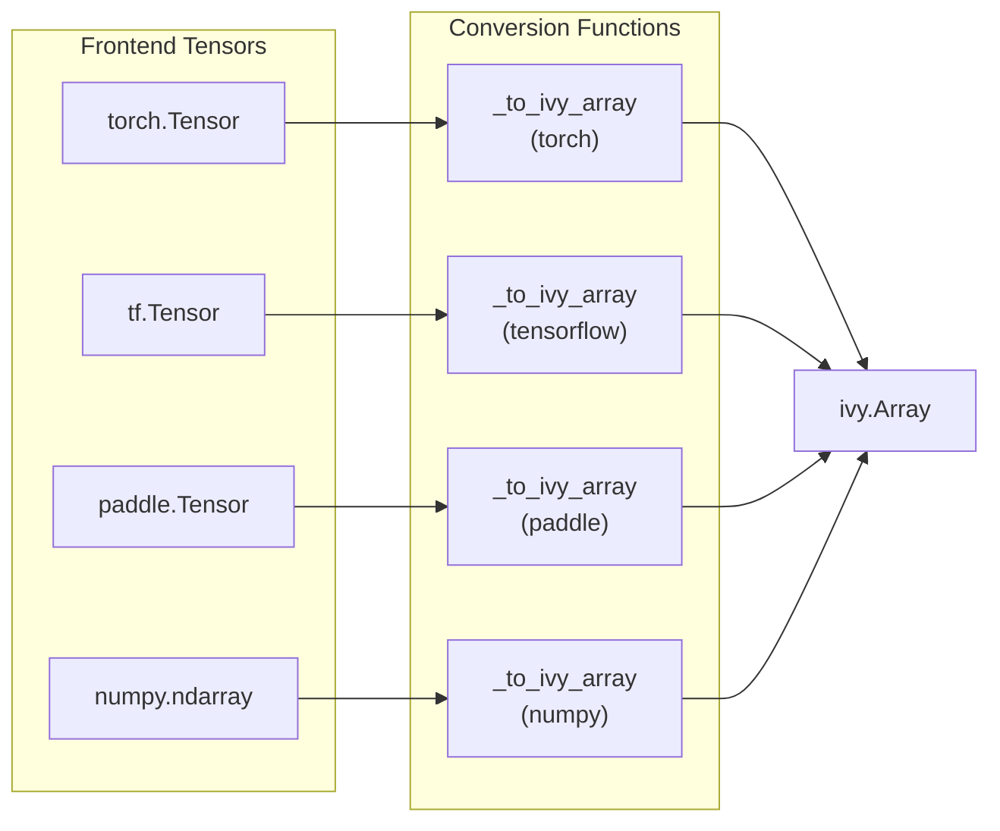
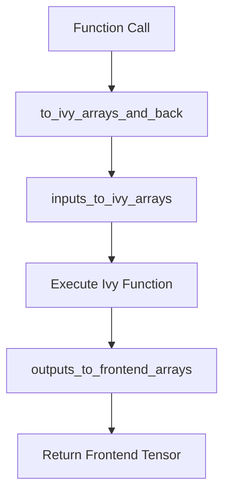
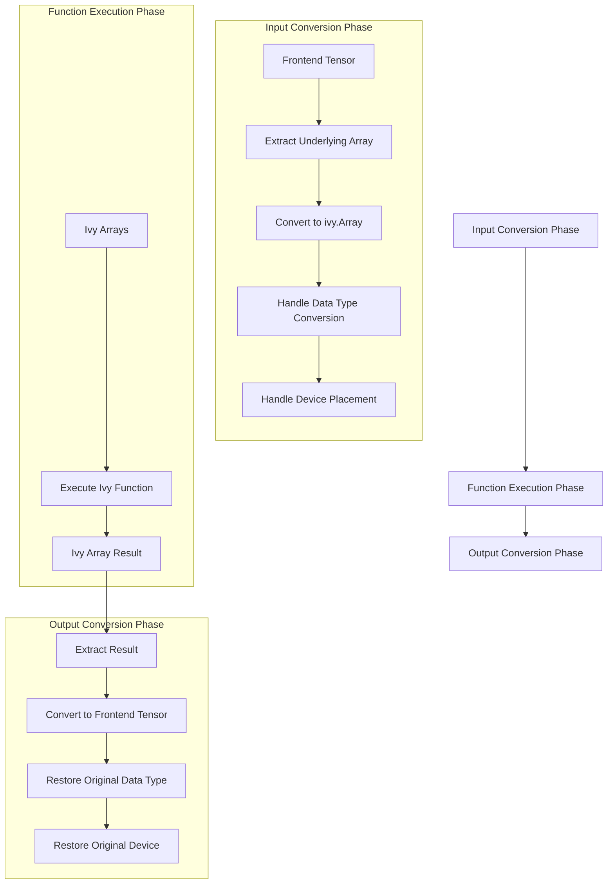
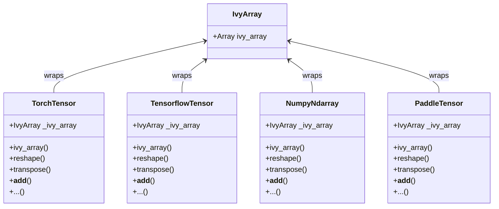

<!-- source: DeepWiki mcp.deepwiki.com · repo ivy-llc/ivy · page 2.4 Frontend Conversion Utilities · fetched 2026-10-21 -->

# Frontend Conversion Utilities

<details>
<summary>Relevant source files</summary>

The following files were used as context for generating this wiki page:

- [ivy/data_classes/array/array.py](ivy/data_classes/array/array.py)
- [ivy/data_classes/container/conversions.py](ivy/data_classes/container/conversions.py)
- [ivy/functional/frontends/jax/func_wrapper.py](ivy/functional/frontends/jax/func_wrapper.py)
- [ivy/functional/frontends/numpy/func_wrapper.py](ivy/functional/frontends/numpy/func_wrapper.py)
- [ivy/functional/frontends/numpy/ndarray/ndarray.py](ivy/functional/frontends/numpy/ndarray/ndarray.py)
- [ivy/functional/frontends/onnx/func_wrapper.py](ivy/functional/frontends/onnx/func_wrapper.py)
- [ivy/functional/frontends/paddle/func_wrapper.py](ivy/functional/frontends/paddle/func_wrapper.py)
- [ivy/functional/frontends/paddle/nn/functional/activation.py](ivy/functional/frontends/paddle/nn/functional/activation.py)
- [ivy/functional/frontends/paddle/tensor/manipulation.py](ivy/functional/frontends/paddle/tensor/manipulation.py)
- [ivy/functional/frontends/paddle/tensor/math.py](ivy/functional/frontends/paddle/tensor/math.py)
- [ivy/functional/frontends/paddle/tensor/random.py](ivy/functional/frontends/paddle/tensor/random.py)
- [ivy/functional/frontends/paddle/tensor/tensor.py](ivy/functional/frontends/paddle/tensor/tensor.py)
- [ivy/functional/frontends/tensorflow/compat/v1/nn.py](ivy/functional/frontends/tensorflow/compat/v1/nn.py)
- [ivy/functional/frontends/tensorflow/func_wrapper.py](ivy/functional/frontends/tensorflow/func_wrapper.py)
- [ivy/functional/frontends/tensorflow/general_functions.py](ivy/functional/frontends/tensorflow/general_functions.py)
- [ivy/functional/frontends/tensorflow/linalg.py](ivy/functional/frontends/tensorflow/linalg.py)
- [ivy/functional/frontends/tensorflow/math.py](ivy/functional/frontends/tensorflow/math.py)
- [ivy/functional/frontends/tensorflow/nn.py](ivy/functional/frontends/tensorflow/nn.py)
- [ivy/functional/frontends/tensorflow/raw_ops.py](ivy/functional/frontends/tensorflow/raw_ops.py)
- [ivy/functional/frontends/tensorflow/tensor.py](ivy/functional/frontends/tensorflow/tensor.py)
- [ivy/functional/frontends/torch/func_wrapper.py](ivy/functional/frontends/torch/func_wrapper.py)
- [ivy/functional/frontends/torch/tensor.py](ivy/functional/frontends/torch/tensor.py)
- [ivy_tests/test_ivy/test_frontends/test_jax/test_func_wrapper.py](ivy_tests/test_ivy/test_frontends/test_jax/test_func_wrapper.py)
- [ivy_tests/test_ivy/test_frontends/test_numpy/test_ndarray/test_ndarray.py](ivy_tests/test_ivy/test_frontends/test_numpy/test_ndarray/test_ndarray.py)
- [ivy_tests/test_ivy/test_frontends/test_paddle/test_nn/test_functional/test_activation.py](ivy_tests/test_ivy/test_frontends/test_paddle/test_nn/test_functional/test_activation.py)
- [ivy_tests/test_ivy/test_frontends/test_paddle/test_tensor/test_manipulation.py](ivy_tests/test_ivy/test_frontends/test_paddle/test_tensor/test_manipulation.py)
- [ivy_tests/test_ivy/test_frontends/test_paddle/test_tensor/test_math.py](ivy_tests/test_ivy/test_frontends/test_paddle/test_tensor/test_math.py)
- [ivy_tests/test_ivy/test_frontends/test_paddle/test_tensor/test_random.py](ivy_tests/test_ivy/test_frontends/test_paddle/test_tensor/test_random.py)
- [ivy_tests/test_ivy/test_frontends/test_paddle/test_tensor/test_tensor.py](ivy_tests/test_ivy/test_frontends/test_paddle/test_tensor/test_tensor.py)
- [ivy_tests/test_ivy/test_frontends/test_tensorflow/test_compat/test_v1/test_nn.py](ivy_tests/test_ivy/test_frontends/test_tensorflow/test_compat/test_v1/test_nn.py)
- [ivy_tests/test_ivy/test_frontends/test_tensorflow/test_general_functions.py](ivy_tests/test_ivy/test_frontends/test_tensorflow/test_general_functions.py)
- [ivy_tests/test_ivy/test_frontends/test_tensorflow/test_linalg.py](ivy_tests/test_ivy/test_frontends/test_tensorflow/test_linalg.py)
- [ivy_tests/test_ivy/test_frontends/test_tensorflow/test_math.py](ivy_tests/test_ivy/test_frontends/test_tensorflow/test_math.py)
- [ivy_tests/test_ivy/test_frontends/test_tensorflow/test_nn.py](ivy_tests/test_ivy/test_frontends/test_tensorflow/test_nn.py)
- [ivy_tests/test_ivy/test_frontends/test_tensorflow/test_raw_ops.py](ivy_tests/test_ivy/test_frontends/test_tensorflow/test_raw_ops.py)
- [ivy_tests/test_ivy/test_frontends/test_tensorflow/test_tensor.py](ivy_tests/test_ivy/test_frontends/test_tensorflow/test_tensor.py)
- [ivy_tests/test_ivy/test_frontends/test_torch/test_nn/test_functional/test_non_linear_activation_functions.py](ivy_tests/test_ivy/test_frontends/test_torch/test_nn/test_functional/test_non_linear_activation_functions.py)
- [ivy_tests/test_ivy/test_frontends/test_torch/test_tensor.py](ivy_tests/test_ivy/test_frontends/test_torch/test_tensor.py)
- [ivy_tests/test_ivy/test_misc/test_array.py](ivy_tests/test_ivy/test_misc/test_array.py)

</details>


This page documents the frontend conversion utilities in the Ivy framework, which are responsible for translating between frontend framework tensor types (like PyTorch tensors, TensorFlow tensors, etc.) and Ivy's unified array representation. These utilities enable Ivy to provide consistent frontend APIs that mimic popular frameworks while internally using Ivy's backend-agnostic implementation.

For information about the overall Frontend System architecture, see [Frontend System](#2).

## Conversion Architecture

Frontend conversion utilities serve as the bridge between framework-specific tensor objects and Ivy's unified array representation. They enable seamless conversion in both directions, allowing users to work with familiar APIs while leveraging Ivy's backend-agnostic capabilities.



Sources: 
- [ivy/functional/frontends/torch/func_wrapper.py]()
- [ivy/functional/frontends/tensorflow/func_wrapper.py]()
- [ivy/functional/frontends/numpy/func_wrapper.py]()
- [ivy/functional/frontends/paddle/func_wrapper.py]()

## Core Conversion Functions

### `_to_ivy_array`

This function converts a frontend framework tensor to an Ivy array. Each frontend has its own implementation, but they all serve the same purpose.



The basic implementation of `_to_ivy_array` for different frontends:

- **PyTorch**: Extracts the underlying array from a `torch.Tensor` object and converts it to an Ivy array
- **TensorFlow**: Converts a `tf.Tensor` object to an Ivy array using the appropriate backend
- **NumPy**: Converts a `numpy.ndarray` to an Ivy array
- **Paddle**: Extracts the underlying array from a `paddle.Tensor` object and converts it to an Ivy array

Sources:
- [ivy/functional/frontends/torch/func_wrapper.py:15-20]()
- [ivy/functional/frontends/tensorflow/func_wrapper.py:12-20]()
- [ivy/functional/frontends/paddle/func_wrapper.py:9-11]()
- [ivy/functional/frontends/numpy/func_wrapper.py:19-25]()

### `to_ivy_arrays_and_back`

This is a decorator that wraps frontend functions to handle the conversion of inputs to Ivy arrays and outputs back to frontend tensor types. It's a critical component that enables the transparent conversion between frontend and Ivy array types.



The general flow of the `to_ivy_arrays_and_back` decorator:

1. Intercepts a call to a frontend function
2. Converts all tensor inputs to Ivy arrays
3. Executes the function with Ivy arrays
4. Converts the result back to the frontend's tensor type
5. Returns the frontend tensor

Sources:
- [ivy/functional/frontends/torch/func_wrapper.py:23-91]()
- [ivy/functional/frontends/tensorflow/func_wrapper.py:23-73]()
- [ivy/functional/frontends/numpy/func_wrapper.py:76-124]()
- [ivy/functional/frontends/paddle/func_wrapper.py:14-50]()

## Framework-Specific Conversion Helpers

Different frameworks have different conventions and requirements. Ivy provides additional helpers to handle these differences.

### PyTorch-Specific Helpers

#### `numpy_to_torch_style_args`

This decorator converts NumPy-style arguments to PyTorch-style. For example, it converts `axis` to `dim` and `keepdims` to `keepdim`. This is useful because Ivy uses NumPy-style arguments internally but PyTorch uses different parameter names.

```python
# Example conversion:
# numpy-style: function(x, axis=0, keepdims=True)
# torch-style: function(x, dim=0, keepdim=True)
```

Sources:
- [ivy/functional/frontends/torch/func_wrapper.py:94-114]()
- [ivy/functional/frontends/torch/tensor.py:177-182]()

### TensorFlow-Specific Helpers

#### `map_raw_ops_alias`

Maps TensorFlow raw operations to their Ivy equivalents and handles argument name conversions. This is particularly important for TensorFlow's low-level raw operations API.

Sources:
- [ivy/functional/frontends/tensorflow/func_wrapper.py:76-98]()
- [ivy/functional/frontends/tensorflow/raw_ops.py:7-9]()

### NumPy-Specific Helpers

#### `handle_numpy_out_argument`

Handles NumPy's `out` parameter, which allows the result to be stored in a pre-existing array.

Sources:
- [ivy/functional/frontends/numpy/func_wrapper.py:127-139]()

## Conversion Process Details

The conversion process involves several phases to ensure proper handling of arrays, data types, devices, and other array properties.



Sources:
- [ivy/functional/frontends/torch/func_wrapper.py:23-91]()
- [ivy/functional/frontends/tensorflow/func_wrapper.py:23-73]()

## Frontend Tensor Wrappers

Each frontend in Ivy provides a wrapper class that mimics the behavior of the corresponding framework's tensor class. These wrappers store an Ivy array internally and implement methods that match the behavior of the original framework.



All frontend tensor classes follow a similar pattern:
1. They store an Ivy array internally
2. They implement methods that match the original framework's API
3. They use conversion utilities to convert between Ivy arrays and frontend tensors

Sources:
- [ivy/functional/frontends/torch/tensor.py:20-1130]()
- [ivy/functional/frontends/tensorflow/tensor.py:11-116]()
- [ivy/functional/frontends/numpy/ndarray/ndarray.py:18-1137]()
- [ivy/functional/frontends/paddle/tensor/tensor.py:12-762]()

## Usage Examples

Let's examine how these conversion utilities are used in practice.

### Example 1: PyTorch Frontend Function

When implementing a PyTorch frontend function like `torch.add`, the conversion process ensures that inputs are converted to Ivy arrays, the core computation is performed, and the result is converted back to a PyTorch tensor.

```python
# Simplified example of a PyTorch frontend function
@to_ivy_arrays_and_back
def add(input, other, *, alpha=1, out=None):
    # At this point, input and other have been converted to Ivy arrays
    # We can use Ivy operations directly
    return ivy.add(input, ivy.multiply(alpha, other))
    # The result will be automatically converted back to a PyTorch tensor
```

### Example 2: Tensor Method Implementation

Tensor methods also use conversion utilities, typically calling the corresponding frontend function:

```python
# Method implementation in torch.Tensor
def add(self, other, *, alpha=1):
    # self._ivy_array is already an Ivy array
    # other might be a PyTorch tensor and needs conversion
    return torch_frontend.add(self, other, alpha=alpha)
    # The result is a PyTorch tensor containing an Ivy array
```

Sources:
- [ivy/functional/frontends/torch/tensor.py:162-164]()
- [ivy/functional/frontends/tensorflow/tensor.py:78-82]()
- [ivy/functional/frontends/numpy/ndarray/ndarray.py:223-228]()
- [ivy/functional/frontends/paddle/tensor/tensor.py:501-507]()

## Handling Special Cases

### Data Type Conversion

Different frameworks have different data type systems. The conversion utilities handle data type conversion between framework types and Ivy types.

```python
# Example of data type conversion
def to_ivy_dtype(dtype):
    # Convert framework dtype to Ivy dtype
    ...
```

### Device Placement

Different frameworks handle devices differently. The conversion utilities ensure proper device placement when converting between frameworks.

```python
# Example of handling device information
def to_ivy_array(tensor):
    # Extract device information and pass it to ivy.array
    ...
```

Sources:
- [ivy/functional/frontends/torch/func_wrapper.py:23-91]()
- [ivy/functional/frontends/tensorflow/func_wrapper.py:168-183]()

## Conclusion

Frontend conversion utilities are a crucial component of Ivy's architecture, enabling seamless interoperability between different framework interfaces while maintaining Ivy's unified backend implementation. These utilities handle the complexities of converting between various tensor representations, managing data types, and ensuring proper device placement.

Understanding these conversion mechanisms is essential for anyone working with Ivy's frontend implementations or developing new frontend interfaces for other frameworks.

---

