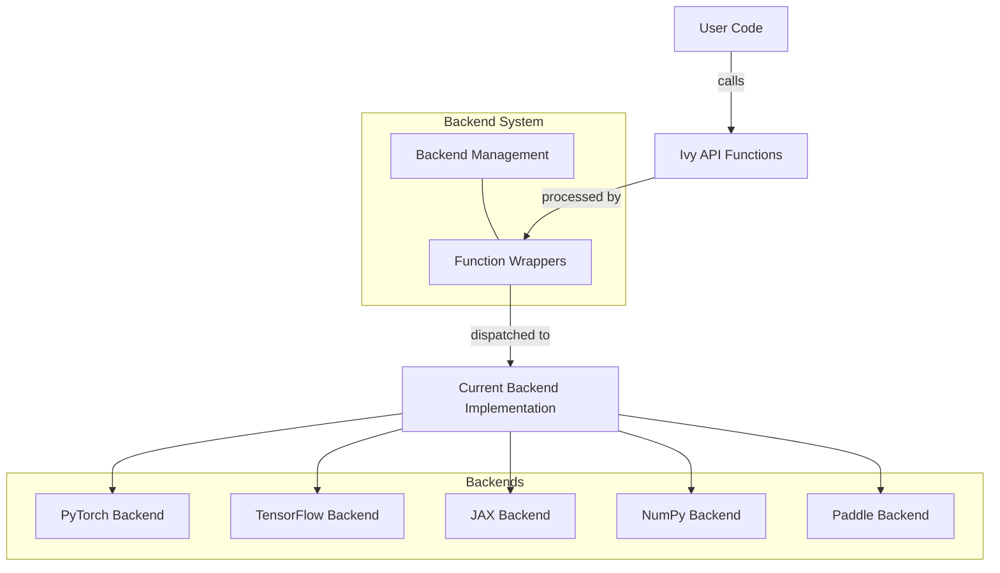
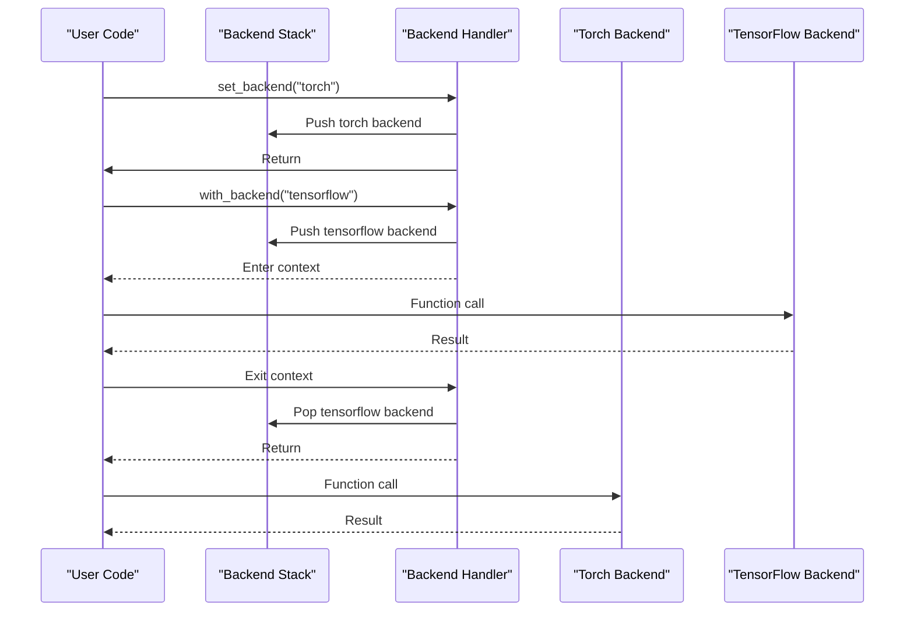
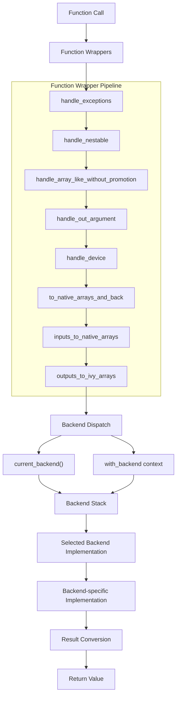
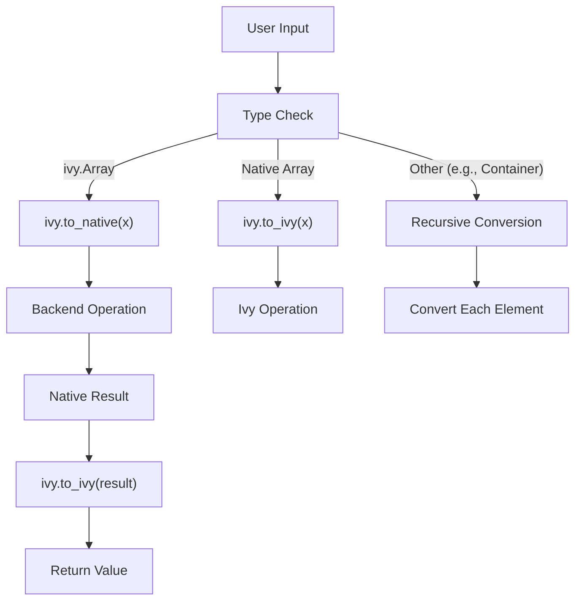

<!-- source: DeepWiki mcp.deepwiki.com · repo ivy-llc/ivy · page 3 Backend System · fetched 2026-10-21 -->

# Backend System

<details>
<summary>Relevant source files</summary>

The following files were used as context for generating this wiki page:

- [ivy/__init__.py](ivy/__init__.py)
- [ivy/func_wrapper.py](ivy/func_wrapper.py)
- [ivy/functional/backends/jax/__init__.py](ivy/functional/backends/jax/__init__.py)
- [ivy/functional/backends/jax/general.py](ivy/functional/backends/jax/general.py)
- [ivy/functional/backends/mxnet/__init__.py](ivy/functional/backends/mxnet/__init__.py)
- [ivy/functional/backends/mxnet/general.py](ivy/functional/backends/mxnet/general.py)
- [ivy/functional/backends/numpy/__init__.py](ivy/functional/backends/numpy/__init__.py)
- [ivy/functional/backends/numpy/general.py](ivy/functional/backends/numpy/general.py)
- [ivy/functional/backends/paddle/general.py](ivy/functional/backends/paddle/general.py)
- [ivy/functional/backends/tensorflow/__init__.py](ivy/functional/backends/tensorflow/__init__.py)
- [ivy/functional/backends/tensorflow/general.py](ivy/functional/backends/tensorflow/general.py)
- [ivy/functional/backends/torch/__init__.py](ivy/functional/backends/torch/__init__.py)
- [ivy/functional/backends/torch/general.py](ivy/functional/backends/torch/general.py)
- [ivy/functional/ivy/__init__.py](ivy/functional/ivy/__init__.py)
- [ivy/functional/ivy/general.py](ivy/functional/ivy/general.py)
- [ivy_tests/test_ivy/test_functional/test_core/test_general.py](ivy_tests/test_ivy/test_functional/test_core/test_general.py)

</details>


The Backend System is the core component of Ivy that enables framework-agnostic operations by abstracting away the differences between machine learning frameworks (PyTorch, TensorFlow, JAX, NumPy, and Paddle). It manages the current backend, handles dispatching function calls to the appropriate backend implementation, and provides utilities for array type conversion between Ivy and native arrays.

For information about frontend interfaces that adapt Ivy to mimic other frameworks' APIs, see [Frontend System](#2).

## Architecture

The Backend System consists of two main components:
1. **Backend Management** - Handles backend selection and switching
2. **Function Wrappers** - Process function calls to ensure consistent behavior across backends

### Backend System Overview



Sources: [ivy/utils/backend/handler.py](), [ivy/functional/backends/torch/general.py](), [ivy/functional/backends/tensorflow/general.py](), [ivy/functional/backends/jax/general.py](), [ivy/functional/backends/numpy/general.py](), [ivy/functional/backends/paddle/general.py]()

## Backend Management

The Backend Management component enables switching between different machine learning frameworks at runtime. Each backend implements Ivy's API functions for its specific framework.

### Backend Selection and Switching



Sources: [ivy/functional/backends/torch/__init__.py](), [ivy/functional/backends/tensorflow/__init__.py](), [ivy/functional/backends/jax/__init__.py](), [ivy/functional/backends/numpy/__init__.py](), [ivy/functional/backends/paddle/__init__.py](), [ivy/utils/backend/handler.py]()

### Backend Context Managers

The Backend System provides two main ways to select and switch backends:

1. **Global Backend Setting**:
   ```python
   ivy.set_backend("torch")  # Set PyTorch as global backend
   ivy.unset_backend()       # Return to previous backend
   ```

2. **Temporary Backend Context**:
   ```python
   with ivy.with_backend("tensorflow"):
       # Code in this block uses TensorFlow
   # Outside the block reverts to the previous backend
   ```

The backend state is maintained using a stack system, allowing nested context managers to work correctly.

Sources: [ivy/__init__.py:767-784](), [ivy/utils/backend/handler.py]()

## Function Wrapping System

The Function Wrapping System is a collection of decorators that process function calls to ensure consistent behavior across backends.

### Function Wrapper Flow



Sources: [ivy/func_wrapper.py:16-39](), [ivy/func_wrapper.py:270-331](), [ivy/func_wrapper.py:381-457](), [ivy/func_wrapper.py:497-524](), [ivy/func_wrapper.py:553-570]()

### Key Function Wrappers

The function wrappers apply transformations to inputs and outputs of Ivy functions in a specific order. The main wrappers include:

| Wrapper | Purpose |
|---------|---------|
| `handle_exceptions` | Manages consistent error handling across backends |
| `handle_nestable` | Enables functions to work with nested containers |
| `handle_array_like_without_promotion` | Converts non-array inputs to arrays |
| `handle_out_argument` | Manages in-place updates via `out` parameter |
| `handle_device` | Places arrays on the appropriate device |
| `to_native_arrays_and_back` | Converts between Ivy and native arrays |
| `infer_dtype` | Determines appropriate data types for operations |

Sources: [ivy/func_wrapper.py:16-39](), [ivy/func_wrapper.py:270-331](), [ivy/func_wrapper.py:381-457](), [ivy/func_wrapper.py:497-524](), [ivy/func_wrapper.py:553-570](), [ivy/func_wrapper.py:689-719]()

## Array Conversion

A critical part of the Backend System is converting between Ivy arrays and framework-specific native arrays.

### Array Conversion Flow



Sources: [ivy/func_wrapper.py:381-457](), [ivy/func_wrapper.py:497-524](), [ivy/func_wrapper.py:553-570]()

### Conversion Utilities

The Backend System provides several conversion utilities:

| Function | Purpose |
|----------|---------|
| `inputs_to_native_arrays` | Converts input arrays to native arrays |
| `inputs_to_ivy_arrays` | Converts input arrays to Ivy arrays |
| `outputs_to_ivy_arrays` | Converts output arrays to Ivy arrays |
| `to_native_arrays_and_back` | Converts inputs to native arrays and outputs back to Ivy arrays |
| `to_ivy` | Converts a native array to an Ivy array |
| `to_native` | Converts an Ivy array to a native array |

Sources: [ivy/func_wrapper.py:381-457](), [ivy/func_wrapper.py:497-524](), [ivy/func_wrapper.py:553-570]()

## Backend-Specific Implementations

Each supported framework has its own implementation of Ivy's API functions organized in parallel directory structures.

### Backend Directory Structure

```
ivy/
└── functional/
    └── backends/
        ├── jax/
        │   ├── __init__.py
        │   ├── activations.py
        │   ├── creation.py
        │   ├── general.py
        │   └── ...
        ├── numpy/
        │   ├── __init__.py
        │   ├── activations.py
        │   ├── creation.py
        │   ├── general.py
        │   └── ...
        ├── tensorflow/
        │   ├── __init__.py
        │   ├── activations.py
        │   ├── creation.py
        │   ├── general.py
        │   └── ...
        ├── torch/
        │   ├── __init__.py
        │   ├── activations.py
        │   ├── creation.py
        │   ├── general.py
        │   └── ...
        └── paddle/
            ├── __init__.py
            ├── activations.py
            ├── creation.py
            ├── general.py
            └── ...
```

Sources: [ivy/functional/backends/jax/general.py](), [ivy/functional/backends/torch/general.py](), [ivy/functional/backends/tensorflow/general.py](), [ivy/functional/backends/numpy/general.py](), [ivy/functional/backends/paddle/general.py]()

### Common Backend Functions

Each backend implements a set of common functions that provide the backend-specific behavior:

| Function | Purpose |
|----------|---------|
| `current_backend_str()` | Returns the name of the backend as a string |
| `is_native_array()` | Checks if an object is a native array for the backend |
| `to_numpy()` | Converts a native array to a NumPy array |
| `to_scalar()` | Converts a single-element array to a scalar |
| `to_list()` | Converts an array to a Python list |
| `array_equal()` | Checks if two arrays have the same values |
| `get_item()` | Gets items from an array using indices |
| `set_item()` | Sets items in an array using indices |
| `inplace_update()` | Updates array values in-place |

Sources: [ivy/functional/backends/jax/general.py:50-252](), [ivy/functional/backends/torch/general.py:51-178](), [ivy/functional/backends/tensorflow/general.py:27-141](), [ivy/functional/backends/numpy/general.py:23-79](), [ivy/functional/backends/paddle/general.py:22-223]()

## Usage Examples

### Switching Backends

```python
import ivy

# Using PyTorch backend
ivy.set_backend("torch")
x = ivy.array([1, 2, 3])
print(ivy.current_backend_str())  # "torch"

# Temporarily switch to TensorFlow
with ivy.with_backend("tensorflow"):
    y = ivy.array([4, 5, 6])
    print(ivy.current_backend_str())  # "tensorflow"

# Back to PyTorch
print(ivy.current_backend_str())  # "torch"
```

### Cross-Framework Compatibility

```python
import ivy
import torch
import tensorflow as tf
import numpy as np

# Create arrays in different frameworks
torch_array = torch.tensor([1, 2, 3])
tf_array = tf.constant([4, 5, 6])
numpy_array = np.array([7, 8, 9])

# Wrap in Ivy for framework-agnostic operations
ivy_from_torch = ivy.array(torch_array)
ivy_from_tf = ivy.array(tf_array)
ivy_from_numpy = ivy.array(numpy_array)

# Can work with arrays regardless of source framework
result = ivy.concatenate([ivy_from_torch, ivy_from_tf, ivy_from_numpy])
```

## Backend Compatibility

The Backend System ensures consistent behavior across different machine learning frameworks while respecting the unique characteristics of each framework. Some operations may be unavailable or have different behavior in specific backends, which is handled through the function wrappers.

### Framework-Specific Considerations

| Framework | Special Considerations |
|-----------|------------------------|
| PyTorch | Supports in-place operations; Handles gradient tensors |
| TensorFlow | Eager execution mode; Graph-compatible operations |
| JAX | Functional approach; No in-place operations; Handles JIT compilation |
| NumPy | No GPU support; No automatic differentiation |
| Paddle | Limited support for complex data types |

Sources: [ivy/functional/backends/torch/general.py:338-611](), [ivy/functional/backends/tensorflow/general.py:227-466](), [ivy/functional/backends/jax/general.py:255-334](), [ivy/functional/backends/numpy/general.py:181-247](), [ivy/functional/backends/paddle/general.py:253-591]()

## Common Troubleshooting

1. **Backend Switching Issues**: If you encounter issues when switching backends, ensure that the backend is properly installed and accessible. Use `ivy.current_backend_str()` to confirm which backend is active.

2. **Array Type Conversion**: If functions raise type errors, you may need to explicitly convert arrays using `ivy.array()` to ensure compatibility.

3. **Device Placement**: For GPU operations, ensure the device is specified correctly. Use `ivy.dev()` to check the current device of an array.

4. **In-place Operations**: Remember that not all backends support in-place operations. JAX, in particular, follows a functional paradigm and doesn't support in-place updates.

---

