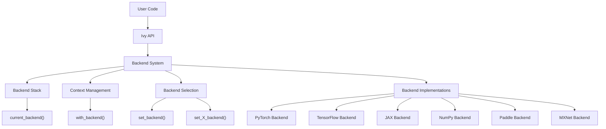
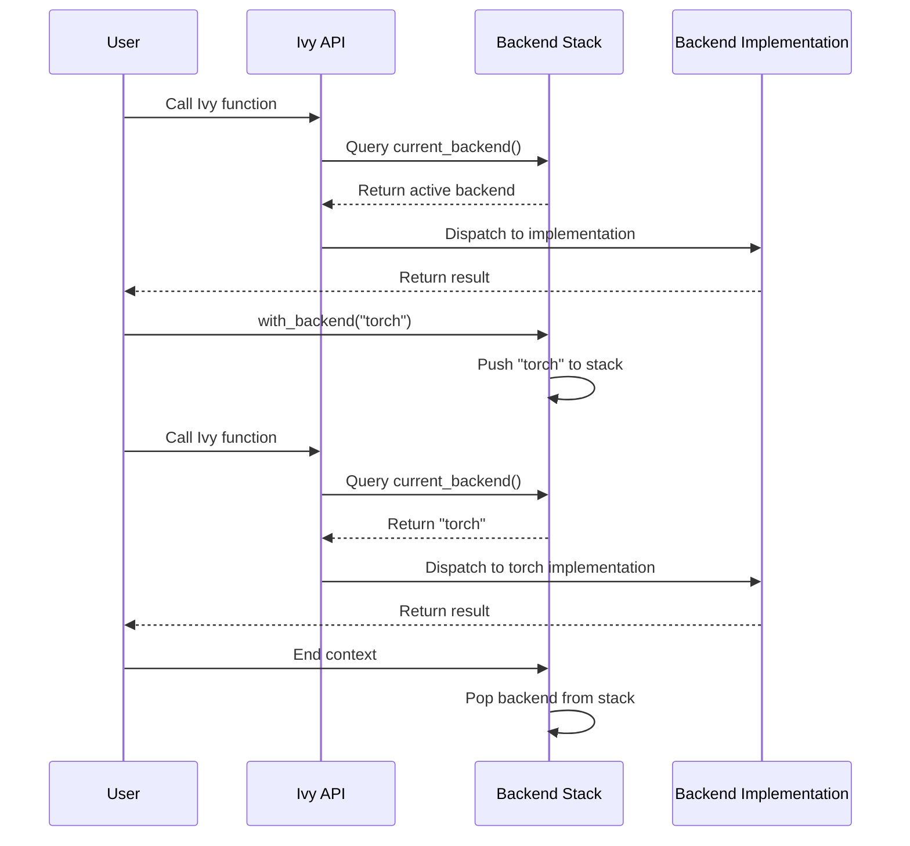
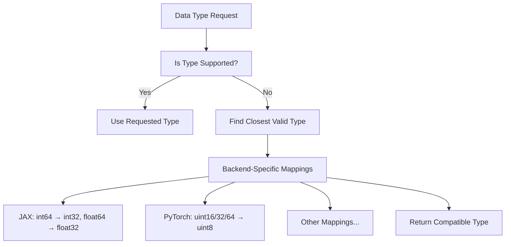
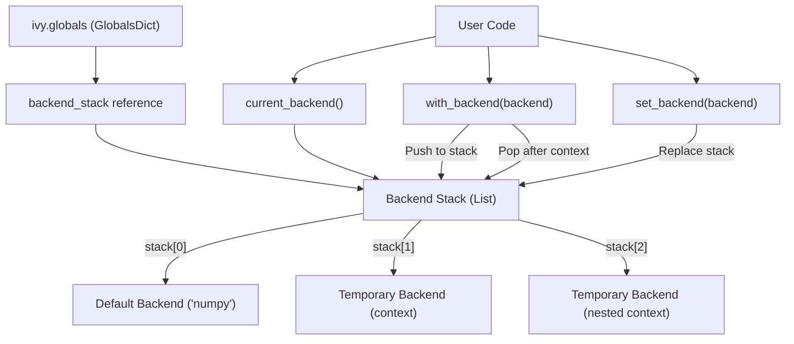

<!-- source: DeepWiki mcp.deepwiki.com · repo ivy-llc/ivy · page 3.1 Backend Management · fetched 2026-10-21 -->

# Backend Management

<details>
<summary>Relevant source files</summary>

The following files were used as context for generating this wiki page:

- [ivy/__init__.py](ivy/__init__.py)
- [ivy/func_wrapper.py](ivy/func_wrapper.py)
- [ivy/functional/backends/jax/__init__.py](ivy/functional/backends/jax/__init__.py)
- [ivy/functional/backends/mxnet/__init__.py](ivy/functional/backends/mxnet/__init__.py)
- [ivy/functional/backends/numpy/__init__.py](ivy/functional/backends/numpy/__init__.py)
- [ivy/functional/backends/tensorflow/__init__.py](ivy/functional/backends/tensorflow/__init__.py)
- [ivy/functional/backends/torch/__init__.py](ivy/functional/backends/torch/__init__.py)
- [ivy/functional/ivy/__init__.py](ivy/functional/ivy/__init__.py)

</details>


## Purpose and Scope

This document details Ivy's backend management system, which is responsible for selecting, switching between, and managing different framework backends (PyTorch, TensorFlow, JAX, NumPy, and others). The backend management system enables Ivy to provide a consistent API across all supported frameworks while handling the complexities of framework-specific implementations behind the scenes.

For information about the function wrapping system that works with backends, see [Function Wrapping System](#3.2).

## Overview of Backend Architecture

Ivy's backend management system allows code to be written once and executed on any supported framework. Backend management handles framework selection, stack-based context switching, and proper conversion between native framework data types and Ivy's unified API.



Sources: [ivy/__init__.py:770-785](), [ivy/functional/backends/jax/__init__.py:55-56](), [ivy/functional/backends/torch/__init__.py:21-22]()

## Backend Stack Management

The backend stack is a core concept in Ivy's backend management system. It maintains a stack of backends, with the current active backend being at the top of the stack.

### How the Backend Stack Works

The backend stack is implemented as a list that keeps track of selected backends. When a new backend is selected (either permanently or temporarily with context managers), it is pushed onto the stack. When a context ends, the backend is popped from the stack.



Sources: [ivy/__init__.py:770-785]()

## Backend Selection and Switching

Ivy provides several methods for selecting and switching between backends, both permanently and temporarily.

### Permanent Backend Selection

The `set_backend()` function sets the backend for all subsequent operations:

```python
# Setting to PyTorch backend
ivy.set_backend("torch")

# Setting to JAX backend
ivy.set_backend("jax")
```

There are also convenience functions for each supported backend:

- `set_numpy_backend()`
- `set_jax_backend()`
- `set_tensorflow_backend()`
- `set_torch_backend()`
- `set_paddle_backend()`
- `set_mxnet_backend()`

### Temporary Backend Switching

For temporary backend switching, use the `with_backend()` context manager:

```python
# Temporarily use TensorFlow backend
with ivy.with_backend("tensorflow"):
    # Code here runs on TensorFlow
    x = ivy.array([1, 2, 3])  # TensorFlow tensor
    
# Outside the context, back to previous backend
y = ivy.array([4, 5, 6])  # Original backend tensor
```

### Querying the Current Backend

To check the current active backend:

```python
current = ivy.current_backend()
```

Sources: [ivy/__init__.py:770-785]()

## Backend Compatibility System

One of the key challenges in Ivy is handling the differences between frameworks, including supported data types, devices, and operations.

### Data Type Compatibility

Each backend defines its valid and invalid data types. When a data type isn't supported by a backend, Ivy provides a closest valid alternative:



Each backend implements a `closest_valid_dtype()` function that handles this conversion logic.

Sources: [ivy/functional/backends/jax/__init__.py:192-197](), [ivy/functional/backends/torch/__init__.py:135-142](), [ivy/functional/backends/numpy/__init__.py:138-143](), [ivy/functional/backends/tensorflow/__init__.py:219-222]()

### Device Compatibility

Similarly, each backend supports specific devices. The backend management system handles device compatibility across frameworks:

- **Valid devices**: Each backend defines which devices it supports (CPU, GPU, TPU)
- **Invalid devices**: Devices that are explicitly not supported by the backend

Sources: [ivy/functional/backends/jax/__init__.py:73-75](), [ivy/functional/backends/torch/__init__.py:32-34](), [ivy/functional/backends/numpy/__init__.py:28-30](), [ivy/functional/backends/tensorflow/__init__.py:105-107]()

## Backend-Specific Features

Each backend has unique characteristics that the backend management system handles:

### Native Inplace Support

Whether the backend natively supports inplace operations:
- PyTorch: Yes (`native_inplace_support = True`)
- TensorFlow: No (`native_inplace_support = False`)
- JAX: No (`native_inplace_support = False`)
- NumPy: Yes (`native_inplace_support = True`)

### Gradient Support

Whether the backend supports automatic differentiation:
- PyTorch: Yes (`supports_gradients = True`)
- TensorFlow: Yes (`supports_gradients = True`) 
- JAX: Yes (`supports_gradients = True`)
- NumPy: No (`supports_gradients = False`)

### Native Module Support

Each backend provides its own implementation of neural network modules:
- PyTorch: `torch.nn.Module`
- TensorFlow: Custom `Model` class
- JAX: Conditional support for Flax or Haiku
- NumPy: None (no native module support)

Sources: [ivy/functional/backends/jax/__init__.py:187-189, 245-258](), [ivy/functional/backends/torch/__init__.py:130-133, 207](), [ivy/functional/backends/numpy/__init__.py:133-135, 196](), [ivy/functional/backends/tensorflow/__init__.py:214-216, 275]()

## Backend Context Manager

Each backend includes a `use` context manager that provides a way to use the backend temporarily:

```python
# Using the JAX backend temporarily
with ivy.functional.backends.jax.use:
    # Code here executes with JAX backend
    x = ivy.array([1, 2, 3])  # JAX array
```

This is implemented via the `ContextManager` class which maintains the backend stack.

Sources: [ivy/functional/backends/jax/__init__.py:55-56](), [ivy/functional/backends/torch/__init__.py:21-22](), [ivy/functional/backends/numpy/__init__.py:17-18](), [ivy/functional/backends/tensorflow/__init__.py:31-32]()

## Technical Implementation

### Backend Stack Implementation

The backend stack is implemented as a list maintained in the `backend_stack` variable. It's exposed in the `ivy.globals` dictionary for easy access and management:



Sources: [ivy/__init__.py:770-785, 935-974]()

### Backend Versioning

Each backend maintains version information to handle version-specific compatibility issues:

```python
backend_version = {"version": jax.__version__}  # For JAX backend
backend_version = {"version": torch.__version__.split("+")[0]}  # For PyTorch backend
```

This version information is used for determining valid data types and other version-specific functionality.

Sources: [ivy/functional/backends/jax/__init__.py:18](), [ivy/functional/backends/torch/__init__.py:9](), [ivy/functional/backends/numpy/__init__.py:9](), [ivy/functional/backends/tensorflow/__init__.py:23]()

## Best Practices

1. **Prefer Context Managers for Temporary Changes**: Use `with ivy.with_backend(...)` rather than setting and resetting backends
2. **Check Backend Capabilities**: Be aware of backend-specific limitations (e.g., device support, data types)
3. **Handle Type Compatibility**: Use `ivy.as_ivy_dtype()` and `ivy.as_native_dtype()` when working with multiple backends
4. **Respect Backend Stack**: Don't manipulate the backend stack directly; use the provided API functions

## Conclusion

Ivy's backend management system enables framework-agnostic code by handling the complexities of multiple ML frameworks behind a unified API. Through a stack-based approach, it supports nested contexts, proper backend switching, and consistent behavior across different backend frameworks.

---

