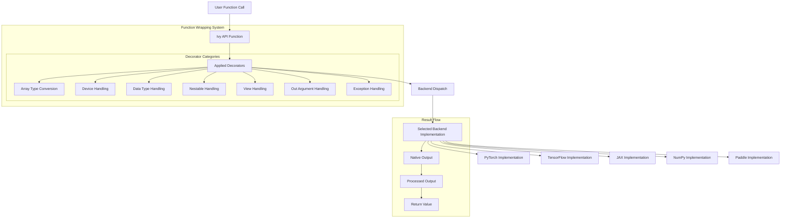
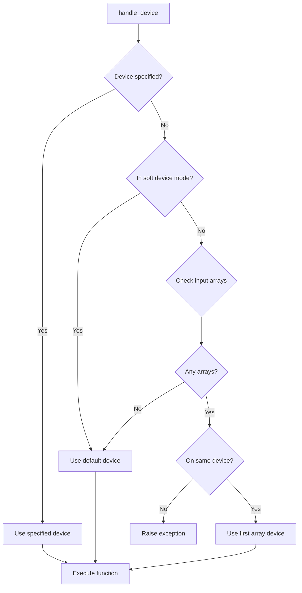
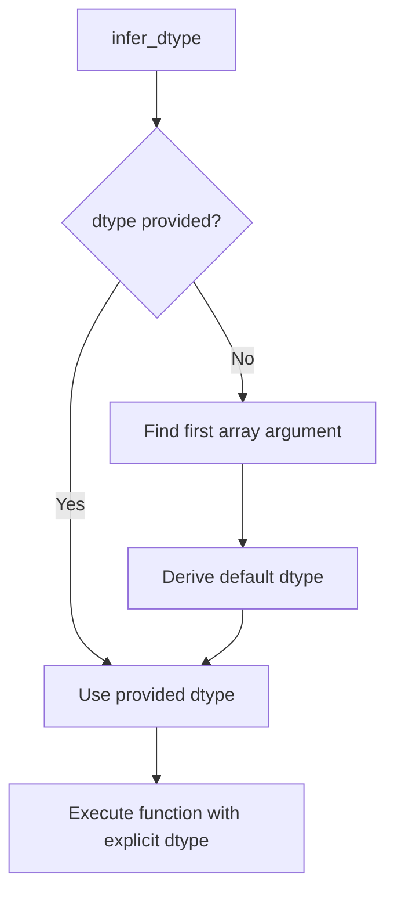
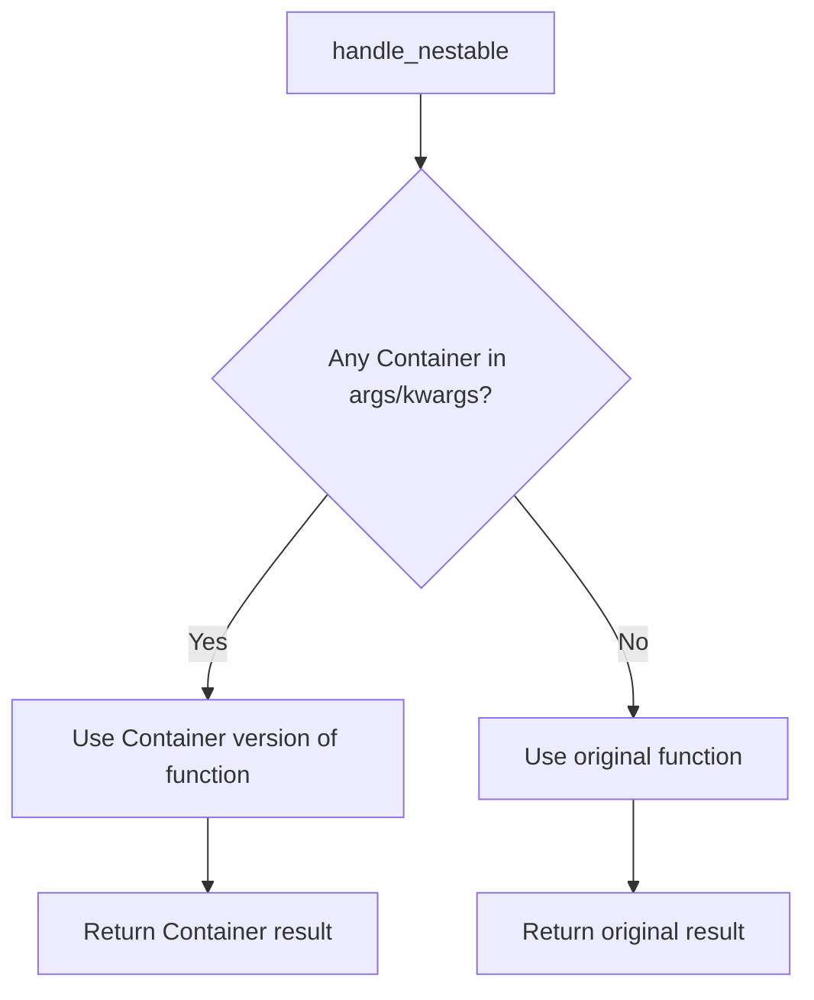
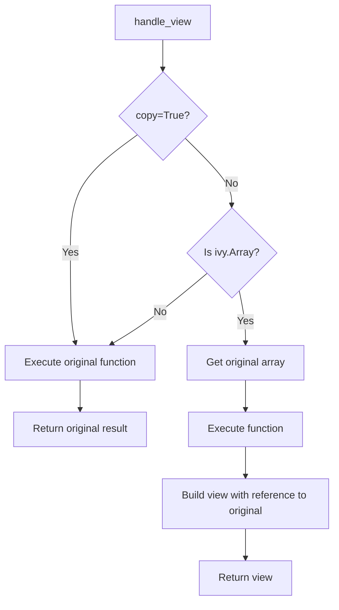
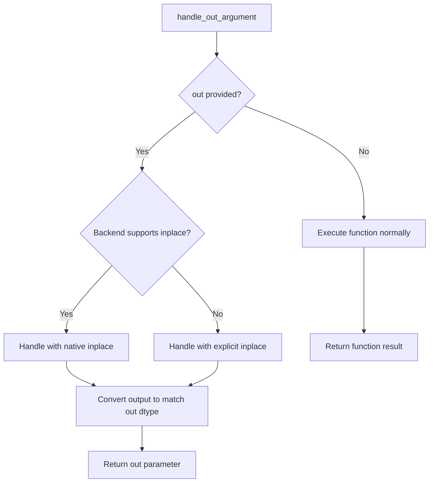
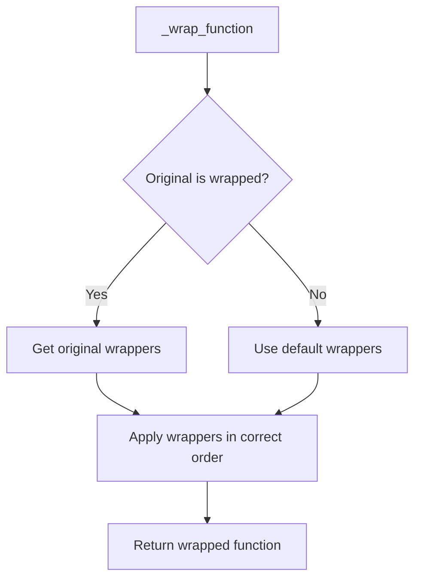
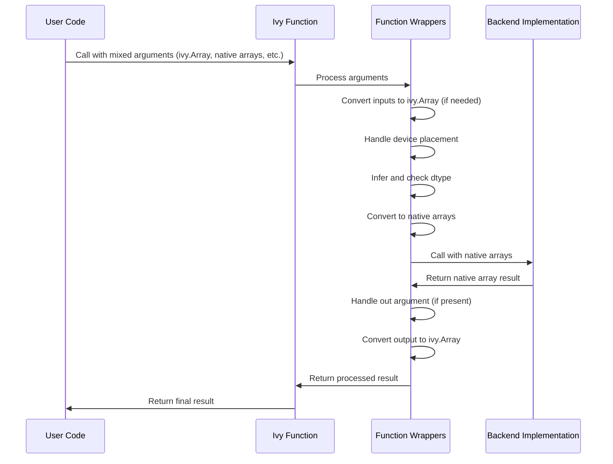

<!-- source: DeepWiki mcp.deepwiki.com · repo ivy-llc/ivy · page 3.2 Function Wrapping System · fetched 2026-10-21 -->

# Function Wrapping System

Relevant source files

The following files were used as context for generating this wiki page:

- [ivy/__init__.py](ivy/__init__.py)
- [ivy/func_wrapper.py](ivy/func_wrapper.py)
- [ivy/functional/backends/jax/__init__.py](ivy/functional/backends/jax/__init__.py)
- [ivy/functional/backends/mxnet/__init__.py](ivy/functional/backends/mxnet/__init__.py)
- [ivy/functional/backends/numpy/__init__.py](ivy/functional/backends/numpy/__init__.py)
- [ivy/functional/backends/tensorflow/__init__.py](ivy/functional/backends/tensorflow/__init__.py)
- [ivy/functional/backends/torch/__init__.py](ivy/functional/backends/torch/__init__.py)
- [ivy/functional/ivy/__init__.py](ivy/functional/ivy/__init__.py)

## Purpose and Scope

The Function Wrapping System is a core component of Ivy's backend architecture that applies decorator functions to enhance and standardize the behavior of Ivy functions across different backend frameworks (PyTorch, TensorFlow, JAX, NumPy, etc.). This system enables Ivy to maintain consistent functionality regardless of which backend is currently active, handling tasks such as array type conversion, device placement, data type inference, and more.

This document covers the structure, components, and workflow of the Function Wrapping System. For information about the broader Backend System, see [Backend System](#3).

## System Overview

The Function Wrapping System works by applying a series of decorator functions to Ivy's functional API. These decorators add behaviors such as converting between array types, handling device placement, ensuring proper data type handling, supporting nestable containers, and managing inplace updates.

### High-Level Architecture

Sources: [ivy/func_wrapper.py:16-39](), [ivy/functional/backends/jax/__init__.py:57-67](), [ivy/functional/backends/torch/__init__.py:23-27](), [ivy/functional/backends/numpy/__init__.py:19-23](), [ivy/functional/backends/tensorflow/__init__.py:96-103]()

## Decorator Definition and Order

The Function Wrapping System defines a sequence of function decorators that are applied in a specific order. The order is crucial for ensuring correct behavior, as each decorator may depend on transformations performed by previous ones.

```mermaid
flowchart TD
    Function["Original Function"] --> Wrapped["Wrapped Function"]
    
    subgraph "Wrapper Application Order"
        direction LR
        D1["handle_complex_input"] --> D2["handle_device"]
        D2 --> D3["infer_dtype"]
        D3 --> D4["handle_array_function"]
        D4 --> D5["outputs_to_ivy_arrays"]
        D5 --> D6["outputs_to_ivy_shapes"]
        D6 --> D7["outputs_to_native_arrays"]
        D7 --> D8["inputs_to_native_arrays"]
        D8 --> D9["inputs_to_native_shapes"]
        D9 --> D10["inputs_to_ivy_arrays"]
        D10 --> D11["handle_out_argument"]
        D11 --> D12["handle_view_indexing"]
        D12 --> D13["handle_view"]
        D13 --> D14["handle_array_like_without_promotion"]
        D14 --> D15["handle_partial_mixed_function"]
        D15 --> D16["handle_nestable"]
        D16 --> D17["handle_ragged"]
        D17 --> D18["handle_backend_invalid"]
        D18 --> D19["temp_asarray_wrapper"]
        D19 --> D20["handle_exceptions"]
        D20 --> D21["handle_nans"]
    end
```

Sources: [ivy/func_wrapper.py:16-39]()

## Core Decorator Categories

The Function Wrapping System includes several categories of decorators, each responsible for specific functionality.

### Array Type Conversion

These decorators handle conversion between native arrays (from frameworks like PyTorch, TensorFlow, etc.) and Ivy arrays.

| Decorator | Description |
|-----------|-------------|
| `inputs_to_native_arrays` | Converts Ivy arrays in input arguments to native arrays of the active backend |
| `inputs_to_ivy_arrays` | Converts native arrays in input arguments to Ivy arrays |
| `outputs_to_ivy_arrays` | Converts native arrays in function outputs to Ivy arrays |
| `outputs_to_native_arrays` | Converts Ivy arrays in function outputs to native arrays |

Sources: [ivy/func_wrapper.py:381-570]()

### Device Handling

The device handling decorator ensures that arrays are placed on the correct device before function execution.

Sources: [ivy/func_wrapper.py:726-771]()

### Data Type Handling

The `infer_dtype` decorator determines the appropriate data type for function execution.

Sources: [ivy/func_wrapper.py:689-719]()

### Nestable Function Handling

The `handle_nestable` decorator allows functions to work with Ivy Containers, recursively applying the function to container elements.

Sources: [ivy/func_wrapper.py:871-913]()

### View Handling

View handling decorators provide special treatment for functions that create views of arrays rather than new copies.

Sources: [ivy/func_wrapper.py:593-621]()

### Out Argument Handling

The `handle_out_argument` decorator manages functions with an `out` parameter for in-place updates.

Sources: [ivy/func_wrapper.py:778-838]()

## Wrapping Process

The Function Wrapping System uses the `_wrap_function` function to apply the appropriate sequence of decorators to backend-specific implementations.

Sources: [ivy/func_wrapper.py:1032-1167]()

## Backend-Specific Considerations

Different backends have different characteristics that the Function Wrapping System must account for:

| Backend | Native Inplace Support | Supports Gradients | Notes |
|---------|------------------------|-------------------|-------|
| NumPy | Yes | No | CPU only |
| JAX | No | Yes | Functional design requires special view handling |
| TensorFlow | No | Yes | Shape handling requires special support |
| PyTorch | Yes | Yes | Supports native torch.Tensor operations |
| Paddle | Yes | Yes | Has similar API to PyTorch |

Sources: [ivy/functional/backends/jax/__init__.py:187-189](), [ivy/functional/backends/torch/__init__.py:130-132](), [ivy/functional/backends/numpy/__init__.py:133-135](), [ivy/functional/backends/tensorflow/__init__.py:214-216](), [ivy/functional/backends/mxnet/__init__.py:157-158]()

## Functions and Their Decorators

The table below shows some common decorators and their applications:

| Function Type | Common Decorators |
|---------------|-------------------|
| Array Creation | `handle_device`, `infer_dtype`, `inputs_to_native_arrays`, `outputs_to_ivy_arrays` |
| Elementwise Operations | `handle_device`, `handle_out_argument`, `handle_nestable`, `handle_array_like_without_promotion` |
| Linear Algebra | `handle_device`, `infer_dtype`, `inputs_to_native_arrays`, `outputs_to_ivy_arrays` |
| Neural Network Layers | `handle_device`, `infer_dtype`, `handle_nestable` |

Sources: [ivy/func_wrapper.py:16-39](), [ivy/functional/ivy/__init__.py:1-58]()

## Array Type Flow During Function Execution

The diagram below shows how arrays flow through the wrappers during function execution:

Sources: [ivy/func_wrapper.py:381-570]()

## Conclusion

The Function Wrapping System is a critical component of Ivy that enables consistent functionality across multiple backend frameworks. By applying a series of decorators in a specific order, it handles various aspects of function execution including array conversion, device placement, data type inference, nestable container support, and more.

This system is what allows Ivy's framework-agnostic API to operate seamlessly, abstracting away the differences between various frameworks and providing a unified interface for machine learning operations.

---

