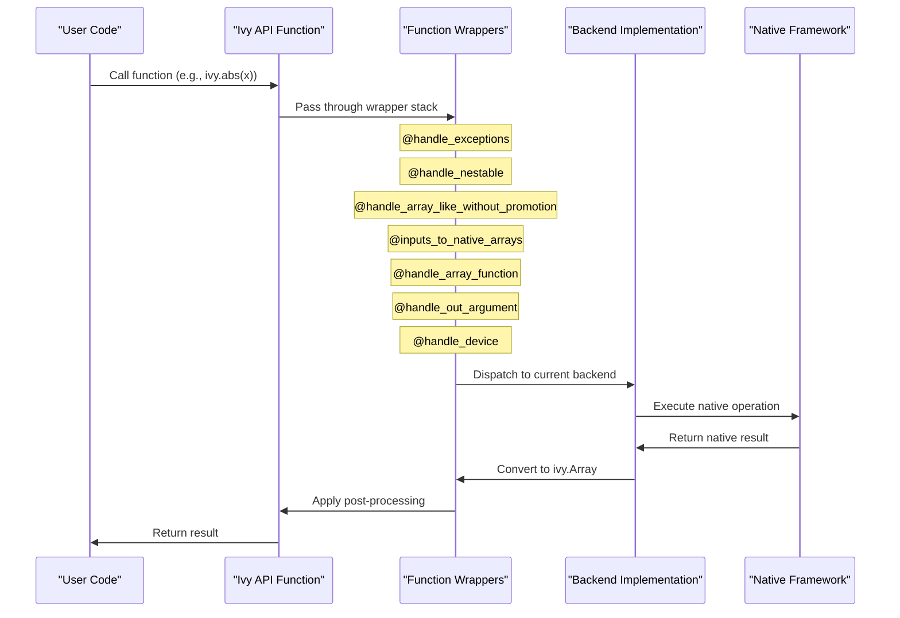
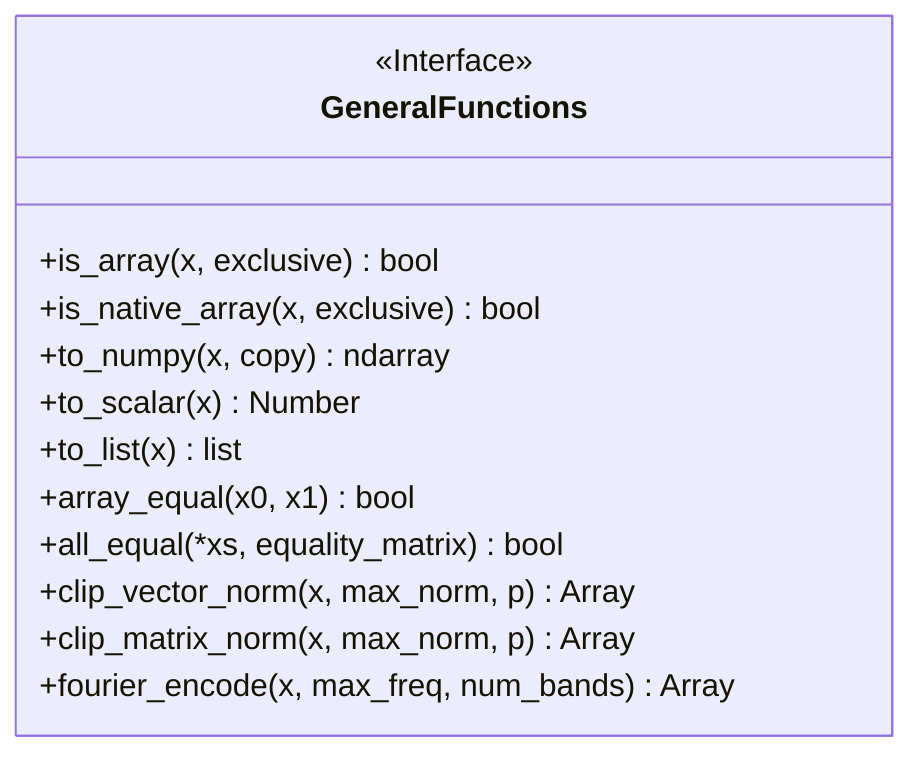
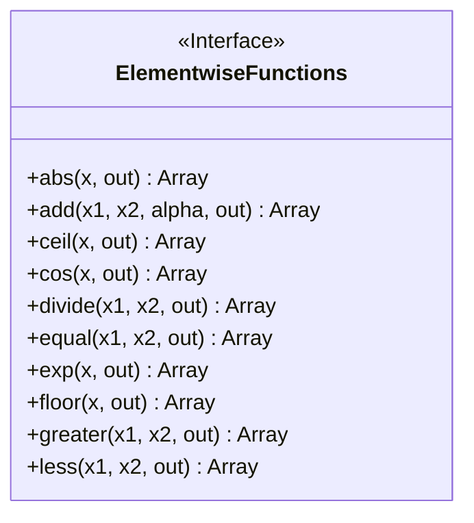
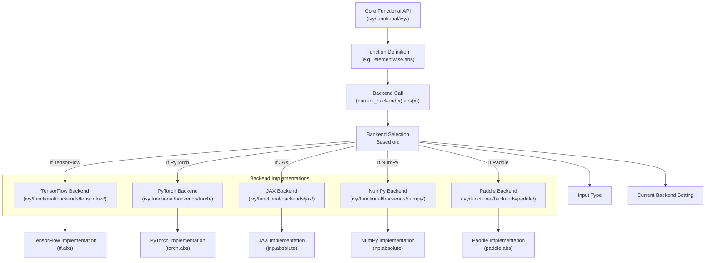
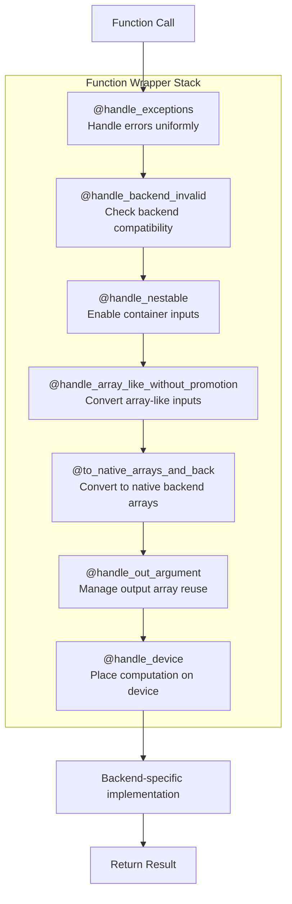
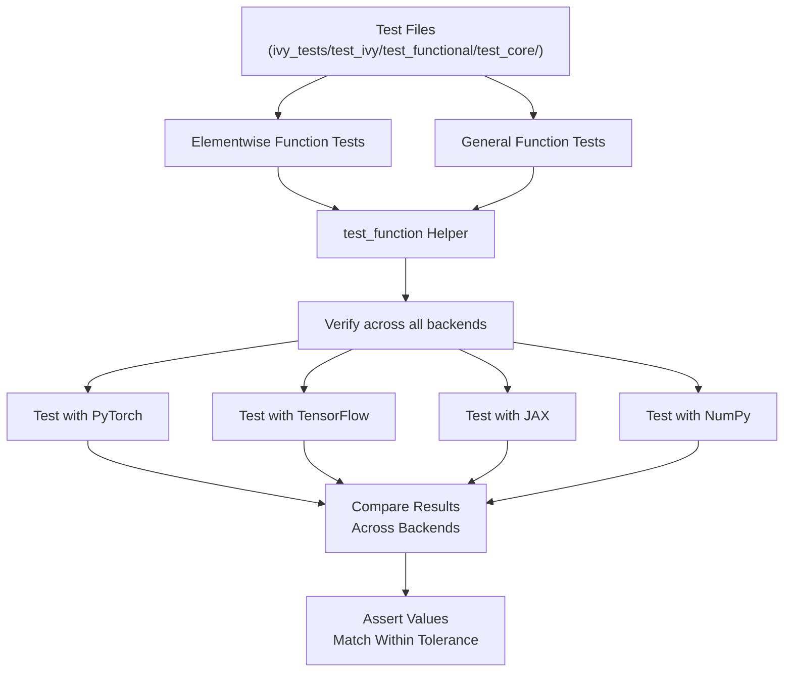

<!-- source: DeepWiki mcp.deepwiki.com · repo ivy-llc/ivy · page 4 Core Functional API · fetched 2026-10-21 -->

# Core Functional API

<details>
<summary>Relevant source files</summary>

The following files were used as context for generating this wiki page:

- [ivy/data_classes/array/elementwise.py](ivy/data_classes/array/elementwise.py)
- [ivy/data_classes/container/elementwise.py](ivy/data_classes/container/elementwise.py)
- [ivy/functional/backends/jax/elementwise.py](ivy/functional/backends/jax/elementwise.py)
- [ivy/functional/backends/jax/general.py](ivy/functional/backends/jax/general.py)
- [ivy/functional/backends/mxnet/elementwise.py](ivy/functional/backends/mxnet/elementwise.py)
- [ivy/functional/backends/mxnet/general.py](ivy/functional/backends/mxnet/general.py)
- [ivy/functional/backends/numpy/elementwise.py](ivy/functional/backends/numpy/elementwise.py)
- [ivy/functional/backends/numpy/general.py](ivy/functional/backends/numpy/general.py)
- [ivy/functional/backends/paddle/elementwise.py](ivy/functional/backends/paddle/elementwise.py)
- [ivy/functional/backends/paddle/general.py](ivy/functional/backends/paddle/general.py)
- [ivy/functional/backends/tensorflow/elementwise.py](ivy/functional/backends/tensorflow/elementwise.py)
- [ivy/functional/backends/tensorflow/general.py](ivy/functional/backends/tensorflow/general.py)
- [ivy/functional/backends/torch/elementwise.py](ivy/functional/backends/torch/elementwise.py)
- [ivy/functional/backends/torch/general.py](ivy/functional/backends/torch/general.py)
- [ivy/functional/ivy/elementwise.py](ivy/functional/ivy/elementwise.py)
- [ivy/functional/ivy/general.py](ivy/functional/ivy/general.py)
- [ivy_tests/test_ivy/test_functional/test_core/test_elementwise.py](ivy_tests/test_ivy/test_functional/test_core/test_elementwise.py)
- [ivy_tests/test_ivy/test_functional/test_core/test_general.py](ivy_tests/test_ivy/test_functional/test_core/test_general.py)

</details>


The Core Functional API is the heart of the Ivy framework, providing a comprehensive set of framework-agnostic mathematical operations that serve as the foundation for building higher-level functionality. This API is designed to work consistently across different machine learning frameworks by abstracting away backend-specific implementations while maintaining a unified interface.

## Overview

The Core Functional API provides fundamental operations that work with arrays across different ML frameworks. It includes categories such as elementwise functions, linear algebra operations, array creation utilities, data type handling, array manipulation, and neural network layers.

```mermaid
graph TD
    subgraph "Core Functional API Overview"
        CoreAPI["Core Functional API"]
        CoreAPI --> General["General Functions"]
        CoreAPI --> Elementwise["Elementwise Functions"]
        CoreAPI --> LinearAlgebra["Linear Algebra"]
        CoreAPI --> Creation["Array Creation"]
        CoreAPI --> DataType["Data Type System"]
        CoreAPI --> Manipulation["Array Manipulation"]
        CoreAPI --> NNLayers["Neural Network Layers"]
    end
    
    General --> |"includes"| Utils["Utility Functions"]
    General --> |"includes"| TypeConv["Type Conversion"]
    General --> |"includes"| DeviceHandling["Device Handling"]
    
    Elementwise --> |"includes"| Math["Mathematical Operations"]
    Elementwise --> |"includes"| Logic["Logical Operations"]
    Elementwise --> |"includes"| Comparison["Comparison Operations"]
    
    LinearAlgebra --> |"includes"| MatrixOps["Matrix Operations"]
    LinearAlgebra --> |"includes"| Decomp["Matrix Decompositions"]
    
    Creation --> |"includes"| ArrayConstr["Array Construction"]
    
    DataType --> |"includes"| TypeInfer["Type Inference"]
    DataType --> |"includes"| TypeProm["Type Promotion"]
    
    Manipulation --> |"includes"| Reshape["Reshape Operations"]
    Manipulation --> |"includes"| Concat["Concatenation Operations"]
    
    NNLayers --> |"includes"| Linear["Linear Layers"]
    NNLayers --> |"includes"| Conv["Convolutional Layers"]
    NNLayers --> |"includes"| Activ["Activation Functions"]
```



Sources:
- [ivy/functional/ivy/general.py:1-1346](ivy/functional/ivy/general.py:1-1346)
- [ivy/functional/ivy/elementwise.py:1-500](ivy/functional/ivy/elementwise.py:1-500)

## Function Execution Flow

When you call a function from the Core Functional API, it goes through several layers of processing before the actual computation is performed:



Sources:
- [ivy/functional/ivy/general.py:633-678](ivy/functional/ivy/general.py:633-678)
- [ivy/functional/ivy/elementwise.py:25-125](ivy/functional/ivy/elementwise.py:25-125)

## Function Categories

### General Functions

General functions provide utilities for array checking, conversions, mode settings, and special operations.

Key functions include:
- Array type checking: `is_array`, `is_native_array`
- Conversion functions: `to_numpy`, `to_scalar`, `to_list`
- Array comparison: `array_equal`, `all_equal`
- Vector operations: `clip_vector_norm`, `clip_matrix_norm`
- Data encoding: `fourier_encode`



Sources:
- [ivy/functional/ivy/general.py:280-347](ivy/functional/ivy/general.py:280-347)
- [ivy/functional/ivy/general.py:633-778](ivy/functional/ivy/general.py:633-778)
- [ivy/functional/ivy/general.py:971-1069](ivy/functional/ivy/general.py:971-1069)
- [ivy/functional/ivy/general.py:1157-1307](ivy/functional/ivy/general.py:1157-1307)

### Elementwise Functions

Elementwise functions perform operations on individual elements of arrays, such as mathematical operations, comparisons, and bitwise manipulations.

Key functions include:
- Basic arithmetic: `add`, `subtract`, `multiply`, `divide` 
- Mathematical functions: `abs`, `exp`, `log`, `cos`, `sin`
- Comparison operations: `equal`, `greater`, `less`
- Rounding operations: `floor`, `ceil`



Sources:
- [ivy/functional/ivy/elementwise.py:25-144](ivy/functional/ivy/elementwise.py:25-144)
- [ivy/functional/ivy/elementwise.py:347-494](ivy/functional/ivy/elementwise.py:347-494)
- [ivy_tests/test_ivy/test_functional/test_core/test_elementwise.py:164-201](ivy_tests/test_ivy/test_functional/test_core/test_elementwise.py:164-201)

## Backend System Integration

The Core Functional API is implemented across multiple backends, allowing seamless switching between different frameworks:



Sources:
- [ivy/functional/ivy/elementwise.py:125](ivy/functional/ivy/elementwise.py:125)
- [ivy/functional/backends/tensorflow/elementwise.py:12-23](ivy/functional/backends/tensorflow/elementwise.py:12-23)
- [ivy/functional/backends/torch/elementwise.py:17-42](ivy/functional/backends/torch/elementwise.py:17-42)
- [ivy/functional/backends/jax/elementwise.py:19-28](ivy/functional/backends/jax/elementwise.py:19-28)
- [ivy/functional/backends/numpy/elementwise.py:12-22](ivy/functional/backends/numpy/elementwise.py:12-22)

## Function Wrapping System

Ivy uses a sophisticated function wrapping system to handle common concerns such as type conversion, device placement, and error handling:



Sources:
- [ivy/functional/ivy/elementwise.py:25-36](ivy/functional/ivy/elementwise.py:25-36)
- [ivy/functional/ivy/general.py:633-638](ivy/functional/ivy/general.py:633-638)
- [ivy/func_wrapper.py](ivy/func_wrapper.py)

## Array Classes and Method Bindings

The Core Functional API functions are also available as methods on array classes, making them more convenient to use in object-oriented style:

```mermaid
classDiagram
    class Array {
        +dtype
        +shape
        +device
        +abs() Array
        +add(other) Array
        +cos() Array
        +equal(other) Array
        +exp() Array
        ...
    }
    
    class Container {
        +abs() Container
        +add(other) Container
        +cos() Container
        +equal(other) Container
        +exp() Container
        ...
    }
    
    Array --> "_ArrayWithElementwise" : inherits methods
    Container --> "_ContainerWithElementwise" : inherits methods
```

Sources:
- [ivy/data_classes/array/elementwise.py:11-42](ivy/data_classes/array/elementwise.py:11-42)
- [ivy/data_classes/container/elementwise.py:9-52](ivy/data_classes/container/elementwise.py:9-52)

## Example Usage Patterns

Here are some typical usage patterns for the Core Functional API:

### Direct Function Calls

```python
# Using Core API functions directly
x = ivy.array([1.0, -2.0, 3.0])
y = ivy.array([2.0, 3.0, 4.0])

# Elementwise operations
abs_x = ivy.abs(x)                  # [1.0, 2.0, 3.0]
sum_xy = ivy.add(x, y)              # [3.0, 1.0, 7.0]
exp_x = ivy.exp(x)                  # [2.72, 0.14, 20.09]

# With out argument
result = ivy.zeros_like(x)
ivy.abs(x, out=result)              # result now contains [1.0, 2.0, 3.0]
```

### Method-Style Usage

```python
# Using methods on ivy.Array objects
x = ivy.array([1.0, -2.0, 3.0])
y = ivy.array([2.0, 3.0, 4.0])

# Elementwise operations as methods
abs_x = x.abs()                     # [1.0, 2.0, 3.0]
sum_xy = x.add(y)                   # [3.0, 1.0, 7.0]
exp_x = x.exp()                     # [2.72, 0.14, 20.09]
```

### Backend Switching

```python
# Switching backends
ivy.set_backend("torch")
x_torch = ivy.array([1.0, -2.0, 3.0])  # Creates a torch tensor internally

ivy.set_backend("tensorflow")
x_tf = ivy.array([1.0, -2.0, 3.0])     # Creates a tensorflow tensor internally

# Same API works across backends
abs_torch = ivy.abs(x_torch)  # Uses torch.abs internally
abs_tf = ivy.abs(x_tf)        # Uses tf.abs internally
```

Sources:
- [ivy/functional/ivy/elementwise.py:97-123](ivy/functional/ivy/elementwise.py:97-123)
- [ivy/functional/ivy/elementwise.py:463-492](ivy/functional/ivy/elementwise.py:463-492)
- [ivy/data_classes/array/elementwise.py:11-42](ivy/data_classes/array/elementwise.py:11-42)

## Performance and Optimization

The Core Functional API is designed to minimize overhead while providing a consistent interface across backends:

1. **Direct Backend Dispatching**: Core functions immediately delegate to the current backend implementation
2. **Native Array Handling**: Input arrays are converted to the appropriate backend's native format once, then processed
3. **Memory Reuse**: The `out` parameter allows reusing existing memory for outputs
4. **Function Caching**: Common function calls can be cached to avoid redundant computation

## Testing and Verification

The Core API functions are extensively tested across all supported backends to ensure consistent behavior:



Sources:
- [ivy_tests/test_ivy/test_functional/test_core/test_elementwise.py:164-201](ivy_tests/test_ivy/test_functional/test_core/test_elementwise.py:164-201)
- [ivy_tests/test_ivy/test_functional/test_core/test_general.py:377-407](ivy_tests/test_ivy/test_functional/test_core/test_general.py:377-407)

## Extending the Core API

When adding new functions to the Core API, you need to:

1. Define the function in the appropriate file in `ivy/functional/ivy/`
2. Implement backend-specific versions in each `ivy/functional/backends/*/` directory
3. Add appropriate function wrappers (decorators)
4. Add test cases to verify behavior across backends
5. Optionally add the function to array and container classes

This ensures that new functionality maintains the same level of framework-agnostic compatibility as existing functions.

---

