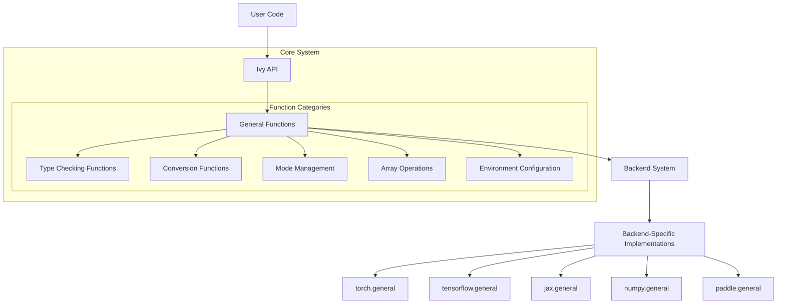
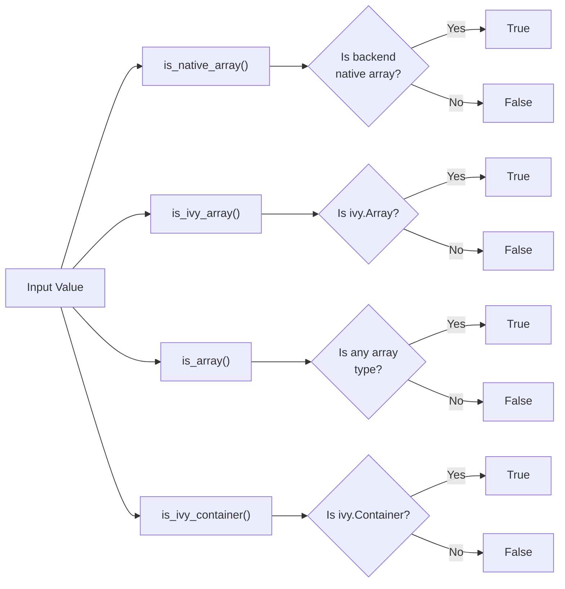
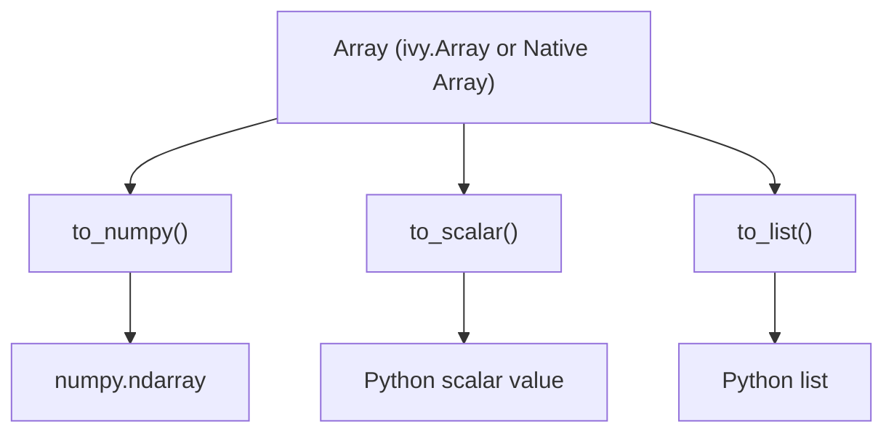
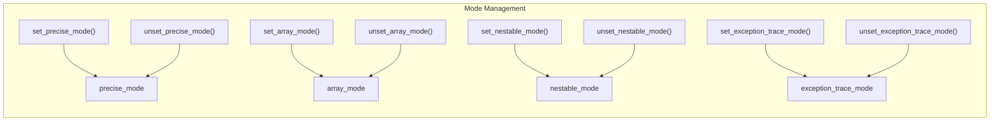
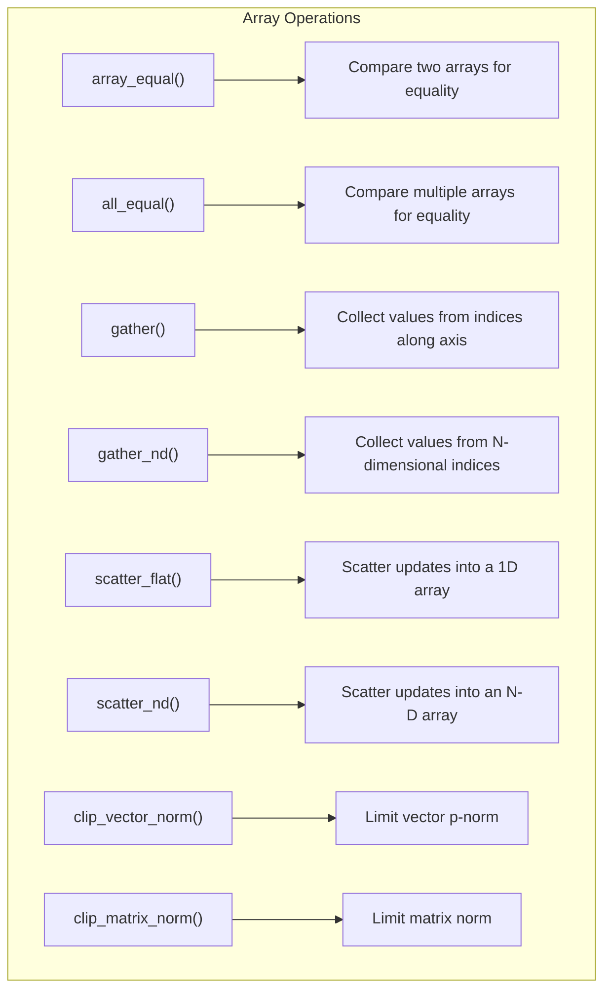
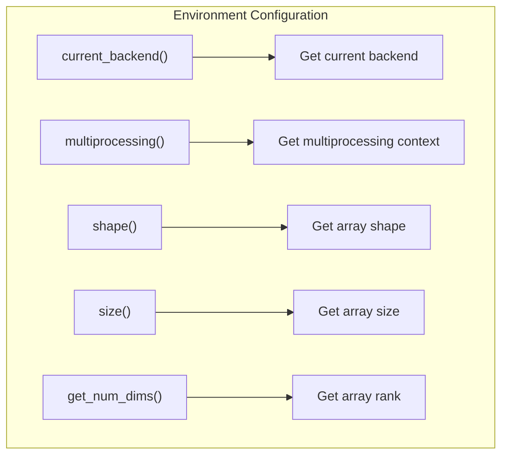
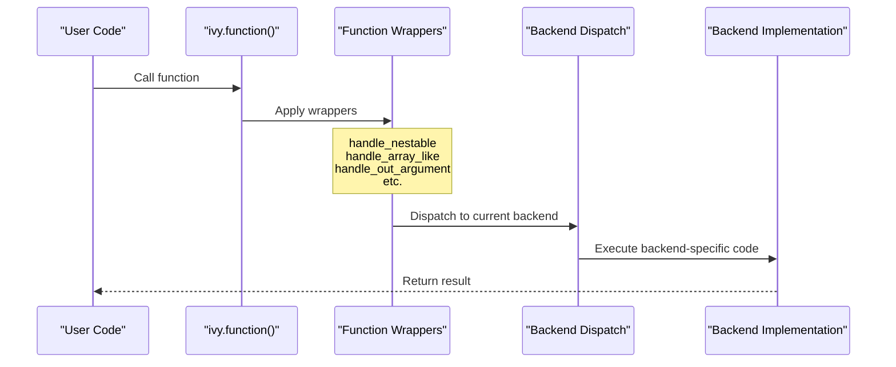
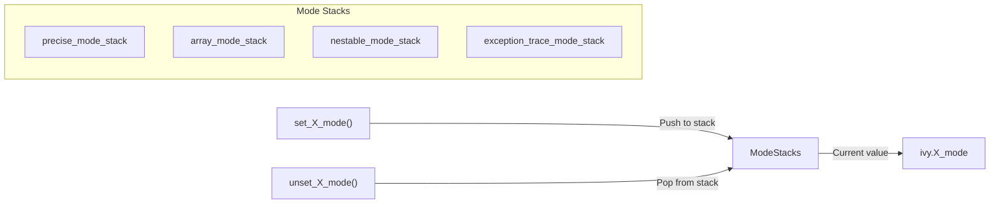

<!-- source: DeepWiki mcp.deepwiki.com · repo ivy-llc/ivy · page 4.1 General Functions · fetched 2026-10-21 -->

# General Functions

<details>
<summary>Relevant source files</summary>

The following files were used as context for generating this wiki page:

- [ivy/functional/backends/jax/general.py](ivy/functional/backends/jax/general.py)
- [ivy/functional/backends/mxnet/general.py](ivy/functional/backends/mxnet/general.py)
- [ivy/functional/backends/numpy/general.py](ivy/functional/backends/numpy/general.py)
- [ivy/functional/backends/paddle/general.py](ivy/functional/backends/paddle/general.py)
- [ivy/functional/backends/tensorflow/general.py](ivy/functional/backends/tensorflow/general.py)
- [ivy/functional/backends/torch/general.py](ivy/functional/backends/torch/general.py)
- [ivy/functional/ivy/general.py](ivy/functional/ivy/general.py)
- [ivy_tests/test_ivy/test_functional/test_core/test_general.py](ivy_tests/test_ivy/test_functional/test_core/test_general.py)

</details>


General Functions in Ivy provide a collection of fundamental utility operations that are essential for cross-framework compatibility. These functions handle common operations like array type checking, data conversion, framework configuration, and basic array utilities that are required across all numerical computation frameworks.

## Purpose and Scope

The General Functions module serves as a foundation for Ivy's unified API, enabling framework-agnostic operations that work consistently across all supported backends (PyTorch, TensorFlow, JAX, NumPy, and Paddle). These functions help developers write code that can seamlessly run on different ML frameworks without modification.

For neural network specific functions, see [Neural Network Layers](#4.7). For array creation functions, see [Array Creation Functions](#4.4).

## Architecture Overview



Sources: [ivy/functional/ivy/general.py:1-55](). [ivy/functional/backends/tensorflow/general.py:1-20](). [ivy/functional/backends/jax/general.py:1-25](). [ivy/functional/backends/torch/general.py:1-25](). [ivy/functional/backends/numpy/general.py:1-22](). [ivy/functional/backends/paddle/general.py:1-21]().

## Key Function Categories

### Type Checking Functions

These functions determine the type of arrays and variables in the system.



Sources: [ivy/functional/ivy/general.py:280-383](). [ivy/functional/backends/tensorflow/general.py:27-36](). [ivy/functional/backends/jax/general.py:54-71](). [ivy/functional/backends/torch/general.py:51-56](). [ivy/functional/backends/numpy/general.py:250-253](). [ivy/functional/backends/paddle/general.py:22-27]().

#### Key Type Checking Functions

| Function | Purpose | Example |
|----------|---------|---------|
| `is_native_array` | Checks if an input is a native array of the current backend | `ivy.is_native_array(x)` → `True` for `torch.Tensor` when PyTorch is backend |
| `is_ivy_array` | Checks if an input is an Ivy Array | `ivy.is_ivy_array(x)` → `True` for `ivy.Array` |
| `is_array` | Checks if an input is either a native array or Ivy Array | `ivy.is_array(x)` → `True` for both types |
| `is_ivy_container` | Checks if an input is an Ivy Container | `ivy.is_ivy_container(x)` → `True` for `ivy.Container` |

### Conversion Functions

These functions convert between different array types and formats.



Sources: [ivy/functional/ivy/general.py:772-968](). [ivy/functional/backends/tensorflow/general.py:114-140](). [ivy/functional/backends/jax/general.py:136-151](). [ivy/functional/backends/torch/general.py:128-178](). [ivy/functional/backends/numpy/general.py:63-77](). [ivy/functional/backends/paddle/general.py:192-222]().

#### Key Conversion Functions

| Function | Purpose | Example |
|----------|---------|---------|
| `to_numpy` | Converts an array to a NumPy array | `ivy.to_numpy(x)` → `numpy.ndarray` |
| `to_scalar` | Converts a single-element array to a scalar | `ivy.to_scalar(x)` → `3.14` |
| `to_list` | Converts an array to a nested Python list | `ivy.to_list(x)` → `[1, 2, 3]` |

### Mode Management Functions

Ivy provides various modes that control framework behavior. These functions manage those modes.



Sources: [ivy/functional/ivy/general.py:79-629]().

#### Key Mode Management Functions

| Mode | Set Function | Unset Function | Purpose |
|------|--------------|----------------|---------|
| Precise Mode | `set_precise_mode()` | `unset_precise_mode()` | Controls promotion table behavior for numerical precision |
| Array Mode | `set_array_mode()` | `unset_array_mode()` | Controls conversion between native arrays and ivy.Array |
| Nestable Mode | `set_nestable_mode()` | `unset_nestable_mode()` | Controls checking for Container inputs |
| Exception Trace Mode | `set_exception_trace_mode()` | `unset_exception_trace_mode()` | Controls exception stack trace detail level |

### Array Operations

These functions provide core operations for working with arrays.



Sources: [ivy/functional/ivy/general.py:632-1122](). [ivy/functional/backends/tensorflow/general.py:38-225](). [ivy/functional/backends/jax/general.py:131-244](). [ivy/functional/backends/torch/general.py:59-326](). [ivy/functional/backends/numpy/general.py:23-169](). [ivy/functional/backends/paddle/general.py:131-435]().

#### Key Array Operation Functions

| Function | Purpose | Example |
|----------|---------|---------|
| `array_equal` | Checks if two arrays have identical values | `ivy.array_equal(x, y)` → `True/False` |
| `all_equal` | Checks if all input arrays have identical values | `ivy.all_equal(x, y, z)` → `True/False` |
| `gather` | Gathers values along an axis according to indices | `ivy.gather(params, indices, axis=1)` |
| `gather_nd` | Gathers values using N-dimensional indices | `ivy.gather_nd(params, indices)` |
| `scatter_flat` | Scatters updates into a flat array at given indices | `ivy.scatter_flat(indices, updates, size=10)` |
| `scatter_nd` | Scatters updates into an array at N-dimensional indices | `ivy.scatter_nd(indices, updates, shape=(5,5,5))` |
| `clip_vector_norm` | Clips the vector norm of an array | `ivy.clip_vector_norm(x, max_norm=2.0)` |
| `clip_matrix_norm` | Clips the matrix norm of an array | `ivy.clip_matrix_norm(x, max_norm=2.0)` |

### Environment Configuration Functions

These functions manage the backend environment and configuration.



Sources: [ivy/functional/ivy/general.py:1255-1343](). [ivy/functional/backends/tensorflow/general.py:227-237](). [ivy/functional/backends/jax/general.py:246-252](). [ivy/functional/backends/torch/general.py:328-335](). [ivy/functional/backends/numpy/general.py:173-179](). [ivy/functional/backends/paddle/general.py:418-445]().

## Function Dispatch Mechanism

General functions in Ivy use a sophisticated dispatch mechanism to route function calls to the appropriate backend implementation:



Sources: [ivy/functional/ivy/general.py:31-52](). [ivy/functional/backends/tensorflow/general.py:6-25](). [ivy/functional/backends/jax/general.py:6-25](). [ivy/functional/backends/torch/general.py:6-25](). [ivy/functional/backends/numpy/general.py:6-20](). [ivy/functional/backends/paddle/general.py:6-20]().

## Mode Stack Implementation

Ivy uses a stack-based approach for managing modes, allowing for nested context changes:



Sources: [ivy/functional/ivy/general.py:56-73](). [ivy/functional/ivy/general.py:97-149](). [ivy/functional/ivy/general.py:413-465](). [ivy/functional/ivy/general.py:467-514](). [ivy/functional/ivy/general.py:517-570]().

## Common Utility Functions

### Array Checking and Comparison

```python
# Check if an input is a native array
is_native_array(x, exclusive=False)  # Returns boolean

# Check if two arrays are equal
array_equal(x0, x1)  # Returns boolean

# Check if multiple inputs are equal
all_equal(*xs, equality_matrix=False)  # Returns boolean or matrix
```

Sources: [ivy/functional/ivy/general.py:280-347](). [ivy/functional/ivy/general.py:633-678](). [ivy/functional/ivy/general.py:685-768]().

### Data Conversion

```python
# Convert an array to a NumPy array
to_numpy(x, copy=True)  # Returns np.ndarray

# Convert a single-element array to a scalar
to_scalar(x)  # Returns a Python number

# Convert an array to a Python list
to_list(x)  # Returns a Python list
```

Sources: [ivy/functional/ivy/general.py:772-834](). [ivy/functional/ivy/general.py:850-896](). [ivy/functional/ivy/general.py:906-968]().

### Mode Management

```python
# Context manager for setting a mode
with PreciseMode(True):
    # Code that runs with precise_mode=True
    pass  # Mode reverts to previous value after context

# Or directly setting/unsetting modes
set_array_mode(True)  # ivy.array_mode becomes True
unset_array_mode()    # ivy.array_mode reverts to previous value
```

Sources: [ivy/functional/ivy/general.py:79-95](). [ivy/functional/ivy/general.py:100-149](). [ivy/functional/ivy/general.py:169-184](). [ivy/functional/ivy/general.py:417-464]().

## Backend-Specific Implementation Details

Different backends implement general functions with varying approaches to match their frameworks' idioms:

| Function | PyTorch | TensorFlow | JAX | NumPy | Paddle |
|----------|---------|------------|-----|-------|--------|
| `is_native_array` | Checks `isinstance(x, torch.Tensor)` | Checks `isinstance(x, (tf.Tensor, tf.Variable))` | Checks `isinstance(x, (jnp.ndarray, jax.interpreters.ad.JVPTracer))` | Checks `isinstance(x, (np.ndarray, np.generic))` | Checks `isinstance(x, paddle.Tensor)` |
| `to_numpy` | Uses `.detach().cpu().numpy()` | Uses `.numpy()` | Uses `np.array(_to_array(x))` | Returns copy or original | Uses direct numpy conversion |
| `gather` | Uses `torch.gather` with shape handling | Uses `tf.gather` | Implements through `jnp.take` | Uses `np.take` | Implements custom gather |

Sources: [ivy/functional/backends/tensorflow/general.py:27-155](). [ivy/functional/backends/jax/general.py:54-183](). [ivy/functional/backends/torch/general.py:51-265](). [ivy/functional/backends/numpy/general.py:23-109](). [ivy/functional/backends/paddle/general.py:22-286]().

## Conclusion

General Functions in Ivy provide the essential utilities for cross-framework compatibility. They handle fundamental operations like type checking, data conversion, and environment configuration, allowing the rest of the Ivy ecosystem to build more complex functionality on a stable foundation. These functions abstract away the differences between backend frameworks, providing a consistent API for all array-related operations.

---

