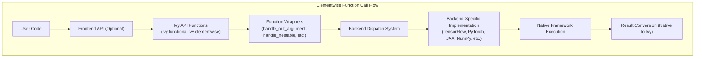
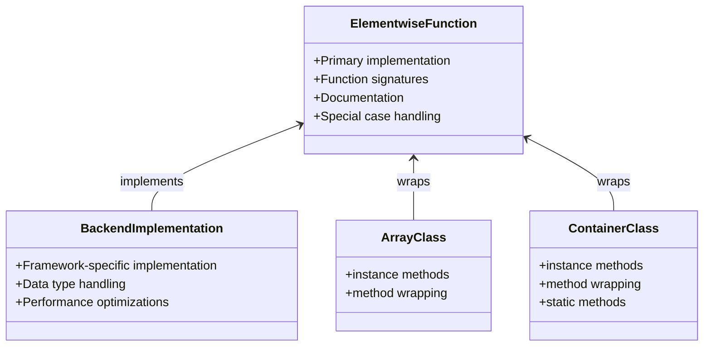
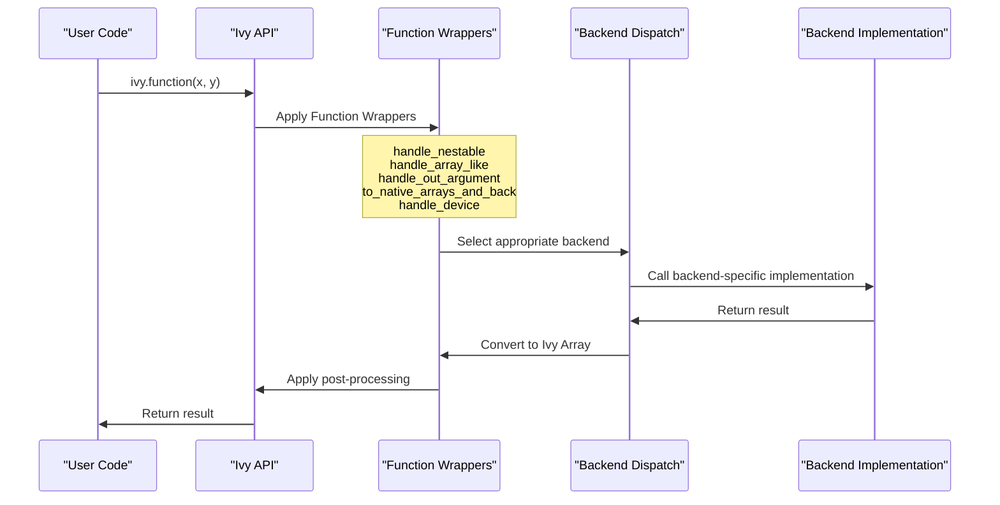

<!-- source: DeepWiki mcp.deepwiki.com · repo ivy-llc/ivy · page 4.2 Elementwise Functions · fetched 2026-10-21 -->

# Elementwise Functions

<details>
<summary>Relevant source files</summary>

The following files were used as context for generating this wiki page:

- [ivy/data_classes/array/elementwise.py](ivy/data_classes/array/elementwise.py)
- [ivy/data_classes/container/elementwise.py](ivy/data_classes/container/elementwise.py)
- [ivy/functional/backends/jax/elementwise.py](ivy/functional/backends/jax/elementwise.py)
- [ivy/functional/backends/mxnet/elementwise.py](ivy/functional/backends/mxnet/elementwise.py)
- [ivy/functional/backends/numpy/elementwise.py](ivy/functional/backends/numpy/elementwise.py)
- [ivy/functional/backends/paddle/elementwise.py](ivy/functional/backends/paddle/elementwise.py)
- [ivy/functional/backends/tensorflow/elementwise.py](ivy/functional/backends/tensorflow/elementwise.py)
- [ivy/functional/backends/torch/elementwise.py](ivy/functional/backends/torch/elementwise.py)
- [ivy/functional/ivy/elementwise.py](ivy/functional/ivy/elementwise.py)
- [ivy_tests/test_ivy/test_functional/test_core/test_elementwise.py](ivy_tests/test_ivy/test_functional/test_core/test_elementwise.py)

</details>


Elementwise functions in Ivy are core mathematical operations that apply transformations independently to each element of an array or container. These functions form a fundamental building block in the Ivy library and provide the basis for many higher-level numerical operations.

This page documents the architecture, implementation, and usage of Ivy's elementwise function system. For information about linear algebra operations, see [Linear Algebra Functions](#4.3), and for general utility functions, see [General Functions](#4.1).

## Overview and Purpose

Elementwise functions in Ivy provide a consistent interface for performing element-by-element operations across different backend frameworks (PyTorch, TensorFlow, JAX, NumPy, etc.). These functions include:

- Basic arithmetic operations (add, subtract, multiply, divide)
- Trigonometric and inverse trigonometric functions (sin, cos, asin, acos)
- Hyperbolic and inverse hyperbolic functions (sinh, cosh, asinh, acosh)
- Exponential and logarithmic functions (exp, log, log10)
- Logical operations (logical_and, logical_or, logical_not)
- Comparison operations (equal, less, greater)
- Bitwise operations (bitwise_and, bitwise_or, bitwise_xor)
- Other mathematical functions (abs, sqrt, round, ceil, floor)

These functions enable array manipulation and computation while maintaining framework agnosticism, allowing users to write code that works consistently across all supported backend frameworks.

Sources: [ivy/functional/ivy/elementwise.py:21-125](), [ivy/functional/ivy/elementwise.py:129-345](), [ivy/functional/ivy/elementwise.py:348-583]()

## Architecture and Implementation

The elementwise function system follows Ivy's layered architecture pattern, with implementations at multiple levels:

### Elementwise Function Architecture



Sources: [ivy/functional/ivy/elementwise.py:25-34](), [ivy/functional/ivy/elementwise.py:129-139]()

### Primary Components



Sources: [ivy/functional/ivy/elementwise.py](), [ivy/functional/backends/torch/elementwise.py](), [ivy/functional/backends/tensorflow/elementwise.py](), [ivy/data_classes/array/elementwise.py](), [ivy/data_classes/container/elementwise.py]()

### Core Implementation

The primary implementation of each elementwise function is defined in `ivy/functional/ivy/elementwise.py`. These implementations include:

1. Type annotations and function signatures
2. Comprehensive docstrings with parameter descriptions
3. Special case handling documentation
4. Function wrappers for handling:
   - Input type conversions
   - Output array handling
   - Nestable operations
   - Device placement
   - Backend invalidation
   - Array-like input handling

For example, the `abs` function definition includes wrappers for these cross-cutting concerns:

```python
@handle_exceptions
@handle_backend_invalid
@handle_nestable
@handle_array_like_without_promotion
@handle_out_argument
@to_native_arrays_and_back
@handle_array_function
@handle_device
def abs(
    x: Union[float, ivy.Array, ivy.NativeArray],
    /,
    *,
    out: Optional[ivy.Array] = None,
) -> ivy.Array:
    # Function implementation...
```

Sources: [ivy/functional/ivy/elementwise.py:25-125]()

### Backend Implementations

Each backend framework has its own implementation of the elementwise functions, tailored to the specific API and behavior of that framework. These implementations are found in:

- `ivy/functional/backends/tensorflow/elementwise.py`
- `ivy/functional/backends/torch/elementwise.py`
- `ivy/functional/backends/numpy/elementwise.py`
- `ivy/functional/backends/jax/elementwise.py`
- `ivy/functional/backends/paddle/elementwise.py`
- `ivy/functional/backends/mxnet/elementwise.py`

Backend implementations handle framework-specific edge cases and ensure consistent behavior across different frameworks.

Sources: [ivy/functional/backends/tensorflow/elementwise.py:13-34](), [ivy/functional/backends/torch/elementwise.py:17-75](), [ivy/functional/backends/numpy/elementwise.py:13-40]()

## Function Categories

Elementwise functions in Ivy can be grouped into several categories:

### Arithmetic Operations

Basic mathematical operations that form the foundation of numerical computing:

| Function | Description | Example |
|----------|-------------|---------|
| `add` | Adds two arrays element-wise | `ivy.add(x, y)` |
| `subtract` | Subtracts one array from another | `ivy.subtract(x, y)` |
| `multiply` | Multiplies two arrays element-wise | `ivy.multiply(x, y)` |
| `divide` | Divides one array by another | `ivy.divide(x, y)` |
| `floor_divide` | Integer division with floor rounding | `ivy.floor_divide(x, y)` |
| `negative` | Numerical negation | `ivy.negative(x)` |
| `positive` | Identity operation | `ivy.positive(x)` |

Sources: [ivy/functional/ivy/elementwise.py:347-494](), [ivy/functional/ivy/elementwise.py:729-798]()

### Trigonometric and Hyperbolic Functions

Functions related to angles, circles, and hyperbolic geometry:

| Function Group | Functions |
|----------------|-----------|
| Trigonometric | `sin`, `cos`, `tan` |
| Inverse Trigonometric | `asin`, `acos`, `atan`, `atan2` |
| Hyperbolic | `sinh`, `cosh`, `tanh` |
| Inverse Hyperbolic | `asinh`, `acosh`, `atanh` |

Sources: [ivy/functional/ivy/elementwise.py:136-346](), [ivy/functional/ivy/elementwise.py:502-623]()

### Logical and Comparison Operations

Functions for comparing values and performing logical operations:

| Function Group | Functions |
|----------------|-----------|
| Comparison | `equal`, `not_equal`, `greater`, `greater_equal`, `less`, `less_equal` |
| Logical | `logical_and`, `logical_or`, `logical_not`, `logical_xor` |

Sources: [ivy/functional/ivy/elementwise.py:692-802](), [ivy/functional/ivy/elementwise.py:2453-2579]()

### Bitwise Operations

Operations on the binary representation of integers:

| Function | Description |
|----------|-------------|
| `bitwise_and` | Bitwise AND |
| `bitwise_or` | Bitwise OR |
| `bitwise_xor` | Bitwise XOR |
| `bitwise_invert` | Bitwise NOT/inversion |
| `bitwise_left_shift` | Binary left shift |
| `bitwise_right_shift` | Binary right shift |

Sources: [ivy/functional/ivy/elementwise.py:1174-1520]()

### Mathematical Functions

Various mathematical functions applicable to numerical data:

| Function Group | Examples |
|----------------|----------|
| Exponential | `exp`, `expm1`, `exp2` |
| Logarithmic | `log`, `log10`, `log2`, `log1p`, `logaddexp`, `logaddexp2` |
| Rounding | `ceil`, `floor`, `round`, `trunc` |
| Special | `abs`, `sqrt`, `pow`, `sign`, `gcd`, `lcm` |

Sources: [ivy/functional/ivy/elementwise.py:583-691](), [ivy/functional/ivy/elementwise.py:803-966]()

## Function Call Flow

When an elementwise function is called, it goes through several stages:



Sources: [ivy/functional/ivy/elementwise.py:25-34](), [ivy/functional/backends/torch/elementwise.py:23-40]()

## Special Considerations

### Type Promotion

Many elementwise functions support automatic type promotion when operating on arrays of different data types. For example, when adding a float array and an integer array, the result will be a float array.

```python
x = ivy.array([1, 2, 3])        # int32 array
y = ivy.array([1.5, 2.5, 3.5])  # float32 array
z = ivy.add(x, y)               # Result is float32
```

The type promotion rules follow established conventions from NumPy and are consistent across all backends.

Sources: [ivy/functional/ivy/elementwise.py:32-54](), [ivy/functional/backends/tensorflow/elementwise.py:53-59]()

### Special Values

Elementwise functions include detailed documentation on how they handle special values such as:
- NaN (Not a Number)
- Infinity (positive and negative)
- Zero (positive and negative)

These behaviors are standardized according to the Array API Standard where applicable.

Sources: [ivy/functional/ivy/elementwise.py:47-67](), [ivy/functional/ivy/elementwise.py:367-396]()

### Broadcasting

When operating on arrays with different shapes, Ivy applies broadcasting rules to make the operation possible. This allows operations between arrays of compatible shapes without explicit reshaping.

For example, you can add a scalar to an array, or add a 1D array to a 2D array along a particular axis.

Sources: [ivy/functional/ivy/elementwise.py:72-76](), [ivy/functional/ivy/elementwise.py:436-438]()

## Usage Examples

### Basic Usage

```python
# Basic arithmetic
x = ivy.array([1, 2, 3])
y = ivy.array([4, 5, 6])
z = ivy.add(x, y)  # [5, 7, 9]

# Trigonometric functions
angles = ivy.array([0, 0.5, 1.0])
sines = ivy.sin(angles)

# Logical operations
a = ivy.array([True, False, True])
b = ivy.array([False, False, True])
result = ivy.logical_and(a, b)  # [False, False, True]
```

### Array Instance Methods

All elementwise functions are also available as instance methods on Ivy Arrays:

```python
x = ivy.array([1, 2, 3])
y = ivy.array([4, 5, 6])
z = x.add(y)  # Same as ivy.add(x, y)

angles = ivy.array([0, 0.5, 1.0])
sines = angles.sin()  # Same as ivy.sin(angles)
```

Sources: [ivy/data_classes/array/elementwise.py:11-42](), [ivy/data_classes/array/elementwise.py:102-147]()

### Container Support

Elementwise functions can also operate on Ivy Containers:

```python
container = ivy.Container(a=ivy.array([1, 2, 3]), b=ivy.array([4, 5, 6]))
result = ivy.abs(container)  # Contains absolute values of each array

# Or using instance methods
result = container.abs()
```

Sources: [ivy/data_classes/container/elementwise.py:11-128](), [ivy/data_classes/container/elementwise.py:193-251]()

## Integration with Other Systems

Elementwise functions integrate with other Ivy subsystems:

1. **Data Type System**: Functions follow type promotion rules and handle data type conversions.
2. **Device System**: Operations respect device placement (CPU, GPU, etc.).
3. **Array API Standard**: Functions adhere to the Array API Standard where applicable.
4. **Backend System**: Functions are dispatched to the appropriate backend implementation.

This integration ensures that elementwise operations work consistently across different contexts and configurations.

Sources: [ivy/functional/ivy/elementwise.py:4-19](), [ivy/functional/backends/tensorflow/elementwise.py:3-10]()

## Testing

Elementwise functions are thoroughly tested with a comprehensive test suite in `ivy_tests/test_ivy/test_functional/test_core/test_elementwise.py`. The tests cover:

1. Correctness across different backends
2. Handling of special values
3. Type promotion
4. Shape broadcasting
5. Gradient computation (where applicable)

Sources: [ivy_tests/test_ivy/test_functional/test_core/test_elementwise.py:163-201](), [ivy_tests/test_ivy/test_functional/test_core/test_elementwise.py:229-255]()

## Summary

Elementwise functions form a critical building block in the Ivy library, providing the fundamental mathematical operations needed for array manipulation and numerical computing. With a consistent interface across different backend frameworks, these functions enable framework-agnostic code while maintaining high performance and adhering to established mathematical conventions.

---

