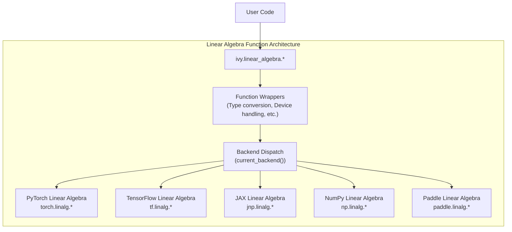
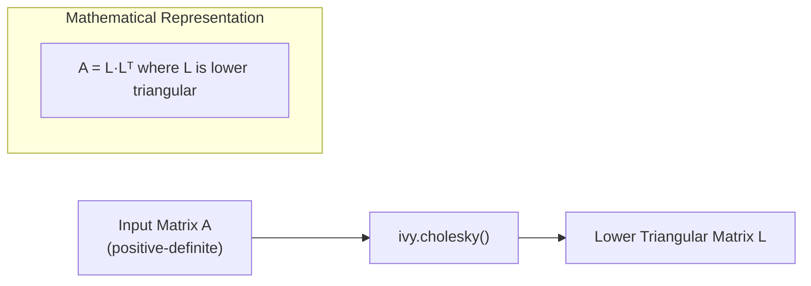
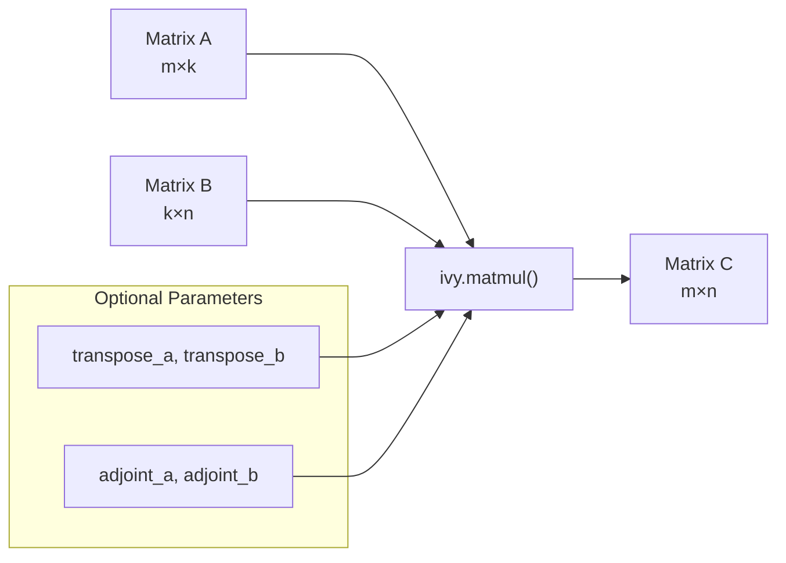
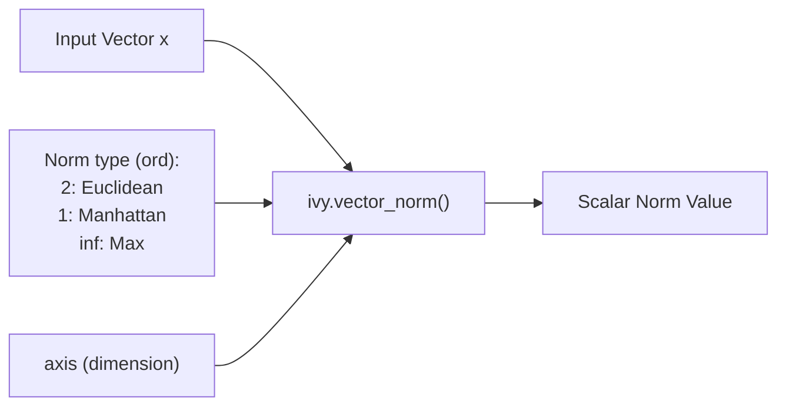
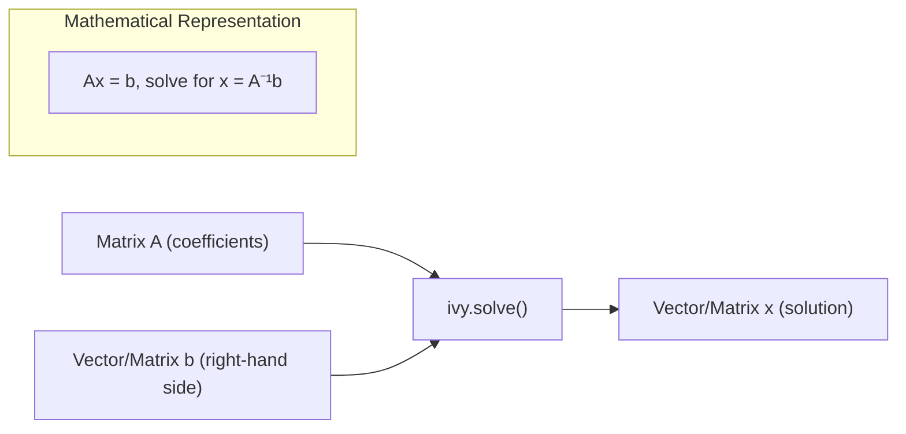
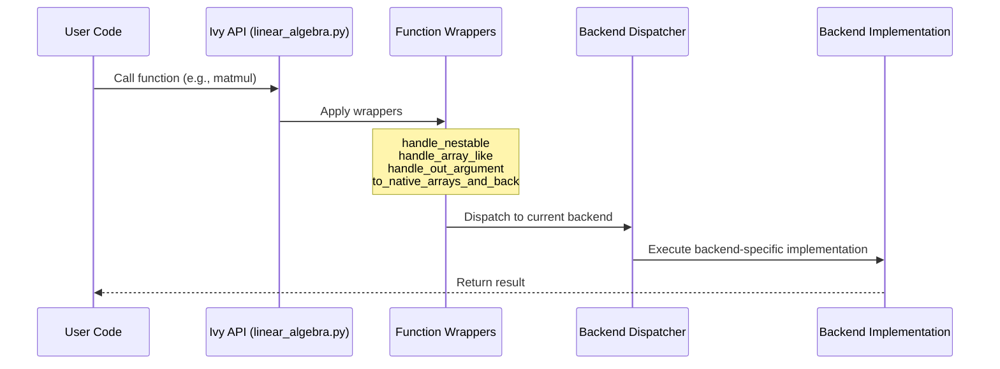

<!-- source: DeepWiki mcp.deepwiki.com · repo ivy-llc/ivy · page 4.3 Linear Algebra Functions · fetched 2026-10-21 -->

# Linear Algebra Functions

<details>
<summary>Relevant source files</summary>

The following files were used as context for generating this wiki page:

- [ivy/functional/backends/jax/linear_algebra.py](ivy/functional/backends/jax/linear_algebra.py)
- [ivy/functional/backends/mxnet/linear_algebra.py](ivy/functional/backends/mxnet/linear_algebra.py)
- [ivy/functional/backends/numpy/linear_algebra.py](ivy/functional/backends/numpy/linear_algebra.py)
- [ivy/functional/backends/paddle/linear_algebra.py](ivy/functional/backends/paddle/linear_algebra.py)
- [ivy/functional/backends/tensorflow/linear_algebra.py](ivy/functional/backends/tensorflow/linear_algebra.py)
- [ivy/functional/backends/torch/linear_algebra.py](ivy/functional/backends/torch/linear_algebra.py)
- [ivy/functional/ivy/linear_algebra.py](ivy/functional/ivy/linear_algebra.py)
- [ivy_tests/test_ivy/test_functional/test_core/test_linalg.py](ivy_tests/test_ivy/test_functional/test_core/test_linalg.py)

</details>


Linear Algebra Functions in Ivy provide a unified interface for essential matrix and vector operations across multiple backend frameworks (PyTorch, TensorFlow, JAX, NumPy, and Paddle). These functions form a core component of Ivy's mathematical capabilities, enabling consistent numerical computations regardless of the underlying framework.

For array creation functions, see [Array Creation Functions](#4.4). For elementwise operations, see [Elementwise Functions](#4.2).

## Overview and Architecture

The linear algebra module implements common operations like matrix multiplication, decompositions, determinants, and solving linear systems. All functions maintain consistent behavior across backends while leveraging each backend's optimized implementations.



Sources: [ivy/functional/ivy/linear_algebra.py:1-31](). [ivy/functional/backends/tensorflow/linear_algebra.py:1-19]()

## Function Categories

The linear algebra module is organized into several categories of related mathematical operations:

```mermaid
graph TD
    LinAlg["Linear Algebra Functions"] --> MatrixDecomp["Matrix Decompositions"]
    LinAlg --> MatrixOps["Matrix Operations"]
    LinAlg --> VectorOps["Vector Operations"]
    LinAlg --> LinearSystem["Linear System Solvers"]
    LinAlg --> UtilFuncs["Utility Functions"]
    
    MatrixDecomp --> Cholesky["cholesky()"]
    MatrixDecomp --> QR["qr()"]
    MatrixDecomp --> SVD["svd()"]
    MatrixDecomp --> Eig["eig(), eigh(), eigvalsh()"]
    
    MatrixOps --> MatMul["matmul()"]
    MatrixOps --> Det["det(), slogdet()"]
    MatrixOps --> Inv["inv()"]
    MatrixOps --> MatTrans["matrix_transpose()"]
    MatrixOps --> Trace["trace()"]
    MatrixOps --> MatPower["matrix_power()"]
    MatrixOps --> MatRank["matrix_rank()"]
    MatrixOps --> MatNorm["matrix_norm()"]
    
    VectorOps --> CrossProd["cross()"]
    VectorOps --> DotProd["inner(), vecdot()"]
    VectorOps --> OuterProd["outer()"]
    VectorOps --> VecNorm["vector_norm()"]
    
    LinearSystem --> Solve["solve()"]
    LinearSystem --> PInv["pinv()"]
    LinearSystem --> TensorSolve["tensorsolve()"]
    
    UtilFuncs --> Diagonal["diagonal()"]
    UtilFuncs --> Diag["diag()"]
    UtilFuncs --> Vander["vander()"]
    UtilFuncs --> Vec2Skew["vector_to_skew_symmetric_matrix()"]
```



Sources: [ivy/functional/ivy/linear_algebra.py:35-1128]()

### Matrix Decompositions

Matrix decompositions break down matrices into constituent parts, enabling efficient solutions to various problems.

| Function | Description | Signature |
|----------|-------------|-----------|
| `cholesky` | Computes the Cholesky decomposition of a positive-definite matrix | `cholesky(x, *, upper=False)` |
| `qr` | Computes the QR decomposition | `qr(x, *, mode="reduced")` |
| `svd` | Computes the Singular Value Decomposition | `svd(x, *, full_matrices=True, compute_uv=True)` |
| `svdvals` | Computes singular values without computing singular vectors | `svdvals(x, *, driver=None)` |
| `eigh` | Computes eigenvalues and eigenvectors of Hermitian/symmetric matrices | `eigh(x, *, UPLO="L")` |
| `eigvalsh` | Computes eigenvalues of Hermitian/symmetric matrices | `eigvalsh(x, *, UPLO="L")` |

Sources: [ivy/functional/ivy/linear_algebra.py:28-599](), [ivy/functional/backends/torch/linear_algebra.py:20-112](), [ivy/functional/backends/tensorflow/linear_algebra.py:20-154]()

#### Example: Cholesky Decomposition

The Cholesky decomposition factorizes a Hermitian, positive-definite matrix into the product of a lower triangular matrix and its conjugate transpose.



Sources: [ivy/functional/ivy/linear_algebra.py:36-165](), [ivy/functional/backends/tensorflow/linear_algebra.py:20-33]()

### Matrix Operations

Core operations applied to matrices, forming the foundation of many linear algebra algorithms.

| Function | Description | Signature |
|----------|-------------|-----------|
| `matmul` | Matrix multiplication | `matmul(x1, x2, *, transpose_a=False, transpose_b=False, adjoint_a=False, adjoint_b=False)` |
| `det` | Matrix determinant | `det(x)` |
| `slogdet` | Sign and log-determinant | `slogdet(x)` |
| `inv` | Matrix inverse | `inv(x, *, adjoint=False)` |
| `matrix_transpose` | Transpose a matrix | `matrix_transpose(x, *, conjugate=False)` |
| `trace` | Sum of the diagonal elements | `trace(x, *, offset=0, axis1=0, axis2=1)` |
| `matrix_power` | Matrix raised to a power | `matrix_power(x, n)` |
| `matrix_rank` | Rank of a matrix | `matrix_rank(x, *, atol=None, rtol=None, hermitian=False)` |
| `matrix_norm` | Matrix norm | `matrix_norm(x, *, ord="fro", axis=(-2, -1), keepdims=False, dtype=None)` |

Sources: [ivy/functional/ivy/linear_algebra.py:165-400](), [ivy/functional/backends/numpy/linear_algebra.py:95-200]()

#### Example: Matrix Multiplication

Matrix multiplication is a fundamental operation in linear algebra, with applications in transformations, solving linear systems, and many algorithms.



Sources: [ivy/functional/ivy/linear_algebra.py:205-268](), [ivy/functional/backends/tensorflow/linear_algebra.py:202-267]()

### Vector Operations

Operations specific to vectors and their interactions.

| Function | Description | Signature |
|----------|-------------|-----------|
| `cross` | Cross product of 3D vectors | `cross(x1, x2, *, axisa=-1, axisb=-1, axisc=-1, axis=None)` |
| `inner` | Inner product of two arrays | `inner(x1, x2)` |
| `vecdot` | Dot product along a specific axis | `vecdot(x1, x2, *, axis=-1)` |
| `outer` | Outer product of two arrays | `outer(x1, x2)` |
| `vector_norm` | Vector norm | `vector_norm(x, *, axis=None, keepdims=False, ord=2, dtype=None)` |

Sources: [ivy/functional/ivy/linear_algebra.py:175-268](), [ivy/functional/backends/torch/linear_algebra.py:500-531]()

#### Example: Vector Norm

The vector norm calculates the "length" of vectors, with different norms (L1, L2, etc.) measuring this length in different ways.



Sources: [ivy/functional/ivy/linear_algebra.py:611-648](), [ivy/functional/backends/tensorflow/linear_algebra.py:625-646]()

### Linear System Solvers

Functions for solving linear systems of equations, which are fundamental to many scientific computing problems.

| Function | Description | Signature |
|----------|-------------|-----------|
| `solve` | Solve linear system Ax = b | `solve(x1, x2, *, adjoint=False)` |
| `pinv` | Compute the Moore-Penrose pseudoinverse | `pinv(x, *, rtol=None)` |
| `tensorsolve` | Solve tensor equation ax = b | `tensorsolve(x1, x2, *, axes=None)` |

Sources: [ivy/functional/ivy/linear_algebra.py:800-900](), [ivy/functional/backends/jax/linear_algebra.py:318-353]()

#### Example: Solving Linear Systems

The `solve` function computes the solution to the linear system Ax = b where A is a square coefficient matrix and b is the right-hand side.



Sources: [ivy/functional/ivy/linear_algebra.py:850-950](), [ivy/functional/backends/tensorflow/linear_algebra.py:486-522]()

### Utility Functions

Supporting functions that assist with matrix manipulations and specialized operations.

| Function | Description | Signature |
|----------|-------------|-----------|
| `diagonal` | Extract the diagonal of a matrix | `diagonal(x, *, offset=0, axis1=-2, axis2=-1)` |
| `diag` | Extract a diagonal or construct a diagonal matrix | `diag(x, *, k=0)` |
| `vander` | Generate a Vandermonde matrix | `vander(x, *, N=None, increasing=False)` |
| `vector_to_skew_symmetric_matrix` | Convert 3D vector to skew-symmetric matrix | `vector_to_skew_symmetric_matrix(vector)` |

Sources: [ivy/functional/ivy/linear_algebra.py:356-525](), [ivy/functional/backends/numpy/linear_algebra.py:416-468]()

## Implementation Details

### Backend Dispatch Mechanism

Each linear algebra function follows the same pattern:
1. Define the function in the Ivy API with proper documentation and type hints
2. Apply function wrappers for handling arrays, devices, and other common operations
3. Dispatch to the current backend's implementation
4. Implement the function in each backend, handling backend-specific behaviors



Sources: [ivy/functional/ivy/linear_algebra.py:8-17](), [ivy/functional/backends/tensorflow/linear_algebra.py:16-18]()

### Data Type Handling

Linear algebra functions in Ivy need to handle different data types across backends:

- Some operations only work with floating-point types
- Complex number support varies by backend
- Integer types often need to be cast to floating-point types
- Some backends have limited support for certain dtypes (e.g., float16, bfloat16)

This is managed using decorators like `@with_unsupported_dtypes` and `@with_supported_dtypes` that specify which data types are supported or unsupported for each backend version.

Sources: [ivy/functional/backends/tensorflow/linear_algebra.py:20-21](), [ivy/functional/backends/torch/linear_algebra.py:20-23]()

### Error Handling and Edge Cases

Linear algebra implementations carefully handle special cases such as:

- Empty arrays
- Broadcasting rules when combining arrays
- Scalar outputs from vector operations
- Proper handling of matrix dimensions
- Edge cases like singular matrices

Sources: [ivy/functional/backends/tensorflow/linear_algebra.py:235-267](), [ivy/functional/backends/torch/linear_algebra.py:396-408]()

## Usage Examples

### Matrix Decomposition Example

```python
# Compute Cholesky decomposition of a positive-definite matrix
import ivy
x = ivy.array([[3., -1], [-1., 3]])
L = ivy.cholesky(x)
# Result: lower triangular matrix L where x = L @ L.T
```

### Solving Linear Systems

```python
# Solve the linear system Ax = b
import ivy
A = ivy.array([[3., 1.], [1., 2.]])
b = ivy.array([9., 8.])
x = ivy.solve(A, b)
# Verify: ivy.matmul(A, x) should approximately equal b
```

### Eigenvalue Decomposition

```python
# Compute eigenvalues and eigenvectors of a symmetric matrix
import ivy
x = ivy.array([[1., 2.], [2., 1.]])
eigenvalues, eigenvectors = ivy.eigh(x)
# eigenvalues will be the eigenvalues of x
# eigenvectors will contain the corresponding eigenvectors
```

## Optimizations and Performance Considerations

1. **Backend-Specific Optimizations**: Each backend has optimized implementations for linear algebra operations. Ivy leverages these while providing a unified interface.

2. **Memory Management**: Some operations use out parameters to reuse memory when possible, reducing allocations.

3. **Type Promotion**: Operations between different data types follow type promotion rules for consistent behavior.

4. **Computation Precision**: For numerically sensitive operations like SVD or matrix inversion, some backends enforce minimum precision requirements.

Sources: [ivy/functional/backends/tensorflow/linear_algebra.py:455-465](), [ivy/functional/backends/torch/linear_algebra.py:312-324]()

## Testing

Linear algebra functions are thoroughly tested across all backends using parameterized tests that verify:

1. Correctness of results compared to ground truth
2. Consistent behavior across different input shapes and data types
3. Proper handling of edge cases
4. Gradient computation where applicable

Sources: [ivy_tests/test_ivy/test_functional/test_core/test_linalg.py:353-410](), [ivy_tests/test_ivy/test_functional/test_core/test_linalg.py:623-646]()

---

