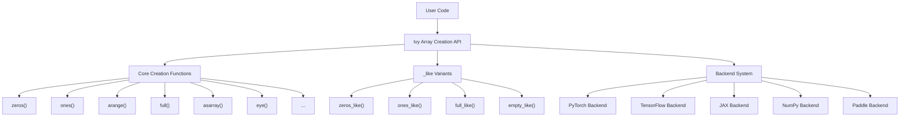
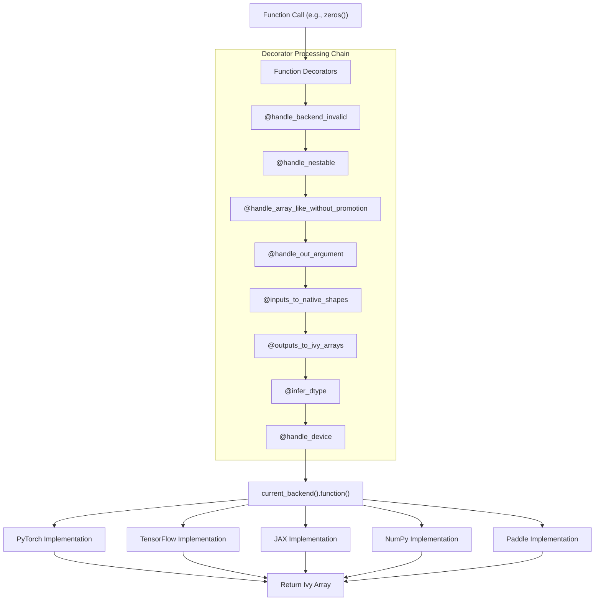
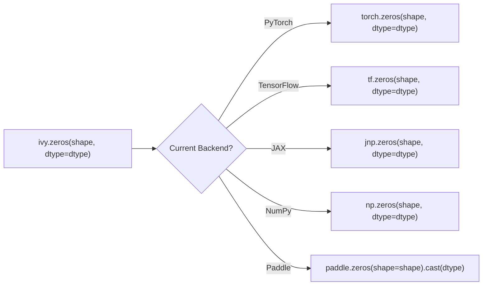
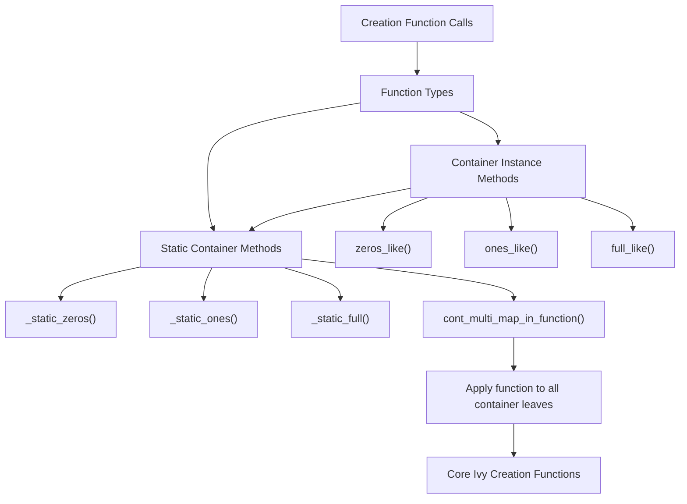
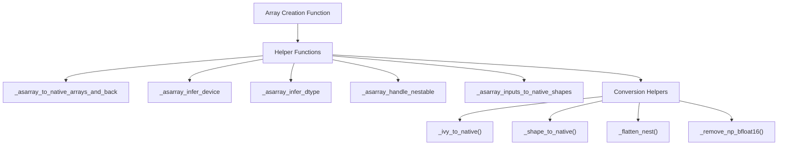

<!-- source: DeepWiki mcp.deepwiki.com · repo ivy-llc/ivy · page 4.4 Array Creation Functions · fetched 2026-10-21 -->

# Array Creation Functions

<details>
<summary>Relevant source files</summary>

The following files were used as context for generating this wiki page:

- [ivy/data_classes/array/creation.py](ivy/data_classes/array/creation.py)
- [ivy/data_classes/container/creation.py](ivy/data_classes/container/creation.py)
- [ivy/functional/backends/jax/creation.py](ivy/functional/backends/jax/creation.py)
- [ivy/functional/backends/mxnet/creation.py](ivy/functional/backends/mxnet/creation.py)
- [ivy/functional/backends/numpy/creation.py](ivy/functional/backends/numpy/creation.py)
- [ivy/functional/backends/paddle/creation.py](ivy/functional/backends/paddle/creation.py)
- [ivy/functional/backends/tensorflow/creation.py](ivy/functional/backends/tensorflow/creation.py)
- [ivy/functional/backends/torch/creation.py](ivy/functional/backends/torch/creation.py)
- [ivy/functional/ivy/creation.py](ivy/functional/ivy/creation.py)
- [ivy_tests/test_ivy/test_functional/test_core/test_creation.py](ivy_tests/test_ivy/test_functional/test_core/test_creation.py)

</details>


Array creation functions in Ivy provide a consistent API for creating arrays across different machine learning frameworks. These functions serve as the foundation for initializing arrays with specific values, shapes, and properties, regardless of the underlying backend framework (PyTorch, TensorFlow, JAX, NumPy, or Paddle).

For information about array manipulation after creation, see [Array Manipulation](#4.6).

## Overview

Array creation functions allow developers to initialize arrays with specific patterns (e.g., zeros, ones), from existing data structures, or according to mathematical sequences. These functions share common parameters such as `dtype` (data type), `device` (computation device), and `out` (optional output array).



Sources:
- [ivy/functional/ivy/creation.py:289-383]()
- [ivy/functional/ivy/creation.py:549-610]()
- [ivy/functional/ivy/creation.py:627-707]()

## Function Architecture and Processing Flow

Array creation functions follow a consistent architecture with a series of wrapper decorators that handle common functionality. When an array creation function is called, it passes through several processing layers before the actual array is created by the backend.



Sources:
- [ivy/functional/ivy/creation.py:19-36]()
- [ivy/functional/ivy/creation.py:548-610]()

## Core Array Creation Functions

### `asarray`

Converts the input to an array, handling a wide variety of input types.

```python
ivy.asarray(
    obj, 
    /, 
    *, 
    copy=None, 
    dtype=None, 
    device=None, 
    out=None
) -> ivy.Array
```

Key features:
- Converts various input types (lists, tuples, native arrays, etc.) to Ivy arrays
- Special handling for nestable inputs through the `_asarray_handle_nestable` wrapper
- Infers appropriate dtype and device when not specified
- Special handling for bfloat16 data types in numpy arrays

Sources:
- [ivy/functional/ivy/creation.py:460-546]()
- [ivy/functional/backends/torch/creation.py:104-143]()
- [ivy/functional/backends/tensorflow/creation.py:86-124]()

### `zeros` and `ones`

Create arrays filled with zeros or ones, respectively.

```python
ivy.zeros(
    shape, 
    *, 
    dtype=None, 
    device=None, 
    out=None
) -> ivy.Array

ivy.ones(
    shape, 
    *, 
    dtype=None, 
    device=None, 
    out=None
) -> ivy.Array
```

Key features:
- Create arrays of a specified shape filled with 0s or 1s
- Support for various dtypes including numeric, boolean, and complex types
- Consistent behavior across backends

Sources:
- [ivy/functional/ivy/creation.py:548-610]() - `zeros`
- [ivy/functional/ivy/creation.py:612-706]() - `ones`

### `_like` Variants

Functions like `zeros_like`, `ones_like`, `full_like`, and `empty_like` create arrays based on the shape of an existing array.

```python
ivy.zeros_like(
    x, 
    /, 
    *, 
    dtype=None, 
    device=None, 
    out=None
) -> ivy.Array
```

Key features:
- Create arrays with the same shape as the input array
- Can optionally specify a different dtype or device
- Consistent interface across all _like variants

Sources:
- [ivy/functional/ivy/creation.py:816-935]() - `full_like`
- [ivy/functional/ivy/creation.py:826-934]() - `ones_like`
- [ivy/functional/ivy/creation.py:945-1048]() - `zeros_like`

### `arange`

Creates a 1-D array with evenly spaced values within a given interval.

```python
ivy.arange(
    start, 
    /, 
    stop=None, 
    step=1, 
    *, 
    dtype=None, 
    device=None, 
    out=None
) -> ivy.Array
```

Key features:
- Similar to Python's range function but returns an array
- Supports floating-point and integer steps
- Handles edge cases (e.g., when start > stop with positive step)

Sources:
- [ivy/functional/ivy/creation.py:281-383]()
- [ivy/functional/backends/torch/creation.py:50-81]()
- [ivy/functional/backends/numpy/creation.py:25-43]()

### `eye`

Creates a 2-D array with ones on the diagonal and zeros elsewhere.

```python
ivy.eye(
    n_rows, 
    n_cols=None, 
    /, 
    *, 
    k=0, 
    batch_shape=None, 
    dtype=None, 
    device=None, 
    out=None
) -> ivy.Array
```

Key features:
- Creates identity matrices or matrices with the diagonal offset by k
- Supports batch dimensions for creating multiple matrices at once
- Handles positive and negative k values (diagonal above or below main diagonal)

Sources:
- [ivy/functional/backends/torch/creation.py:176-234]()
- [ivy/functional/backends/tensorflow/creation.py:149-195]()

### `linspace`

Creates a 1-D array with evenly spaced values within a given interval.

```python
ivy.linspace(
    start, 
    stop, 
    /, 
    num, 
    *, 
    axis=None, 
    endpoint=True, 
    dtype=None, 
    device=None, 
    out=None
) -> ivy.Array
```

Key features:
- Creates an array of `num` evenly spaced values
- Can include or exclude the endpoint (`stop` value)
- Can distribute the values along a specific axis

Sources:
- [ivy/functional/backends/torch/creation.py:289-340]()
- [ivy/functional/backends/jax/creation.py:168-235]()

### `tril` and `triu`

Create lower or upper triangular matrices by zeroing elements above or below the diagonal.

```python
ivy.tril(
    x, 
    /, 
    *, 
    k=0, 
    out=None
) -> ivy.Array

ivy.triu(
    x, 
    /, 
    *, 
    k=0, 
    out=None
) -> ivy.Array
```

Key features:
- `tril`: Keep elements on and below the diagonal, zero others
- `triu`: Keep elements on and above the diagonal, zero others
- Parameter `k` controls which diagonal to use (0 = main, +ve = above, -ve = below)

Sources:
- [ivy/functional/ivy/creation.py:1058-1104]() - `tril`
- [ivy/functional/ivy/creation.py:1114-1155]() - `triu`

## Backend Implementation Variations

Ivy's creation functions are implemented differently across backends to match each framework's native behavior while maintaining a consistent API.



Differences in backend implementations include:
- Type promotion and conversion behavior
- Device placement and memory handling
- Support for different dtypes
- Performance optimizations

Sources:
- [ivy/functional/backends/torch/creation.py:513-523]()
- [ivy/functional/backends/tensorflow/creation.py:350-357]()
- [ivy/functional/backends/jax/creation.py:276-284]()
- [ivy/functional/backends/numpy/creation.py:227-236]()
- [ivy/functional/backends/paddle/creation.py:566-573]()

## Container Support

The array creation functions also support Ivy's Container class, allowing operations on nested containers of arrays.



The Container class provides:
- Static methods for creating containers of arrays
- Instance methods for creating arrays based on container shapes
- Key-chain management for selectively applying operations

Sources:
- [ivy/data_classes/container/creation.py:11-142]()
- [ivy/data_classes/container/creation.py:532-645]()

## Array Class Integration

The `ivy.Array` class integrates with creation functions through instance methods, allowing for chained operations.

```python
# Creating new arrays based on existing arrays
x = ivy.array([1, 2, 3])
y = x.zeros_like()  # Creates [0, 0, 0]
z = x.ones_like()   # Creates [1, 1, 1]
```

Key instance methods include:
- `asarray`: Convert to an Ivy array
- `zeros_like`, `ones_like`, `full_like`: Create arrays with the same shape
- `tril`, `triu`: Create triangular matrices

Sources:
- [ivy/data_classes/array/creation.py:14-502]()

## Function Wrappers and Helpers

Array creation functions rely on several helper functions and wrappers to manage common functionality:



Notable helper functions include:
- `_asarray_handle_nestable`: Handles container types by mapping functions to leaves
- `_ivy_to_native`: Converts Ivy arrays to native backend arrays
- `_asarray_infer_dtype`: Determines the appropriate dtype when not explicitly specified
- `_asarray_infer_device`: Determines the appropriate device when not explicitly specified

Sources:
- [ivy/functional/ivy/creation.py:38-215]()

## Conclusion

Array creation functions form a foundational component of the Ivy framework, providing a unified interface for creating arrays across different machine learning backends. These functions handle various input types, shapes, and data types, while dealing with the complexities of different backend implementations. The wrapper system ensures consistent behavior across backends, making it easier for developers to work with arrays in a framework-agnostic manner.

---

