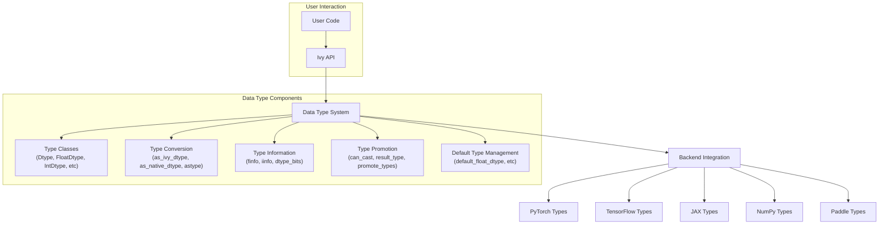
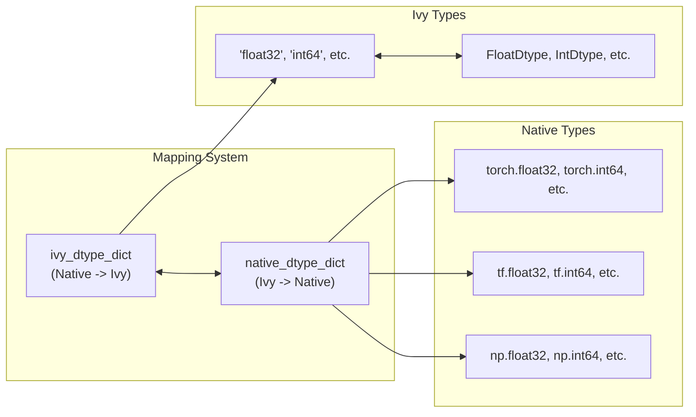
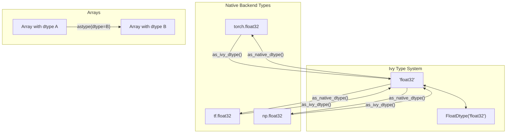
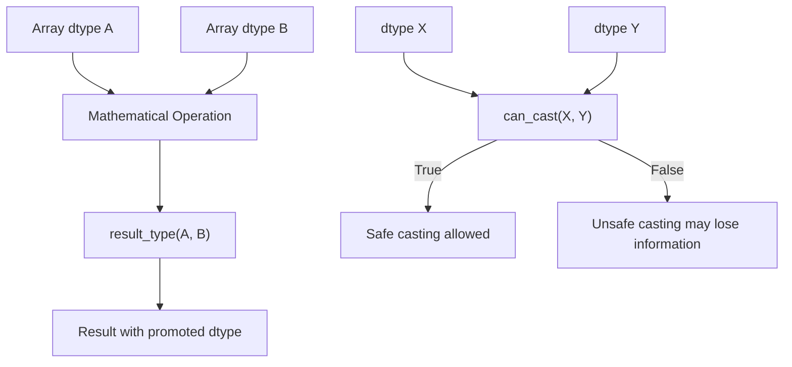
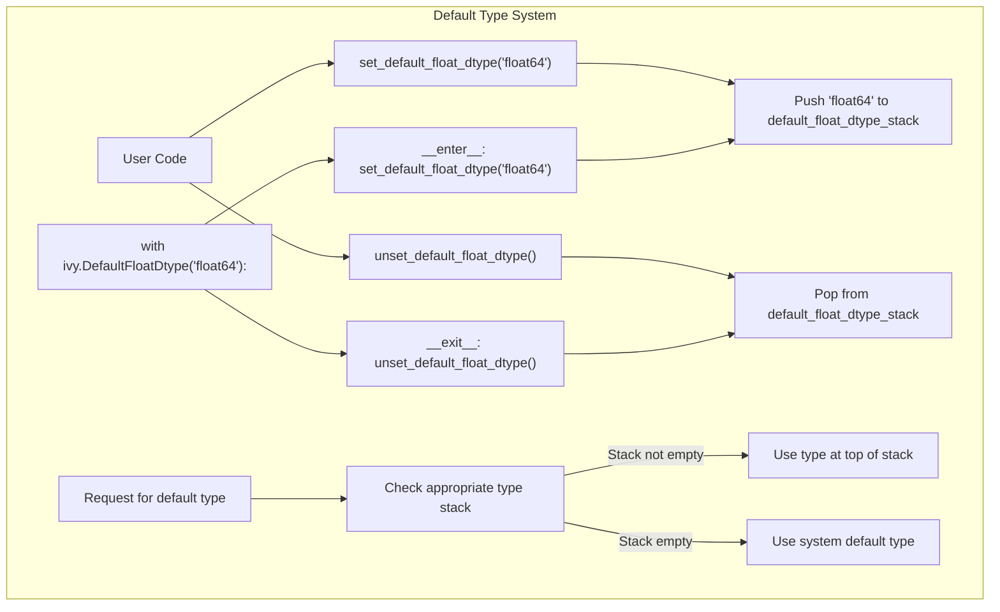
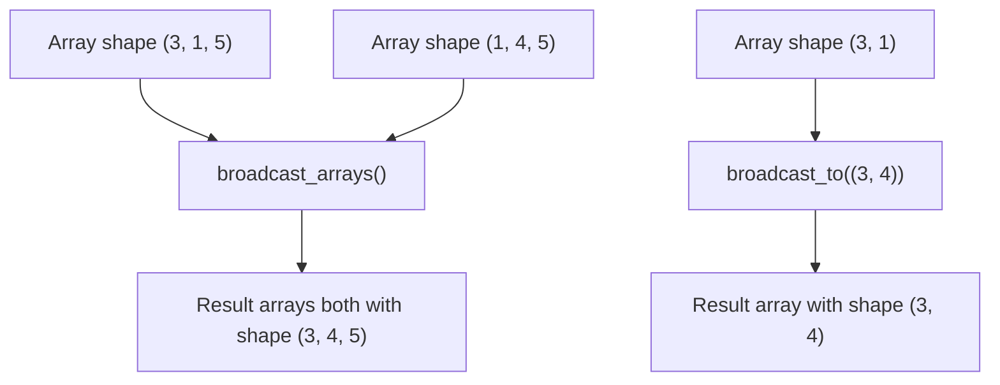

<!-- source: DeepWiki mcp.deepwiki.com · repo ivy-llc/ivy · page 4.5 Data Type System · fetched 2026-10-21 -->

# Data Type System

<details>
<summary>Relevant source files</summary>

The following files were used as context for generating this wiki page:

- [ivy/functional/backends/jax/data_type.py](ivy/functional/backends/jax/data_type.py)
- [ivy/functional/backends/mxnet/data_type.py](ivy/functional/backends/mxnet/data_type.py)
- [ivy/functional/backends/numpy/data_type.py](ivy/functional/backends/numpy/data_type.py)
- [ivy/functional/backends/paddle/data_type.py](ivy/functional/backends/paddle/data_type.py)
- [ivy/functional/backends/tensorflow/data_type.py](ivy/functional/backends/tensorflow/data_type.py)
- [ivy/functional/backends/torch/data_type.py](ivy/functional/backends/torch/data_type.py)
- [ivy/functional/ivy/constants.py](ivy/functional/ivy/constants.py)
- [ivy/functional/ivy/data_type.py](ivy/functional/ivy/data_type.py)
- [ivy_tests/test_ivy/test_functional/test_core/test_dtype.py](ivy_tests/test_ivy/test_functional/test_core/test_dtype.py)

</details>


The Ivy Data Type System provides a unified interface for handling data types across different machine learning frameworks. It abstracts away backend-specific type implementations, allowing users to write framework-agnostic code while ensuring consistent behavior across PyTorch, TensorFlow, JAX, NumPy, and other supported frameworks.

This page explains how Ivy represents, converts, and manages data types, as well as how the type system integrates with various backends. For information about functions that create arrays, see [Array Creation Functions](#4.4).

## Type System Architecture

The Data Type System sits at the core of Ivy's framework-agnostic capabilities, providing a unified set of types and type-related operations.



Sources: [ivy/functional/ivy/data_type.py:1-22](). [ivy/functional/backends/torch/data_type.py:1-15](), [ivy/functional/backends/tensorflow/data_type.py:1-15](), [ivy/functional/backends/numpy/data_type.py:1-15](), [ivy/functional/backends/jax/data_type.py:1-15](), [ivy/functional/backends/paddle/data_type.py:1-15]()

## Type Representation

Ivy provides its own dtype classes to represent different categories of data types in a uniform way across backends.

### Ivy Dtype Classes

Ivy uses the following classes to represent different categories of data types:

- `Dtype`: Base class for all data types
- `FloatDtype`: Floating-point data types (float16, float32, float64, etc.)
- `IntDtype`: Integer data types (int8, int16, int32, int64, etc.)
- `UintDtype`: Unsigned integer data types (uint8, uint16, etc.)
- `ComplexDtype`: Complex number data types (complex64, complex128)

### Type Mapping System

Each backend implementation contains dictionaries that map between native backend data types and Ivy data types:



Sources: [ivy/functional/backends/torch/data_type.py:12-40](), [ivy/functional/backends/tensorflow/data_type.py:14-48](), [ivy/functional/backends/numpy/data_type.py:12-59](), [ivy/functional/backends/jax/data_type.py:12-61](), [ivy/functional/backends/paddle/data_type.py:13-41]()

## Type Conversion

Ivy provides several functions to convert between different type representations:

### Core Conversion Functions

1. **as_ivy_dtype**: Converts a native backend data type to Ivy's dtype representation
   ```python
   result = ivy.as_ivy_dtype(torch.float32)  # Returns 'float32'
   ```

2. **as_native_dtype**: Converts an Ivy dtype to a backend-specific native dtype
   ```python
   result = ivy.as_native_dtype('float32')  # Returns torch.float32 if using PyTorch backend
   ```

3. **astype**: Converts an array from one data type to another
   ```python
   new_array = ivy.astype(x, 'float64')  # Converts array x to float64 type
   ```

### Conversion Flow



Sources: [ivy/functional/ivy/data_type.py:1006-1037](), [ivy/functional/backends/torch/data_type.py:152-214](), [ivy/functional/backends/tensorflow/data_type.py:197-259](), [ivy/functional/backends/numpy/data_type.py:186-247](), [ivy/functional/backends/jax/data_type.py:189-254]()

## Type Information

Ivy provides several functions to query information about data types:

### Information Functions

1. **finfo**: Gets machine limits for floating-point types
   ```python
   info = ivy.finfo(ivy.float32)
   print(info.eps)  # Prints machine epsilon for float32
   print(info.max)  # Prints maximum representable value for float32
   ```

2. **iinfo**: Gets machine limits for integer types
   ```python
   info = ivy.iinfo(ivy.int32)
   print(info.min)  # Prints minimum representable value for int32
   print(info.max)  # Prints maximum representable value for int32
   ```

3. **dtype**: Gets the data type of an array
   ```python
   dt = ivy.dtype(x)  # Returns data type of array x as Ivy dtype
   ```

4. **dtype_bits**: Gets the number of bits used for a data type
   ```python
   bits = ivy.dtype_bits(ivy.float32)  # Returns 32
   ```

### Type Information Classes

Each backend implements classes to provide type information:

- `Finfo`: Provides information about floating-point types
- `Iinfo`: Provides information about integer types

These classes emulate NumPy's `finfo` and `iinfo` functionality.

### Backend Comparison of Supported Types

This table shows the data types supported across different backends:

| Data Type  | PyTorch | TensorFlow | NumPy | JAX | Paddle |
|------------|---------|------------|-------|-----|--------|
| int8       | ✓       | ✓          | ✓     | ✓   | ✓      |
| int16      | ✓       | ✓          | ✓     | ✓   | ✓      |
| int32      | ✓       | ✓          | ✓     | ✓   | ✓      |
| int64      | ✓       | ✓          | ✓     | ✓   | ✓      |
| uint8      | ✓       | ✓          | ✓     | ✓   | ✓      |
| uint16     | ✗       | ✓          | ✓     | ✓   | ✗      |
| uint32     | ✗       | ✓          | ✓     | ✓   | ✗      |
| uint64     | ✗       | ✓          | ✓     | ✓   | ✗      |
| float16    | ✓       | ✓          | ✓     | ✓   | ✓      |
| float32    | ✓       | ✓          | ✓     | ✓   | ✓      |
| float64    | ✓       | ✓          | ✓     | ✓   | ✓      |
| bfloat16   | ✓       | ✓          | ✗     | ✓   | ✓      |
| complex64  | ✓       | ✓          | ✓     | ✓   | ✓      |
| complex128 | ✓       | ✓          | ✓     | ✓   | ✓      |
| bool       | ✓       | ✓          | ✓     | ✓   | ✓      |

Sources: [ivy/functional/ivy/data_type.py:625-782](), [ivy/functional/backends/torch/data_type.py:42-78](), [ivy/functional/backends/tensorflow/data_type.py:50-85](), [ivy/functional/backends/numpy/data_type.py:83-118](), [ivy/functional/backends/jax/data_type.py:85-120](), [ivy/functional/backends/paddle/data_type.py:44-110]()

## Type Promotion and Casting

Type promotion is the process of determining the appropriate output type when operations involve multiple data types. Ivy provides functions to handle type promotion and to determine when casting between types is safe.

### Promotion and Casting Functions

1. **can_cast**: Determines if one data type can be cast to another
   ```python
   result = ivy.can_cast(ivy.float32, ivy.int32)  # Returns False
   ```

2. **result_type**: Determines the output dtype resulting from operations on inputs with specified dtypes
   ```python
   result = ivy.result_type(ivy.float32, ivy.int32)  # Returns 'float32'
   ```

3. **promote_types**: Determines a type that can represent both input types
   ```python
   result = ivy.promote_types(ivy.float32, ivy.int64)  # Returns 'float64'
   ```

### Type Promotion Flow



Sources: [ivy/functional/ivy/data_type.py:551-620](), [ivy/functional/ivy/data_type.py:790-848](), [ivy/functional/backends/torch/data_type.py:133-145](), [ivy/functional/backends/tensorflow/data_type.py:178-190](), [ivy/functional/backends/numpy/data_type.py:173-179]()

## Default Type Management

Ivy allows setting default data types for different type categories (float, int, uint, complex). The default types are used when a specific data type is not provided.

### Default Type System

Ivy maintains separate stacks for each default type category:

```python
default_dtype_stack = []
default_float_dtype_stack = []
default_int_dtype_stack = []
default_uint_dtype_stack = []
default_complex_dtype_stack = []
```

### Default Type Functions

1. **default_dtype**: Gets/sets the default data type
   ```python
   dtype = ivy.default_dtype()  # Gets current default dtype
   ```

2. **default_float_dtype**: Gets/sets the default float data type
   ```python
   dtype = ivy.default_float_dtype()  # Gets current default float dtype
   ```

3. **default_int_dtype**: Gets/sets the default integer data type
   ```python
   dtype = ivy.default_int_dtype()  # Gets current default int dtype
   ```

### Context Managers

Ivy provides context managers for temporarily setting default data types:

```python
with ivy.DefaultFloatDtype('float64'):
    # Inside this block, default float dtype is float64
    array = ivy.ones((3, 3))  # Will be float64

# Outside the block, default float dtype is restored
array = ivy.ones((3, 3))  # Will use original default (typically float32)
```

### Default Type Stack Management



Sources: [ivy/functional/ivy/data_type.py:853-943](), [ivy/functional/ivy/data_type.py:1098-1293]()

## Broadcasting System

Broadcasting is the operation of making arrays with different shapes compatible for arithmetic operations. Ivy's Data Type System includes functions for broadcasting arrays.

### Broadcasting Functions

1. **broadcast_arrays**: Broadcasts multiple arrays against one another to make them compatible
   ```python
   result = ivy.broadcast_arrays(x, y)  # Returns broadcasted versions of x and y
   ```

2. **broadcast_to**: Broadcasts an array to a specified shape
   ```python
   result = ivy.broadcast_to(x, (3, 3, 3))  # Broadcasts x to shape (3, 3, 3)
   ```

### Broadcasting Rules

Arrays are compatible for broadcasting if for each dimension pair, either:
- The dimensions are equal
- One of the dimensions is 1
- One of the arrays doesn't have the dimension



Sources: [ivy/functional/ivy/data_type.py:393-470](), [ivy/functional/ivy/data_type.py:481-543](), [ivy/functional/backends/torch/data_type.py:98-116](), [ivy/functional/backends/tensorflow/data_type.py:122-159](), [ivy/functional/backends/numpy/data_type.py:138-156](), [ivy/functional/backends/jax/data_type.py:141-158](), [ivy/functional/backends/paddle/data_type.py:139-192]()

## Backend Integration

The data type system is integrated with each backend through backend-specific implementations. The core functionality is defined in `ivy/functional/ivy/data_type.py`, and each backend provides its own implementation in files like `ivy/functional/backends/torch/data_type.py`.

### Dtype Mapping Implementation

Each backend has dictionaries to map between backend-specific types and Ivy types:

```python
# Example from PyTorch backend
ivy_dtype_dict = {
    torch.int8: "int8",
    torch.float32: "float32",
    # ...other mappings
}

native_dtype_dict = {
    "int8": torch.int8,
    "float32": torch.float32,
    # ...other mappings
}
```

### Function Wrapping

Functions in the Data Type System are wrapped with decorators like `handle_nestable` and `to_native_arrays_and_back` to ensure uniform behavior across backends:


### Common Decorator Pattern

Most functions use a common set of decorators:

```python
@handle_exceptions
@handle_backend_invalid
@handle_nestable
@handle_array_like_without_promotion
@handle_out_argument
@to_native_arrays_and_back
@handle_array_function
@handle_device
def astype(x, dtype, /, *, copy=True, out=None):
    # Implementation or dispatch to backend
    return current_backend(x).astype(x, dtype, copy=copy, out=out)
```

Sources: [ivy/functional/ivy/data_type.py:13-27](), [ivy/functional/ivy/data_type.py:293-391](), [ivy/functional/backends/torch/data_type.py:84-96](), [ivy/functional/backends/tensorflow/data_type.py:108-119](), [ivy/functional/backends/numpy/data_type.py:124-135](), [ivy/functional/backends/jax/data_type.py:126-138]()

## Unsupported Data Types and Version Handling

Ivy provides mechanisms to handle backend-specific data type limitations and version-specific behavior.

### Function Decorators for Dtype Limitations

The `with_unsupported_dtypes` decorator specifies dtypes that are not supported by a particular backend or backend version:

```python
@with_unsupported_dtypes({"2.2 and below": ("bfloat16", "float16")}, backend_version)
def astype(x, dtype, /, *, copy=True, out=None):
    # Implementation
```

### Backend Version Detection

Ivy detects the version of each backend and adjusts behavior accordingly:

```python
# Usage pattern
if backend_version <= "2.2":
    # Use alternate implementation for older versions
else:
    # Use newer implementation
```

Sources: [ivy/functional/backends/torch/data_type.py:84](), [ivy/functional/backends/paddle/data_type.py:157-168]()

## Type System Helper Functions

Ivy provides several helper functions for working with the type system:

1. **closest_valid_dtype**: Returns the closest valid data type for a given data type
2. **is_float_dtype**: Checks if a data type is a floating-point type
3. **is_int_dtype**: Checks if a data type is an integer type
4. **is_uint_dtype**: Checks if a data type is an unsigned integer type
5. **is_complex_dtype**: Checks if a data type is a complex type
6. **is_bool_dtype**: Checks if a data type is a boolean type
7. **is_native_dtype**: Checks if a data type is a native backend dtype

### Example Usage

```python
ivy.is_float_dtype(x.dtype)  # Returns True if x has a float data type
ivy.is_int_dtype('int32')    # Returns True
ivy.is_native_dtype(torch.float32)  # Returns True if using PyTorch backend
```

Sources: [ivy/functional/ivy/data_type.py:1059-1293](), [ivy/functional/backends/torch/data_type.py:237-240](), [ivy/functional/backends/tensorflow/data_type.py:284-287](), [ivy/functional/backends/numpy/data_type.py:269-272](), [ivy/functional/backends/jax/data_type.py:276-279](), [ivy/functional/backends/paddle/data_type.py:287-290]()

---

