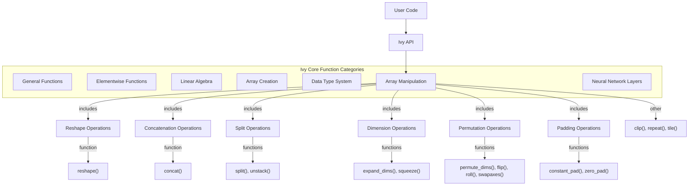
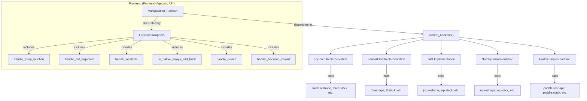
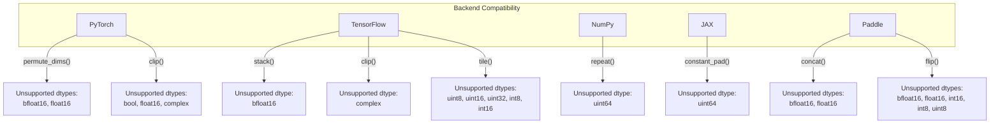

<!-- source: DeepWiki mcp.deepwiki.com · repo ivy-llc/ivy · page 4.6 Array Manipulation · fetched 2026-10-21 -->

# Array Manipulation

<details>
<summary>Relevant source files</summary>

The following files were used as context for generating this wiki page:

- [ivy/functional/backends/jax/manipulation.py](ivy/functional/backends/jax/manipulation.py)
- [ivy/functional/backends/mxnet/manipulation.py](ivy/functional/backends/mxnet/manipulation.py)
- [ivy/functional/backends/numpy/manipulation.py](ivy/functional/backends/numpy/manipulation.py)
- [ivy/functional/backends/paddle/manipulation.py](ivy/functional/backends/paddle/manipulation.py)
- [ivy/functional/backends/tensorflow/manipulation.py](ivy/functional/backends/tensorflow/manipulation.py)
- [ivy/functional/backends/torch/manipulation.py](ivy/functional/backends/torch/manipulation.py)
- [ivy/functional/ivy/manipulation.py](ivy/functional/ivy/manipulation.py)
- [ivy_tests/test_ivy/test_functional/test_core/test_manipulation.py](ivy_tests/test_ivy/test_functional/test_core/test_manipulation.py)

</details>


Array manipulation in Ivy refers to operations that transform the shape, structure, or organization of arrays without fundamentally changing the data values they contain. This module provides functions for reshaping, concatenating, splitting, stacking, flipping, rolling, and otherwise manipulating array data across multiple backend frameworks.

## Relationship to Other Components

Array manipulation functions are a core part of Ivy's functional API, sitting alongside other mathematical operations such as elementwise functions, linear algebra, and array creation. These functions provide the fundamental operations necessary for tensor reshaping in neural network architectures and data preprocessing.



Sources: [ivy/functional/ivy/manipulation.py:1-1100]()

## Implementation Architecture

Array manipulation functions follow Ivy's standard dispatch pattern, where the frontend functions are decorated with wrappers that handle type conversion, backend selection, and other cross-cutting concerns before dispatching to the backend-specific implementations.



Sources: 
- [ivy/functional/ivy/manipulation.py:10-21]()
- [ivy/functional/backends/torch/manipulation.py:1-20]()
- [ivy/functional/backends/tensorflow/manipulation.py:1-20]()
- [ivy/functional/backends/numpy/manipulation.py:1-20]()
- [ivy/functional/backends/jax/manipulation.py:1-20]()
- [ivy/functional/backends/paddle/manipulation.py:1-20]()

## Core Manipulation Functions

### Reshape Operations

#### reshape

Changes the shape of an array without changing its data.

```python
def reshape(
    x: Union[ivy.Array, ivy.NativeArray],
    /,
    shape: Union[ivy.Shape, ivy.NativeShape, Sequence[int]],
    *,
    copy: Optional[bool] = None,
    order: str = "C",
    allowzero: bool = True,
    out: Optional[ivy.Array] = None,
) -> ivy.Array
```

- **Parameters**:
  - `x`: Input array to be reshaped
  - `shape`: The new shape of the array (one dimension can be -1 to be inferred)
  - `copy`: Whether to copy the input array
  - `order`: "C" for C-style row-major or "F" for Fortran-style column-major
  - `allowzero`: Whether to allow dimensions of size 0
  - `out`: Optional output array

Sources: [ivy/functional/ivy/manipulation.py:459-573]()

### Concatenation Operations

#### concat

Joins a sequence of arrays along an existing axis.

```python
def concat(
    xs: Union[
        Tuple[Union[ivy.Array, ivy.NativeArray], ...],
        List[Union[ivy.Array, ivy.NativeArray]],
    ],
    /,
    *,
    axis: int = 0,
    out: Optional[ivy.Array] = None,
) -> ivy.Array
```

- **Parameters**:
  - `xs`: Arrays to join
  - `axis`: Axis along which to join (default: 0)
  - `out`: Optional output array

Sources: [ivy/functional/ivy/manipulation.py:67-116]()

### Dimension Operations

#### expand_dims

Expands the shape of an array by inserting a new axis (dimension) of size one.

```python
def expand_dims(
    x: Union[ivy.Array, ivy.NativeArray],
    /,
    *,
    copy: Optional[bool] = None,
    axis: Union[int, Sequence[int]] = 0,
    out: Optional[ivy.Array] = None,
) -> ivy.Array
```

- **Parameters**:
  - `x`: Input array
  - `copy`: Whether to copy the input array
  - `axis`: Position where new axis is inserted
  - `out`: Optional output array

Sources: [ivy/functional/ivy/manipulation.py:128-253]()

#### squeeze

Removes singleton dimensions (axes) from an array.

```python
def squeeze(
    x: Union[ivy.Array, ivy.NativeArray],
    /,
    *,
    axis: Optional[Union[int, Sequence[int]]] = None,
    copy: Optional[bool] = None,
    out: Optional[ivy.Array] = None,
) -> ivy.Array
```

- **Parameters**:
  - `x`: Input array
  - `axis`: Axis or axes to remove (if None, removes all singleton dimensions)
  - `copy`: Whether to copy the input array
  - `out`: Optional output array

Sources: [ivy/functional/ivy/manipulation.py:698-777]()

### Permutation Operations

#### permute_dims

Permutes the axes (dimensions) of an array.

```python
def permute_dims(
    x: Union[ivy.Array, ivy.NativeArray],
    /,
    axes: Tuple[int, ...],
    *,
    copy: Optional[bool] = None,
    out: Optional[ivy.Array] = None,
) -> ivy.Array
```

- **Parameters**:
  - `x`: Input array
  - `axes`: Tuple containing a permutation of (0, 1, ..., N-1) where N is the rank
  - `copy`: Whether to copy the input array
  - `out`: Optional output array

Sources: [ivy/functional/ivy/manipulation.py:359-447]()

#### flip

Reverses the order of elements in an array along the specified axis.

```python
def flip(
    x: Union[ivy.Array, ivy.NativeArray],
    /,
    *,
    copy: Optional[bool] = None,
    axis: Optional[Union[int, Sequence[int]]] = None,
    out: Optional[ivy.Array] = None,
) -> ivy.Array
```

- **Parameters**:
  - `x`: Input array
  - `copy`: Whether to copy the input array
  - `axis`: Axis or axes along which to flip (if None, flips all axes)
  - `out`: Optional output array

Sources: [ivy/functional/ivy/manipulation.py:265-347]()

#### roll

Rolls array elements along a specified axis.

```python
def roll(
    x: Union[ivy.Array, ivy.NativeArray, ivy.Container],
    /,
    shift: Union[int, Sequence[int]],
    *,
    axis: Optional[Union[int, Sequence[int]]] = None,
    out: Optional[ivy.Array] = None,
) -> Union[ivy.Array, ivy.Container]
```

- **Parameters**:
  - `x`: Input array
  - `shift`: Number of places by which elements are shifted
  - `axis`: Axis or axes along which to roll (if None, flattens the array first)
  - `out`: Optional output array

Sources: [ivy/functional/ivy/manipulation.py:584-686]()

### Stack and Split Operations

#### stack

Joins a sequence of arrays along a new axis.

```python
def stack(
    arrays: Union[
        Tuple[Union[ivy.Array, ivy.NativeArray], ...],
        List[Union[ivy.Array, ivy.NativeArray]],
    ],
    /,
    *,
    axis: int = 0,
    out: Optional[ivy.Array] = None,
) -> ivy.Array
```

- **Parameters**:
  - `arrays`: Input arrays having the same shape
  - `axis`: Axis along which to join (default: 0)
  - `out`: Optional output array

Sources: [ivy/functional/ivy/manipulation.py:788-863]()

#### split

Splits an array into multiple sub-arrays.

```python
def split(
    x: Union[ivy.Array, ivy.NativeArray],
    /,
    *,
    copy: Optional[bool] = None,
    num_or_size_splits: Optional[Union[int, List[int], ivy.Array]] = None,
    axis: int = 0,
    with_remainder: bool = False,
) -> List[ivy.Array]
```

- **Parameters**:
  - `x`: Input array
  - `copy`: Whether to copy the input array
  - `num_or_size_splits`: Number of equal splits or sizes of each split
  - `axis`: Axis along which to split
  - `with_remainder`: Whether to allow uneven splits if split not even

Sources: (Implemented in backend-specific files)

### Other Operations

#### clip

Clips (limits) the values in an array.

```python
def clip(
    x: Union[ivy.Array, ivy.NativeArray],
    /,
    x_min: Optional[Union[Number, ivy.Array, ivy.NativeArray]] = None,
    x_max: Optional[Union[Number, ivy.Array, ivy.NativeArray]] = None,
    *,
    out: Optional[ivy.Array] = None,
) -> ivy.Array
```

- **Parameters**:
  - `x`: Input array containing elements to clip
  - `x_min`: Minimum value (if None, no lower bound is applied)
  - `x_max`: Maximum value (if None, no upper bound is applied)
  - `out`: Optional output array

Sources: [ivy/functional/ivy/manipulation.py:878-977]()

#### constant_pad

Pads an array with a constant value.

```python
def constant_pad(
    x: Union[ivy.Array, ivy.NativeArray],
    /,
    pad_width: Iterable[Tuple[int]],
    *,
    value: Number = 0,
    out: Optional[ivy.Array] = None,
) -> ivy.Array
```

- **Parameters**:
  - `x`: Input array to pad
  - `pad_width`: Number of values padded to edges of each axis
  - `value`: Constant value to pad with (default: 0)
  - `out`: Optional output array

Sources: [ivy/functional/ivy/manipulation.py:1004-1088]()

#### repeat

Repeats elements of an array.

```python
def repeat(
    x: Union[ivy.Array, ivy.NativeArray],
    /,
    repeats: Union[int, Iterable[int]],
    *,
    axis: Optional[int] = None,
    out: Optional[ivy.Array] = None,
) -> ivy.Array
```

- **Parameters**:
  - `x`: Input array
  - `repeats`: Number of repetitions for each element
  - `axis`: Axis along which to repeat (if None, uses flattened input)
  - `out`: Optional output array

Sources: [ivy/functional/ivy/manipulation.py:1100-1159]()

## Backend Implementations

Each of the array manipulation functions has specific implementations in each supported backend. These implementations typically map to the closest corresponding native function in the backend framework while handling any framework-specific quirks.

| Function | PyTorch | TensorFlow | NumPy | JAX | Paddle |
|----------|---------|------------|-------|-----|--------|
| `reshape` | `torch.reshape` | `tf.reshape` | `np.reshape` | `jnp.reshape` | `paddle.reshape` |
| `concat` | `torch.cat` | `tf.concat` | `np.concatenate` | `jnp.concatenate` | `paddle.concat` |
| `expand_dims` | `torch.reshape` | `tf.reshape` | `np.expand_dims` | `jnp.expand_dims` | Custom reshaping |
| `squeeze` | `torch.squeeze` | `tf.squeeze` | `np.squeeze` | `jnp.squeeze` | `paddle.squeeze` |
| `permute_dims` | `torch.permute` | `tf.transpose` | `np.transpose` | `jnp.transpose` | `paddle.transpose` |
| `flip` | `torch.flip` | `tf.reverse` | `np.flip` | `jnp.flip` | `paddle.flip` |
| `stack` | `torch.stack` | `tf.experimental.numpy.stack` | `np.stack` | `jnp.stack` | `paddle.stack` |

Sources:
- [ivy/functional/backends/torch/manipulation.py:27-192]()
- [ivy/functional/backends/tensorflow/manipulation.py:28-244]()
- [ivy/functional/backends/numpy/manipulation.py:23-155]()
- [ivy/functional/backends/jax/manipulation.py:25-150]()
- [ivy/functional/backends/paddle/manipulation.py:29-268]()

## Backend Compatibility Considerations

Some array manipulation functions have specific dtype or backend limitations:



Sources:
- [ivy/functional/backends/torch/manipulation.py:81-82, 316-318]()
- [ivy/functional/backends/tensorflow/manipulation.py:232-233, 296-306, 369-370]()
- [ivy/functional/backends/numpy/manipulation.py:201-202]()
- [ivy/functional/backends/jax/manipulation.py:240-241]()
- [ivy/functional/backends/paddle/manipulation.py:25-28, 94-96]()

## Common Patterns and Best Practices

1. **Copy parameter**: Most manipulation functions provide a `copy` parameter that controls whether the operation should create a new array or modify the existing one.

2. **Out parameter**: All functions support an `out` parameter for pre-allocated output arrays, following the Array API Standard.

3. **Working with singleton dimensions**: When using `squeeze` or `expand_dims`, be careful about axis specification to avoid errors.

4. **Order in reshape**: The `order` parameter in `reshape` determines memory layout - "C" (row-major) is the default, but "F" (column-major) is also supported for compatibility with Fortran-style arrays.

5. **Backend compatibility**: Some functions may have different behavior or limitations across backends. The Ivy API aims to provide a consistent interface, but be aware of potential backend-specific quirks, especially with complex dtypes or specialized operations.

---

