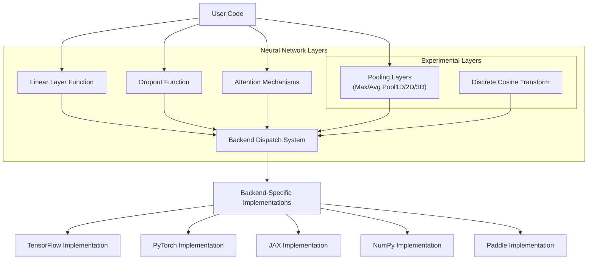
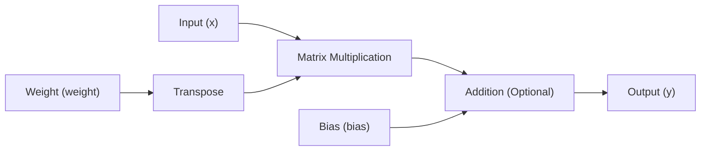
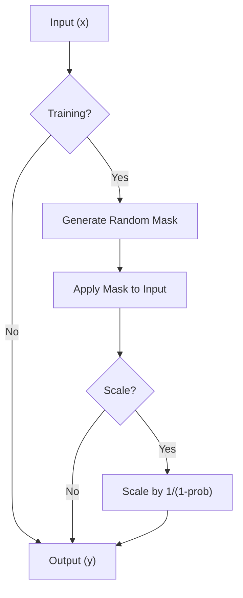
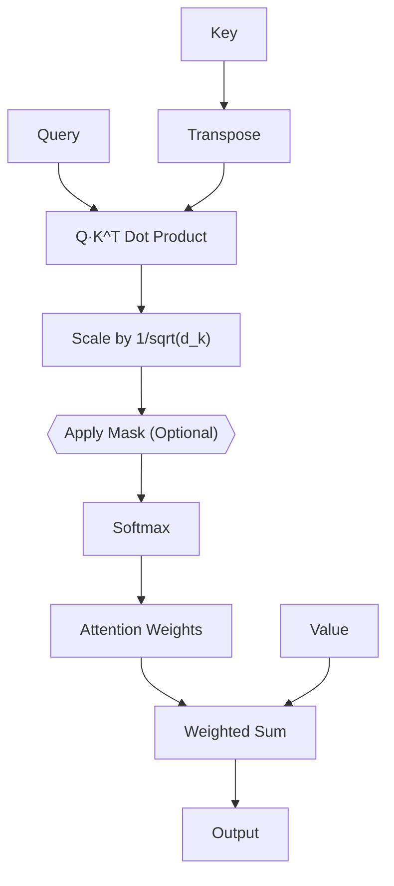
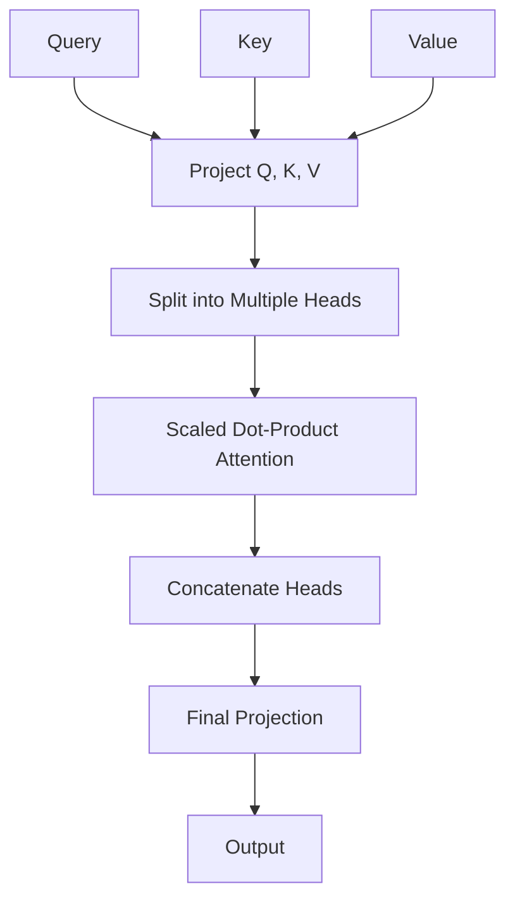
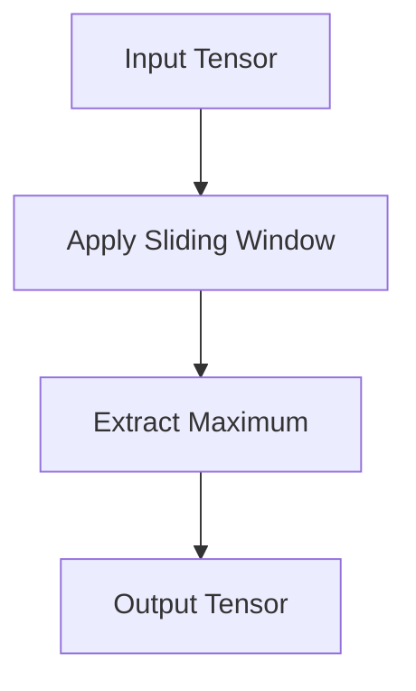
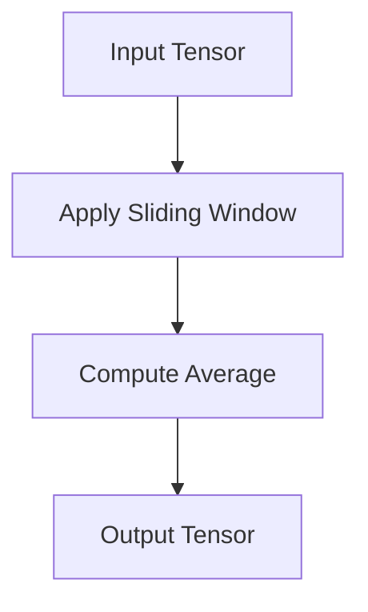
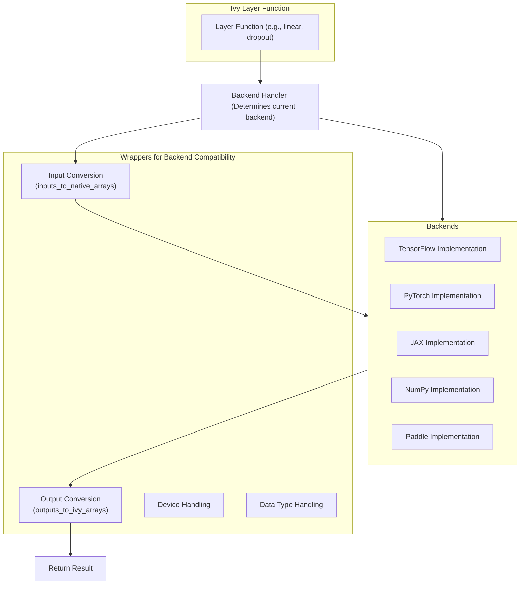

<!-- source: DeepWiki mcp.deepwiki.com · repo ivy-llc/ivy · page 4.7 Neural Network Layers · fetched 2026-10-21 -->

# Neural Network Layers

<details>
<summary>Relevant source files</summary>

The following files were used as context for generating this wiki page:

- [ivy/data_classes/array/experimental/layers.py](ivy/data_classes/array/experimental/layers.py)
- [ivy/data_classes/container/experimental/layers.py](ivy/data_classes/container/experimental/layers.py)
- [ivy/functional/backends/jax/experimental/layers.py](ivy/functional/backends/jax/experimental/layers.py)
- [ivy/functional/backends/jax/layers.py](ivy/functional/backends/jax/layers.py)
- [ivy/functional/backends/mxnet/experimental/layers.py](ivy/functional/backends/mxnet/experimental/layers.py)
- [ivy/functional/backends/mxnet/layers.py](ivy/functional/backends/mxnet/layers.py)
- [ivy/functional/backends/numpy/experimental/layers.py](ivy/functional/backends/numpy/experimental/layers.py)
- [ivy/functional/backends/numpy/layers.py](ivy/functional/backends/numpy/layers.py)
- [ivy/functional/backends/paddle/experimental/layers.py](ivy/functional/backends/paddle/experimental/layers.py)
- [ivy/functional/backends/paddle/layers.py](ivy/functional/backends/paddle/layers.py)
- [ivy/functional/backends/tensorflow/experimental/layers.py](ivy/functional/backends/tensorflow/experimental/layers.py)
- [ivy/functional/backends/tensorflow/layers.py](ivy/functional/backends/tensorflow/layers.py)
- [ivy/functional/backends/torch/experimental/layers.py](ivy/functional/backends/torch/experimental/layers.py)
- [ivy/functional/backends/torch/layers.py](ivy/functional/backends/torch/layers.py)
- [ivy/functional/frontends/torch/nn/functional/__init__.py](ivy/functional/frontends/torch/nn/functional/__init__.py)
- [ivy/functional/frontends/torch/nn/functional/layer_functions.py](ivy/functional/frontends/torch/nn/functional/layer_functions.py)
- [ivy/functional/ivy/experimental/layers.py](ivy/functional/ivy/experimental/layers.py)
- [ivy/functional/ivy/layers.py](ivy/functional/ivy/layers.py)
- [ivy_tests/test_docstrings.py](ivy_tests/test_docstrings.py)
- [ivy_tests/test_ivy/test_frontends/test_torch/test_nn/test_functional/test_layer_functions.py](ivy_tests/test_ivy/test_frontends/test_torch/test_nn/test_functional/test_layer_functions.py)
- [ivy_tests/test_ivy/test_functional/test_experimental/test_nn/test_layers.py](ivy_tests/test_ivy/test_functional/test_experimental/test_nn/test_layers.py)
- [ivy_tests/test_ivy/test_functional/test_nn/test_layers.py](ivy_tests/test_ivy/test_functional/test_nn/test_layers.py)

</details>


This document details the Neural Network (NN) Layers component of Ivy's Core Functional API. The NN Layers module provides implementations of common neural network building blocks that work consistently across all supported backend frameworks (PyTorch, TensorFlow, JAX, NumPy, and Paddle).

For information about the overall Module system that builds upon these layers, see [Module System](#5.3). For details on the Container system that can hold layer parameters, see [Container and Module System](#5).

## Architecture Overview

The NN Layers module is a key part of Ivy's Core Functional API, providing fundamental building blocks for neural networks.



Sources:
- [ivy/functional/ivy/layers.py:1-850]()
- [ivy/functional/ivy/experimental/layers.py:1-800]()

## Core Layer Functions

The NN Layers module provides several core functions that are essential for building neural networks:

### Linear Layer

The `linear` function applies a linear transformation to the incoming data: y = x * t(weight) + bias. The operation supports batching of weight matrices.



The linear function has the following signature:

```
linear(x, weight, /, *, bias=None, out=None) -> ivy.Array
```

Where:
- `x`: Input array of shape [batch_shape, inner_batch_shape, in_features]
- `weight`: Weight matrix of shape [outer_batch_shape, out_features, in_features]
- `bias`: Optional bias vector of shape [outer_batch_shape, out_features]

The implementation handles various broadcasting rules to support batched operations.

Sources:
- [ivy/functional/ivy/layers.py:87-242]()
- [ivy/functional/backends/tensorflow/layers.py:20-42]()
- [ivy/functional/backends/torch/layers.py:119-135]()

### Dropout Layer

The `dropout` function randomly sets elements of the input tensor to zero with probability `prob` during training to prevent overfitting. Elements that are not set to zero are scaled by `1/(1-prob)` by default.



The function signature is:

```
dropout(x, prob, /, *, scale=True, dtype=None, training=True, seed=None, noise_shape=None, out=None) -> ivy.Array
```

Where:
- `x`: Input array
- `prob`: Probability of zeroing out each array element
- `scale`: Whether to scale the output by `1/(1-prob)`
- `training`: Whether to apply dropout (True) or return input unchanged (False)

Sources:
- [ivy/functional/ivy/layers.py:245-428]()
- [ivy_tests/test_ivy/test_functional/test_nn/test_layers.py:30-67]()

### Attention Mechanisms

The module provides two primary attention implementations:

#### Scaled Dot-Product Attention

The `scaled_dot_product_attention` function computes attention weights between query, key, and value tensors.



Function signature:
```
scaled_dot_product_attention(query, key, value, /, *, scale=None, mask=None, dropout_p=0.0, is_causal=False, training=False, out=None) -> ivy.Array
```

#### Multi-Head Attention

The `multi_head_attention` function splits queries, keys, and values into multiple heads to enable parallel attention computations.



Function signature:
```
multi_head_attention(query, /, *, key=None, value=None, batch_first=True, num_heads=8, scale=None, attention_mask=None, in_proj_weights=None, q_proj_weights=None, k_proj_weights=None, v_proj_weights=None, out_proj_weights=None, in_proj_bias=None, out_proj_bias=None, is_causal=False, key_padding_mask=None, bias_k=None, bias_v=None, static_k=None, static_v=None, add_zero_attn=False, return_attention_weights=False, average_attention_weights=True, dropout=0.0, training=False, out=None) -> Union[ivy.Array, Tuple[ivy.Array, ivy.Array]]
```

Sources:
- [ivy/functional/ivy/layers.py:432-713]()
- [ivy/functional/ivy/layers.py:715-846]()
- [ivy_tests/test_ivy/test_functional/test_nn/test_layers.py:237-507]()

## Experimental Layers

The experimental module provides additional layer implementations that may not be fully stabilized yet:

### Pooling Layers

The experimental layers module includes various pooling operations:

#### Max Pooling

Max pooling operations extract the maximum value within a sliding window:
- `max_pool1d`: 1D max pooling
- `max_pool2d`: 2D max pooling
- `max_pool3d`: 3D max pooling



#### Average Pooling

Average pooling operations compute the mean value within a sliding window:
- `avg_pool1d`: 1D average pooling
- `avg_pool2d`: 2D average pooling
- `avg_pool3d`: 3D average pooling



#### Generic Pooling

The `pool` function provides a generic pooling operation that can be configured for different types of pooling.

Function signature:
```
pool(x, window_shape, pool_type, /, *, strides=None, padding="VALID", data_format=None, dilations=None, ceil_mode=False, out=None) -> ivy.Array
```

Sources:
- [ivy/functional/ivy/experimental/layers.py:29-618]()
- [ivy/functional/backends/tensorflow/experimental/layers.py:25-541]()
- [ivy/functional/backends/torch/experimental/layers.py:22-285]()
- [ivy/functional/backends/jax/experimental/layers.py:29-286]()

### Frequency Domain Transforms

The experimental layers module also includes frequency domain transformations:

#### Discrete Cosine Transform (DCT)

The `dct` function computes the Discrete Cosine Transform of a given signal.

Function signature:
```
dct(x, /, *, type=2, n=None, axis=-1, norm=None, out=None) -> ivy.Array
```

#### Inverse Discrete Cosine Transform (IDCT)

The `idct` function computes the Inverse Discrete Cosine Transform of a given signal.

Function signature:
```
idct(x, /, *, type=2, n=None, axis=-1, norm=None, out=None) -> ivy.Array
```

Sources:
- [ivy/functional/ivy/experimental/layers.py:621-799]()
- [ivy_tests/test_ivy/test_functional/test_experimental/test_nn/test_layers.py:238-323]()

## Backend Implementation Details

Ivy's neural network layers are implemented across multiple backends. Each implementation adheres to the same API but leverages backend-specific optimizations.



Key implementation aspects:

1. **Function Wrappers**: Layer functions use decorators like `@handle_nestable`, `@handle_array_like_without_promotion`, and `@handle_out_argument` to ensure consistent behavior.

2. **Backend Dispatch**: Functions are dispatched to the appropriate backend implementation via `ivy.current_backend()`.

3. **Data Format Handling**: Many layer functions handle different data formats (e.g., "NHWC" vs "NCHW") by transposing data when needed.

4. **Padding Logic**: Implementations handle different padding types ("SAME", "VALID", or explicit padding) consistently across backends.

Sources:
- [ivy/functional/backends/tensorflow/layers.py:1-332]()
- [ivy/functional/backends/torch/layers.py:1-255]()
- [ivy/functional/backends/jax/layers.py:1-210]()
- [ivy/functional/backends/numpy/layers.py:1-170]()
- [ivy/functional/backends/paddle/layers.py:1-180]()

## Usage Examples

Here are some examples demonstrating how to use the neural network layers in Ivy:

### Linear Layer Example

```python
# Create input tensor and weight matrix
x = ivy.array([1., 2., 3.])
weight = ivy.array([[1., 0., 0.]])

# Apply linear transformation
y = ivy.linear(x, weight)
print(y)  # Output: ivy.array([1.])

# With bias
bias = ivy.array([1.])
y = ivy.linear(x, weight, bias=bias)
print(y)  # Output: ivy.array([2.])
```

### Dropout Example

```python
x = ivy.array([[1., 2., 3.],
               [4., 5., 6.],
               [7., 8., 9.],
               [10., 11., 12.]])

# Apply dropout with 30% probability
y = ivy.dropout(x, 0.3)
print(y)  # Some elements will be zeroed out and others scaled

# Disable dropout during inference
y = ivy.dropout(x, 0.3, training=False)
print(y)  # Same as input (no dropout applied)
```

### Scaled Dot-Product Attention Example

```python
q = ivy.array([[[0.2, 1.], [2.2, 3.], [4.4, 5.6]]])
k = ivy.array([[[0.6, 1.5], [2.4, 3.3], [4.2, 5.1]]])
v = ivy.array([[[0.4, 1.3], [2.2, 3.1], [4.3, 5.3]]])

# Apply scaled dot-product attention
result = ivy.scaled_dot_product_attention(q, k, v, scale=1)
print(result)
```

### Max Pooling Example

```python
x = ivy.arange(0, 24.).reshape((2, 3, 4))
# Apply max pooling
y = ivy.max_pool1d(x, 2, 2, 'SAME')
print(y)
```

Sources:
- [ivy/functional/ivy/layers.py:130-194]()
- [ivy/functional/ivy/layers.py:310-394]()
- [ivy/functional/ivy/layers.py:495-683]()
- [ivy/functional/ivy/experimental/layers.py:82-102]()

## Integration with Container and Array Classes

Neural network layers can be used with Ivy's Container and Array classes, allowing for more object-oriented usage patterns.

### Array Methods

The Array class provides methods corresponding to each layer function, allowing layers to be applied directly to array objects:

```python
x = ivy.array([[1., 2., 3.], [4., 5., 6.]])
weight = ivy.array([[1., 0., 0.], [0., 1., 0.]])

# Using as a function
result1 = ivy.linear(x, weight)

# Using as an array method
result2 = x.linear(weight)
```

### Container Methods

Similarly, the Container class provides methods for working with containers of arrays:

```python
x_dict = {'a': ivy.array([1., 2., 3.]), 'b': ivy.array([4., 5., 6.])}
x_container = ivy.Container(x_dict)

w_dict = {'a': ivy.array([[1., 0., 0.]]), 'b': ivy.array([[0., 1., 0.]])}
w_container = ivy.Container(w_dict)

# Apply linear layer to container
result = x_container.linear(w_container)
```

Sources:
- [ivy/data_classes/array/experimental/layers.py:1-25]()
- [ivy/data_classes/container/experimental/layers.py:1-30]()

## Layer Testing

The Neural Network Layers module includes comprehensive testing to ensure consistent behavior across different backends:

1. **Functional Tests**: Each layer function is tested with various parameter combinations.
2. **Backend Consistency**: Tests verify that each layer produces consistent results across backends.
3. **Gradient Testing**: For differentiable layers, tests verify correct gradient computation.
4. **Edge Cases**: Tests include edge cases like zero-sized inputs, extreme values, etc.

Sources:
- [ivy_tests/test_ivy/test_functional/test_nn/test_layers.py:1-949]()
- [ivy_tests/test_ivy/test_functional/test_experimental/test_nn/test_layers.py:1-800]()
- [ivy_tests/test_docstrings.py:1-230]()

---

