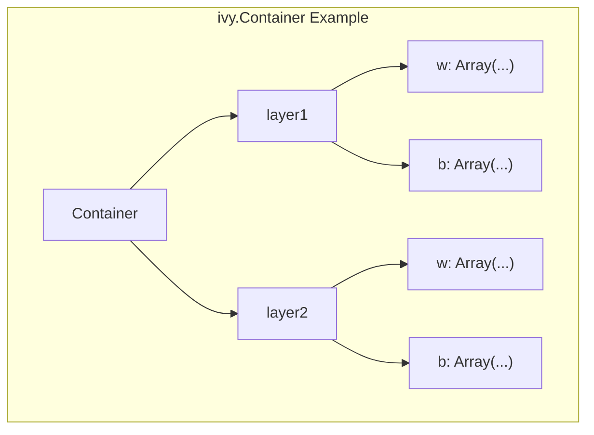
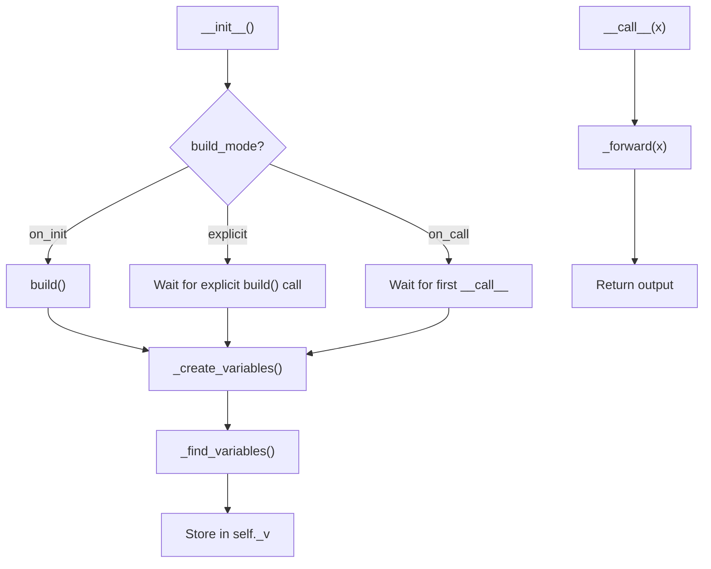
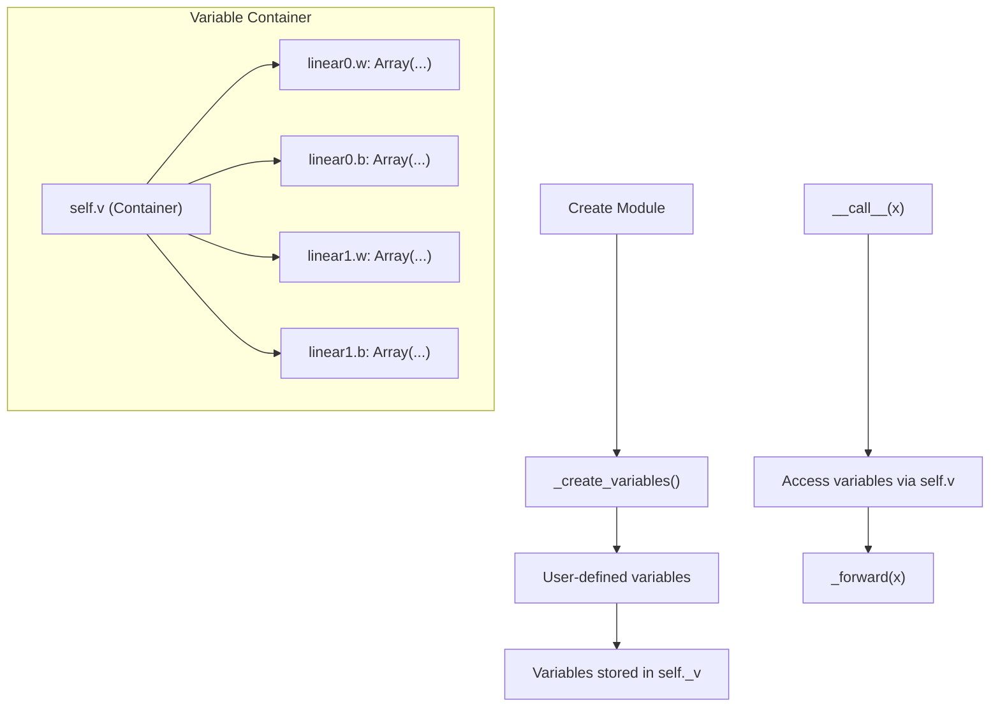
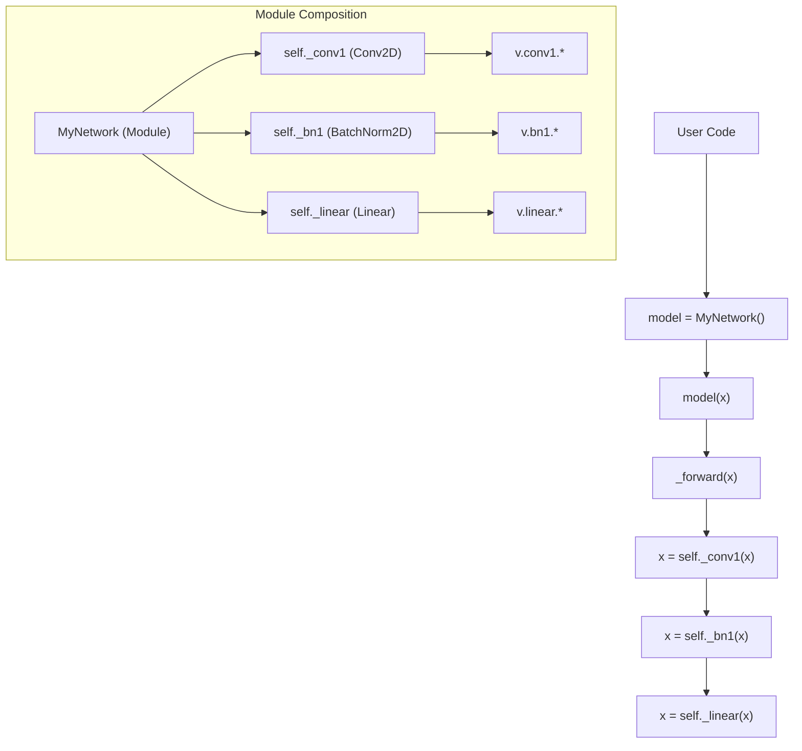
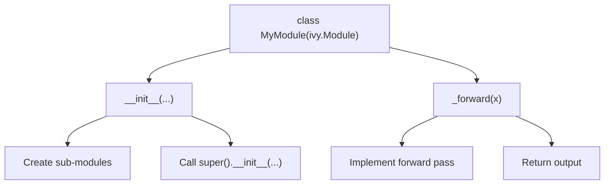
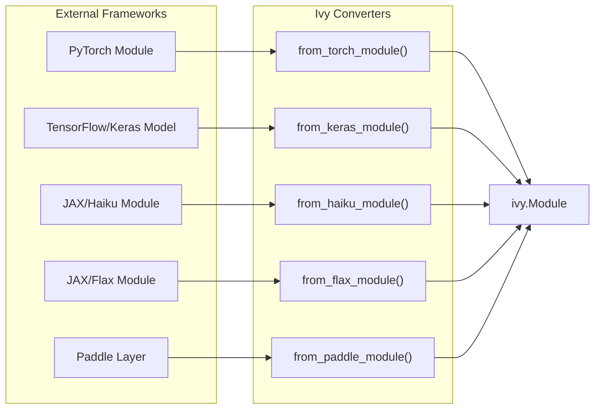
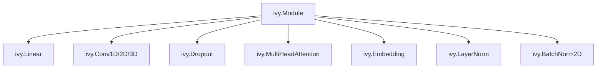
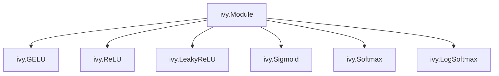
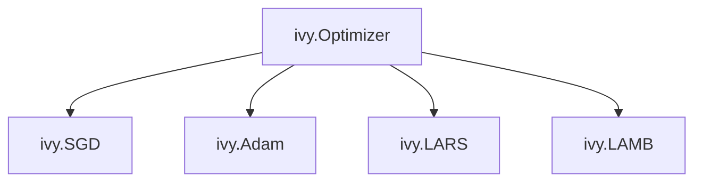
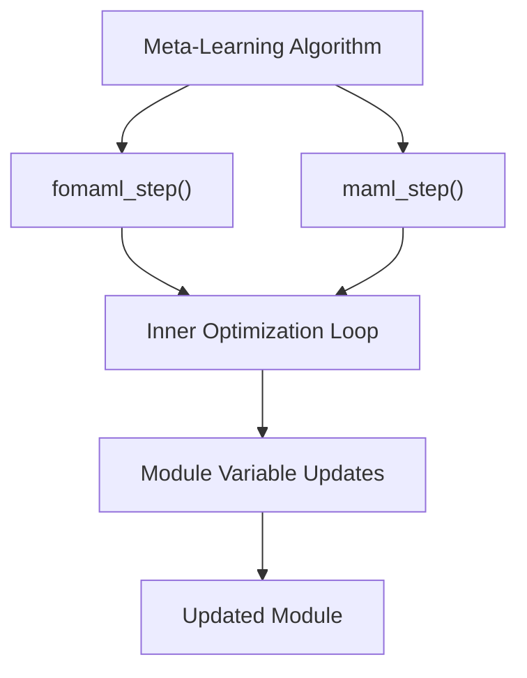

<!-- source: DeepWiki mcp.deepwiki.com · repo ivy-llc/ivy · page 5 Container and Module System · fetched 2026-10-21 -->

# Container and Module System

<details>
<summary>Relevant source files</summary>

The following files were used as context for generating this wiki page:

- [ivy/functional/ivy/meta.py](ivy/functional/ivy/meta.py)
- [ivy/stateful/activations.py](ivy/stateful/activations.py)
- [ivy/stateful/converters.py](ivy/stateful/converters.py)
- [ivy/stateful/initializers.py](ivy/stateful/initializers.py)
- [ivy/stateful/layers.py](ivy/stateful/layers.py)
- [ivy/stateful/module.py](ivy/stateful/module.py)
- [ivy/stateful/norms.py](ivy/stateful/norms.py)
- [ivy/stateful/optimizers.py](ivy/stateful/optimizers.py)
- [ivy/stateful/sequential.py](ivy/stateful/sequential.py)
- [ivy_tests/test_ivy/test_functional/test_core/test_meta.py](ivy_tests/test_ivy/test_functional/test_core/test_meta.py)
- [ivy_tests/test_ivy/test_stateful/test_activations.py](ivy_tests/test_ivy/test_stateful/test_activations.py)
- [ivy_tests/test_ivy/test_stateful/test_converters.py](ivy_tests/test_ivy/test_stateful/test_converters.py)
- [ivy_tests/test_ivy/test_stateful/test_initializers.py](ivy_tests/test_ivy/test_stateful/test_initializers.py)
- [ivy_tests/test_ivy/test_stateful/test_layers.py](ivy_tests/test_ivy/test_stateful/test_layers.py)
- [ivy_tests/test_ivy/test_stateful/test_modules.py](ivy_tests/test_ivy/test_stateful/test_modules.py)
- [ivy_tests/test_ivy/test_stateful/test_norms.py](ivy_tests/test_ivy/test_stateful/test_norms.py)
- [ivy_tests/test_ivy/test_stateful/test_optimizers.py](ivy_tests/test_ivy/test_stateful/test_optimizers.py)
- [ivy_tests/test_ivy/test_stateful/test_sequential.py](ivy_tests/test_ivy/test_stateful/test_sequential.py)

</details>


This document covers Ivy's Container and Module System, which provides the foundation for building stateful neural networks and organizing collections of arrays. The Container class offers a powerful way to manage nested collections of arrays, while the Module class enables the creation of trainable neural network components with variables that can be updated during training.

For details on individual layer implementations, see [Neural Network Layers](#4.7).

## Overview

The Container and Module System forms a key part of Ivy's architecture, providing:

1. A class for nested collections of arrays (Container)
2. A base class for trainable modules (Module)
3. Variable management and tracking
4. Module composition capabilities
5. Conversion utilities for importing from other frameworks

These components enable both functional and object-oriented programming approaches to building and training neural networks.

```mermaid
classDiagram
    class "ivy.Container" {
        +dict_keys: dict keys
        +cont_map(func): Container
        +cont_to_iterator(): Iterator
        +cont_flatten(): Container
        +stop_gradient(): Container
    }
    
    class "ivy.Module" {
        -_build_mode: str
        -_v: Container
        -_built: bool
        +__call__(x): Output
        +v: Container
        +build(): Container
        +train(mode): Module
        +eval(): Module
    }
    
    "ivy.Module" --> "ivy.Container" : uses for variables
    
    class "ivy.Linear" {
        -_input_channels: int
        -_output_channels: int
        -_with_bias: bool
        +_forward(x): Output
    }
    
    class "ivy.Sequential" {
        -_submodules: List[Module]
        +_forward(x): Output
    }
    
    "ivy.Module" <|-- "ivy.Linear"
    "ivy.Module" <|-- "ivy.Sequential"
```

Sources: [ivy/stateful/module.py:39-663](ivy/stateful/module.py:39-663), [ivy/stateful/sequential.py:11-81](ivy/stateful/sequential.py:11-81)

## Container System

The Container class is a powerful data structure that acts as a nested dictionary for storing and manipulating arrays. It's especially useful for organizing the parameters of neural networks in a structured and convenient way.

### Key Features

- **Nested Structure**: Contains data organized in a hierarchical structure
- **Dictionary-like Interface**: Provides familiar dictionary access patterns
- **Array Type Compatibility**: Works with arrays from any supported backend framework
- **Functional Operations**: Supports mapping functions across all contained arrays
- **Gradient Management**: Capabilities for tracking and stopping gradients



Sources: [ivy/stateful/module.py:99-101](ivy/stateful/module.py:99-101), [ivy/stateful/module.py:646-651](ivy/stateful/module.py:646-651)

## Module System

The Module class serves as the foundation for building neural networks in Ivy. It provides a stateful object-oriented interface that manages variables for training.

### Module Lifecycle



The Module lifecycle consists of three main phases:

1. **Initialization**: The `__init__` method sets up the module configuration
2. **Building**: Variables are created based on the build mode
3. **Forward Pass**: The `__call__` method triggers the forward computation

The build mode controls when variables are created:
- `on_init`: Build immediately during initialization (default)
- `explicit`: Wait for an explicit call to `build()`
- `on_call`: Build on the first call to `__call__()`

Sources: [ivy/stateful/module.py:42-149](ivy/stateful/module.py:42-149), [ivy/stateful/module.py:469-512](ivy/stateful/module.py:469-512)

### Variable Management

The Module class automatically manages variable creation and tracking:



Module variables are stored in a Container accessible via the `.v` property. This Container holds all trainable parameters that can be updated during the training process.

Sources: [ivy/stateful/module.py:572-588](ivy/stateful/module.py:572-588), [ivy/stateful/module.py:645-657](ivy/stateful/module.py:645-657)

### Key Methods

| Method | Description |
|--------|-------------|
| `__init__()` | Initializes the module and optionally builds it |
| `build()` | Creates internal variables and prepares the module |
| `_build()` | Abstract method to be implemented by child classes |
| `_create_variables()` | Creates trainable variables for the module |
| `_forward()` | Implements the forward computation (must override) |
| `__call__()` | Handles the forward pass with variable management |
| `train(mode=True)` | Sets the module to training mode |
| `eval()` | Sets the module to evaluation mode |
| `save_weights(path)` | Saves module weights to a file |
| `to_device(device)` | Moves all variables to the specified device |

Sources: [ivy/stateful/module.py:151-466](ivy/stateful/module.py:151-466)

## Module Composition

Modules can be composed by nesting them within each other, creating complex neural network architectures:



Ivy provides `Sequential` for simple sequential composition of modules, similar to frameworks like PyTorch and TensorFlow:

```python
model = ivy.Sequential(
    ivy.Conv2D(3, 64, [3, 3]),
    ivy.ReLU(),
    ivy.Linear(64, 10)
)
```

Sources: [ivy/stateful/sequential.py:11-81](ivy/stateful/sequential.py:11-81)

## Creating Custom Modules

To create a custom module, you need to:

1. Subclass `ivy.Module`
2. Initialize components in `__init__()`
3. Implement the `_forward()` method

Example structure:



The framework will automatically track variables through the module hierarchy.

Sources: [ivy_tests/test_ivy/test_stateful/test_modules.py:14-33](ivy_tests/test_ivy/test_stateful/test_modules.py:14-33)

## Framework Converters

Ivy provides converters to import modules from other frameworks:



These converters provide interoperability for models built in different frameworks, allowing seamless integration with Ivy.

Sources: [ivy/stateful/converters.py:15-426](ivy/stateful/converters.py:15-426)

## Neural Network Implementation

Ivy provides implementations of common neural network components built on the Module system:

### Layers

Various neural network layers like Linear, Conv1D, Conv2D, Dropout, etc. are implemented as Module subclasses.



Sources: [ivy/stateful/layers.py:17-119](ivy/stateful/layers.py:17-119), [ivy/stateful/layers.py:131-193](ivy/stateful/layers.py:131-193)

### Activations

Common activation functions are implemented as Module subclasses:



Sources: [ivy/stateful/activations.py:9-604](ivy/stateful/activations.py:9-604)

### Optimizers

Optimizers for training neural networks:



Sources: [ivy/stateful/optimizers.py:16-89](ivy/stateful/optimizers.py:16-89)

## Meta-Learning Support

The Container and Module System also supports meta-learning workflows:



Sources: [ivy/functional/ivy/meta.py:509-532](ivy/functional/ivy/meta.py:509-532)

## Summary

The Container and Module System forms the foundation of Ivy's stateful neural network capabilities, offering:

1. A flexible Container for organizing arrays and variables
2. A powerful Module base class for building neural networks
3. Automatic variable tracking and management
4. Support for module composition and reuse
5. Interoperability with other frameworks
6. Pre-built implementations of common neural network components

This system enables both researchers and practitioners to build, train, and deploy neural networks in a framework-agnostic manner.

---

