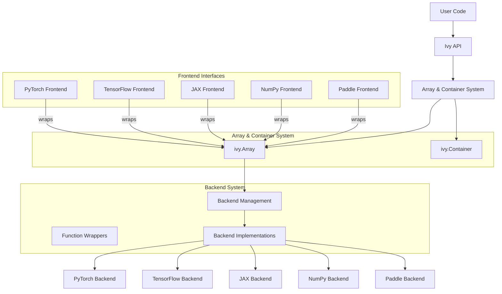
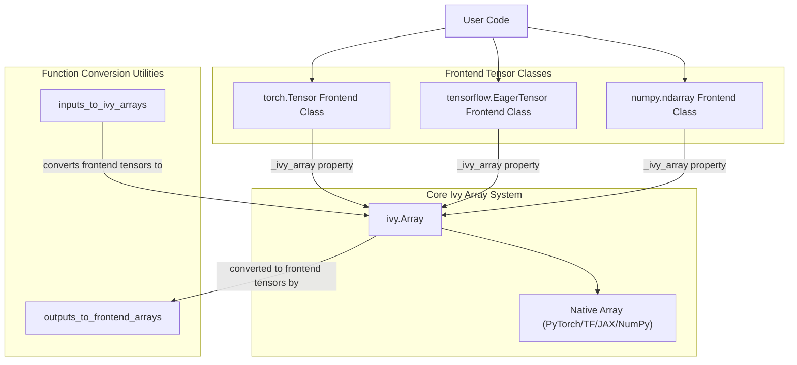
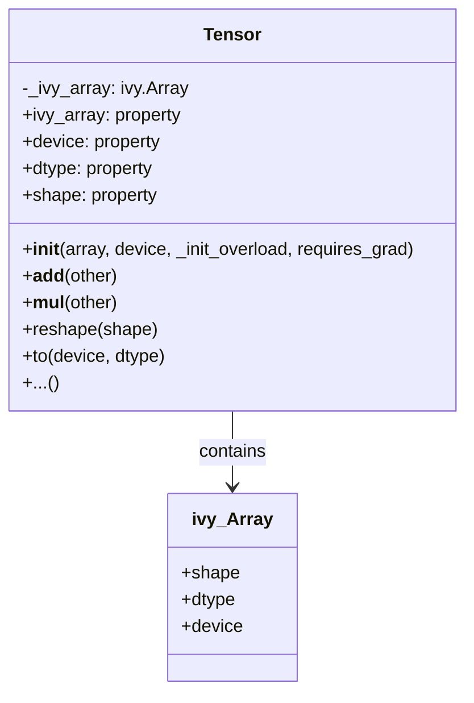
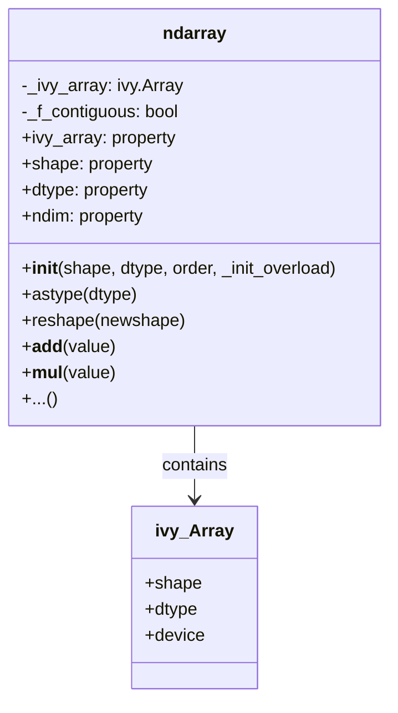
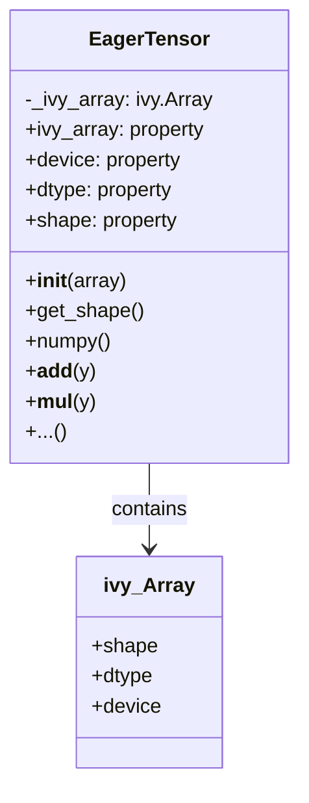
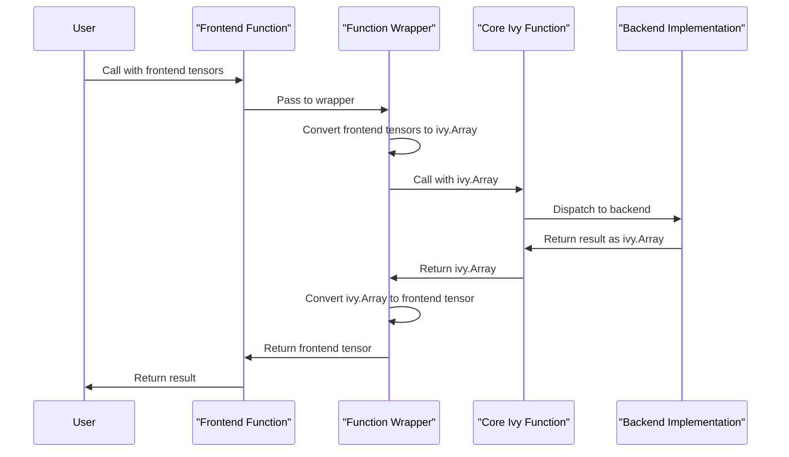
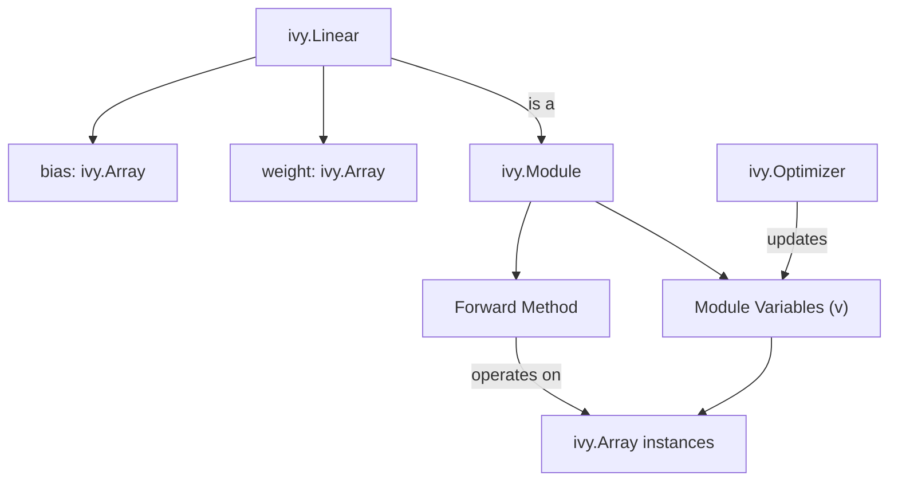

<!-- source: DeepWiki mcp.deepwiki.com · repo ivy-llc/ivy · page 5.1 Ivy Array · fetched 2026-10-21 -->

# Ivy Array

Relevant source files

The following files were used as context for generating this wiki page:

- [ivy/data_classes/container/conversions.py](ivy/data_classes/container/conversions.py)
- [ivy/functional/frontends/jax/func_wrapper.py](ivy/functional/frontends/jax/func_wrapper.py)
- [ivy/functional/frontends/numpy/func_wrapper.py](ivy/functional/frontends/numpy/func_wrapper.py)
- [ivy/functional/frontends/numpy/ndarray/ndarray.py](ivy/functional/frontends/numpy/ndarray/ndarray.py)
- [ivy/functional/frontends/onnx/func_wrapper.py](ivy/functional/frontends/onnx/func_wrapper.py)
- [ivy/functional/frontends/paddle/func_wrapper.py](ivy/functional/frontends/paddle/func_wrapper.py)
- [ivy/functional/frontends/tensorflow/func_wrapper.py](ivy/functional/frontends/tensorflow/func_wrapper.py)
- [ivy/functional/frontends/tensorflow/tensor.py](ivy/functional/frontends/tensorflow/tensor.py)
- [ivy/functional/frontends/torch/func_wrapper.py](ivy/functional/frontends/torch/func_wrapper.py)
- [ivy/functional/frontends/torch/tensor.py](ivy/functional/frontends/torch/tensor.py)
- [ivy/functional/ivy/meta.py](ivy/functional/ivy/meta.py)
- [ivy/stateful/activations.py](ivy/stateful/activations.py)
- [ivy/stateful/converters.py](ivy/stateful/converters.py)
- [ivy/stateful/initializers.py](ivy/stateful/initializers.py)
- [ivy/stateful/layers.py](ivy/stateful/layers.py)
- [ivy/stateful/module.py](ivy/stateful/module.py)
- [ivy/stateful/norms.py](ivy/stateful/norms.py)
- [ivy/stateful/optimizers.py](ivy/stateful/optimizers.py)
- [ivy/stateful/sequential.py](ivy/stateful/sequential.py)
- [ivy_tests/test_ivy/test_frontends/test_jax/test_func_wrapper.py](ivy_tests/test_ivy/test_frontends/test_jax/test_func_wrapper.py)
- [ivy_tests/test_ivy/test_frontends/test_numpy/test_ndarray/test_ndarray.py](ivy_tests/test_ivy/test_frontends/test_numpy/test_ndarray/test_ndarray.py)
- [ivy_tests/test_ivy/test_frontends/test_tensorflow/test_tensor.py](ivy_tests/test_ivy/test_frontends/test_tensorflow/test_tensor.py)
- [ivy_tests/test_ivy/test_frontends/test_torch/test_tensor.py](ivy_tests/test_ivy/test_frontends/test_torch/test_tensor.py)
- [ivy_tests/test_ivy/test_functional/test_core/test_meta.py](ivy_tests/test_ivy/test_functional/test_core/test_meta.py)
- [ivy_tests/test_ivy/test_stateful/test_activations.py](ivy_tests/test_ivy/test_stateful/test_activations.py)
- [ivy_tests/test_ivy/test_stateful/test_converters.py](ivy_tests/test_ivy/test_stateful/test_converters.py)
- [ivy_tests/test_ivy/test_stateful/test_initializers.py](ivy_tests/test_ivy/test_stateful/test_initializers.py)
- [ivy_tests/test_ivy/test_stateful/test_layers.py](ivy_tests/test_ivy/test_stateful/test_layers.py)
- [ivy_tests/test_ivy/test_stateful/test_modules.py](ivy_tests/test_ivy/test_stateful/test_modules.py)
- [ivy_tests/test_ivy/test_stateful/test_norms.py](ivy_tests/test_ivy/test_stateful/test_norms.py)
- [ivy_tests/test_ivy/test_stateful/test_optimizers.py](ivy_tests/test_ivy/test_stateful/test_optimizers.py)
- [ivy_tests/test_ivy/test_stateful/test_sequential.py](ivy_tests/test_ivy/test_stateful/test_sequential.py)

## Introduction

Ivy Array is the core data structure in the Ivy framework that provides a unified representation of multi-dimensional arrays across different machine learning frameworks. It serves as a critical abstraction layer that enables framework-agnostic programming by wrapping native arrays from backends like PyTorch, TensorFlow, JAX, NumPy, and others. This page explains the purpose, structure, and role of Ivy Array within the larger Ivy ecosystem.

For information about the Container data structure that can hold collections of Ivy Arrays, see [Ivy Container](#5.2).

Sources:
[ivy/functional/frontends/torch/tensor.py:20-39](),(ivy/functional/frontends/numpy/ndarray/ndarray.py:18-39]()

## Position in Ivy Architecture

The following diagram illustrates where Ivy Array sits within the overall architecture of the Ivy framework:

Sources:
[ivy/functional/frontends/torch/tensor.py:20-39](),(ivy/functional/frontends/numpy/ndarray/ndarray.py:18-40](), [ivy/functional/frontends/tensorflow/tensor.py:11-37]()

## Structure and Implementation

Ivy Array serves as an abstraction over native arrays from various machine learning frameworks. The following diagram illustrates how Ivy Array is structured and how it interacts with different components:

Sources:
[ivy/functional/frontends/torch/tensor.py:20-39](),(ivy/functional/frontends/torch/func_wrapper.py:97-125](), [ivy/functional/frontends/numpy/ndarray/ndarray.py:18-52](), [ivy/functional/frontends/tensorflow/tensor.py:11-37]()

### Core Structure

At its core, an Ivy Array is defined by:

1. The actual data stored in a native array format (e.g., PyTorch tensor, TensorFlow tensor)
2. Properties and methods that provide a consistent interface across frameworks
3. Conversion utilities that facilitate interoperability between frameworks

When a user interacts with Ivy's frontend API, they work with framework-specific classes (like `torch.Tensor` in the PyTorch frontend) that internally wrap an Ivy Array via the `_ivy_array` property.

Sources:
[ivy/functional/frontends/torch/tensor.py:59-104](),(ivy/functional/frontends/numpy/ndarray/ndarray.py:46-85](), [ivy/functional/frontends/tensorflow/tensor.py:27-43]()

## Frontend Integration

Ivy Array serves as the bridge between different frontend interfaces. Each frontend framework in Ivy (PyTorch, TensorFlow, NumPy, etc.) has its own tensor/array class that wraps an Ivy Array. This setup allows users to work with familiar APIs while leveraging Ivy's framework-agnostic capabilities.

### Example: PyTorch Frontend Tensor

In the PyTorch frontend, the `Tensor` class wraps an Ivy Array:

The PyTorch frontend tensor defines numerous methods that operate on the underlying Ivy Array, including arithmetic operations, reshaping, type conversion, and more.

Sources:
[ivy/functional/frontends/torch/tensor.py:20-1100]()

### Example: NumPy Frontend ndarray

Similarly, the NumPy frontend has an `ndarray` class that wraps an Ivy Array:

Sources:
[ivy/functional/frontends/numpy/ndarray/ndarray.py:18-668]()

### Example: TensorFlow Frontend EagerTensor

The TensorFlow frontend provides an `EagerTensor` class that also wraps an Ivy Array:

Sources:
[ivy/functional/frontends/tensorflow/tensor.py:11-340]()

## Function Wrapper System

Ivy's function wrapper system plays a crucial role in handling conversions between frontend tensor objects and Ivy Arrays. This system allows functions to operate on Ivy Arrays internally while presenting a frontend-specific interface to the user.

Key conversion functions include:

1. `inputs_to_ivy_arrays`: Converts frontend tensors to Ivy Arrays
2. `outputs_to_frontend_arrays`: Converts Ivy Arrays back to frontend tensors
3. `to_ivy_arrays_and_back`: Combines both conversions in a single wrapper

Sources:
[ivy/functional/frontends/torch/func_wrapper.py:97-168](),(ivy/functional/frontends/numpy/func_wrapper.py:187-220](), [ivy/functional/frontends/tensorflow/func_wrapper.py:12-36]()

## Common Properties and Methods

Ivy Array provides a consistent set of properties and methods across different frontend implementations:

### Key Properties

| Property | Description | Implementation Examples |
|----------|-------------|------------------------|
| `ivy_array` | The underlying Ivy Array | All frontend tensor classes |
| `shape` | The shape of the array | All frontend tensor classes |
| `dtype` | The data type of the array | All frontend tensor classes |
| `device` | The device on which the array is stored | All frontend tensor classes |
| `T` | Transpose of the array | PyTorch, NumPy frontends |
| `ndim` | Number of dimensions | PyTorch, NumPy frontends |

### Common Methods

| Method | Description | Implementation Examples |
|--------|-------------|------------------------|
| `__add__`, `__mul__`, etc. | Arithmetic operations | All frontend tensor classes |
| `reshape` | Reshape the array | All frontend tensor classes |
| `transpose` | Transpose dimensions | All frontend tensor classes |
| `to` / `astype` | Convert to different dtype or device | PyTorch, NumPy frontends |
| `__getitem__` | Array indexing | All frontend tensor classes |

Sources:
[ivy/functional/frontends/torch/tensor.py:56-145](),(ivy/functional/frontends/numpy/ndarray/ndarray.py:46-87](), [ivy/functional/frontends/tensorflow/tensor.py:27-43]()

## Integration with Module System

Ivy Array is a fundamental component that integrates with the Ivy Module system. Modules in Ivy manage variables that are typically Ivy Arrays:

The Module system has mechanisms to:
1. Create and manage Ivy Arrays as variables
2. Perform operations on these arrays through forward passes
3. Update arrays during training through optimizers

Sources:
[ivy/stateful/module.py:39-1072](),(ivy/stateful/layers.py:17-102]()

## Array Conversion Utilities

Ivy provides various utility functions to convert between different array types:

### Key Conversion Functions

| Function | Purpose |
|----------|---------|
| `_to_ivy_array` | Convert a native array or frontend tensor to an Ivy Array |
| `_from_ivy_array_to_torch_frontend_tensor` | Convert an Ivy Array to a PyTorch frontend tensor |
| `_ivy_array_to_tensorflow` | Convert an Ivy Array to a TensorFlow frontend tensor |
| `_ivy_to_numpy` | Convert an Ivy Array to a NumPy frontend array |

These conversion utilities allow seamless interoperation between different frameworks through Ivy's unified interface.

Sources:
[ivy/functional/frontends/torch/func_wrapper.py:97-125](),(ivy/functional/frontends/numpy/func_wrapper.py:187-220](), [ivy/functional/frontends/tensorflow/func_wrapper.py:12-36]()

## Summary

Ivy Array is the foundational data structure in the Ivy framework that provides a unified representation for multi-dimensional arrays across different machine learning frameworks. It enables framework-agnostic programming by:

1. Serving as a common representation for arrays from different frameworks
2. Providing a consistent interface for array operations
3. Facilitating conversion between different framework-specific tensor types
4. Integrating with Ivy's Module system for building and training neural networks

Through this unified array interface, Ivy achieves its goal of providing a single API that works across different machine learning frameworks, allowing code to be written once and run anywhere.

Sources:
[ivy/functional/frontends/torch/tensor.py:20-1100](),(ivy/functional/frontends/numpy/ndarray/ndarray.py:18-668](), [ivy/functional/frontends/tensorflow/tensor.py:11-340]()

---

