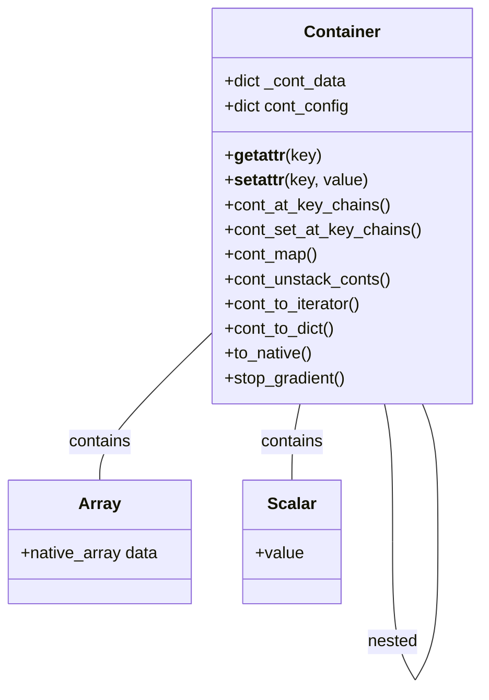
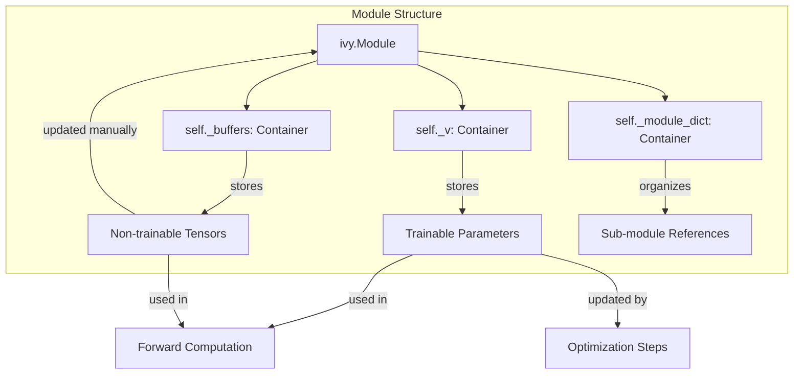
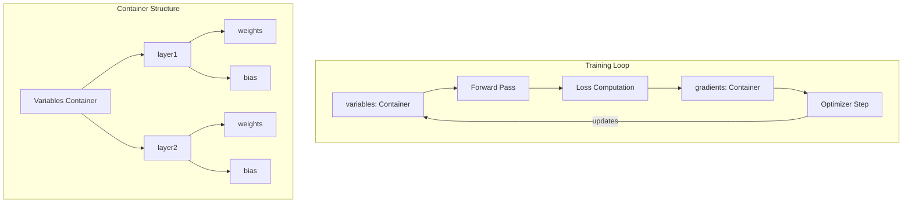

<!-- source: DeepWiki mcp.deepwiki.com · repo ivy-llc/ivy · page 5.2 Ivy Container · fetched 2026-10-21 -->

# Ivy Container

<details>
<summary>Relevant source files</summary>

The following files were used as context for generating this wiki page:

- [ivy/functional/ivy/meta.py](ivy/functional/ivy/meta.py)
- [ivy/stateful/activations.py](ivy/stateful/activations.py)
- [ivy/stateful/converters.py](ivy/stateful/converters.py)
- [ivy/stateful/initializers.py](ivy/stateful/initializers.py)
- [ivy/stateful/layers.py](ivy/stateful/layers.py)
- [ivy/stateful/module.py](ivy/stateful/module.py)
- [ivy/stateful/norms.py](ivy/stateful/norms.py)
- [ivy/stateful/optimizers.py](ivy/stateful/optimizers.py)
- [ivy/stateful/sequential.py](ivy/stateful/sequential.py)
- [ivy_tests/test_ivy/test_functional/test_core/test_meta.py](ivy_tests/test_ivy/test_functional/test_core/test_meta.py)
- [ivy_tests/test_ivy/test_stateful/test_activations.py](ivy_tests/test_ivy/test_stateful/test_activations.py)
- [ivy_tests/test_ivy/test_stateful/test_converters.py](ivy_tests/test_ivy/test_stateful/test_converters.py)
- [ivy_tests/test_ivy/test_stateful/test_initializers.py](ivy_tests/test_ivy/test_stateful/test_initializers.py)
- [ivy_tests/test_ivy/test_stateful/test_layers.py](ivy_tests/test_ivy/test_stateful/test_layers.py)
- [ivy_tests/test_ivy/test_stateful/test_modules.py](ivy_tests/test_ivy/test_stateful/test_modules.py)
- [ivy_tests/test_ivy/test_stateful/test_norms.py](ivy_tests/test_ivy/test_stateful/test_norms.py)
- [ivy_tests/test_ivy/test_stateful/test_optimizers.py](ivy_tests/test_ivy/test_stateful/test_optimizers.py)
- [ivy_tests/test_ivy/test_stateful/test_sequential.py](ivy_tests/test_ivy/test_stateful/test_sequential.py)

</details>


The Ivy Container is a versatile nested dictionary-like data structure in the Ivy library that provides hierarchical organization for arrays, variables, and other data. It's one of the core data classes in Ivy, enabling consistent representation and manipulation of structured data across different ML frameworks. For information about the Ivy Array class, see [Ivy Array](#5.1).

## Overview

The Ivy Container serves as a fundamental building block for organizing and manipulating collections of arrays or other values in a hierarchical manner. It's particularly important for:

1. Storing and managing trainable variables in neural networks
2. Organizing model parameters and gradients
3. Handling batched data with complex structures
4. Providing a consistent interface across different backend frameworks

Sources: [ivy/stateful/module.py:13-14](), [ivy/stateful/module.py:92-102]()

## Container Structure

The Container is essentially a hierarchical dictionary-like structure that can hold arrays, scalars, or other containers. It organizes data with string keys in a tree-like format, allowing for intuitive access to nested values using dot notation or key chains.



### Key Attributes and Methods

The Container provides several important capabilities:

- **Key Chain Access**: Access nested values using dot notation or key chains
- **Mapping Operations**: Apply functions across all elements in the container
- **Shape Manipulation**: Operations like stacking, unstacking, and reshaping container structures
- **Type Conversion**: Methods to convert between native types and Ivy types
- **Gradient Control**: Control gradient flow through the container

Sources: [ivy/stateful/module.py:98-102](), [ivy/functional/ivy/meta.py:89-91](), [ivy/meta.py:98-106]()

## Container Usage in Module System

The Container is a core component of Ivy's Module system. Every Module instance maintains three primary containers:

1. **Variables Container (`self._v`)**: Stores trainable parameters
2. **Buffers Container (`self._buffers`)**: Stores non-trainable arrays used in the module
3. **Module Dictionary (`self._module_dict`)**: Keeps track of module structure



### How Modules Use Containers

When a Module is built, it:

1. Creates variables in its `_create_variables` method
2. Stores these variables in a Container (`self._v`)
3. Uses these variables in the forward pass
4. Updates the variables during optimization

This Container-based architecture allows Modules to:
- Manage complex parameter hierarchies
- Track variable dependencies
- Efficiently update subsets of parameters
- Maintain a clean separation between variables and computation

Sources: [ivy/stateful/module.py:42-102](), [ivy/stateful/module.py:154-293]()

## Creating and Manipulating Containers

### Creating Containers

Containers can be created from dictionaries, other containers, or manually by adding attributes:

```python
# From dictionary
params = ivy.Container({'layer1': {'w': w1, 'b': b1}, 'layer2': {'w': w2, 'b': b2}})

# Using attributes
params = ivy.Container()
params.layer1.w = w1
params.layer1.b = b1
params.layer2.w = w2
params.layer2.b = b2
```

### Accessing Container Elements

Container elements can be accessed using attribute notation or key chains:

```python
# Attribute notation
weight1 = params.layer1.w

# Key chains
weight1 = params['layer1/w']  # Using string key chain
weight1 = params.cont_at_key_chains('layer1/w')  # Using method
```

### Container Operations

Containers support various operations for manipulation:

| Operation | Description | Method |
|-----------|-------------|--------|
| Mapping | Apply a function to all elements | `cont_map(fn)` |
| Filtering | Filter elements based on a condition | `cont_filter(fn)` |
| Unstacking | Split container along a dimension | `cont_unstack_conts(axis)` |
| Cloning | Create a copy of the container | `cont_copy()` |
| Pruning | Remove specific key chains | `cont_prune_key_chains(key_chains)` |
| Flattening | Convert to a flat container | `cont_flatten()` |

Sources: [ivy/functional/ivy/meta.py:89-91](), [ivy/stateful/module.py:98-102]()

## Container in Training and Optimization

The Container is particularly useful in training neural networks, as it provides a structured way to manage variables and gradients:



### Gradient Computation

When computing gradients, Ivy returns the gradients in a Container with the same structure as the variables:

```python
def loss_fn(v):
    # Forward pass using variables in v
    out = model(x, v=v)
    return ivy.mean(out)

# Compute gradients
loss, grads = ivy.execute_with_gradients(loss_fn, module.v)

# grads has the same structure as module.v
```

### Optimization

Optimizers use the gradient Container to update the variable Container:

```python
# Update variables with gradients
module.v = ivy.gradient_descent_update(module.v, grads, learning_rate)
```

Sources: [ivy_tests/test_ivy/test_stateful/test_modules.py:275-288](), [ivy/stateful/module.py:466-512]()

## Advanced Container Features

### Container Configuration

Containers have a configuration dictionary (`cont_config`) that controls behavior such as:
- Framework compatibility
- Implicit type conversion
- Gradient tracking options

### Container Nesting and Shape Operations

Containers support nested operations that preserve structure:

- **Reshaping**: Change the structure while preserving hierarchy
- **Broadcasting**: Apply operations across differently shaped containers
- **Reduction**: Aggregate values across container dimensions

### Container and Backend Integration

One powerful feature of Ivy's Container is its ability to work across different ML frameworks:

- Container elements can be native arrays from different frameworks (PyTorch, TensorFlow, JAX, etc.)
- Operations maintain framework compatibility through the Ivy backend system
- Type conversion happens automatically when required

Sources: [ivy/stateful/module.py:99-102](), [ivy/stateful/module.py:226-227]()

## Practical Examples

### Neural Network Parameter Organization

```python
# Module variables stored in a Container
model = ivy.Linear(10, 5)
print(model.v)
# Container with structure:
# {
#   'w': ivy.Array(shape=(10, 5)),
#   'b': ivy.Array(shape=(5,))
# }
```

### Meta-Learning with Nested Containers

Containers are especially useful in meta-learning, where you need to manage multiple sets of parameters:

```python
# Container of task-specific parameters
task_params = ivy.Container({
    'task1': {
        'layer1': {'w': w1, 'b': b1},
        'layer2': {'w': w2, 'b': b2}
    },
    'task2': {
        'layer1': {'w': w3, 'b': b3},
        'layer2': {'w': w4, 'b': b4}
    }
})
```

Sources: [ivy/functional/ivy/meta.py:89-106](), [ivy/functional/ivy/meta.py:428-437]()

## Container vs Other Data Structures

Compared to other Python data structures, the Ivy Container offers several advantages:

| Feature | Container | Dict | List | NamedTuple |
|---------|-----------|------|------|------------|
| Attribute access | ✓ | ✗ | ✗ | ✓ |
| Nested structures | ✓ | ✓ | ✓ | ✗ |
| Dynamic attributes | ✓ | ✓ | ✗ | ✗ |
| Vectorized operations | ✓ | ✗ | ✗ | ✗ |
| Backend compatibility | ✓ | ✗ | ✗ | ✗ |
| Gradient tracking | ✓ | ✗ | ✗ | ✗ |

The Container's combination of dictionary-like flexibility and object-like attribute access makes it particularly well-suited for complex neural network programming.

Sources: [ivy/stateful/module.py:98-102](), [ivy/functional/ivy/meta.py:89-91]()

## Summary

The Ivy Container is a powerful data structure that forms a core component of the Ivy library. It provides:

1. A hierarchical organization for neural network parameters
2. Intuitive access to nested data structures
3. Framework-agnostic operations on collections of arrays
4. Support for meta-learning and complex gradient operations

By combining dictionary-like nesting with object-like attribute access, Containers offer an elegant solution for managing the complex data structures required in machine learning applications.

---

