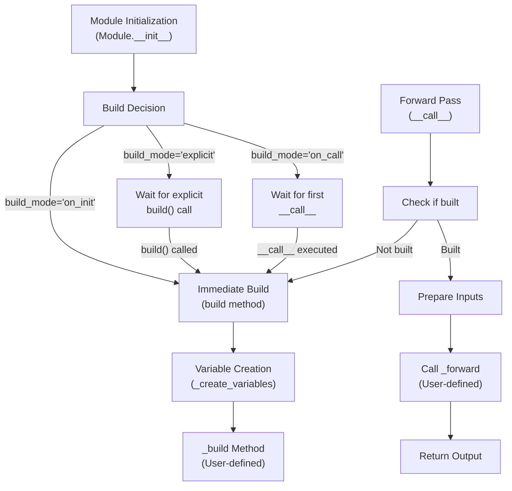
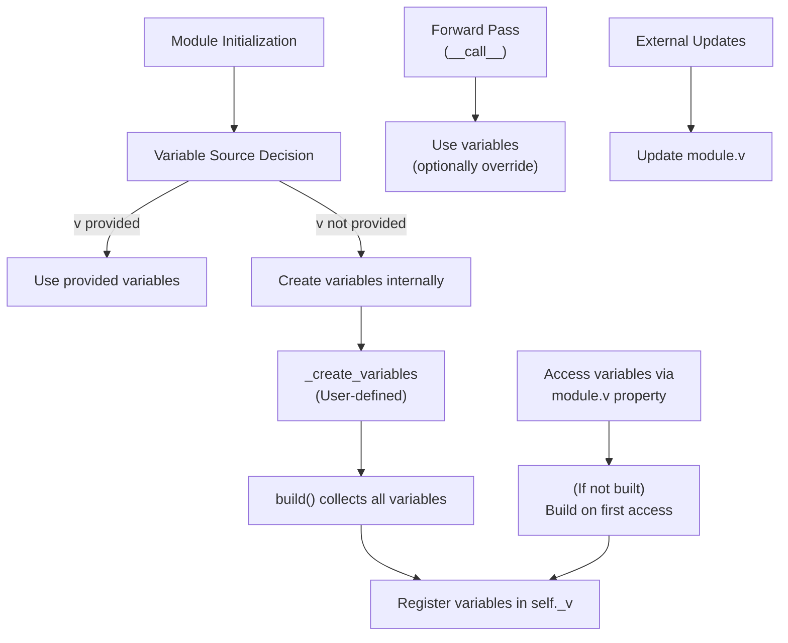

<!-- source: DeepWiki mcp.deepwiki.com · repo ivy-llc/ivy · page 5.3 Module System · fetched 2026-10-21 -->

# Module System

<details>
<summary>Relevant source files</summary>

The following files were used as context for generating this wiki page:

- [ivy/functional/ivy/meta.py](ivy/functional/ivy/meta.py)
- [ivy/stateful/activations.py](ivy/stateful/activations.py)
- [ivy/stateful/converters.py](ivy/stateful/converters.py)
- [ivy/stateful/initializers.py](ivy/stateful/initializers.py)
- [ivy/stateful/layers.py](ivy/stateful/layers.py)
- [ivy/stateful/module.py](ivy/stateful/module.py)
- [ivy/stateful/norms.py](ivy/stateful/norms.py)
- [ivy/stateful/optimizers.py](ivy/stateful/optimizers.py)
- [ivy/stateful/sequential.py](ivy/stateful/sequential.py)
- [ivy_tests/test_ivy/test_functional/test_core/test_meta.py](ivy_tests/test_ivy/test_functional/test_core/test_meta.py)
- [ivy_tests/test_ivy/test_stateful/test_activations.py](ivy_tests/test_ivy/test_stateful/test_activations.py)
- [ivy_tests/test_ivy/test_stateful/test_converters.py](ivy_tests/test_ivy/test_stateful/test_converters.py)
- [ivy_tests/test_ivy/test_stateful/test_initializers.py](ivy_tests/test_ivy/test_stateful/test_initializers.py)
- [ivy_tests/test_ivy/test_stateful/test_layers.py](ivy_tests/test_ivy/test_stateful/test_layers.py)
- [ivy_tests/test_ivy/test_stateful/test_modules.py](ivy_tests/test_ivy/test_stateful/test_modules.py)
- [ivy_tests/test_ivy/test_stateful/test_norms.py](ivy_tests/test_ivy/test_stateful/test_norms.py)
- [ivy_tests/test_ivy/test_stateful/test_optimizers.py](ivy_tests/test_ivy/test_stateful/test_optimizers.py)
- [ivy_tests/test_ivy/test_stateful/test_sequential.py](ivy_tests/test_ivy/test_stateful/test_sequential.py)

</details>


The Module System in Ivy provides the foundation for building and managing stateful neural network components. It offers a unified interface for creating trainable modules that work consistently across different backend frameworks. This page details the `ivy.Module` class, which is the central component for building neural networks in Ivy. For information about containers used within modules, see [Ivy Container](#5.2).

## Module Architecture 

The Module System is designed to provide a framework-agnostic way to build neural networks with managed state (parameters and buffers). It facilitates model creation, parameter management, and model training while maintaining compatibility with multiple ML frameworks.

```mermaid
classDiagram
    class "ivy.Module" {
        +__init__(build_mode="on_init", v=None, buffers=None, ...)
        +build(from_call=False, device=None, ...)
        +_build(*args, **kwargs)*
        +_create_variables(device=None, dtype=None)
        +_forward(*args, **kwargs)*
        +__call__(*args, v=None, buffers=None, ...)
        +train(mode=True)
        +eval()
        +trace_graph(args=None, kwargs=None, ...)
        +to_device(device)
        +save_weights(weights_path, /)
        +save(filename)
        +load(filename)
    }
    
    class "ModuleHelpers" {
        #Helper methods for Module
    }
    
    class "ModuleConverters" {
        #Framework conversion methods
    }
    
    class "ModuleMeta" {
        #Meta class for Module
    }
    
    class "ivy.Container" {
        #Nested parameter container
    }
    
    "ivy.Module" --|> "ModuleHelpers"
    "ivy.Module" --|> "ModuleConverters"
    "ivy.Module" --|> "ModuleMeta"
    "ivy.Module" --> "ivy.Container" : stores variables in
```

Sources: [ivy/stateful/module.py:38-662](ivy/stateful/module.py:38-662)

### Core Components

The Module system comprises several key components:

1. **Module Class** - The base class for creating trainable neural network modules
2. **Variable Management** - Handling of trainable parameters and buffers
3. **Build System** - Configurable process for initializing module variables
4. **Framework Converters** - Tools for interoperating with other frameworks

## Module Lifecycle

The lifecycle of an Ivy Module follows several distinct phases:



Sources: [ivy/stateful/module.py:38-153](ivy/stateful/module.py:38-153), [ivy/stateful/module.py:154-299](ivy/stateful/module.py:154-299), [ivy/stateful/module.py:469-513](ivy/stateful/module.py:469-513)

### Initialization

When you create a new module instance, the `__init__` method configures the module with options including:

- **build_mode**: Controls when variables are built ("on_init", "explicit", or "on_call")
- **v**: Optional pre-defined variables container
- **with_partial_v**: Whether to allow partial specification of variables
- **device**: Device on which to create module variables
- **dtype**: Data type for module variables

```python
module = ivy.Module(
    build_mode="on_init",  # Build variables immediately
    device="cpu",          # Create variables on CPU
    dtype="float32"        # Use float32 data type
)
```

Sources: [ivy/stateful/module.py:42-149](ivy/stateful/module.py:42-149)

### Building

Module building is the process of creating internal variables (parameters). This can happen at different times depending on the `build_mode`:

- **on_init**: Variables are built during initialization (default)
- **explicit**: Variables are built only when `build()` is explicitly called
- **on_call**: Variables are built on the first call to the module

The building process involves:

1. Calling the user-defined `_build` method to set up the module structure
2. Creating variables with `_create_variables`
3. Finding and organizing all variables in a container structure

Sources: [ivy/stateful/module.py:154-298](ivy/stateful/module.py:154-298)

### Forward Pass

The forward pass is executed when the module is called with input data:

```python
output = module(input_data)  # Calls __call__ which invokes _forward
```

The `__call__` method:
1. Ensures the module is built
2. Optionally uses provided variables
3. Calls the user-defined `_forward` method with inputs
4. Returns the processed output

Sources: [ivy/stateful/module.py:469-513](ivy/stateful/module.py:469-513)

## Variable Management

Ivy Modules store variables (parameters) in the `v` property as an `ivy.Container`. Variable management involves:



Sources: [ivy/stateful/module.py:572-588](ivy/stateful/module.py:572-588), [ivy/stateful/module.py:625-647](ivy/stateful/module.py:625-647), [ivy/stateful/module.py:514-520](ivy/stateful/module.py:514-520)

### Creating Variables

Variables are created by implementing the `_create_variables` method:

```python
def _create_variables(self, device=None, dtype=None):
    """Create internal variables for the layer."""
    return {
        "weight": self._weight_init.create_variables(
            self._weight_shape, device, dtype=dtype
        ),
        "bias": self._bias_init.create_variables(
            self._bias_shape, device, dtype=dtype
        ),
    }
```

The method returns a dictionary (or `ivy.Container`) of variables which is stored in the module's `v` property.

Sources: [ivy/stateful/layers.py:68-102](ivy/stateful/layers.py:68-102), [ivy/stateful/module.py:572-588](ivy/stateful/module.py:572-588)

### Buffers

In addition to trainable variables, modules can have buffers - non-trainable arrays that are part of the model state:

```python
# Register a buffer
module.register_buffer("running_mean", ivy.zeros(10))

# Access the buffer
running_mean = module.buffers.running_mean
```

Buffers are stored in the `buffers` property and included in the module's `state_dict`.

Sources: [ivy/stateful/module.py:339-352](ivy/stateful/module.py:339-352), [ivy/stateful/module.py:659-657](ivy/stateful/module.py:659-657)

## Creating Custom Modules

To create a custom module, subclass `ivy.Module` and implement at least the `_forward` method:

```python
class MyModule(ivy.Module):
    def __init__(self, in_features, out_features):
        self.linear = ivy.Linear(in_features, out_features)
        ivy.Module.__init__(self)
    
    def _forward(self, x):
        return ivy.relu(self.linear(x))
```

For more complex modules, you can also override the `_build` and `_create_variables` methods:

```python
def _build(self, *args, **kwargs):
    """Build the internal layers."""
    # Create internal layers
    return True  # Indicate successful build

def _create_variables(self, device=None, dtype=None):
    """Create module variables."""
    return {
        "param1": ivy.random_uniform(shape=(10, 10), device=device, dtype=dtype),
        "param2": ivy.zeros(shape=(10,), device=device, dtype=dtype)
    }
```

Sources: [ivy_tests/test_ivy/test_stateful/test_modules.py:14-33](ivy_tests/test_ivy/test_stateful/test_modules.py:14-33), [ivy/stateful/module.py:572-601](ivy/stateful/module.py:572-601), [ivy/stateful/module.py:590-601](ivy/stateful/module.py:590-601)

## Advanced Features

### Training Mode

Modules maintain a training flag that can be toggled with `train()` and `eval()` methods:

```python
# Enable training mode
module.train()

# Disable training mode (evaluation)
module.eval()
```

This flag affects the behavior of certain operations like dropout and batch normalization.

Sources: [ivy/stateful/module.py:366-377](ivy/stateful/module.py:366-377)

### Device Management

You can move a module's variables to a specific device:

```python
# Move to GPU
module.to_device("cuda:0")
```

This recursively moves all variables and buffers in the module.

Sources: [ivy/stateful/module.py:379-387](ivy/stateful/module.py:379-387)

### Graph Tracing

Modules can be traced for optimization:

```python
# Trace the module with example inputs
module.trace_graph(args=(example_input,))

# Now calls to the module will use the optimized graph
output = module(actual_input)
```

Tracing creates an optimized computation graph from the module's forward pass.

Sources: [ivy/stateful/module.py:300-337](ivy/stateful/module.py:300-337)

### Saving and Loading

Modules can be saved to disk and loaded back:

```python
# Save the module
module.save("model.pkl")

# Load the module
loaded_module = ivy.Module.load("model.pkl")
```

For saving just the weights (without the module structure):

```python
# Save only weights
module.save_weights("weights.hdf5")
```

Sources: [ivy/stateful/module.py:416-464](ivy/stateful/module.py:416-464)

## Framework Interoperability

Ivy provides converters for modules from other frameworks through the `ModuleConverters` class:

```mermaid
flowchart TD
    A["Native Framework Modules"] --> B["ivy.to_ivy_module()"]
    B --> C["Framework-specific Converter"]
    
    C --> D["from_haiku_module\n(Haiku)"]
    C --> E["from_flax_module\n(Flax)"] 
    C --> F["from_keras_module\n(TensorFlow)"]
    C --> G["from_paddle_module\n(Paddle)"]
    C --> H["from_torch_module\n(PyTorch)"]
    
    D --> I["_HaikuIvyModule"]
    E --> J["_FlaxIvyModule"]
    F --> K["_KerasIvyModule"]
    G --> L["_PaddleIvyModule"]
    H --> M["_TorchIvyModule"]
    
    I --> N["ivy.Module"]
    J --> N
    K --> N
    L --> N
    M --> N
</flowchart>
```

Sources: [ivy/stateful/converters.py:15-62](ivy/stateful/converters.py:15-62), [ivy/stateful/module.py:664-910](ivy/stateful/module.py:664-910)

### Conversion Methods

To convert a module from another framework to an Ivy module, use the appropriate conversion method:

```python
# Convert from PyTorch
ivy_module = ivy.to_ivy_module(torch_module)

# Convert from Haiku
ivy_module = ivy.Module.from_haiku_module(haiku_module, params_hk)

# Convert from Flax
ivy_module = ivy.Module.from_flax_module(flax_module, params_fx)

# Convert from Keras
ivy_module = ivy.Module.from_keras_module(keras_module)

# Convert from Paddle
ivy_module = ivy.Module.from_paddle_module(paddle_module)
```

The conversion process:
1. Wraps the native module
2. Extracts its variables/parameters
3. Creates an Ivy module that delegates forward passes to the native module
4. Manages variable conversion between Ivy and the native framework

Sources: [ivy/stateful/converters.py:64-634](ivy/stateful/converters.py:64-634), [ivy/stateful/module.py:664-910](ivy/stateful/module.py:664-910)

## Practical Example

Here's a complete example of creating, training, and using a custom module:

```python
# Define a custom module
class MLP(ivy.Module):
    def __init__(self, in_size, out_size, hidden_size=64):
        self._linear0 = ivy.Linear(in_size, hidden_size)
        self._linear1 = ivy.Linear(hidden_size, out_size)
        ivy.Module.__init__(self)
    
    def _forward(self, x):
        x = ivy.relu(self._linear0(x))
        return self._linear1(x)

# Create an instance
model = MLP(10, 1)

# Training loop
def loss_fn(v):
    pred = model(x_data, v=v)
    return ivy.mean((pred - y_data)**2)

# Forward pass and compute gradients
loss, grads = ivy.execute_with_gradients(loss_fn, model.v)

# Update parameters
model.v = ivy.gradient_descent_update(model.v, grads, lr=1e-3)

# Save the trained model
model.save("my_model.pkl")
```

## Summary

The Ivy Module System provides a powerful framework for building, training, and using neural networks in a framework-agnostic way. Key features include:

- **Flexible initialization** with different build modes
- **Variable management** through the `v` property and `_create_variables` method
- **Customization** by implementing `_build` and `_forward` methods
- **Training utilities** with train/eval modes
- **Advanced capabilities** like graph tracing and device management
- **Cross-framework compatibility** through converter methods

By leveraging the Module System, you can create neural networks that work consistently across different ML frameworks, enabling unified code that runs with any backend.

---

