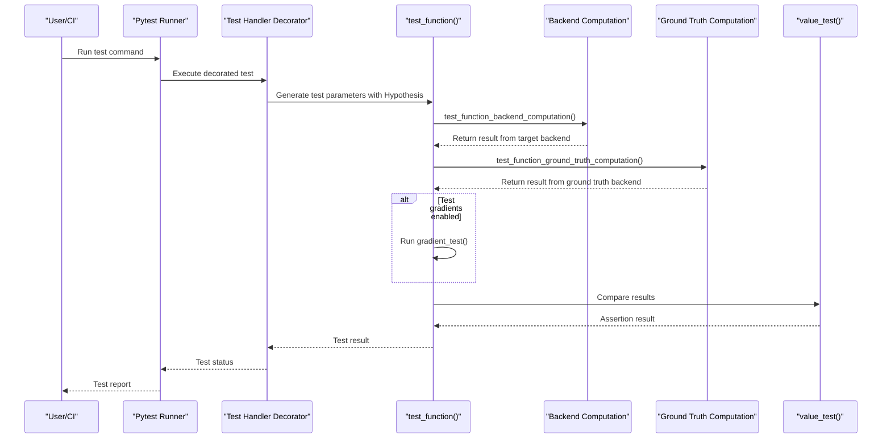
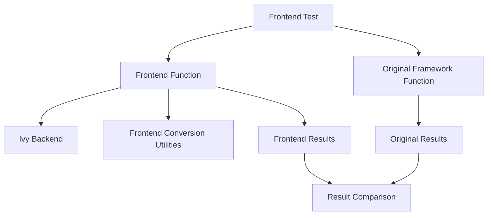
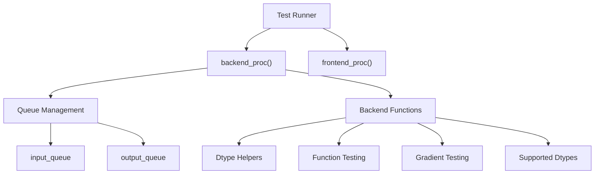
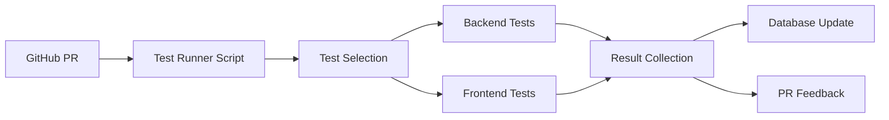

<!-- source: DeepWiki mcp.deepwiki.com · repo ivy-llc/ivy · page 6 Testing Framework · fetched 2026-10-21 -->

# Testing Framework

<details>
<summary>Relevant source files</summary>

The following files were used as context for generating this wiki page:

- [.github/CODEOWNERS](.github/CODEOWNERS)
- [ivy/data_classes/container/__init__.py](ivy/data_classes/container/__init__.py)
- [ivy_tests/conftest.py](ivy_tests/conftest.py)
- [ivy_tests/test_ivy/conftest.py](ivy_tests/test_ivy/conftest.py)
- [ivy_tests/test_ivy/helpers/function_testing.py](ivy_tests/test_ivy/helpers/function_testing.py)
- [ivy_tests/test_ivy/helpers/globals.py](ivy_tests/test_ivy/helpers/globals.py)
- [ivy_tests/test_ivy/helpers/hypothesis_helpers/array_helpers.py](ivy_tests/test_ivy/helpers/hypothesis_helpers/array_helpers.py)
- [ivy_tests/test_ivy/helpers/hypothesis_helpers/dtype_helpers.py](ivy_tests/test_ivy/helpers/hypothesis_helpers/dtype_helpers.py)
- [ivy_tests/test_ivy/helpers/hypothesis_helpers/general_helpers.py](ivy_tests/test_ivy/helpers/hypothesis_helpers/general_helpers.py)
- [ivy_tests/test_ivy/helpers/hypothesis_helpers/number_helpers.py](ivy_tests/test_ivy/helpers/hypothesis_helpers/number_helpers.py)
- [ivy_tests/test_ivy/helpers/multiprocessing.py](ivy_tests/test_ivy/helpers/multiprocessing.py)
- [ivy_tests/test_ivy/helpers/pipeline_helper.py](ivy_tests/test_ivy/helpers/pipeline_helper.py)
- [ivy_tests/test_ivy/helpers/test_parameter_flags.py](ivy_tests/test_ivy/helpers/test_parameter_flags.py)
- [ivy_tests/test_ivy/helpers/testing_helpers.py](ivy_tests/test_ivy/helpers/testing_helpers.py)
- [ivy_tests/test_ivy/test_frontends/config/base.py](ivy_tests/test_ivy/test_frontends/config/base.py)
- [scripts/backend_generation/generate.py](scripts/backend_generation/generate.py)
- [scripts/run_tests/run_tests.py](scripts/run_tests/run_tests.py)
- [scripts/setup_tests/setup_failing_tests.py](scripts/setup_tests/setup_failing_tests.py)

</details>


This page provides an overview of Ivy's comprehensive testing system, which ensures that Ivy functions work consistently across different backend frameworks and that frontend interfaces properly mimic their original frameworks. This document covers the core testing components, hypothesis-based test generation, test configuration, and execution patterns.

For information on contributing tests, see [Contributing Guide](#7), and for detailed testing guidelines, see [Testing Guidelines](#7.2).

## Core Testing System Architecture

Ivy's testing framework is designed to verify the correctness of various components across different backends (PyTorch, TensorFlow, JAX, NumPy, etc.) while ensuring consistent behavior.

```mermaid
graph TD
    subgraph "Testing Infrastructure"
        TestSystem["Test System"] --> TestHelpers["Test Helpers"]
        TestSystem --> FunctionTesting["Function Testing"]
        TestSystem --> FrontendTesting["Frontend Testing"]
        TestSystem --> TestExecution["Test Execution"]
    end

    TestHelpers --> HypothesisHelpers["Hypothesis Helpers"]
    TestHelpers --> Assertions["Assertions"]
    TestHelpers --> BackendHandler["Backend Handler"]
    TestHelpers --> Globals["Global State Management"]

    HypothesisHelpers --> DtypeHelpers["Dtype Helpers"]
    HypothesisHelpers --> ArrayHelpers["Array Helpers"]
    HypothesisHelpers --> NumberHelpers["Number Helpers"]
    HypothesisHelpers --> GeneralHelpers["General Helpers"]

    FunctionTesting --> TestFunction["test_function()"]
    FunctionTesting --> BackendComputation["Backend Computation"]
    FunctionTesting --> GroundTruthComputation["Ground Truth Computation"]
    FunctionTesting --> GradientTesting["Gradient Testing"]

    FrontendTesting --> TestFrontendFunction["test_frontend_function()"]
    FrontendTesting --> FrontendResultVerification["Frontend Result Verification"]

    TestExecution --> PytestConfiguration["Pytest Configuration"]
    TestExecution --> CommandLineOptions["Command Line Options"]
    TestExecution --> TestFlags["Test Flags/Parameters"]
    TestExecution --> Multiprocessing["Multiprocessing Support"]
```



Sources:
- [ivy_tests/test_ivy/helpers/function_testing.py:1-361]()
- [ivy_tests/test_ivy/conftest.py:1-160]()
- [ivy_tests/test_ivy/helpers/testing_helpers.py:1-100]()

## Test Execution Flow

The following diagram illustrates how a typical test flows through the testing system:



Sources:
- [ivy_tests/test_ivy/helpers/function_testing.py:436-732]()
- [ivy_tests/test_ivy/helpers/testing_helpers.py:329-477]()

## Function Testing

The core of Ivy's testing framework is the function testing infrastructure, which tests Ivy functions against different backends and compares the results with a ground truth implementation.

### Key Components

1. **test_function()**: The main entry point for testing Ivy functions. It orchestrates:
   - Creating test inputs
   - Running the function on the target backend
   - Running the function on the ground truth backend
   - Comparing the results
   - Testing gradients when appropriate

2. **test_function_backend_computation()**: Handles running the function on the target backend.

3. **test_function_ground_truth_computation()**: Handles running the function on the ground truth backend.

4. **value_test()**: Compares the results from both backends to ensure they match within tolerance.

### Example Function Testing Flow

```python
# Simplified example of function testing flow
def test_some_ivy_function():
    # Decorated with handle_test() which sets up the test environment
    @handle_test(
        fn_tree="functional.ivy.some_function",
        dtype_and_x=helpers.dtype_and_values(...),
        ground_truth_backend="tensorflow"
    )
    def test_fn(dtype_and_x, test_flags, fn_name, backend):
        # Extract test parameters
        dtype, x = dtype_and_x
        
        # Run the test function
        ret, ret_gt = helpers.test_function(
            input_dtypes=dtype,
            test_flags=test_flags,
            fn_name=fn_name,
            backend_to_test=backend,
            x=x
        )
        
        # ret: result from backend being tested
        # ret_gt: result from ground truth backend
        # Assertions are handled automatically within test_function
```

Sources:
- [ivy_tests/test_ivy/helpers/function_testing.py:437-732]()
- [ivy_tests/test_ivy/helpers/testing_helpers.py:330-477]()

## Frontend Testing

Frontend testing ensures that Ivy's frontend interfaces, which mimic other frameworks' APIs, behave as expected.

### Key Components

1. **test_frontend_function()**: Tests a frontend function by comparing its result with the original framework.

2. **handle_frontend_test()**: Decorator for frontend function tests that sets up the test environment.

3. **Frontend Function Conversion**: Utilities to convert between frontend and Ivy array types.



Sources:
- [ivy_tests/test_ivy/helpers/function_testing.py:784-1037]()
- [ivy_tests/test_ivy/helpers/testing_helpers.py:479-622]()

## Test Parameter Generation with Hypothesis

Ivy uses the Hypothesis library for property-based testing, which generates a wide range of test inputs to help uncover edge cases.

### Key Hypothesis Helpers

1. **dtype_helpers.py**: Provides functions for generating data types.
   - `get_dtypes()`: Draws valid data types for testing
   - `array_dtypes()`: Generates data types for arrays

2. **array_helpers.py**: Functions for generating arrays and array-related parameters.
   - `dtype_and_values()`: Generates data types and corresponding array values
   - `dtype_values_axis()`: Generates data types, values, and a valid axis

3. **number_helpers.py**: Functions for generating numeric values.
   - `floats()`: Generates floating-point values with appropriate constraints
   - `ints()`: Generates integer values

### Example of Parameter Generation

```python
# Example of using hypothesis helpers to generate test parameters
@handle_test(
    fn_tree="functional.ivy.matmul",
    dtype_and_x=helpers.dtype_and_values(
        available_dtypes=helpers.get_dtypes("numeric"),
        num_arrays=2,
        shape=helpers.get_shape(min_num_dims=2, max_num_dims=5),
        shared_dtype=True,
    ),
    test_gradients=st.booleans(),
)
def test_matmul(*, dtype_and_x, test_flags, backend, fn_name):
    dtype, x = dtype_and_x
    # Test logic here...
```

Sources:
- [ivy_tests/test_ivy/helpers/hypothesis_helpers/array_helpers.py:290-546]()
- [ivy_tests/test_ivy/helpers/hypothesis_helpers/dtype_helpers.py:105-254]()
- [ivy_tests/test_ivy/helpers/hypothesis_helpers/number_helpers.py:17-146]()

## Test Configuration and Flags

Ivy's testing framework provides extensive configuration options through command-line arguments and test flags.

### Test Flags

Test flags customize test behavior for specific scenarios:

```mermaid
graph TD
    TestFlags["Test Flags"] --> FunctionFlags["Function Test Flags"]
    TestFlags --> FrontendFlags["Frontend Test Flags"]
    TestFlags --> MethodFlags["Method Test Flags"]
    
    FunctionFlags --> AsVariable["as_variable: Test with Variable arrays"]
    FunctionFlags --> NativeArrays["native_arrays: Test with backend native arrays"]
    FunctionFlags --> ContainerFlags["container: Test with Container objects"]
    FunctionFlags --> TestGradients["test_gradients: Test gradient computation"]
    FunctionFlags --> WithOut["with_out: Test with out parameter"]
    FunctionFlags --> WithCopy["with_copy: Test with copy parameter"]
    FunctionFlags --> TestTrace["test_trace: Test with traced functions"]
    FunctionFlags --> TraceEach["test_trace_each: Test tracing each example"]
    FunctionFlags --> TestTranspile["transpile: Test transpilation"]
    FunctionFlags --> PrecisionMode["precision_mode: Test with different precision"]
    
    FrontendFlags --> FrontendArrays["generate_frontend_arrays: \nTest with frontend arrays"]
    FrontendFlags --> Inplace["inplace: Test inplace operations"]
```



Sources:
- [ivy_tests/test_ivy/helpers/test_parameter_flags.py:1-156]()
- [ivy_tests/test_ivy/helpers/test_parameter_flags.py:157-195]()
- [ivy_tests/test_ivy/helpers/test_parameter_flags.py:256-286]()

### Command-Line Options

Command-line options configure the test execution environment:

```
--backend BACKEND       Specify which backend(s) to test (e.g., torch,tensorflow,jax)
--device DEVICE         Specify which device to test on (e.g., cpu,gpu:0)
--num-examples N        Set max examples generated by Hypothesis
--with-trace-testing    Enable trace testing
--skip-gradient-testing Skip gradient testing
--with-out-testing      Enable out parameter testing
--no-mp                 Disable multiprocessing
```

Sources:
- [ivy_tests/test_ivy/conftest.py:332-366]()
- [ivy_tests/conftest.py:63-175]()

## Multiprocessing and Test Execution

Ivy's testing framework supports multiprocessing to run tests in parallel for different backends or configurations.

### Multiprocessing Flow



The multiprocessing system enables:
- Parallel testing across multiple backends
- Execution of tests with different backend versions
- Isolated backend environments to prevent interference

Sources:
- [ivy_tests/test_ivy/helpers/multiprocessing.py:1-50]()
- [ivy_tests/test_ivy/conftest.py:91-143]()
- [scripts/run_tests/run_tests.py:1-130]()

## Continuous Integration Pipeline

The testing framework integrates with CI/CD systems to ensure tests are run on code changes:



The CI pipeline:
1. Selects relevant tests based on code changes
2. Runs tests with appropriate backends and configurations
3. Collects and stores test results
4. Provides feedback to developers

Sources:
- [scripts/run_tests/run_tests.py:1-264]()
- [scripts/setup_tests/setup_failing_tests.py:1-120]()

## Extending the Testing Framework

### Adding New Tests

To add new tests to the Ivy project:

1. Use the appropriate test decorator:
   - `handle_test()` for Ivy functions
   - `handle_frontend_test()` for frontend functions
   - `handle_method()` for methods

2. Use Hypothesis helpers to generate test inputs

3. Structure your test to:
   - Set up input data
   - Call the function under test
   - Verify the results (automatic in most cases)

### Supporting New Backends

To support a new backend:

1. Add the backend to available frameworks in `ivy_tests/test_ivy/helpers/globals.py`
2. Define backend-specific type mappings and operations
3. Update the `scripts/backend_generation/generate.py` script to include the new backend

Sources:
- [ivy_tests/test_ivy/helpers/globals.py:1-174]()
- [scripts/backend_generation/generate.py:12-84]()
- [ivy_tests/test_ivy/test_frontends/config/base.py:1-132]()

## Conclusion

Ivy's testing framework provides a comprehensive system for ensuring correctness and compatibility across multiple backends and frontends. The property-based testing approach with Hypothesis enables thorough testing of edge cases, while the flexible configuration options allow tests to be customized for specific scenarios.

The framework's architecture supports:
- Testing across different backends and devices
- Verifying frontend interfaces match their original frameworks
- Testing with various data types, shapes, and parameters
- Gradient computation and verification
- Function tracing and transpilation testing

This robust testing infrastructure is essential for maintaining Ivy's compatibility with multiple frameworks and ensuring consistent behavior across backends.

---

