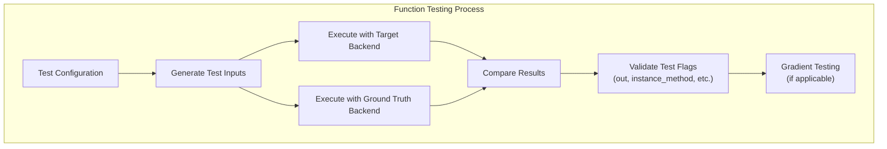
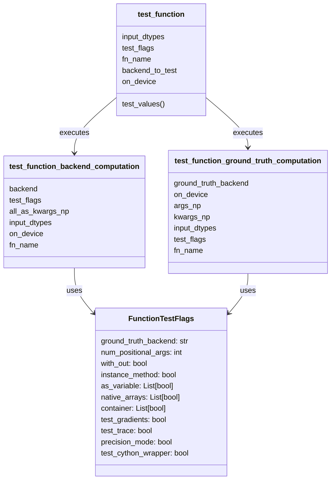
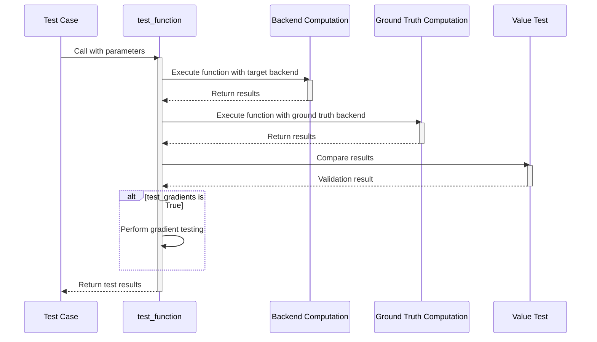
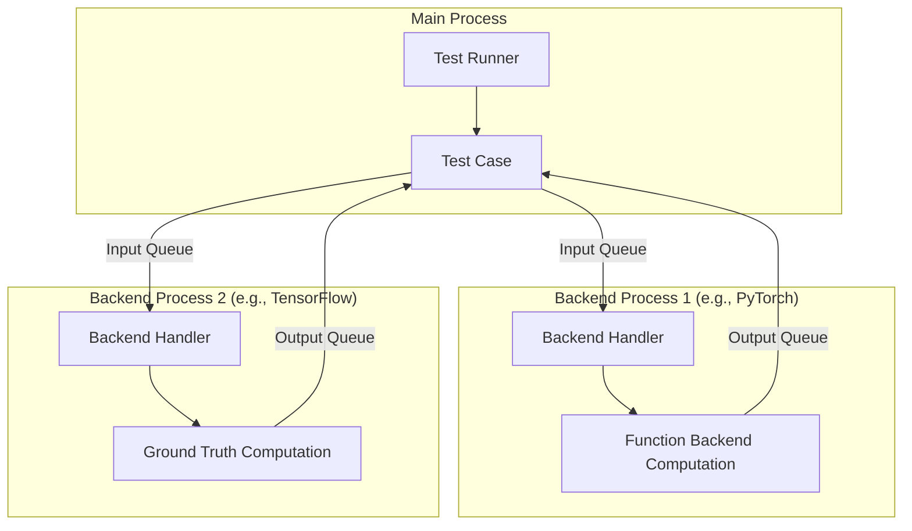
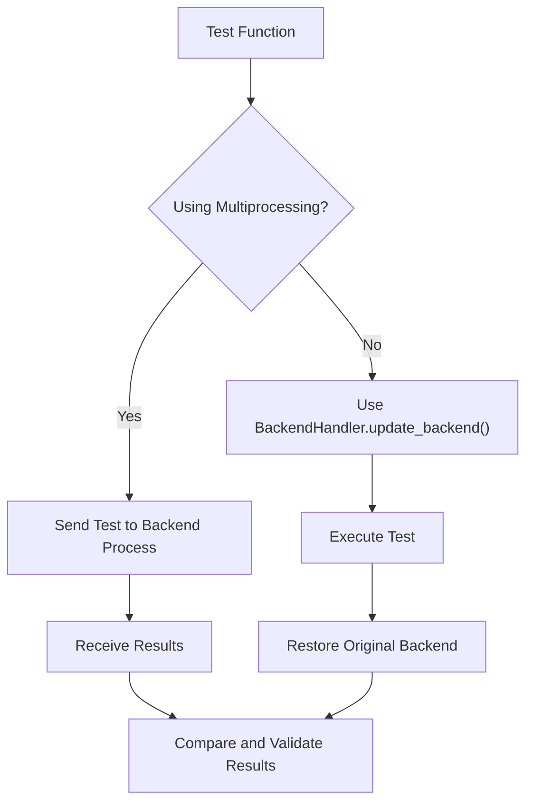

<!-- source: DeepWiki mcp.deepwiki.com · repo ivy-llc/ivy · page 6.1 Function Testing · fetched 2026-10-21 -->

# Function Testing

<details>
<summary>Relevant source files</summary>

The following files were used as context for generating this wiki page:

- [ivy/data_classes/container/__init__.py](ivy/data_classes/container/__init__.py)
- [ivy_tests/conftest.py](ivy_tests/conftest.py)
- [ivy_tests/test_ivy/conftest.py](ivy_tests/test_ivy/conftest.py)
- [ivy_tests/test_ivy/helpers/function_testing.py](ivy_tests/test_ivy/helpers/function_testing.py)
- [ivy_tests/test_ivy/helpers/globals.py](ivy_tests/test_ivy/helpers/globals.py)
- [ivy_tests/test_ivy/helpers/hypothesis_helpers/array_helpers.py](ivy_tests/test_ivy/helpers/hypothesis_helpers/array_helpers.py)
- [ivy_tests/test_ivy/helpers/hypothesis_helpers/dtype_helpers.py](ivy_tests/test_ivy/helpers/hypothesis_helpers/dtype_helpers.py)
- [ivy_tests/test_ivy/helpers/hypothesis_helpers/general_helpers.py](ivy_tests/test_ivy/helpers/hypothesis_helpers/general_helpers.py)
- [ivy_tests/test_ivy/helpers/hypothesis_helpers/number_helpers.py](ivy_tests/test_ivy/helpers/hypothesis_helpers/number_helpers.py)
- [ivy_tests/test_ivy/helpers/multiprocessing.py](ivy_tests/test_ivy/helpers/multiprocessing.py)
- [ivy_tests/test_ivy/helpers/pipeline_helper.py](ivy_tests/test_ivy/helpers/pipeline_helper.py)
- [ivy_tests/test_ivy/helpers/test_parameter_flags.py](ivy_tests/test_ivy/helpers/test_parameter_flags.py)
- [ivy_tests/test_ivy/helpers/testing_helpers.py](ivy_tests/test_ivy/helpers/testing_helpers.py)
- [ivy_tests/test_ivy/test_frontends/config/base.py](ivy_tests/test_ivy/test_frontends/config/base.py)
- [scripts/backend_generation/generate.py](scripts/backend_generation/generate.py)

</details>


Function Testing in Ivy is a comprehensive system designed to validate the correctness of mathematical operations across different backend frameworks (PyTorch, TensorFlow, JAX, NumPy, Paddle). It ensures that operations behave consistently across different backends, devices, and configurations.

For information about Frontend Testing, which validates framework-specific API compatibility, see [Frontend Testing](#6.2).

## Overview of Function Testing Architecture

Function Testing in Ivy revolves around comparing the results of operations between different backends. The central concept is to execute each function being tested with both a target backend and a "ground truth" backend, then compare the results to ensure they match within acceptable tolerances.



Sources:
- [ivy_tests/test_ivy/helpers/function_testing.py:84-732]()
- [ivy_tests/test_ivy/helpers/testing_helpers.py:330-477]()

## Core Components

The Function Testing system consists of several key components that work together to provide comprehensive test coverage:



Sources:
- [ivy_tests/test_ivy/helpers/function_testing.py:85-441]()
- [ivy_tests/test_ivy/helpers/test_parameter_flags.py:85-156]()

### FunctionTestFlags

`FunctionTestFlags` is a class that encapsulates various testing parameters:

| Flag | Description |
|------|-------------|
| `ground_truth_backend` | The backend to compare results against (e.g., "tensorflow") |
| `num_positional_args` | Number of positional arguments to pass to the function |
| `with_out` | Whether to test with pre-allocated output arrays |
| `instance_method` | Whether to test as an instance method of an array |
| `as_variable` | Whether to convert inputs to trainable variables |
| `native_arrays` | Whether to convert to backend-native arrays |
| `container` | Whether to wrap inputs in Ivy Containers |
| `test_gradients` | Whether to test gradient computation |
| `test_trace` | Whether to test with graph tracing |
| `test_trace_each` | Whether to trace each example separately |
| `precision_mode` | Whether to test with different precision modes |

Sources:
- [ivy_tests/test_ivy/helpers/test_parameter_flags.py:85-156]()
- [ivy_tests/test_ivy/helpers/function_testing.py:437-535]()

## Function Testing Workflow

The function testing workflow involves several distinct phases:



Sources:
- [ivy_tests/test_ivy/helpers/function_testing.py:437-731]()
- [ivy_tests/test_ivy/helpers/testing_helpers.py:330-477]()

### 1. Test Configuration

Tests are configured using the `handle_test` decorator, which sets up test parameters and flags:

```python
@handle_test(
    fn_tree="functional.ivy.some_function",
    input_dtypes=["float32", "float64"],
    test_gradients=True,
    ground_truth_backend="tensorflow"
)
def test_some_function(backend_fw, test_flags, fn_name, ...):
    # Test implementation
```

Sources:
- [ivy_tests/test_ivy/helpers/testing_helpers.py:330-477]()

### 2. Backend Computation

The `test_function_backend_computation` function executes the target function using the specified backend:

1. Converts NumPy input arguments to backend-specific arrays
2. Applies test flags (variable conversion, native arrays, containers)
3. Executes the function with the prepared inputs
4. Captures the output and converts it back to NumPy arrays for comparison

Sources:
- [ivy_tests/test_ivy/helpers/function_testing.py:137-363]()

### 3. Ground Truth Computation

The `test_function_ground_truth_computation` function performs similar steps but with the "ground truth" backend:

1. Converts inputs to the ground truth backend's arrays
2. Executes the function
3. Captures the output for comparison

Sources:
- [ivy_tests/test_ivy/helpers/function_testing.py:365-435]()

### 4. Value Testing

The results from both the target backend and ground truth backend are compared to ensure:

1. The values match within specified tolerance (rtol/atol)
2. The return types match
3. The devices match
4. Any additional test flag conditions are satisfied (e.g., `with_out`)

Sources:
- [ivy_tests/test_ivy/helpers/function_testing.py:694-731]()

### 5. Gradient Testing (Optional)

If `test_gradients` is enabled and the function is differentiable:

1. Computes gradients with respect to inputs using the target backend
2. Computes gradients with respect to inputs using the ground truth backend
3. Compares the gradient values

Sources:
- [ivy_tests/test_ivy/helpers/function_testing.py:662-690]()

## Test Data Generation

Ivy uses the Hypothesis library for generating test inputs. Key aspects include:

1. `dtype_and_values`: Generates arrays with specific data types
2. `get_dtypes`: Retrieves compatible data types for the current backend
3. `num_positional_args`: Determines the number of positional arguments to use

Sources:
- [ivy_tests/test_ivy/helpers/hypothesis_helpers/array_helpers.py:290-546]()
- [ivy_tests/test_ivy/helpers/hypothesis_helpers/dtype_helpers.py:105-253]()
- [ivy_tests/test_ivy/helpers/testing_helpers.py:94-132]()

## Multiprocessing Support

Function testing can run in multiple processes to handle different backend versions:



Sources:
- [ivy_tests/test_ivy/conftest.py:90-144]()
- [ivy_tests/test_ivy/helpers/function_testing.py:545-640]()
- [ivy_tests/test_ivy/helpers/multiprocessing.py:32-362]()

The multiprocessing system allows each backend to run in a separate process, which helps isolate different backends and their dependencies from each other.

## Test Parameter Flags

Test flags control various aspects of the testing process. They can be:

1. Set via command-line arguments (e.g., `--with-out-testing`)
2. Configured in the test decorator (e.g., `test_with_out=True`)
3. Generated dynamically using strategies

For instance, to run tests with output arrays:

```bash
pytest --with-out-testing
```

Sources:
- [ivy_tests/test_ivy/conftest.py:264-329]()
- [ivy_tests/test_ivy/helpers/test_parameter_flags.py:10-51]()

## Backend Context Management

When testing functions, the system manages backend switching using context managers:



Sources:
- [ivy_tests/test_ivy/helpers/pipeline_helper.py:8-46]()
- [ivy_tests/test_ivy/helpers/function_testing.py:173-194]()

## Conclusion

The Function Testing system in Ivy provides a comprehensive framework for ensuring that mathematical operations produce consistent results across different backend frameworks. By comparing operations against a ground truth backend and testing with various configurations (data types, devices, etc.), it helps maintain compatibility and correctness in the Ivy codebase.

This system forms a core part of Ivy's testing infrastructure, enabling the library to offer a unified API across multiple machine learning frameworks while maintaining consistent behavior and accuracy.

---

