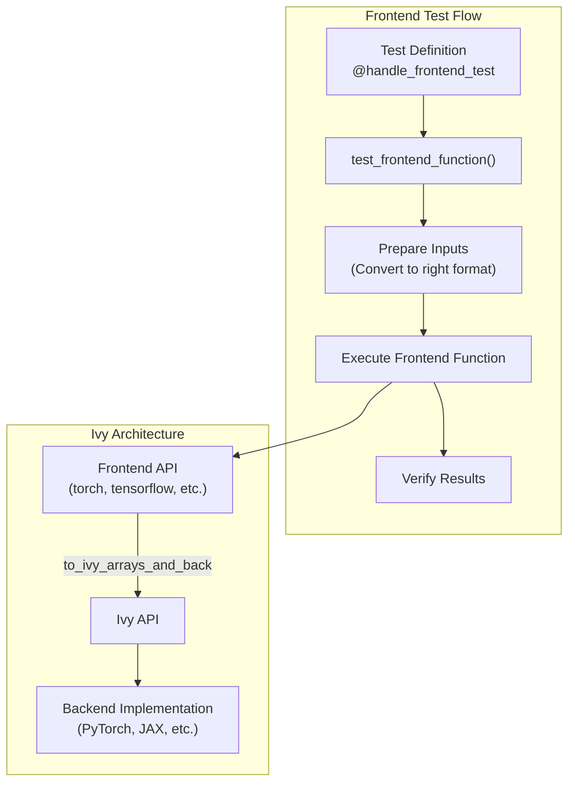
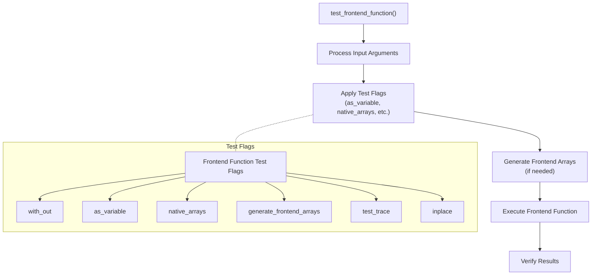
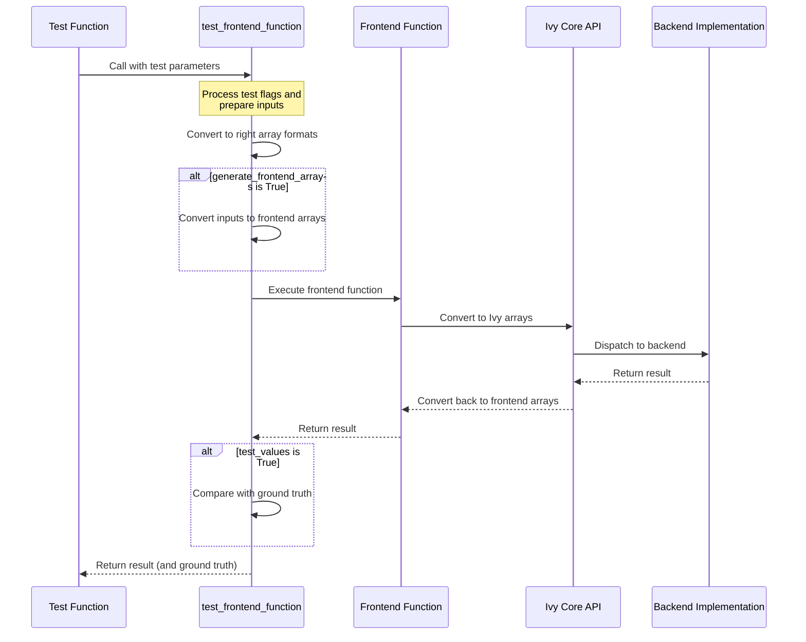
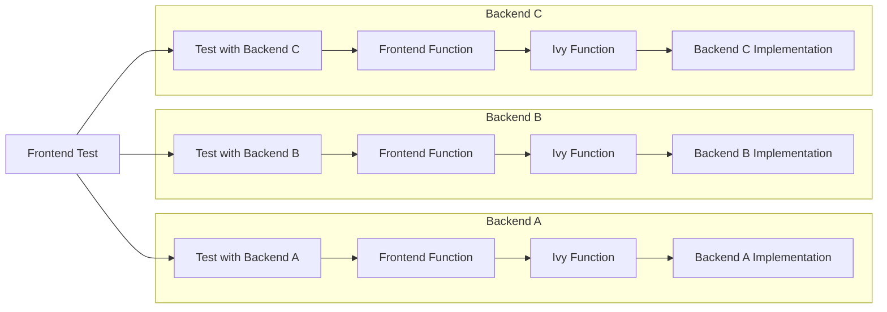

<!-- source: DeepWiki mcp.deepwiki.com · repo ivy-llc/ivy · page 6.2 Frontend Testing · fetched 2026-10-21 -->

# Frontend Testing

<details>
<summary>Relevant source files</summary>

The following files were used as context for generating this wiki page:

- [ivy/data_classes/container/__init__.py](ivy/data_classes/container/__init__.py)
- [ivy/functional/frontends/torch/creation_ops.py](ivy/functional/frontends/torch/creation_ops.py)
- [ivy/functional/frontends/torch/indexing_slicing_joining_mutating_ops.py](ivy/functional/frontends/torch/indexing_slicing_joining_mutating_ops.py)
- [ivy/functional/frontends/torch/miscellaneous_ops.py](ivy/functional/frontends/torch/miscellaneous_ops.py)
- [ivy/functional/frontends/torch/pointwise_ops.py](ivy/functional/frontends/torch/pointwise_ops.py)
- [ivy/functional/frontends/torch/reduction_ops.py](ivy/functional/frontends/torch/reduction_ops.py)
- [ivy_tests/conftest.py](ivy_tests/conftest.py)
- [ivy_tests/test_ivy/conftest.py](ivy_tests/test_ivy/conftest.py)
- [ivy_tests/test_ivy/helpers/function_testing.py](ivy_tests/test_ivy/helpers/function_testing.py)
- [ivy_tests/test_ivy/helpers/globals.py](ivy_tests/test_ivy/helpers/globals.py)
- [ivy_tests/test_ivy/helpers/hypothesis_helpers/array_helpers.py](ivy_tests/test_ivy/helpers/hypothesis_helpers/array_helpers.py)
- [ivy_tests/test_ivy/helpers/hypothesis_helpers/dtype_helpers.py](ivy_tests/test_ivy/helpers/hypothesis_helpers/dtype_helpers.py)
- [ivy_tests/test_ivy/helpers/hypothesis_helpers/general_helpers.py](ivy_tests/test_ivy/helpers/hypothesis_helpers/general_helpers.py)
- [ivy_tests/test_ivy/helpers/hypothesis_helpers/number_helpers.py](ivy_tests/test_ivy/helpers/hypothesis_helpers/number_helpers.py)
- [ivy_tests/test_ivy/helpers/multiprocessing.py](ivy_tests/test_ivy/helpers/multiprocessing.py)
- [ivy_tests/test_ivy/helpers/pipeline_helper.py](ivy_tests/test_ivy/helpers/pipeline_helper.py)
- [ivy_tests/test_ivy/helpers/test_parameter_flags.py](ivy_tests/test_ivy/helpers/test_parameter_flags.py)
- [ivy_tests/test_ivy/helpers/testing_helpers.py](ivy_tests/test_ivy/helpers/testing_helpers.py)
- [ivy_tests/test_ivy/test_frontends/config/base.py](ivy_tests/test_ivy/test_frontends/config/base.py)
- [ivy_tests/test_ivy/test_frontends/test_torch/test_creation_ops.py](ivy_tests/test_ivy/test_frontends/test_torch/test_creation_ops.py)
- [ivy_tests/test_ivy/test_frontends/test_torch/test_indexing_slicing_joining_mutating_ops.py](ivy_tests/test_ivy/test_frontends/test_torch/test_indexing_slicing_joining_mutating_ops.py)
- [ivy_tests/test_ivy/test_frontends/test_torch/test_miscellaneous_ops.py](ivy_tests/test_ivy/test_frontends/test_torch/test_miscellaneous_ops.py)
- [ivy_tests/test_ivy/test_frontends/test_torch/test_pointwise_ops.py](ivy_tests/test_ivy/test_frontends/test_torch/test_pointwise_ops.py)
- [ivy_tests/test_ivy/test_frontends/test_torch/test_reduction_ops.py](ivy_tests/test_ivy/test_frontends/test_torch/test_reduction_ops.py)
- [scripts/backend_generation/generate.py](scripts/backend_generation/generate.py)

</details>


This page explains how Ivy's frontend testing system works. Frontend testing validates that Ivy can correctly mimic the behavior of popular machine learning frameworks like PyTorch, TensorFlow, and others through its frontend interfaces. These tests ensure API compatibility, correct functionality, and consistent behavior across different backend implementations.

For information about testing the core Ivy functions, see [Function Testing](#6.1).

## Overview of Frontend Testing

The frontend testing system in Ivy ensures that frontend functions—which mimic other frameworks' APIs—work correctly across all supported backends. When a user writes code using a familiar framework API (like PyTorch or TensorFlow), Ivy's frontends transparently translate those operations to Ivy's unified API, which then dispatches to the appropriate backend implementation.



Sources: [ivy_tests/test_ivy/helpers/function_testing.py:784-1031](). [ivy/functional/frontends/torch/func_wrapper.py]().

## Key Components of Frontend Testing

### Test Function

The core of frontend testing is the `test_frontend_function()` which handles:
- Converting inputs to appropriate formats
- Executing the frontend function
- Comparing results with expected outputs
- Verifying correctness across various configurations



Sources: [ivy_tests/test_ivy/helpers/function_testing.py:784-1031](). [ivy_tests/test_ivy/helpers/test_parameter_flags.py]().

### Frontend Test Decorator

The `@handle_frontend_test` decorator provides a standardized way to define frontend tests. It manages:
- Test parameters and flags
- Backend selection
- Device placement
- Input data generation

### Array Conversion

A critical aspect of frontend testing is converting between different array types:
- Native arrays (PyTorch tensors, TensorFlow tensors, etc.)
- Ivy arrays
- Frontend arrays (Ivy's wrapper classes that mimic frontend APIs)

The process uses specialized decorators like `@to_ivy_arrays_and_back` to manage these conversions automatically.

## Frontend Test Structure

A typical frontend test follows this structure:

```python
@handle_frontend_test(
    fn_tree="torch.abs",  # Path to function in frontend namespace
    dtype_and_x=helpers.dtype_and_values(  # Input data generator
        available_dtypes=helpers.get_dtypes("numeric"),
    ),
)
def test_torch_abs(
    *,
    dtype_and_x,
    on_device,
    fn_tree,
    frontend,
    test_flags,
    backend_fw,
):
    input_dtype, x = dtype_and_x
    helpers.test_frontend_function(
        input_dtypes=input_dtype,
        backend_to_test=backend_fw,
        frontend=frontend,
        test_flags=test_flags,
        fn_tree=fn_tree,
        on_device=on_device,
        input=x[0],
    )
```

Sources: [ivy_tests/test_ivy/test_frontends/test_torch/test_pointwise_ops.py:132-150](). [ivy_tests/test_ivy/helpers/testing_helpers.py]().

## The Test Execution Process

Let's examine the complete process of testing a frontend function:



Sources: [ivy_tests/test_ivy/helpers/function_testing.py:784-1031](). [ivy/functional/frontends/torch/func_wrapper.py]().

## Frontend Implementation

Frontend functions are typically implemented in a straightforward way using the `@to_ivy_arrays_and_back` decorator. Here's an example of a PyTorch frontend function:

```python
@to_ivy_arrays_and_back
def abs(input, *, out=None):
    return ivy.abs(input, out=out)
```

The decorator handles:
1. Converting frontend-specific inputs to Ivy arrays
2. Calling the corresponding Ivy function
3. Converting the result back to frontend-specific arrays

Sources: [ivy/functional/frontends/torch/pointwise_ops.py:16-19](). [ivy/functional/frontends/torch/func_wrapper.py]().

## Test Parameter Flags

Frontend testing supports various parameter flags that control test behavior:

| Flag | Description |
|------|-------------|
| `with_out` | Test with output arguments |
| `inplace` | Test inplace operations |
| `as_variable` | Test with variables |
| `native_arrays` | Test with native arrays |
| `container` | Test with containers |
| `generate_frontend_arrays` | Use frontend arrays for inputs |
| `test_trace` | Test function tracing |
| `test_gradients` | Test gradient computation |

Sources: [ivy_tests/test_ivy/helpers/test_parameter_flags.py:14-53](). [ivy_tests/test_ivy/helpers/function_testing.py:784-1031]().

## Testing with Different Backends

One of the key aspects of frontend testing is ensuring that frontend functions work correctly across all supported backends. The testing infrastructure allows testing with different backends:



Sources: [ivy_tests/test_ivy/conftest.py](). [ivy_tests/test_ivy/helpers/function_testing.py:784-1031]().

## Value Testing and Verification

A critical aspect of frontend testing is verifying that the frontend functions produce correct results:

1. **Value Verification**: The `value_test` function compares the results of frontend functions with the expected outputs
2. **Type Verification**: The `assert_same_type` function ensures that the output types match the expected types
3. **Device Verification**: Tests ensure that computations happen on the requested device

These verifications ensure that frontend functions behave identically to the original framework functions they mimic.

Sources: [ivy_tests/test_ivy/helpers/function_testing.py:703-725](). [ivy_tests/test_ivy/helpers/assertions.py]().

## Frontend Test Organization

Frontend tests are organized by framework and function category:

```
ivy_tests/test_ivy/test_frontends/
├── test_torch/
│   ├── test_pointwise_ops.py
│   ├── test_creation_ops.py
│   ├── test_indexing_slicing_joining_mutating_ops.py
│   ├── test_reduction_ops.py
│   └── test_miscellaneous_ops.py
├── test_tensorflow/
├── test_numpy/
└── ...
```

This organization makes it easy to locate and maintain tests for specific frameworks and functions.

Sources: [ivy_tests/test_ivy/test_frontends/test_torch/test_pointwise_ops.py](). [ivy_tests/test_ivy/test_frontends/test_torch/test_creation_ops.py](). [ivy_tests/test_ivy/test_frontends/test_torch/test_miscellaneous_ops.py]().

## Frontend Function Testing Examples

Let's look at some examples of frontend function tests:

### Example 1: PyTorch's `abs` function

```python
@handle_frontend_test(
    fn_tree="torch.abs",
    aliases=["torch.absolute"],
    dtype_and_x=helpers.dtype_and_values(
        available_dtypes=helpers.get_dtypes("numeric", full=False).filter(
            lambda x: "uint8" not in x[0]
            and "int8" not in x[0]
            and "uint16" not in x[0]
            and "int16" not in x[0]
            and "float16" not in x[0]
            and "bfloat16" not in x[0]
        ),
        large_abs_safety_factor=2.5,
        small_abs_safety_factor=2.5,
        safety_factor_scale="log",
    ),
)
def test_torch_abs(
    *,
    dtype_and_x,
    on_device,
    fn_tree,
    frontend,
    test_flags,
    backend_fw,
):
    input_dtype, x = dtype_and_x
    helpers.test_frontend_function(
        input_dtypes=input_dtype,
        backend_to_test=backend_fw,
        frontend=frontend,
        test_flags=test_flags,
        fn_tree=fn_tree,
        on_device=on_device,
        input=x[0],
    )
```

Sources: [ivy_tests/test_ivy/test_frontends/test_torch/test_pointwise_ops.py:114-150]().

### Example 2: PyTorch's `add` function

```python
@handle_frontend_test(
    fn_tree="torch.add",
    dtype_and_x=helpers.dtype_and_values(
        available_dtypes=helpers.get_dtypes("numeric"),
        num_arrays=2,
        large_abs_safety_factor=2.5,
        small_abs_safety_factor=2.5,
        safety_factor_scale="log",
    ),
    alpha=st.integers(min_value=1, max_value=5),
)
def test_torch_add(
    *,
    dtype_and_x,
    alpha,
    on_device,
    fn_tree,
    frontend,
    test_flags,
    backend_fw,
):
    input_dtype, x = dtype_and_x
    helpers.test_frontend_function(
        input_dtypes=input_dtype,
        backend_to_test=backend_fw,
        frontend=frontend,
        test_flags=test_flags,
        fn_tree=fn_tree,
        on_device=on_device,
        rtol=1e-03,
        input=x[0],
        other=x[1],
        alpha=alpha,
    )
```

Sources: [ivy_tests/test_ivy/test_frontends/test_torch/test_pointwise_ops.py:237-270]().

## Special Testing Cases

### Complex Types and Special Dtypes

Frontend testing handles special data types like complex numbers and bfloat16:

```python
@handle_frontend_test(
    fn_tree="torch.angle",
    dtype_and_input=helpers.dtype_and_values(
        available_dtypes=["float64", "complex64", "complex128"],
    ),
)
def test_torch_angle(
    *,
    dtype_and_input,
    frontend,
    test_flags,
    fn_tree,
    backend_fw,
    on_device,
):
    input_dtype, x = dtype_and_input
    helpers.test_frontend_function(
        input_dtypes=input_dtype,
        backend_to_test=backend_fw,
        frontend=frontend,
        test_flags=test_flags,
        fn_tree=fn_tree,
        on_device=on_device,
        input=x[0],
    )
```

Sources: [ivy_tests/test_ivy/test_frontends/test_torch/test_pointwise_ops.py:348-372](). [ivy_tests/test_ivy/helpers/hypothesis_helpers/dtype_helpers.py]().

### Inplace Operations and Out Arguments

Frontend testing handles inplace operations and functions with output arguments:

```python
if test_flags.with_out and "out" in list(
    inspect.signature(frontend_fn).parameters.keys()
):
    if not inspect.isclass(ret):
        is_ret_tuple = issubclass(ret.__class__, tuple)
    else:
        is_ret_tuple = issubclass(ret, tuple)
    out = ret
    if is_ret_tuple:
        # ... (handling tuple output)
    else:
        if ivy_backend.native_inplace_support and not any(
            (ivy_backend.isscalar(ret), ivy_backend.isscalar(out))
        ):
            assert ret.ivy_array.data is out.ivy_array.data
        assert ret is out
```

Sources: [ivy_tests/test_ivy/helpers/function_testing.py:958-988]().

## Conclusion

Frontend testing is a crucial part of Ivy's testing infrastructure, ensuring that frontend functions correctly mimic the behavior of popular machine learning frameworks. The testing system verifies:

1. API compatibility (function signatures, arguments, etc.)
2. Correct functionality (producing the expected outputs)
3. Type compatibility (handling different data types correctly)
4. Device compatibility (running on the expected device)
5. Cross-backend compatibility (working with all supported backends)

By comprehensively testing frontend functions, Ivy ensures that users can seamlessly transition from their familiar frameworks to Ivy's unified API.

---

