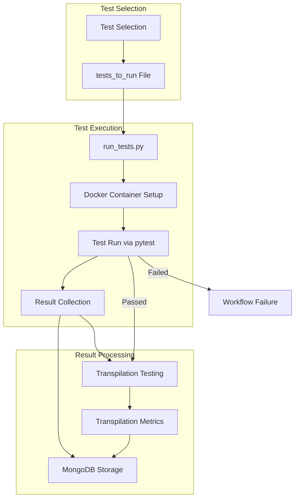
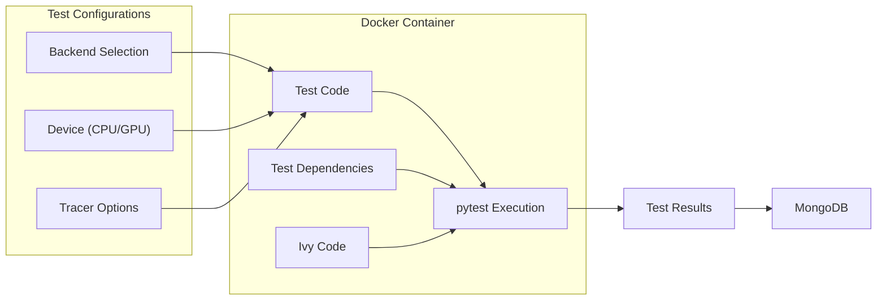
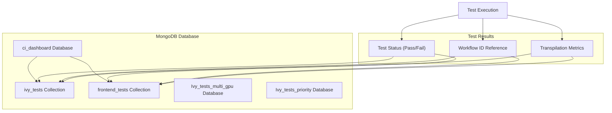

<!-- source: DeepWiki mcp.deepwiki.com · repo ivy-llc/ivy · page 6.3 Test Execution · fetched 2026-10-21 -->

# Test Execution

Relevant source files

The following files were used as context for generating this wiki page:

- [.github/CODEOWNERS](.github/CODEOWNERS)
- [scripts/run_tests/run_tests.py](scripts/run_tests/run_tests.py)
- [scripts/setup_tests/setup_failing_tests.py](scripts/setup_tests/setup_failing_tests.py)

This document explains how tests are executed in the Ivy CI pipeline. It covers the process of test selection, execution environments, configuration options, and result tracking. For information about writing tests, see [Function Testing](#6.1) and [Frontend Testing](#6.2).

## Overview of Test Execution

The Ivy testing system executes tests across multiple backends, devices, and configurations to ensure compatibility and correctness. Tests are run in isolated Docker containers with results stored in MongoDB for tracking and analysis.

Sources: [scripts/run_tests/run_tests.py:15-139](), [scripts/run_tests/run_tests.py:183-202]()

## Test Execution Environment

Tests in Ivy are executed in isolated Docker containers to ensure consistent environments across different execution contexts. Different Docker images are used depending on the test requirements.

Sources: [scripts/run_tests/run_tests.py:112-134]()

## Test Selection and Execution Process

### 1. Test Selection

Tests to be executed are listed in a file called `tests_to_run`. Each line in this file represents a test path and the backend it should be run against, separated by a comma.

For failing tests, the `setup_failing_tests.py` script queries the MongoDB database to identify previously failed tests, which are then added to the `tests_to_run` file.

### 2. Test Execution

The main test execution script `run_tests.py` performs the following steps for each test:

1. Reads each test specification from the `tests_to_run` file
2. Determines if it's a frontend test or an ivy test
3. Sets up the appropriate Docker container for execution
4. Executes the test using pytest with the specified backend and device
5. Records the test results in the MongoDB database
6. For successful tests, additionally runs transpilation tests

### 3. Docker Configuration

Tests can be run in different Docker environments:

- Standard environment: `ivyllc/ivy:latest`
- GPU environment: `ivyllc/ivy:latest-gpu`
- Multi-version environment: `unifyai/multiversion:latest`

The appropriate Docker environment is selected based on the test configuration (device type, version testing requirements).

Sources: [scripts/run_tests/run_tests.py:64-65](), [scripts/run_tests/run_tests.py:112-134]()

## Test Configuration Options

The test execution system supports several configuration options:

| Option | Description | Implementation Details |
|--------|-------------|------------------------|
| Backend | Framework backend to test against (PyTorch, TensorFlow, JAX, NumPy, Paddle) | Specified in the `tests_to_run` file |
| Device | CPU or GPU execution | Determined by `gpu_flag` parameter |
| Version | Multi-version testing | Enabled by `version_flag` parameter |
| Tracer | Trace testing support | Enabled by `tracer_flag` parameter |
| Priority | Priority test execution | Determined by `priority_flag` parameter |

Sources: [scripts/run_tests/run_tests.py:15-58]()

## Test Result Tracking

Test results are stored in a MongoDB database to track test execution, performance metrics, and failures over time.

Each test result document in the database contains:

- Test function name as the document ID
- Test path information
- Submodule information
- Status (pass/fail) for each backend/version/device combination
- Workflow reference link
- Transpilation metrics (for successful tests)

Sources: [scripts/run_tests/run_tests.py:48-61](), [scripts/run_tests/run_tests.py:224-256]()

## Transpilation Testing

For tests that pass successfully, the system automatically runs transpilation tests to ensure that the Ivy code can be correctly transpiled to different backend frameworks.

### Transpilation Metrics

The system collects the following metrics for transpilation:

1. **Node count**: Number of nodes in the transpiled computation graph
2. **Execution time**: Time taken for transpilation
3. **Arguments handling**: How input arguments are processed
4. **Keyword arguments handling**: How keyword arguments are processed

These metrics are stored in the MongoDB database alongside the test results and provide insights into the transpilation efficiency and correctness.

Sources: [scripts/run_tests/run_tests.py:183-202](), [scripts/run_tests/run_tests.py:233-249]()

## Workflow Failure Handling

The test execution system is designed to fail the entire workflow if any test fails. This ensures that code changes introducing regressions are caught before merging.

The workflow failure is triggered by a non-zero exit code from the test execution script, which happens if any test in the `tests_to_run` file fails.

Sources: [scripts/run_tests/run_tests.py:261-263]()

## Integration with CI/CD Pipeline

The test execution system is integrated into the CI/CD pipeline through GitHub Actions workflows. Each workflow run is assigned a unique workflow ID, which is used to link test results in the MongoDB database to the specific GitHub Actions run.

This linkage allows for easy traceability between test failures and the specific code changes that caused them.

Sources: [scripts/run_tests/run_tests.py:26-29](), [scripts/run_tests/run_tests.py:142-149]()

---

