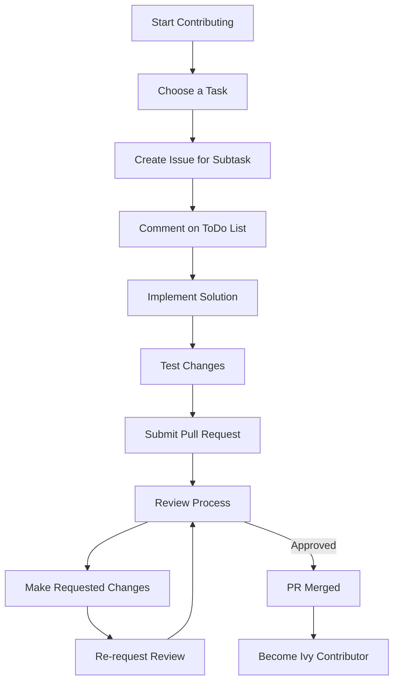
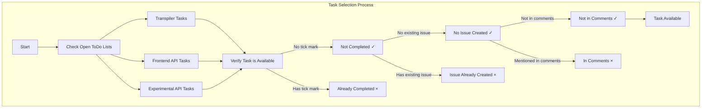
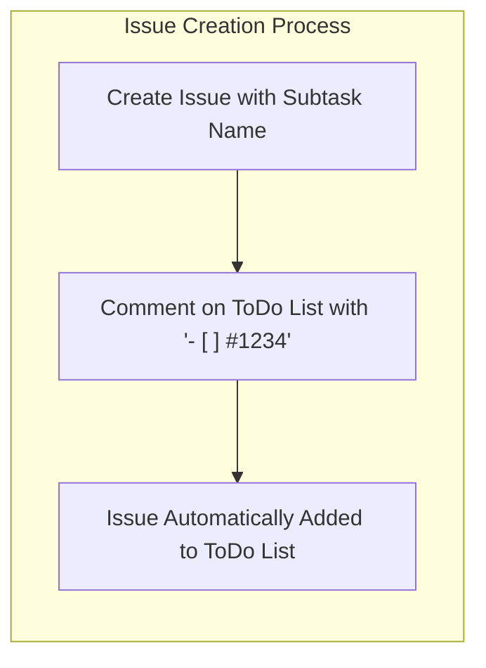
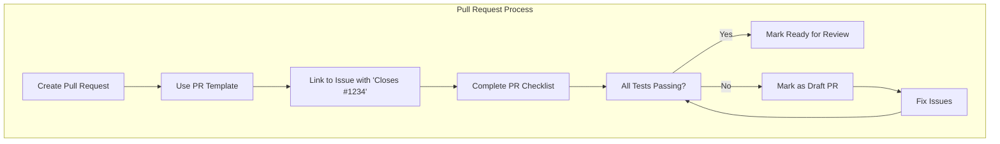
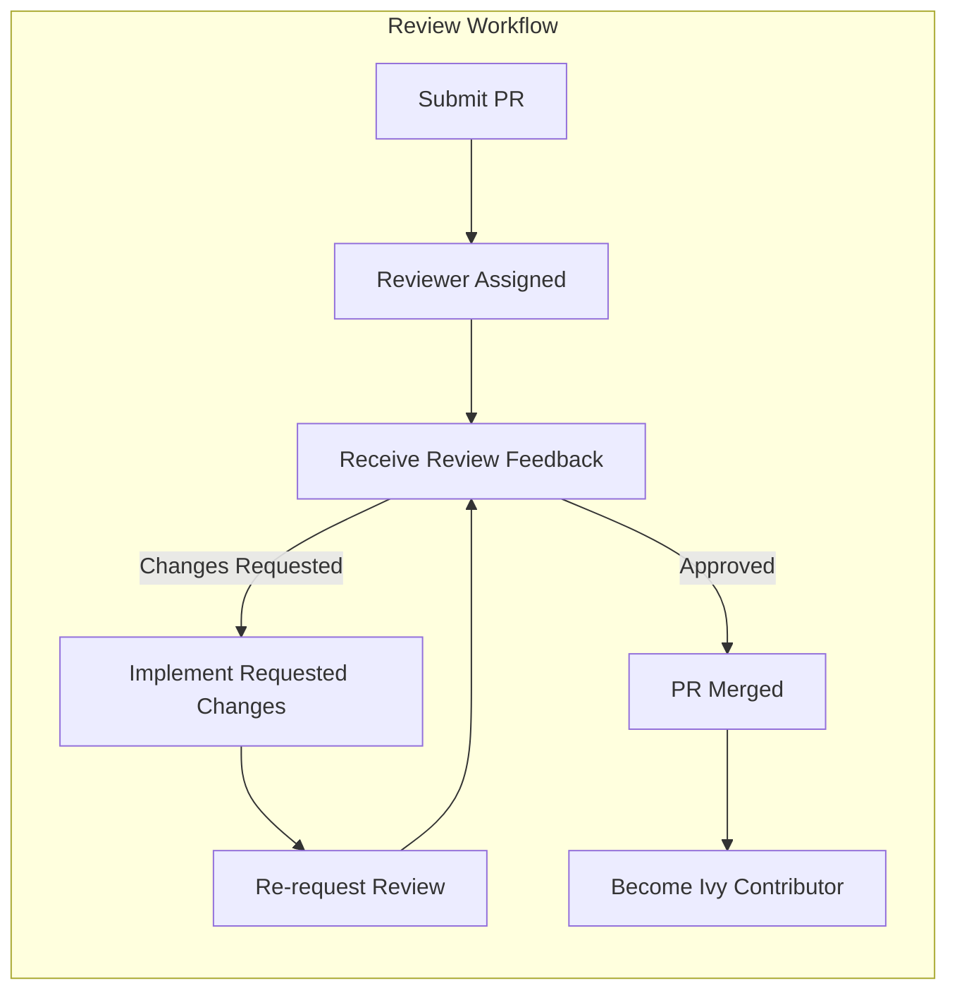

<!-- source: DeepWiki mcp.deepwiki.com · repo ivy-llc/ivy · page 7.1 Contribution Workflow · fetched 2026-10-21 -->

# Contribution Workflow

Relevant source files

The following files were used as context for generating this wiki page:

- [.github/ISSUE_TEMPLATE/docs_bug_report.yml](.github/ISSUE_TEMPLATE/docs_bug_report.yml)
- [.github/pull_request_template.md](.github/pull_request_template.md)
- [.github/workflows/checklist_actions.yml](.github/workflows/checklist_actions.yml)
- [CONTRIBUTING.md](CONTRIBUTING.md)
- [README.md](README.md)
- [automation_tools/checklists/frontend_checklist.md](automation_tools/checklists/frontend_checklist.md)
- [automation_tools/checklists/reformat_checklist.md](automation_tools/checklists/reformat_checklist.md)
- [docs/overview/contributing.rst](docs/overview/contributing.rst)
- [scripts/backend_generation/tree_generation.py](scripts/backend_generation/tree_generation.py)

This document outlines the process for contributing to the Ivy codebase. It covers how to pick a task, create an issue, implement changes, submit a pull request, and navigate the review process. For specific guidance on testing your contributions, see [Testing Guidelines](#7.2).

## Overview of the Contribution Process

The Ivy project welcomes contributions from developers of all skill levels. The general contribution workflow involves selecting a task from the open issues, creating a new issue for your chosen subtask, implementing the changes, submitting a pull request, and addressing feedback during review.

Sources: [CONTRIBUTING.md:1-41]()

## Selecting a Task

The first step in contributing to Ivy is choosing a task to work on. Currently, there are three main categories of open tasks:

1. **Transpiler** - Tasks related to Ivy's framework transpilation capabilities
2. **Frontend APIs** - Implementing framework-specific frontend interfaces
3. **Ivy Experimental API** - Adding experimental functionality to Ivy's core API

When selecting a task:
- Choose one that isn't marked as completed (with a tick)
- Ensure no issue has been created for it already
- Verify it's not mentioned in the comments of the ToDo issue

Sources: [CONTRIBUTING.md:9-20]()

## Creating an Issue

After selecting an available task:

1. Create a new issue with a title that matches the name of the subtask
2. Comment on the relevant ToDo list issue with a reference to your new issue using the format `- [ ] #Issue_number`
3. Wait for your issue to be automatically added to the ToDo list (you don't need to wait before starting work)

Sources: [CONTRIBUTING.md:21-29]()

## Implementing Your Changes

When implementing your changes, follow these guidelines:

1. Make sure your code follows the project style guidelines
2. Write appropriate tests for your changes
3. Ensure all tests pass locally before submitting
4. Follow specific requirements for different task types:

### Task-Specific Implementation Requirements

| Task Type | Implementation Requirements |
|-----------|----------------------------|
| Reformatting | Remove lambda/direct bindings, implement Array/Container methods, add docstrings & examples |
| Frontend APIs | Match original function signatures, compose using Ivy functions, add proper decorators & tests |
| Transpiler | Follow transpiler design patterns and test with multiple frameworks |

Sources: [CONTRIBUTING.md:30-33](), [automation_tools/checklists/reformat_checklist.md:1-96](), [automation_tools/checklists/frontend_checklist.md:1-44]()

## Submitting a Pull Request

When your implementation is ready:

1. Create a pull request following the PR template
2. Link the PR to your issue using "Closes #issue_number" in the PR description
3. Complete the checklist in the PR template
4. Mark your PR as a draft if tests are failing or pre-commit checks have issues

Sources: [.github/pull_request_template.md:1-45]()

## PR Checklist Requirements

All pull requests should address the following checklist items:

1. Did you add a function? (if applicable)
2. Did you add the tests?
3. Did you run your tests and are your tests passing?
4. Did pre-commit not fail on any check?
5. Did you follow the steps we provided?

For specific types of changes, additional checklists may be applied by commenting on the PR:

- `add_reformatting_checklist_[category_name]` - Adds a checklist for reformatting tasks
- `add_frontend_checklist` - Adds a checklist for frontend API tasks

These checklists are automatically added by GitHub Actions when the comments are made.

Sources: [.github/pull_request_template.md:21-38](), [.github/workflows/checklist_actions.yml:1-61]()

## Review Process

After submitting your PR:

1. Wait for maintainers to review your changes
2. Address any requested changes
3. Re-request a review after making changes to notify reviewers
4. Repeat until the PR is approved
5. Once merged, you become an Ivy contributor!

Sources: [CONTRIBUTING.md:34-37]()

## Task-Specific Checklists

### Reformatting Checklist

When working on reformatting tasks, you'll need to:

1. Remove lambda and direct bindings for backend functions
2. Implement various class methods (Array instances, Container instances, etc.)
3. Correct function arguments and type hints
4. Add proper docstrings
5. Add thorough docstring examples
6. Ensure tests pass

The complete checklist is automatically added to your PR when requested.

### Frontend API Checklist

For frontend API tasks, you should:

1. Ensure function/method definitions match the original framework's signatures
2. Properly handle function aliases
3. Implement functionality as a composition of Ivy functions
4. Add appropriate decorators
5. Implement comprehensive tests
6. Ensure all tests pass for all backends

The complete checklist is automatically added to your PR when requested.

Sources: [automation_tools/checklists/reformat_checklist.md:1-96](), [automation_tools/checklists/frontend_checklist.md:1-44]()

## Getting Help

If you run into issues or have questions during the contribution process:

1. Reach out on [Discord](https://discord.gg/uYRmyPxMQq)
2. Check the [Contributing Guide](https://docs.ivy.dev/overview/contributing.html) in the docs
3. Review the [Deep Dive](https://docs.ivy.dev/overview/deep_dive.html) for code implementation details

Sources: [CONTRIBUTING.md:40-41](), [docs/overview/contributing.rst:1-55]()

---

