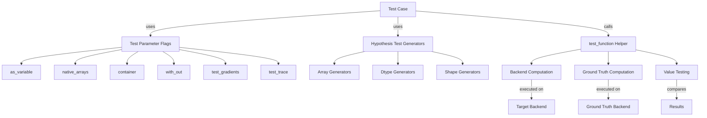
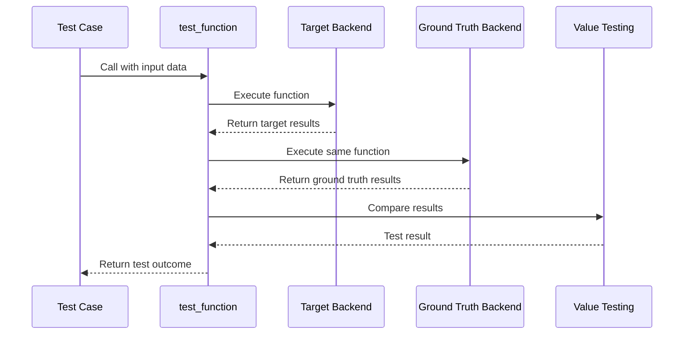
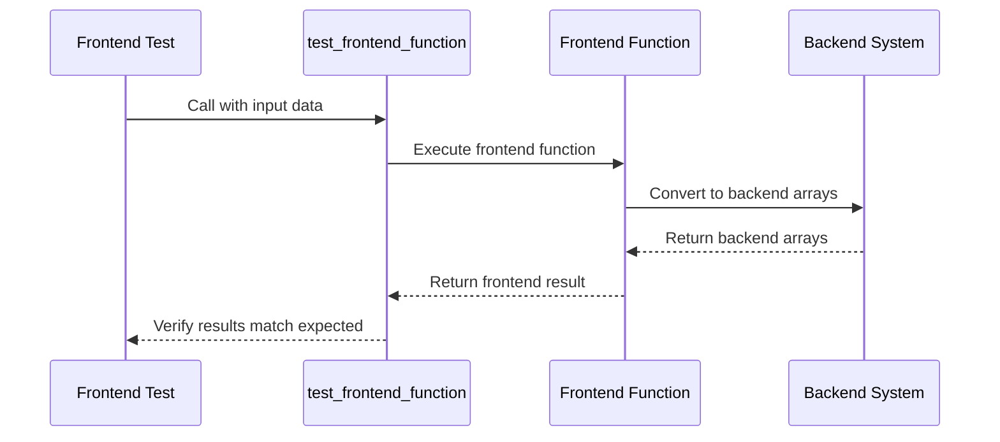
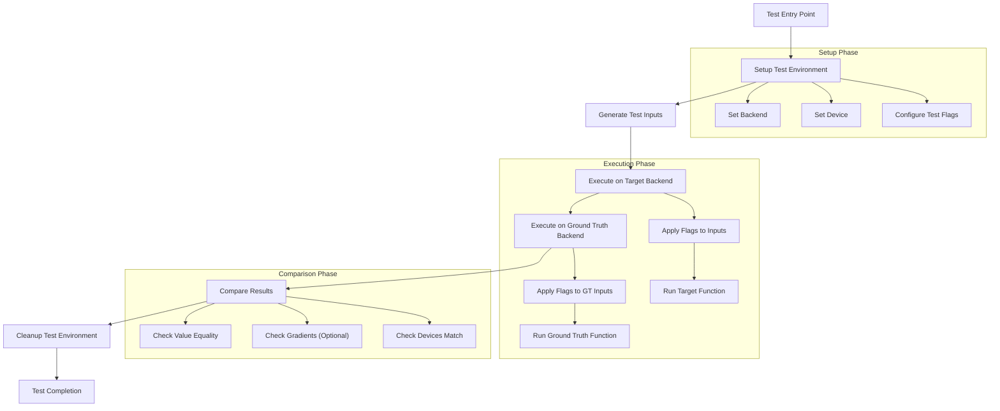

<!-- source: DeepWiki mcp.deepwiki.com · repo ivy-llc/ivy · page 7.2 Testing Guidelines · fetched 2026-10-21 -->

# Testing Guidelines

<details>
<summary>Relevant source files</summary>

The following files were used as context for generating this wiki page:

- [.github/ISSUE_TEMPLATE/docs_bug_report.yml](.github/ISSUE_TEMPLATE/docs_bug_report.yml)
- [.github/pull_request_template.md](.github/pull_request_template.md)
- [.github/workflows/checklist_actions.yml](.github/workflows/checklist_actions.yml)
- [CONTRIBUTING.md](CONTRIBUTING.md)
- [README.md](README.md)
- [automation_tools/checklists/frontend_checklist.md](automation_tools/checklists/frontend_checklist.md)
- [automation_tools/checklists/reformat_checklist.md](automation_tools/checklists/reformat_checklist.md)
- [docs/overview/contributing.rst](docs/overview/contributing.rst)
- [ivy/data_classes/container/__init__.py](ivy/data_classes/container/__init__.py)
- [ivy_tests/conftest.py](ivy_tests/conftest.py)
- [ivy_tests/test_ivy/conftest.py](ivy_tests/test_ivy/conftest.py)
- [ivy_tests/test_ivy/helpers/function_testing.py](ivy_tests/test_ivy/helpers/function_testing.py)
- [ivy_tests/test_ivy/helpers/globals.py](ivy_tests/test_ivy/helpers/globals.py)
- [ivy_tests/test_ivy/helpers/hypothesis_helpers/array_helpers.py](ivy_tests/test_ivy/helpers/hypothesis_helpers/array_helpers.py)
- [ivy_tests/test_ivy/helpers/hypothesis_helpers/dtype_helpers.py](ivy_tests/test_ivy/helpers/hypothesis_helpers/dtype_helpers.py)
- [ivy_tests/test_ivy/helpers/hypothesis_helpers/general_helpers.py](ivy_tests/test_ivy/helpers/hypothesis_helpers/general_helpers.py)
- [ivy_tests/test_ivy/helpers/hypothesis_helpers/number_helpers.py](ivy_tests/test_ivy/helpers/hypothesis_helpers/number_helpers.py)
- [ivy_tests/test_ivy/helpers/multiprocessing.py](ivy_tests/test_ivy/helpers/multiprocessing.py)
- [ivy_tests/test_ivy/helpers/pipeline_helper.py](ivy_tests/test_ivy/helpers/pipeline_helper.py)
- [ivy_tests/test_ivy/helpers/test_parameter_flags.py](ivy_tests/test_ivy/helpers/test_parameter_flags.py)
- [ivy_tests/test_ivy/helpers/testing_helpers.py](ivy_tests/test_ivy/helpers/testing_helpers.py)
- [ivy_tests/test_ivy/test_frontends/config/base.py](ivy_tests/test_ivy/test_frontends/config/base.py)
- [scripts/backend_generation/generate.py](scripts/backend_generation/generate.py)
- [scripts/backend_generation/tree_generation.py](scripts/backend_generation/tree_generation.py)

</details>


## Purpose and Scope

This document provides guidelines for writing and executing tests in the Ivy framework. It covers both core function testing and frontend testing methodologies, including best practices, test organization, and configuration options. For information about the overall testing framework architecture, see [Testing Framework](#6).

## Testing System Overview

Ivy's testing system is designed to verify functionality across multiple backends (PyTorch, TensorFlow, JAX, NumPy, etc.) and devices (CPU, GPU, TPU). Tests are structured to ensure consistent behavior across these environments.



Sources: [ivy_tests/test_ivy/helpers/function_testing.py:84-732](), [ivy_tests/test_ivy/helpers/test_parameter_flags.py:10-52]()

## Test Types

### Function Tests

Function tests verify that Ivy functions produce correct results across all supported backends. They compare a function's output on the target backend against a ground-truth backend.



Sources: [ivy_tests/test_ivy/helpers/function_testing.py:437-732]()

### Frontend Tests

Frontend tests verify that Ivy's frontend implementations correctly mimic the behavior of the original frameworks (PyTorch, TensorFlow, etc.).



Sources: [ivy_tests/test_ivy/helpers/function_testing.py:784-1017]()

## Writing Tests

### Function Test Structure

Function tests should use the `@handle_test` decorator and call the `test_function` helper:

```python
@handle_test(
    fn_tree="functional.ivy.some_function",
    input_dtypes=helpers.get_dtypes("numeric"),
    test_gradients=st.just(False),
)
def test_some_function(
    *,
    input_dtypes,
    test_flags,
    backend_fw,
    fn_name,
    on_device,
):
    # Test implementation
    x = draw(helpers.array_values(dtype=input_dtypes[0], shape=shape))
    
    # Test the function
    test_function(
        input_dtypes=input_dtypes,
        test_flags=test_flags,
        fn_name=fn_name,
        backend_to_test=backend_fw,
        on_device=on_device,
        x=x,
    )
```

Sources: [ivy_tests/test_ivy/helpers/testing_helpers.py:330-476]()

### Frontend Test Structure

Frontend tests should use the `@handle_frontend_test` decorator and call the `test_frontend_function` helper:

```python
@handle_frontend_test(
    fn_tree="torch.some_function",
    input_dtypes=helpers.get_dtypes("numeric"),
)
def test_torch_some_function(
    *,
    input_dtypes,
    test_flags,
    frontend,
    backend_fw,
    fn_name,
    on_device,
):
    # Test implementation
    x = draw(helpers.array_values(dtype=input_dtypes[0], shape=shape))
    
    # Test the frontend function
    test_frontend_function(
        input_dtypes=input_dtypes,
        frontend=frontend,
        test_flags=test_flags,
        fn_tree=fn_tree,
        backend_to_test=backend_fw,
        on_device=on_device,
        x=x,
    )
```

Sources: [ivy_tests/test_ivy/helpers/testing_helpers.py:480-549]()

## Test Configuration

### Test Parameter Flags

Test flags control various aspects of test behavior:

| Flag | Description |
|------|-------------|
| `as_variable` | Test with variables (gradients) |
| `native_arrays` | Test with native backend arrays |
| `container` | Test with ivy.Container |
| `instance_method` | Test as instance methods |
| `with_out` | Test with output arguments |
| `test_gradients` | Test gradient computation |
| `test_trace` | Test function tracing |
| `test_trace_each` | Test tracing each example separately |
| `transpile` | Test transpilation capabilities |
| `precision_mode` | Test different precision modes |

Sources: [ivy_tests/test_ivy/helpers/test_parameter_flags.py:10-52](), [ivy_tests/test_ivy/conftest.py:233-329]()

### Command Line Configuration

Tests can be configured via command line options:

```bash
# Test with specific backend
pytest --backend=torch

# Test on specific device
pytest --device=cpu

# Set number of test examples
pytest --num-examples=10

# Configure test flags
pytest --with-out-testing --skip-gradient-testing
```

Sources: [ivy_tests/test_ivy/conftest.py:332-374](), [ivy_tests/conftest.py:63-92]()

## Using Hypothesis for Input Generation

The Ivy test system uses Hypothesis for generating test inputs. Key generator functions include:

### Data Type Generators

```python
# Get numeric data types
numeric_dtypes = helpers.get_dtypes("numeric")

# Get float data types
float_dtypes = helpers.get_dtypes("float")

# Get multiple array dtypes
array_dtypes = helpers.array_dtypes(
    available_dtypes=helpers.get_dtypes("valid"),
    num_arrays=3
)
```

Sources: [ivy_tests/test_ivy/helpers/hypothesis_helpers/dtype_helpers.py:105-253]()

### Array Value Generators

```python
# Generate arrays with specific shapes and dtypes
arrays = helpers.dtype_and_values(
    available_dtypes=helpers.get_dtypes("numeric"),
    shape=helpers.get_shape(min_num_dims=1, max_num_dims=4),
    min_value=-1e3,
    max_value=1e3
)

# Generate arrays with axes
arrays_with_axis = helpers.dtype_values_axis(
    available_dtypes=helpers.get_dtypes("numeric"),
    min_num_dims=1,
    valid_axis=True
)
```

Sources: [ivy_tests/test_ivy/helpers/hypothesis_helpers/array_helpers.py:290-546](), [ivy_tests/test_ivy/helpers/hypothesis_helpers/array_helpers.py:549-798]()

## Value Testing

The `value_test` function compares results from the target backend with ground truth results:

```python
value_test(
    ret_np_flat=ret_np_flat_from_target,
    ret_np_from_gt_flat=ret_np_from_gt_flat,
    rtol=rtol_,
    atol=atol_,
)
```

Tolerances can be adjusted for different data types and operations.

Sources: [ivy_tests/test_ivy/helpers/function_testing.py:704-709]()

## Backend Handling

The `BackendHandler` class manages backend context:

```python
with BackendHandler.update_backend(backend) as ivy_backend:
    # Test code using ivy_backend
```

This ensures that all operations use the correct backend.

Sources: [ivy_tests/test_ivy/helpers/pipeline_helper.py:8-53]()

## Test Execution Flow



Sources: [ivy_tests/test_ivy/helpers/function_testing.py:437-732](), [ivy_tests/test_ivy/helpers/globals.py:72-173]()

## Best Practices

1. **Use Property-Based Testing**: Leverage Hypothesis to generate diverse test inputs rather than hardcoding values.

2. **Test All Backends**: Ensure tests run on all supported backends.

3. **Test All Devices**: Verify functionality across CPU, GPU, and TPU where applicable.

4. **Cover Edge Cases**: Include tests for special values (inf, NaN, zero) and extreme inputs.

5. **Test Gradient Computation**: Where applicable, verify gradient calculations.

6. **Test With Containers**: Verify functions work with nested Ivy Containers.

7. **Test With Variables**: Ensure functions work with trainable variables.

8. **Test Output Arguments**: Verify functions correctly handle output arguments.

9. **Test Instance Methods**: Verify instance method versions of functions.

10. **Test Frontend Compatibility**: For frontend functions, ensure they match the behavior of the original framework.

## Common Testing Pitfalls

1. **Backend-Specific Behavior**: Be aware that some operations might have slight numerical differences across backends.

2. **Device Limitations**: Some operations may not be supported on all devices (particularly TPU).

3. **Dtype Limitations**: Backends support different sets of dtypes.

4. **Gradient Limitations**: Not all operations support gradient calculation.

5. **Memory Limitations**: Be mindful of generating very large arrays that may cause OOM errors.

6. **Test Execution Time**: Complex tests may time out in CI environments.

Sources: [ivy_tests/test_ivy/helpers/function_testing.py:437-732](), [ivy_tests/test_ivy/helpers/testing_helpers.py:330-476]()