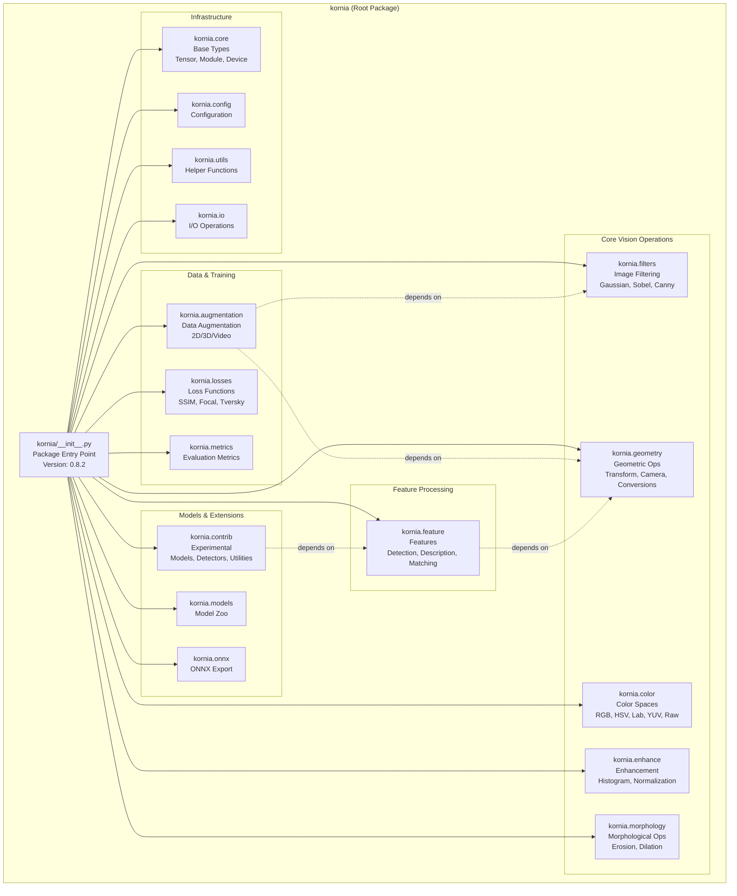
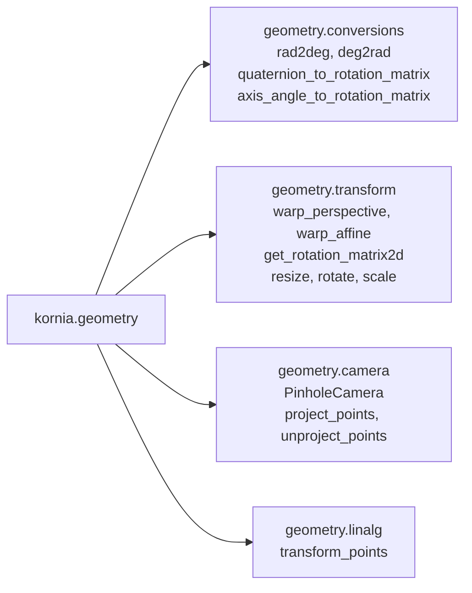
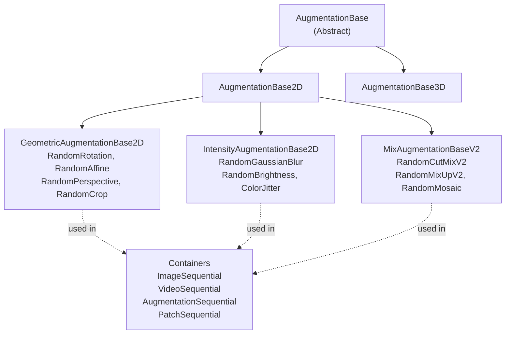
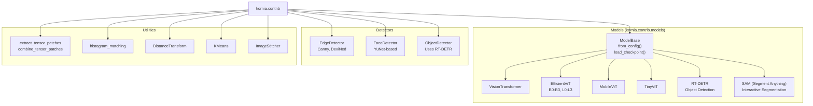
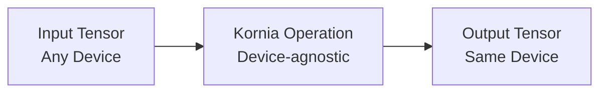
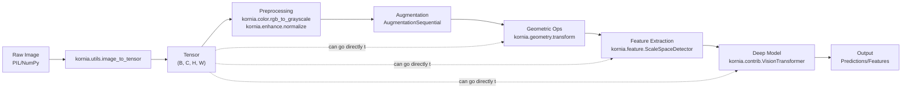

<!-- source: DeepWiki mcp.deepwiki.com · repo kornia/kornia · page 1 Overview · fetched 2026-10-21 -->

# Overview

<details>
<summary>Relevant source files</summary>

The following files were used as context for generating this wiki page:

- [.pre-commit-config.yaml](.pre-commit-config.yaml)
- [CHANGELOG.md](CHANGELOG.md)
- [docs/source/augmentation.rst](docs/source/augmentation.rst)
- [docs/source/color.rst](docs/source/color.rst)
- [docs/source/contrib.rst](docs/source/contrib.rst)
- [docs/source/feature.rst](docs/source/feature.rst)
- [docs/source/geometry.conversions.rst](docs/source/geometry.conversions.rst)
- [docs/source/geometry.transform.rst](docs/source/geometry.transform.rst)
- [docs/source/references.bib](docs/source/references.bib)
- [kornia/__init__.py](kornia/__init__.py)
- [kornia/augmentation/__init__.py](kornia/augmentation/__init__.py)
- [kornia/color/__init__.py](kornia/color/__init__.py)
- [kornia/color/raw.py](kornia/color/raw.py)
- [kornia/color/rgb.py](kornia/color/rgb.py)
- [kornia/contrib/__init__.py](kornia/contrib/__init__.py)
- [kornia/contrib/histogram_matching.py](kornia/contrib/histogram_matching.py)
- [kornia/contrib/models/rt_detr/__init__.py](kornia/contrib/models/rt_detr/__init__.py)
- [kornia/contrib/models/rt_detr/architecture/__init__.py](kornia/contrib/models/rt_detr/architecture/__init__.py)
- [kornia/feature/__init__.py](kornia/feature/__init__.py)
- [kornia/feature/laf.py](kornia/feature/laf.py)
- [kornia/feature/responses.py](kornia/feature/responses.py)
- [kornia/feature/scale_space_detector.py](kornia/feature/scale_space_detector.py)
- [kornia/feature/siftdesc.py](kornia/feature/siftdesc.py)
- [kornia/geometry/camera/pinhole.py](kornia/geometry/camera/pinhole.py)
- [kornia/geometry/conversions.py](kornia/geometry/conversions.py)
- [kornia/geometry/transform/affwarp.py](kornia/geometry/transform/affwarp.py)
- [kornia/geometry/transform/imgwarp.py](kornia/geometry/transform/imgwarp.py)
- [kornia/geometry/transform/pyramid.py](kornia/geometry/transform/pyramid.py)
- [pyproject.toml](pyproject.toml)
- [tests/color/test_rgb.py](tests/color/test_rgb.py)
- [uv.lock](uv.lock)

</details>


## Purpose and Scope

Kornia is a differentiable computer vision library for PyTorch that provides GPU-accelerated, batch-processing implementations of classical and modern computer vision algorithms. The library's core value proposition is enabling end-to-end gradient flow through vision operations, making it suitable for deep learning pipelines where vision operations need to be learned or optimized.

**Current Version**: 0.8.2 [kornia/__init__.py:66]()

**Key Scope**:
- Image processing operations (filters, color space conversions, morphology)
- Geometric transformations and camera models
- Data augmentation with differentiable transforms
- Feature detection, description, and matching
- Vision models and experimental features

**Out of Scope**: This overview covers the library's architecture and organization. For specific module details, see:
- Color space conversions → [2](#2)
- Geometric operations → [3](#3)
- Data augmentation → [4](#4)
- Feature detection/matching → [5](#5)
- Models and contrib → [6](#6)
- Development setup → [7](#7)

**Sources**: [kornia/__init__.py:1-67](), [pyproject.toml:1-109]()

## Core Architecture

The following diagram shows Kornia's main package structure with concrete module names from the codebase:



**Sources**: [kornia/__init__.py:24-48]()

## Module Organization

Kornia organizes functionality into several layers, each with specific responsibilities:

### Layer 1: Core Infrastructure

| Module | Path | Purpose |
|--------|------|---------|
| `kornia.core` | [kornia/core/]() | Base tensor types, modules, device abstractions |
| `kornia.utils` | [kornia/utils/]() | Helper functions: `image_to_tensor`, `tensor_to_image`, `create_meshgrid` |
| `kornia.io` | [kornia/io/]() | Image loading and saving operations |
| `kornia.config` | [kornia/config/]() | Library configuration management |

### Layer 2: Basic Vision Operations

These modules provide fundamental differentiable operations:

| Module | Path | Key Operations |
|--------|------|----------------|
| `kornia.filters` | [kornia/filters/]() | Gaussian blur, Sobel, Laplacian, median filtering |
| `kornia.color` | [kornia/color/__init__.py:1-160]() | `rgb_to_grayscale`, `rgb_to_hsv`, `rgb_to_lab`, `raw_to_rgb` |
| `kornia.morphology` | [kornia/morphology/]() | Erosion, dilation, opening, closing |
| `kornia.enhance` | [kornia/enhance/]() | Histogram equalization, normalization, CLAHE |

### Layer 3: Geometric Operations

The `kornia.geometry` module is subdivided into specialized components:



**Sources**: [kornia/geometry/conversions.py:1-2084](), [kornia/geometry/transform/imgwarp.py:1-957]()

### Layer 4: Data Augmentation

The augmentation system has a hierarchical class structure:



**Sources**: [kornia/augmentation/__init__.py:1-205](), [kornia/augmentation/_2d/base.py]()

### Layer 5: Feature Processing

The feature module provides classical and learned feature detection:

| Component | Key Classes/Functions |
|-----------|----------------------|
| **LAF Operations** | `laf_from_center_scale_ori`, `extract_patches_from_pyramid`, `normalize_laf` |
| **Detectors** | `ScaleSpaceDetector`, `MultiResolutionDetector`, `KeyNet`, `DISK` |
| **Response Functions** | `harris_response`, `hessian_response`, `dog_response`, `gftt_response` |
| **Descriptors** | `SIFTDescriptor`, `HardNet`, `HyNet`, `SOSNet` |
| **Matching** | `match_nn`, `match_mnn`, `match_adalam`, `LightGlue`, `LoFTR` |

**Sources**: [kornia/feature/__init__.py:1-189](), [kornia/feature/laf.py:1-520]()

### Layer 6: Models and Experimental

The `kornia.contrib` module contains experimental features and modern architectures:



**Sources**: [kornia/contrib/__init__.py:1-67](), [docs/source/contrib.rst:1-161]()

## Design Principles

Kornia follows several key design principles that distinguish it from other computer vision libraries:

### 1. Differentiability First

All operations support PyTorch autograd for gradient computation:

- **Functional API**: Pure functions like `rgb_to_grayscale(input)` [kornia/color/__init__.py:24]()
- **Module API**: `nn.Module` classes like `RgbToGrayscale()` for integration into neural networks [kornia/color/__init__.py:24]()
- **Gradient flow**: Operations preserve gradient information for end-to-end learning

### 2. Batch Processing

Operations are designed for batched tensor inputs:

- Standard shape: `(B, C, H, W)` for 2D images
- 3D/Video shape: `(B, C, D, H, W)` for volumetric data
- Broadcasting support for efficient batch operations

### 3. Device Agnostic

Tensors can reside on CPU, CUDA, or other accelerators:



### 4. PyTorch Native

- No external dependencies like OpenCV for core operations
- Uses PyTorch's native functions: `F.grid_sample`, `F.affine_grid`, etc.
- Compatible with TorchScript, ONNX export [kornia/onnx/]()

**Sources**: [kornia/__init__.py:18-22](), [pyproject.toml:1-109]()

## Dependencies and Build System

### Core Dependencies

From [pyproject.toml:14-18]():

| Dependency | Version | Purpose |
|------------|---------|---------|
| `torch` | ≥2.0.0 | Core tensor operations and autograd |
| `kornia_rs` | ≥0.1.9 | Rust-based accelerated operations |
| `packaging` | - | Version management |

### Development Dependencies

Key development tools configured in [pyproject.toml:19-37]():

- **Testing**: `pytest==8.3.5`, `pytest-cov`, `pytest-timeout`
- **Type Checking**: `mypy` with strict configuration [pyproject.toml:297-309]()
- **Linting**: `ruff` with 20+ rule families [pyproject.toml:117-192]()
- **Pre-commit**: Automated code quality checks [.pre-commit-config.yaml:1-55]()

### Package Management

Kornia uses the **uv** package manager for reproducible environments:

- Lock file: [uv.lock:1-10000+]() with exact dependency pins
- PyTorch index: `https://download.pytorch.org/whl/cpu` [pyproject.toml:324-332]()
- Multiple Python versions: 3.9-3.13 [pyproject.toml:13]()

**Sources**: [pyproject.toml:1-379](), [.pre-commit-config.yaml:1-55](), [uv.lock:1-10]()

## Library Entry Points

The main package exposes core utilities at the top level [kornia/__init__.py:54-63]():

```python
from kornia.constants import pi
from kornia.utils import (
    eye_like,
    vec_like,
    create_meshgrid,
    image_to_tensor,
    tensor_to_image,
    xla_is_available,
)
```

### Multi-Framework Support

Kornia includes experimental transpilers for cross-framework compatibility [kornia/__init__.py:52]():

- `to_jax()` - Convert to JAX
- `to_numpy()` - Convert to NumPy
- `to_tensorflow()` - Convert to TensorFlow

**Sources**: [kornia/__init__.py:51-63]()

## Typical Data Flow

The following diagram shows how data flows through a typical Kornia pipeline:



Each stage is differentiable, allowing gradients to flow backward through the entire pipeline.

**Sources**: [kornia/__init__.py:56-62](), Diagram 3 from high-level architecture

## Getting Started

To use Kornia in your project:

1. **Installation**: `pip install kornia` or `pip install kornia[x]` for extended features [pyproject.toml:38-41]()
2. **Import**: `import kornia` or specific modules like `from kornia import augmentation`
3. **Configuration**: See [1.1](#1.1) for installation details
4. **Development Setup**: See [7](#7) for contributing guidelines

The library is designed to be imported and used immediately with PyTorch:

```python
import torch
import kornia

# All operations work with PyTorch tensors
img = torch.rand(1, 3, 256, 256)
gray = kornia.color.rgb_to_grayscale(img)
```

**Sources**: [kornia/__init__.py:1-67](), [pyproject.toml:5-18]()

---

