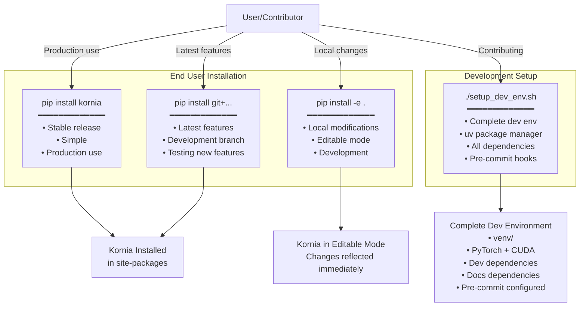
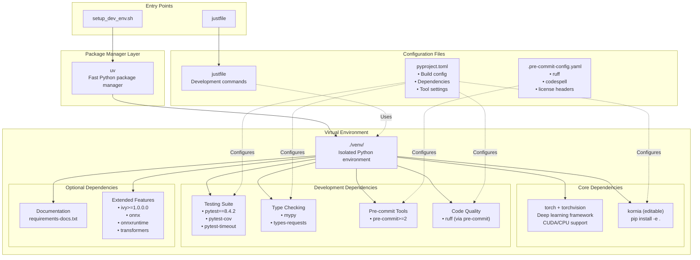
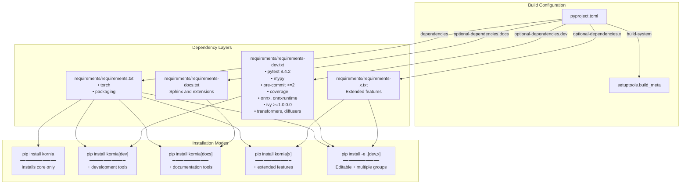

<!-- source: DeepWiki mcp.deepwiki.com · repo kornia/kornia · page 1.1 Installation and Setup · fetched 2026-10-21 -->

# Installation and Setup

<details>
<summary>Relevant source files</summary>

The following files were used as context for generating this wiki page:

- [.github/workflows/coverage.yml](.github/workflows/coverage.yml)
- [.gitignore](.gitignore)
- [.pre-commit-config.yaml](.pre-commit-config.yaml)
- [CHANGELOG.md](CHANGELOG.md)
- [CONTRIBUTING.md](CONTRIBUTING.md)
- [README.md](README.md)
- [README_zh-CN.md](README_zh-CN.md)
- [docker/Dockerfile.benchmark](docker/Dockerfile.benchmark)
- [docs/source/_static/img/cn_community_zhihu.jpg](docs/source/_static/img/cn_community_zhihu.jpg)
- [docs/source/community/contribute.rst](docs/source/community/contribute.rst)
- [justfile](justfile)
- [pyproject.toml](pyproject.toml)
- [setup_dev_env.sh](setup_dev_env.sh)
- [uv.lock](uv.lock)

</details>


This document covers the installation process for Kornia and the setup of a development environment for contributors. It includes basic installation methods for end users, detailed development environment configuration, project dependencies, and development tools.

For information about the overall architecture and module organization, see [Architecture and Module Organization](#1.3). For details about contributing code and development practices, see [Development Environment Setup](#9.1) and [Code Quality Standards](#9.2).

---

## Overview

Kornia supports multiple installation methods depending on your use case:
- **End users** can install via pip from PyPI or directly from GitHub
- **Contributors** should use the automated development environment setup script
- **Advanced users** can install from source with editable mode

The project requires **Python 3.9+** and **PyTorch 1.9.1+** as specified in [pyproject.toml:13-27]() and [README.md:86-87]().

---

## Basic Installation

### Installation via pip

The simplest method for end users is to install the stable release from PyPI:

```bash
pip install kornia
```

This installs the latest stable version with all required dependencies as specified in [requirements/requirements.txt]().

Sources: [README.md:89-93](), [pyproject.toml:1-65]()

### Installation from Source

For users who want the latest features or need to make local modifications:

```bash
pip install -e .
```

The `-e` flag installs the package in editable mode, allowing changes to the source code to be immediately reflected without reinstalling. This uses setuptools as the build backend as configured in [pyproject.toml:1-3]().

Sources: [README.md:98-102](), [CONTRIBUTING.md:154-156]()

### Installation from GitHub

To install the latest development version directly from the GitHub repository:

```bash
pip install git+https://github.com/kornia/kornia
```

This method pulls the most recent code from the main branch.

Sources: [README.md:114-118]()

---

## Installation Methods Comparison



Sources: [README.md:84-120](), [CONTRIBUTING.md:68-156]()

---

## Development Environment Setup

### Using the Automated Setup Script (Recommended)

For contributors, Kornia provides an automated setup script that uses `uv` for fast package management:

```bash
./setup_dev_env.sh
```

This script performs the following operations:
1. Installs `uv` if not already available
2. Creates a virtual environment in `./venv`
3. Installs PyTorch with appropriate CUDA support (default: CUDA 12.1)
4. Installs development dependencies from [requirements/requirements-dev.txt]()
5. Installs documentation dependencies from [requirements/requirements-docs.txt]()
6. Installs Kornia in editable mode

Sources: [README.md:104-112](), [CONTRIBUTING.md:70-86]()

#### Customizing the Setup

The setup script supports environment variables for customization:

```bash
# Custom Python version
PYTHON_VERSION=3.10 ./setup_dev_env.sh

# Custom PyTorch and CUDA versions
PYTORCH_VERSION=2.4.0 CUDA_VERSION=11.8 ./setup_dev_env.sh

# CPU-only installation
PYTORCH_MODE=cpuonly ./setup_dev_env.sh
```

Sources: [CONTRIBUTING.md:87-95]()

### Manual Setup with uv

If you prefer manual control over the environment setup:

1. **Install uv**:
```bash
# Linux/macOS
curl -LsSf https://astral.sh/uv/install.sh | sh

# Or using pip
pip install uv
```

2. **Create and activate virtual environment**:
```bash
uv venv
source .venv/bin/activate  # On Windows: .venv\Scripts\activate
```

3. **Install PyTorch**:
```bash
# For CUDA 12.1 (default)
uv pip install torch torchvision --index-url https://download.pytorch.org/whl/cu121

# For CPU-only
uv pip install torch torchvision --index-url https://download.pytorch.org/whl/cpu
```

4. **Install Kornia dependencies**:
```bash
uv pip install -e .[dev,x]
uv pip install -e .[docs]  # For documentation development
```

Sources: [CONTRIBUTING.md:120-152]()

---

## Development Environment Architecture



Sources: [CONTRIBUTING.md:68-156](), [pyproject.toml:1-282](), [.pre-commit-config.yaml:1-55](), [justfile:1-149]()

---

## Project Dependencies

### Core Runtime Dependencies

The minimum requirements for running Kornia are defined in [requirements/requirements.txt]():

| Package | Purpose |
|---------|---------|
| `torch` | PyTorch tensor operations and autograd |
| `packaging` | Version parsing and comparison |

Kornia supports **PyTorch 1.9.1+** and **Python 3.9-3.13** as declared in [pyproject.toml:13,26-29]().

### Development Dependencies

Development dependencies are specified in [requirements/requirements-dev.txt:1-18]():

| Package | Version | Purpose |
|---------|---------|---------|
| `pytest` | 8.4.2 | Testing framework |
| `pytest-cov` | - | Code coverage reporting |
| `pytest-timeout` | - | Test timeout management |
| `mypy` | - | Static type checking |
| `pre-commit` | >=2 | Git pre-commit hooks |
| `coverage` | - | Coverage analysis |
| `numpy` | <3 | Numerical operations |
| `pillow` | - | Image I/O |
| `onnx` | - | ONNX model export |
| `onnxruntime` | - | ONNX inference |
| `ivy` | >=1.0.0.0 | Multi-framework support |
| `transformers` | - | Pre-trained models |
| `diffusers` | - | Diffusion models |
| `accelerate` | - | Training acceleration |

### Optional Dependencies

Kornia defines optional dependency groups in [pyproject.toml:54-57]():

- **`dev`**: All development tools (from requirements-dev.txt)
- **`docs`**: Documentation building tools (from requirements-docs.txt)
- **`x`**: Extended features including ONNX, transformers, etc. (from requirements-x.txt)

Installation with optional dependencies:
```bash
pip install kornia[dev]      # Development dependencies
pip install kornia[docs]     # Documentation dependencies
pip install kornia[x]        # Extended features
pip install kornia[dev,x]    # Multiple groups
```

Sources: [pyproject.toml:49-57](), [requirements/requirements-dev.txt:1-18]()

---

## Development Tools and Commands

### justfile Command Runner

Kornia uses `just` (a command runner similar to `make`) to provide convenient development commands. The configuration is in [justfile:1-149]().

**Common commands:**

```bash
just                    # List all available commands
just test-cpu          # Run CPU tests
just test-cuda         # Run CUDA tests
just test-all          # Run all tests with coverage
just lint              # Run code formatting and linting
just mypy              # Run type checking
just build-docs        # Build documentation
just benchmark         # Run benchmarks
```

The `justfile` automatically ensures the virtual environment is set up via the `_ensure-venv` recipe before running commands [justfile:16-23]().

Sources: [justfile:1-149](), [CONTRIBUTING.md:97-119]()

### Pre-commit Hooks

Kornia uses pre-commit hooks to enforce code quality standards before commits. Configuration is in [.pre-commit-config.yaml:1-55]().

**Hooks configured:**

| Hook | Tool | Purpose |
|------|------|---------|
| `end-of-file-fixer` | pre-commit | Ensures files end with newline |
| `trailing-whitespace` | pre-commit | Removes trailing whitespace |
| `check-yaml` | pre-commit | Validates YAML syntax |
| `ruff --fix` | ruff v0.14.0 | Auto-fixes linting issues |
| `ruff-format` | ruff v0.14.0 | Formats code |
| `codespell` | codespell v2.4.1 | Checks spelling |
| `add-license-header` | add-license-header v2.4.0 | Adds Apache 2.0 license headers |

The hooks run automatically on commit and can also be triggered manually:
```bash
pre-commit run --all-files
```

The configuration enables auto-fixing on pull requests via pre-commit.ci [.pre-commit-config.yaml:1-4]().

Sources: [.pre-commit-config.yaml:1-55](), [CONTRIBUTING.md:171-173]()

---

## Development Workflow

```mermaid
graph LR
    subgraph "Initial Setup"
        Clone["git clone kornia<br/>git remote add upstream"]
        Setup["./setup_dev_env.sh"]
        Activate["source venv/bin/activate"]
    end
    
    subgraph "Development Cycle"
        Branch["git checkout -b<br/>feat/feature-name"]
        Code["Edit code<br/>kornia/..."]
        LocalTest["just test-cpu<br/>just lint<br/>just mypy"]
        Commit["git commit"]
        PreCommitHooks["Pre-commit runs:<br/>• ruff --fix<br/>• ruff-format<br/>• codespell<br/>• license headers"]
    end
    
    subgraph "Submission"
        Push["git push origin<br/>feature-branch"]
        PR["Create Pull Request"]
        CI["CI/CD Pipeline:<br/>• Test matrix<br/>• Type checking<br/>• Coverage<br/>• Docs build"]
    end
    
    Clone --> Setup
    Setup --> Activate
    Activate --> Branch
    Branch --> Code
    Code --> LocalTest
    LocalTest -->|"Pass"| Commit
    LocalTest -->|"Fail"| Code
    Commit --> PreCommitHooks
    PreCommitHooks -->|"Auto-fix"| Code
    PreCommitHooks -->|"Pass"| Push
    Push --> PR
    PR --> CI
    CI -->|"All pass"| Merge["Merge to main"]
    CI -->|"Fail"| Code
```



Sources: [CONTRIBUTING.md:44-173](), [.pre-commit-config.yaml:1-55](), [justfile:1-149]()

---

## Tool Configuration

### pyproject.toml Configuration

The [pyproject.toml:1-282]() file centralizes all project configuration:

**Build system** [pyproject.toml:1-3]():
- Backend: `setuptools.build_meta`
- Requires: `setuptools>=61.2`

**Project metadata** [pyproject.toml:5-43]():
- Name: `kornia`
- License: Apache-2.0
- Python requirement: `>=3.9`
- Classifiers include Python 3.9-3.12, GPU support, etc.

**ruff configuration** [pyproject.toml:69-209]():
- Target: Python 3.9
- Line length: 120 characters
- Enabled linters: Pyflakes, pycodestyle, pylint, pydocstyle, and more
- Google-style docstrings [pyproject.toml:153-154]()
- Per-file ignores for tests, benchmarks, docs

**mypy configuration** [pyproject.toml:256-271]():
- Strict mode enabled
- Files: `kornia/` directory
- Flags: `check_untyped_defs`, `disallow_any_generics`, `disallow_incomplete_defs`, etc.

**pytest configuration** [pyproject.toml:210-217]():
- Markers for test categories: `grad`, `jit`, `nn`, `slow`
- Color output enabled

**coverage configuration** [pyproject.toml:219-254]():
- Source: `kornia/`
- Fail threshold: 84%
- Branch coverage enabled

Sources: [pyproject.toml:1-282]()

### Testing Configuration

Tests support multiple devices and dtypes through command-line arguments:

```bash
# Test on all devices and dtypes
pytest tests/ --device=all --dtype=all

# Test on specific device
pytest tests/ --device=cpu --dtype=float32,float64

# Test on CUDA
pytest tests/ --device=cuda --dtype=float32
```

Available options:
- **Device**: `cpu`, `cuda`, `mps`, `tpu`, `all`
- **Dtype**: `bfloat16`, `float16`, `float32`, `float64`, `all`

Test markers defined in [pyproject.toml:212-217]():
- `grad`: Gradient check tests
- `jit`: TorchScript compilation tests
- `nn`: Neural network module tests
- `slow`: Tests that take significant time

Sources: [CONTRIBUTING.md:160-169](), [pyproject.toml:210-217]()

---

## Dependency Resolution and Package Structure



Sources: [pyproject.toml:1-65](), [requirements/requirements-dev.txt:1-18]()

---

## Platform Support

### Operating Systems

Kornia is tested on multiple operating systems through the CI/CD pipeline:
- **Ubuntu** (Linux)
- **Windows**
- **macOS**

Sources: [README.md:86-87](), Diagram 3 from provided overview

### Python Versions

Supported Python versions as declared in [pyproject.toml:13,25-29]():
- Python 3.9
- Python 3.10
- Python 3.11
- Python 3.12
- Python 3.13 (beta support)

### PyTorch Versions

Kornia maintains compatibility with PyTorch versions from 1.9.1 to the latest (2.5+). The CI/CD pipeline tests against multiple PyTorch versions to ensure compatibility.

### Hardware Acceleration

Kornia supports multiple hardware backends:
- **CPU**: Standard CPU operations
- **CUDA**: NVIDIA GPU acceleration (CUDA 11.8, 12.1)
- **MPS**: Apple Silicon Metal Performance Shaders
- **TPU**: Google Cloud TPU (limited support)

The setup script defaults to CUDA 12.1 but can be customized via environment variables [CONTRIBUTING.md:87-95]().

Sources: [pyproject.toml:13-33](), [CONTRIBUTING.md:87-95]()

---

## Verification

After installation, verify that Kornia is correctly installed:

```python
import kornia
print(kornia.__version__)

# Test a simple operation
import torch
image = torch.rand(1, 3, 224, 224)
gray = kornia.color.rgb_to_grayscale(image)
print(f"Grayscale shape: {gray.shape}")  # Should be (1, 1, 224, 224)
```

For development environments, verify all tools are available:

```bash
# Check Python and PyTorch versions
python --version
python -c "import torch; print(f'PyTorch {torch.__version__}')"

# Verify development tools
pytest --version
mypy --version
pre-commit --version
just --version
```

Sources: [README.md:122-159]()

---

## Troubleshooting

### Common Issues

**Virtual environment not found**:
- Run `./setup_dev_env.sh` to create the environment
- Or check that you're in the correct directory

**CUDA version mismatch**:
- Specify CUDA version explicitly: `CUDA_VERSION=11.8 ./setup_dev_env.sh`
- For CPU-only: `PYTORCH_MODE=cpuonly ./setup_dev_env.sh`

**Pre-commit hooks failing**:
- Run manually: `pre-commit run --all-files`
- Update hooks: `pre-commit autoupdate`

**Type checking errors with mypy**:
- Ensure virtual environment is activated
- Run: `mypy` or `just mypy`

**Import errors**:
- For editable installs, ensure you ran `pip install -e .` from the repository root
- Check that the virtual environment is activated

Sources: [CONTRIBUTING.md:68-173](), [justfile:1-149]()

---

## Summary

Kornia provides multiple installation methods tailored to different use cases:
- **End users**: Simple `pip install kornia` for production use
- **Contributors**: Automated `./setup_dev_env.sh` for complete development environment
- **Advanced users**: Manual setup with `uv` for custom configurations

The development environment uses modern Python tooling:
- `uv` for fast package management
- `just` for convenient development commands
- `pre-commit` for automated code quality checks
- `pytest` with extensive device/dtype testing support

All configuration is centralized in `pyproject.toml`, making the project easy to maintain and extend. The setup supports Python 3.9-3.13, PyTorch 1.9.1+, and multiple hardware backends (CPU, CUDA, MPS).

Sources: [README.md:84-120](), [CONTRIBUTING.md:44-173](), [pyproject.toml:1-282](), [justfile:1-149](), [.pre-commit-config.yaml:1-55]()

---

