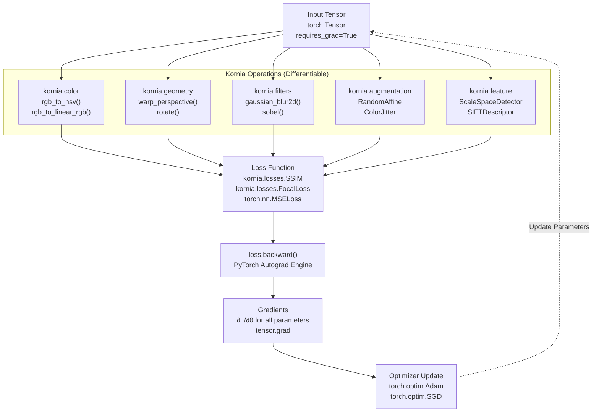
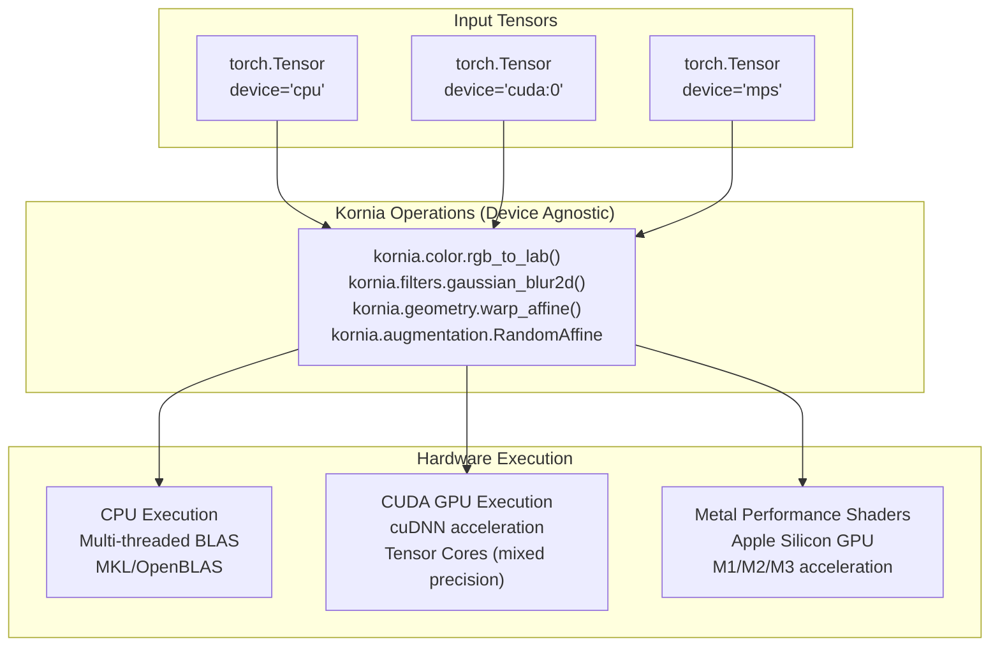
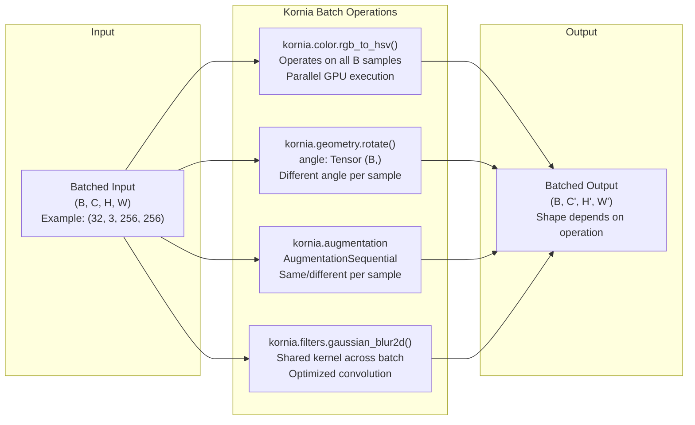
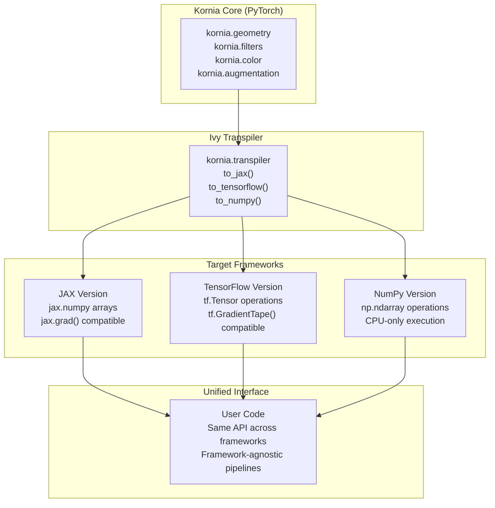
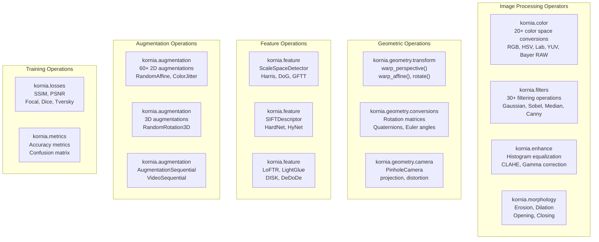
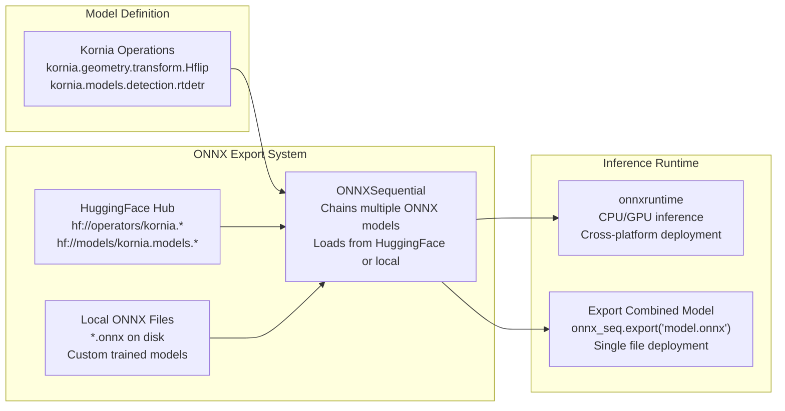
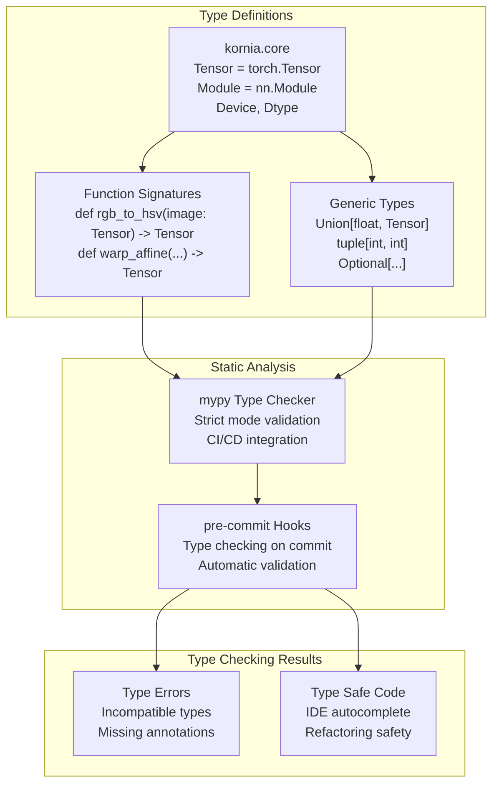
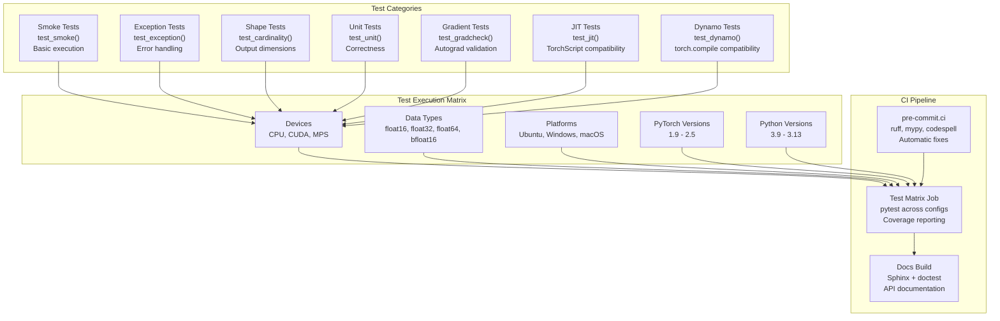

<!-- source: DeepWiki mcp.deepwiki.com · repo kornia/kornia · page 1.2 Key Features and Capabilities · fetched 2026-10-21 -->

# Key Features

<details>
<summary>Relevant source files</summary>

The following files were used as context for generating this wiki page:

- [docs/source/augmentation.rst](docs/source/augmentation.rst)
- [docs/source/contrib.rst](docs/source/contrib.rst)
- [docs/source/feature.rst](docs/source/feature.rst)
- [docs/source/geometry.conversions.rst](docs/source/geometry.conversions.rst)
- [docs/source/geometry.transform.rst](docs/source/geometry.transform.rst)
- [docs/source/references.bib](docs/source/references.bib)
- [kornia/augmentation/__init__.py](kornia/augmentation/__init__.py)
- [kornia/contrib/__init__.py](kornia/contrib/__init__.py)
- [kornia/contrib/histogram_matching.py](kornia/contrib/histogram_matching.py)
- [kornia/contrib/models/rt_detr/__init__.py](kornia/contrib/models/rt_detr/__init__.py)
- [kornia/contrib/models/rt_detr/architecture/__init__.py](kornia/contrib/models/rt_detr/architecture/__init__.py)
- [kornia/feature/__init__.py](kornia/feature/__init__.py)
- [kornia/feature/laf.py](kornia/feature/laf.py)
- [kornia/feature/responses.py](kornia/feature/responses.py)
- [kornia/feature/scale_space_detector.py](kornia/feature/scale_space_detector.py)
- [kornia/feature/siftdesc.py](kornia/feature/siftdesc.py)
- [kornia/geometry/camera/pinhole.py](kornia/geometry/camera/pinhole.py)
- [kornia/geometry/conversions.py](kornia/geometry/conversions.py)
- [kornia/geometry/transform/affwarp.py](kornia/geometry/transform/affwarp.py)
- [kornia/geometry/transform/imgwarp.py](kornia/geometry/transform/imgwarp.py)
- [kornia/geometry/transform/pyramid.py](kornia/geometry/transform/pyramid.py)

</details>


This page documents Kornia's key capabilities that distinguish it as a differentiable computer vision library. These features enable seamless integration of computer vision operations into deep learning pipelines with support for automatic differentiation, GPU acceleration, and multi-framework compatibility.

For installation and setup instructions, see [Installation and Setup](#1.1). For information about the overall architecture and how these features are organized across modules, see [Architecture and Module Organization](#1.3).

---

## Overview of Key Capabilities

Kornia is built on PyTorch and provides a comprehensive set of differentiable computer vision operations. The library's design emphasizes several core capabilities:

| Capability | Description | Primary Benefit |
|------------|-------------|-----------------|
| **Differentiability** | All operations support automatic differentiation | End-to-end training of vision pipelines |
| **GPU Acceleration** | Native PyTorch tensor operations with CUDA support | High-performance batch processing |
| **Batch Processing** | Vectorized operations on batched inputs | Efficient parallel computation |
| **Multi-Framework** | Transpilation to JAX, TensorFlow, NumPy | Ecosystem interoperability |
| **Rich Operator Set** | 500+ vision operations across multiple domains | Comprehensive toolset |
| **ONNX Export** | Model serialization and chaining support | Production deployment |
| **Type Safety** | Static typing with mypy validation | Code reliability |

**Sources:** [README.md:28-49](), [kornia/__init__.py:18-60]()

---

## Differentiability and Automatic Gradient Computation

All Kornia operations are implemented as differentiable functions that integrate seamlessly with PyTorch's autograd system. This enables gradient-based optimization of entire computer vision pipelines.

### Gradient Flow Architecture



### Gradient Checking Infrastructure

Kornia maintains strict gradient correctness through comprehensive testing:

- **Gradient Check Tests**: Each operation includes `test_gradcheck()` validating numerical vs. analytical gradients
- **Test Framework**: Located in [testing/base.py](), provides `BaseTester.gradcheck()` helper
- **Example Tests**: [tests/color/test_rgb.py:92-95](), [tests/color/test_rgb.py:383-387]()

The gradient checking ensures all operations satisfy:
```
|∇f_numerical - ∇f_analytical| < tolerance
```

**Sources:** [kornia/color/rgb.py:206-259](), [tests/color/test_rgb.py:92-95](), [CONTRIBUTING.md:307-311]()

---

## GPU Acceleration and Multi-Device Support

Kornia operations execute on any PyTorch-supported device, including CPU, CUDA GPUs, and Apple Silicon MPS accelerators. The library leverages PyTorch's device abstraction for transparent device placement.

### Device Support Matrix



### Testing Across Devices

The test suite validates correctness across all devices:

**Test Configuration:**
- **Device Selection**: `--device=cpu`, `--device=cuda`, `--device=mps`, `--device=all`
- **Dtype Selection**: `--dtype=float32`, `--dtype=float64`, `--dtype=all`
- **Test Fixtures**: [testing/base.py]() provides `device` and `dtype` fixtures

**Example Test Commands:**
```bash
# CPU-only tests (from justfile)
just test-cpu          # All dtypes on CPU
just test-cpu-f32      # Float32 only on CPU

# CUDA tests
just test-cuda         # All dtypes on CUDA
just test-cuda-f32     # Float32 only on CUDA

# MPS tests (Apple Silicon)
just test-mps          # Float32 only, excluding grad/jit tests
```

**Sources:** [justfile:29-45](), [CONTRIBUTING.md:163-169](), [README.md:86-87]()

---

## Batch Processing and Vectorization

All Kornia operations support batched inputs with shape conventions `(B, C, H, W)` for 2D operations and `(B, C, D, H, W)` for 3D operations. Batch dimensions are preserved through all transformations.

### Batch Processing Flow



### Batch Dimension Conventions

| Operation Type | Input Shape | Output Shape | Notes |
|----------------|-------------|--------------|-------|
| **Color Conversion** | `(*, 3, H, W)` | `(*, 3, H, W)` | Arbitrary batch dimensions `*` |
| **Geometric Transform** | `(B, C, H, W)` | `(B, C, H', W')` | H', W' depend on transform |
| **Augmentation** | `(B, C, H, W)` | `(B, C, H', W')` | Random per-sample transforms |
| **Filtering** | `(B, C, H, W)` | `(B, C, H, W)` | Preserves spatial dimensions |
| **Raw to RGB** | `(*, 1, H, W)` | `(*, 3, H, W)` | H, W must be even |

**Example from Color Operations:**
- [kornia/color/rgb.py:29-52]() - `rgb_to_bgr()` accepts shape `(*, 3, H, W)`
- [kornia/color/raw.py:53-193]() - `raw_to_rgb()` processes batched raw images

**Sources:** [kornia/color/rgb.py:29-52](), [kornia/color/raw.py:240-298](), [README.md:28]()

---

## Multi-Framework Support via Ivy Transpilation

Kornia provides transpilation to JAX, TensorFlow, and NumPy through the Ivy framework, enabling interoperability across the deep learning ecosystem.

### Multi-Framework Architecture



### Transpilation API

The transpilation interface is exposed at the top level:

**Import and Usage:**
```python
# From kornia/__init__.py
from kornia.transpiler import to_jax, to_numpy, to_tensorflow

# Usage example from README.md:191-193
import kornia
tf_kornia = kornia.to_tensorflow()
# Now use tf_kornia.geometry, tf_kornia.filters, etc.
```

**Transpiler Functions:**
- `to_jax()`: Converts Kornia operations to JAX
- `to_tensorflow()`: Converts to TensorFlow operations
- `to_numpy()`: Converts to NumPy operations (CPU-only)

**Ivy Integration:**
- Dependency: [requirements/requirements-dev.txt:4]() - `ivy>=1.0.0.0`
- Supports automatic backend conversion
- Maintains API compatibility across frameworks

**Sources:** [kornia/__init__.py:45](), [README.md:186-203](), [requirements/requirements-dev.txt:4]()

---

## Comprehensive Operator Coverage

Kornia provides over 500 operations across multiple computer vision domains, organized into specialized modules.

### Operator Categories and Code Organization



### Operator Statistics by Module

| Module | Operations | Primary Use Cases |
|--------|------------|-------------------|
| **kornia.color** | 20+ | Color space conversions, RAW processing |
| **kornia.filters** | 30+ | Gaussian blur, edge detection, kernels |
| **kornia.geometry** | 50+ | Transforms, projections, camera models |
| **kornia.feature** | 40+ | Feature detection, description, matching |
| **kornia.augmentation** | 60+ | Data augmentation pipelines |
| **kornia.losses** | 15+ | Training objectives, photometric losses |
| **kornia.morphology** | 10+ | Morphological operations |
| **kornia.enhance** | 10+ | Image enhancement, normalization |

**Module Imports:**
From [kornia/__init__.py:24-42]():
```python
from . import (
    augmentation,
    color,
    contrib,
    core,
    config,
    enhance,
    feature,
    io,
    losses,
    metrics,
    models,
    morphology,
    onnx,
    tracking,
    utils,
    x,
)
```

**Sources:** [kornia/__init__.py:18-60](), [README.md:50-73](), [docs/source/color.rst:1-236](), [kornia/color/__init__.py:18-152]()

---

## ONNX Export and Model Deployment

Kornia supports ONNX export for production deployment through the `kornia.onnx` module, enabling model chaining and cross-platform inference.

### ONNX Sequential Pipeline



### ONNX Export Example

**Usage Pattern (from README.md):**
```python
from kornia.onnx import ONNXSequential

# Chain ONNX models from HuggingFace and local files
onnx_seq = ONNXSequential(
    "hf://operators/kornia.geometry.transform.flips.Hflip",
    "hf://models/kornia.models.detection.rtdetr_r18vd_640x640",
)

# Inference
input_data = np.random.randn(1, 3, 384, 512).astype(np.float32)
outputs = onnx_seq(input_data)

# Export chained model
onnx_seq.export("chained_model.onnx")
```

**ONNX Module Support:**
- Module organization: [kornia/onnx/]()
- Operator exports: Models with `ONNX_DEFAULT_INPUTSHAPE` and `ONNX_DEFAULT_OUTPUTSHAPE` attributes
- Examples: [kornia/color/rgb.py:356-357](), [kornia/color/raw.py:316-317]()

**Sources:** [README.md:164-183](), [kornia/color/rgb.py:356-357](), [kornia/color/raw.py:316-317](), [requirements/requirements-dev.txt:7-8]()

---

## Type Safety and Static Analysis

Kornia maintains strict type safety through comprehensive type annotations and mypy validation, ensuring code reliability and developer productivity.

### Type System Architecture



### Type Annotation Examples

**Color Module Example:**
From [kornia/color/rgb.py:18-20](), [kornia/color/rgb.py:79-115]():
```python
from __future__ import annotations
from kornia.core import Tensor

def rgb_to_rgba(image: Tensor, alpha_val: Union[float, Tensor]) -> Tensor:
    # Type-safe implementation
    # Returns RGBA version of shape (*, 4, H, W)
```

**Mypy Configuration:**
- Tool: `mypy` in [requirements/requirements-dev.txt:5]()
- Justfile command: `just mypy` runs type checking [justfile:82-83]()
- CI validation: Type checks run on all pull requests [CONTRIBUTING.md:398]()

**Type Checking Standards (from CONTRIBUTING.md):**
- Use `from __future__ import annotations` for advanced typing
- Import types from `kornia.core`: `Tensor`, `Module`
- Always type function inputs and outputs
- Use typing for complex types: `Union`, `Optional`, `tuple[int, int]`

**Sources:** [kornia/color/rgb.py:18-115](), [CONTRIBUTING.md:337-358](), [justfile:82-83](), [requirements/requirements-dev.txt:5]()

---

## Development and Testing Infrastructure

Kornia maintains high code quality through comprehensive testing infrastructure and CI/CD pipelines that validate all key features across multiple configurations.

### Testing Matrix



### Test Framework Structure

**Base Test Class:**
From [CONTRIBUTING.md:273-322]():
```python
from testing.base import BaseTester

class TestMyFunction(BaseTester):
    def test_smoke(self, device, dtype):
        # Test basic execution
        pass
    
    def test_exception(self, device, dtype):
        # Test error handling
        pass
    
    def test_cardinality(self, device, dtype):
        # Test output shapes
        pass
    
    def test_gradcheck(self, device):
        # Test gradients with self.gradcheck(...)
        pass
    
    def test_dynamo(self, device, dtype, torch_optimizer):
        # Test torch.compile compatibility
        pass
```

**CI/CD Pipeline:**
- Pre-commit hooks: [.pre-commit-config.yaml]() with ruff, mypy, codespell
- Test matrix: [.github/workflows/]() validates across platforms
- Coverage threshold: 84% minimum [CONTRIBUTING.md:395-397]()

**Justfile Test Commands:**
```bash
just test-all          # Run all tests with coverage
just test-cpu          # CPU-only tests
just test-cuda         # CUDA tests
just test-quick        # Fast tests (no jit/grad)
just test-coverage     # Coverage report
```

**Sources:** [CONTRIBUTING.md:158-322](), [justfile:25-76](), [README.md:104-112]()

---

## Summary

Kornia's key features work together to provide a comprehensive, production-ready computer vision library:

1. **Differentiability**: Enables end-to-end training with automatic gradient computation
2. **GPU Acceleration**: Leverages PyTorch's device abstraction for high-performance execution
3. **Batch Processing**: Vectorized operations for efficient parallel computation
4. **Multi-Framework**: Transpilation to JAX, TensorFlow, and NumPy via Ivy
5. **Rich Operators**: 500+ operations across color, geometry, features, and augmentation
6. **ONNX Export**: Production deployment with model chaining
7. **Type Safety**: Comprehensive type annotations with mypy validation
8. **Testing**: Extensive test matrix ensuring correctness across configurations

These capabilities are organized into a modular architecture detailed in [Architecture and Module Organization](#1.3), with each feature supporting the others to create a cohesive ecosystem for differentiable computer vision.

**Sources:** [README.md:1-256](), [kornia/__init__.py:18-60](), [CONTRIBUTING.md:1-410]()

---

