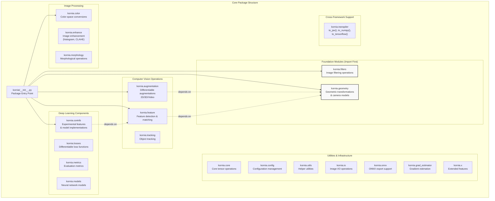
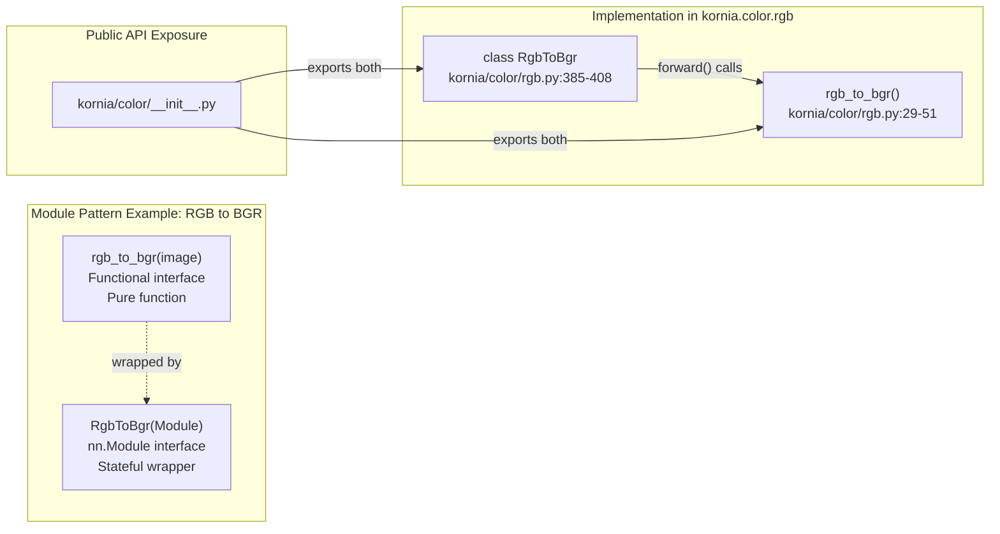
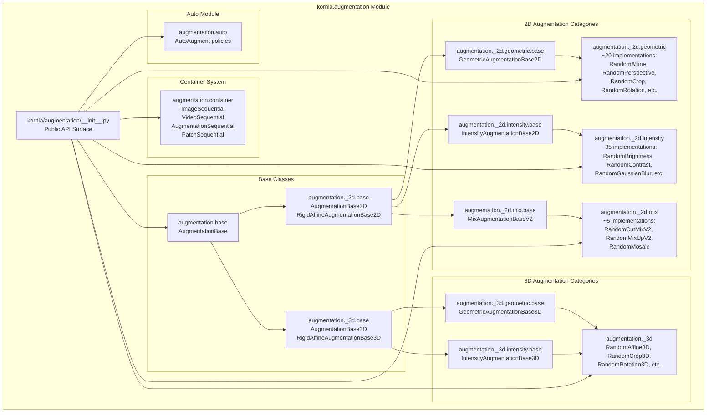
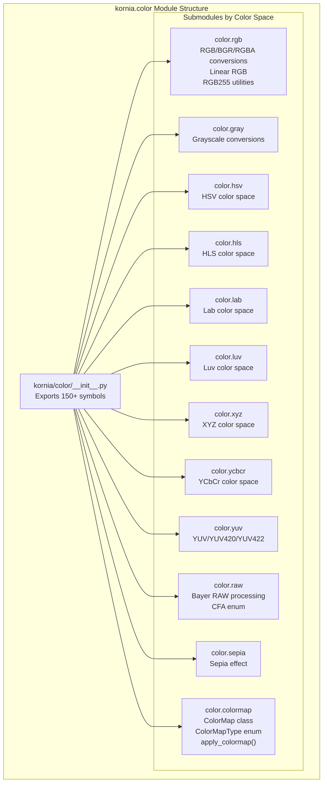
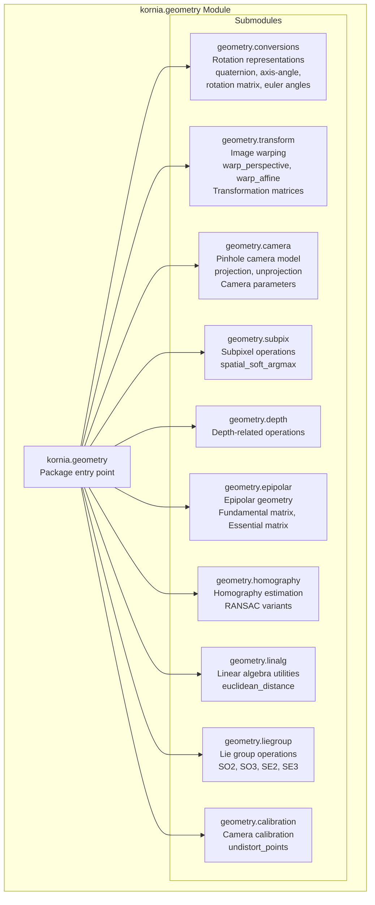
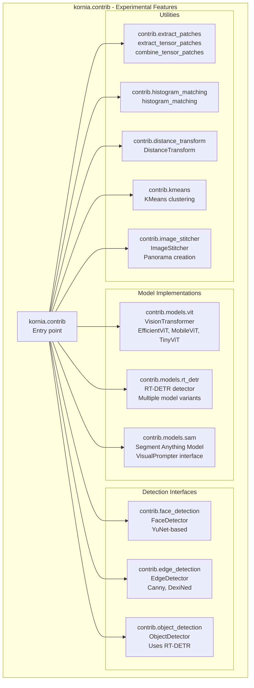
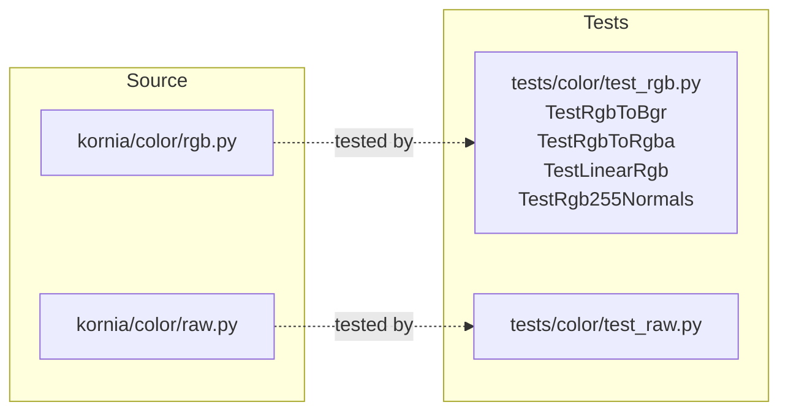

<!-- source: DeepWiki mcp.deepwiki.com · repo kornia/kornia · page 1.3 Module Organization and Architecture · fetched 2026-10-21 -->

# Module Organization and Architecture

<details>
<summary>Relevant source files</summary>

The following files were used as context for generating this wiki page:

- [.pre-commit-config.yaml](.pre-commit-config.yaml)
- [CHANGELOG.md](CHANGELOG.md)
- [docs/source/augmentation.rst](docs/source/augmentation.rst)
- [docs/source/color.rst](docs/source/color.rst)
- [kornia/__init__.py](kornia/__init__.py)
- [kornia/augmentation/__init__.py](kornia/augmentation/__init__.py)
- [kornia/color/__init__.py](kornia/color/__init__.py)
- [kornia/color/raw.py](kornia/color/raw.py)
- [kornia/color/rgb.py](kornia/color/rgb.py)
- [pyproject.toml](pyproject.toml)
- [tests/color/test_rgb.py](tests/color/test_rgb.py)
- [uv.lock](uv.lock)

</details>


This document describes how the Kornia codebase is organized into modules, the architectural patterns used consistently across modules, and the dependency relationships between major components. For specific details about individual modules' functionality, see the module-specific documentation pages (e.g., [Color Space Processing](#2), [Geometry and Transformations](#3), [Data Augmentation System](#4), etc.).

## Overview of Module Structure

Kornia is organized as a hierarchical package with approximately 15 top-level modules, each providing a cohesive set of computer vision functionality. The library follows a consistent architectural pattern across modules: each module exposes both functional (pure function) and object-oriented (`nn.Module` subclass) interfaces for the same operations, enabling flexible integration into PyTorch workflows.

The main package entry point at [kornia/__init__.py:1-67]() establishes the module namespace and handles imports. Critical to the architecture is the import order: `filters` and `geometry` modules must be imported first [kornia/__init__.py:24-27]() as they are foundational and changing this order can cause circular dependency issues.

**Sources:** [kornia/__init__.py:1-67]()

## Top-Level Module Taxonomy



The modules are imported in a specific order at [kornia/__init__.py:24-48]():

| Import Order | Module | Purpose | Key Dependencies |
|--------------|--------|---------|------------------|
| 1-2 | `filters`, `geometry` | Foundation modules providing core operations | None (must be first) |
| 3 | `grad_estimator` | Gradient estimation utilities | Core modules |
| 4-16 | `augmentation`, `color`, `contrib`, `core`, `config`, `enhance`, `feature`, `io`, `losses`, `metrics`, `models`, `morphology`, `onnx`, `tracking`, `utils`, `x` | Feature modules | Foundation modules |
| 17 | `transpiler` | Multi-framework support | Core modules |

**Sources:** [kornia/__init__.py:24-52]()

## Module Design Pattern: Functional + Object-Oriented Interface

Kornia follows a dual-interface pattern across all modules: each operation is implemented as both a functional (pure function) and an object-oriented (`torch.nn.Module` subclass) interface. This pattern provides flexibility for different use cases—functions for simple transformations and modules for integration into neural network architectures.

### Pattern Structure



**Example Implementation:**

The `rgb_to_bgr` operation demonstrates this pattern:

1. **Functional Interface** [kornia/color/rgb.py:29-51](): Pure function accepting a tensor and returning the transformed tensor
2. **Module Interface** [kornia/color/rgb.py:385-408](): `RgbToBgr` class inheriting from `Module` with a `forward()` method that calls the functional implementation
3. **Public Exports** [kornia/color/__init__.py:39-49](): Both interfaces exported in `__all__` list for consistent API

This pattern is applied consistently across:
- Color conversions (RGB↔BGR, RGB↔HSV, RGB↔Lab, etc.)
- Geometric transformations (affine, perspective, rotation)
- Augmentations (all 60+ augmentation operations)
- Filters (Gaussian, Sobel, median, etc.)

**Sources:** [kornia/color/rgb.py:29-51](), [kornia/color/rgb.py:385-408](), [kornia/color/__init__.py:23-160]()

## Internal Module Hierarchy: Augmentation Module Example

Modules are internally organized with multi-level hierarchies to separate concerns. The augmentation module exemplifies this structure:



**Hierarchy Levels:**

1. **Package Entry** [kornia/augmentation/__init__.py:1-205](): Imports and re-exports public API (60+ augmentations + containers)
2. **Abstract Base Classes**: Define common interfaces
   - `AugmentationBase` - Root base for all augmentations
   - `AugmentationBase2D` [kornia/augmentation/__init__.py:88]() - Base for 2D operations
   - `AugmentationBase3D` [kornia/augmentation/__init__.py:105]() - Base for 3D operations
3. **Categorical Bases**: Organize by operation type
   - `GeometricAugmentationBase2D` [kornia/augmentation/__init__.py:89]() - Spatial transformations
   - `IntensityAugmentationBase2D` [kornia/augmentation/__init__.py:90]() - Pixel-level adjustments
   - `MixAugmentationBaseV2` [kornia/augmentation/__init__.py:91]() - Multi-image mixing
4. **Concrete Implementations**: Specific augmentation classes (e.g., `RandomAffine`, `RandomBrightness`)
5. **Container Classes**: Pipeline builders (`ImageSequential`, `AugmentationSequential`) [kornia/augmentation/__init__.py:108-115]()

**Sources:** [kornia/augmentation/__init__.py:1-205]()

## Color Module Internal Structure

The color module demonstrates organization by conversion families:



Each submodule typically contains:
- 2-4 functional implementations (forward and reverse conversions)
- Corresponding `nn.Module` wrapper classes
- Type definitions (e.g., `CFA` enum for Bayer patterns [kornia/color/raw.py:30-51]())

**Example Exports from RGB Module:**

| Category | Functions | Modules |
|----------|-----------|---------|
| RGB↔BGR | `rgb_to_bgr`, `bgr_to_rgb` | `RgbToBgr`, `BgrToRgb` |
| RGB↔RGBA | `rgb_to_rgba`, `rgba_to_rgb`, `bgr_to_rgba`, `rgba_to_bgr` | `RgbToRgba`, `RgbaToRgb`, `BgrToRgba`, `RgbaToBgr` |
| Linear RGB | `rgb_to_linear_rgb`, `linear_rgb_to_rgb` | `RgbToLinearRgb`, `LinearRgbToRgb` |
| Quantization | `rgb_to_rgb255`, `rgb255_to_rgb` | `RgbToRgb255`, `Rgb255ToRgb` |
| Normals | `normals_to_rgb255`, `rgb255_to_normals` | `NormalsToRgb255`, `Rgb255ToNormals` |

**Sources:** [kornia/color/__init__.py:23-160](), [kornia/color/rgb.py:1-684](), [kornia/color/raw.py:30-51]()

## Import Management and Public API Control

Kornia uses explicit import management to control the public API surface and prevent namespace pollution:

### The `__all__` Pattern

Every module defines an `__all__` list explicitly enumerating exported symbols [kornia/augmentation/__init__.py:117-204]():

```python
__all__ = [
    "AugmentationBase2D",
    "AugmentationBase3D",
    "AugmentationSequential",
    "CenterCrop",
    # ... 200+ more symbols
]
```

**Benefits:**
- Documents intended public API
- Prevents accidental exports of internal utilities
- Enables IDE autocomplete
- Controls `from kornia.module import *` behavior

### Module-Level Convenience Imports

The top-level package exposes a curated set of commonly-used utilities directly [kornia/__init__.py:54-63]():

```python
from kornia.constants import pi
from kornia.utils import (
    eye_like,
    vec_like,
    create_meshgrid,
    image_to_tensor,
    tensor_to_image,
    xla_is_available,
)
```

This allows users to write `kornia.image_to_tensor()` instead of `kornia.utils.image_to_tensor()` for frequently-used functions.

### Import Order and Circular Dependencies

The comment at [kornia/__init__.py:24-25]() explicitly documents the critical import order:

> "NOTE: kornia filters and geometry must go first since are the core of the library and by changing the import order you might get into a circular dependencies issue."

This architectural constraint exists because:
- `augmentation` depends on `geometry` for transformation matrices
- `feature` depends on `geometry` for LAF (Local Affine Frame) operations  
- Multiple modules depend on `filters` for core convolution operations

**Sources:** [kornia/__init__.py:24-63](), [kornia/augmentation/__init__.py:117-204](), [kornia/color/__init__.py:74-160]()

## Geometry Module Internal Organization

The geometry module is internally subdivided by functional area:



The geometry module contains particularly complex internal dependencies because:
- `transform` uses `conversions` for rotation matrix generation
- `camera` uses `conversions` for coordinate transformations
- `epipolar` depends on both `camera` and `linalg`
- `homography` depends on `transform` for warp operations

**Sources:** Based on diagram analysis from high-level architecture diagrams

## Contrib Module: Experimental Features

The `kornia.contrib` module houses experimental features and higher-level APIs not yet stabilized for the main modules:



The contrib module serves as an incubation space where:
- New models can be added without strict API stability guarantees
- Experimental interfaces can be tested before promoting to main modules
- Community contributions can be integrated with lower barriers
- Complex multi-component systems (like `ObjectDetector` wrapping RT-DETR with pre/post-processing) can be developed

**Sources:** Based on high-level architecture diagrams (Diagram 5)

## Dependency Flow and Module Relationships

The following table summarizes key inter-module dependencies:

| Module | Direct Dependencies | Reason for Dependency |
|--------|-------------------|----------------------|
| `augmentation` | `geometry.transform`, `geometry.conversions` | Geometric augmentations require transformation matrix generation and application |
| `feature` | `geometry` (LAF operations), `filters` | Feature detection uses scale-space filtering; LAFs require geometric utilities |
| `contrib.models` | `feature` (matching), `filters` | Models like RT-DETR use feature processing pipelines |
| `augmentation.container` | `geometry.transform` | `AugmentationSequential` applies geometric transforms to masks/boxes/keypoints |
| All modules | `core` | Core tensor operations and base classes (`Tensor`, `Module`, `as_tensor`) |

**Circular Dependency Prevention:**

The architecture avoids circular dependencies through:
1. **Layered Import Order**: Foundation modules (`filters`, `geometry`) imported before dependent modules
2. **Lazy Imports**: Some heavy dependencies (like model weights) use lazy loading
3. **Interface Segregation**: Modules depend on interfaces/base classes rather than concrete implementations
4. **Clear Hierarchy**: No bi-directional dependencies; dependency graph is a DAG (directed acyclic graph)

**Sources:** [kornia/__init__.py:24-27]()

## Configuration and Extension Points

### Package Configuration

The `kornia.config` module [kornia/__init__.py:36]() provides runtime configuration options. The `kornia.constants` module [kornia/__init__.py:55]() defines mathematical constants (e.g., `pi`) used throughout the library.

### ONNX Export Support

The `kornia.onnx` module [kornia/__init__.py:44]() provides export functionality for converting Kornia operations to ONNX format. Module classes define `ONNX_DEFAULT_INPUTSHAPE` and `ONNX_DEFAULT_OUTPUTSHAPE` class variables to specify default tensor shapes for ONNX export [kornia/color/rgb.py:378-379](), [kornia/color/raw.py:316-317]().

### Multi-Framework Transpilation

The `kornia.transpiler` module [kornia/__init__.py:52]() provides experimental support for converting PyTorch operations to other frameworks:
- `to_jax()` - Convert to JAX
- `to_numpy()` - Convert to NumPy  
- `to_tensorflow()` - Convert to TensorFlow

This uses the Ivy framework for cross-framework translation.

**Sources:** [kornia/__init__.py:36-55](), [kornia/color/rgb.py:378-379](), [kornia/color/raw.py:316-317]()

## Module Documentation Structure

Kornia modules are documented using Sphinx with reStructuredText format. Each major module has a corresponding `.rst` file in `docs/source/`:

| Module | Documentation File | Notable Sections |
|--------|-------------------|------------------|
| augmentation | `docs/source/augmentation.rst` | Interactive demo, benchmark table, module organization |
| color | `docs/source/color.rst` | Organized by color space families with Wikipedia references |
| geometry | `docs/source/geometry.rst` | Subdivided by transformation types |
| feature | `docs/source/feature.rst` | Detector/descriptor/matcher organization |

Each documentation file:
- Uses `.. autofunction::` directives to generate API docs from docstrings [docs/source/color.rst:22-26]()
- Uses `.. autoclass::` directives for module classes [docs/source/color.rst:28-32]()
- Groups related functions together (e.g., "Grayscale", "RGB", "RGBA" sections)
- Provides links to external references (Wikipedia, papers)
- Shows example usage with interactive demos where available [docs/source/augmentation.rst:20-30]()

**Sources:** [docs/source/augmentation.rst:1-77](), [docs/source/color.rst:1-236]()

## Testing Organization

Tests mirror the module structure with a corresponding test file for each module file:



Test classes inherit from `BaseTester` [tests/color/test_rgb.py:24]() which provides:
- `assert_close()` for tensor comparison
- Device and dtype parametrization
- Standard test method names: `test_smoke`, `test_cardinality`, `test_exception`, `test_gradcheck`, `test_jit`, `test_module`

**Test Coverage Categories:**
1. **Smoke tests** [tests/color/test_rgb.py:28-31](): Basic execution without errors
2. **Cardinality tests** [tests/color/test_rgb.py:33-36](): Output shape verification
3. **Exception tests** [tests/color/test_rgb.py:38-59](): Error handling
4. **Unit tests** [tests/color/test_rgb.py:67-89](): Known input/output pairs
5. **Gradient tests** [tests/color/test_rgb.py:91-95](): Backward pass validation
6. **JIT tests** [tests/color/test_rgb.py:97-103](): TorchScript compilation
7. **Module tests** [tests/color/test_rgb.py:105-117](): Module/functional equivalence

**Sources:** [tests/color/test_rgb.py:1-484]()

---

