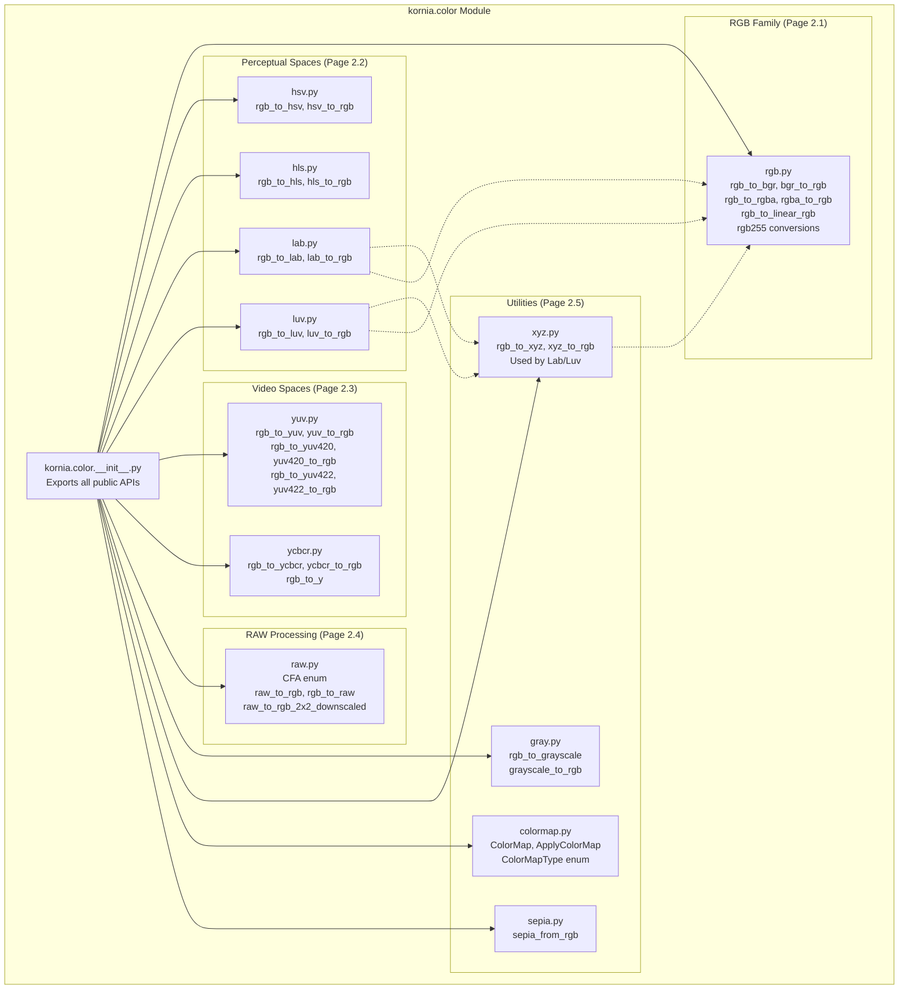
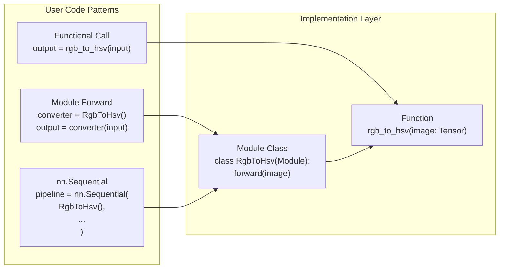
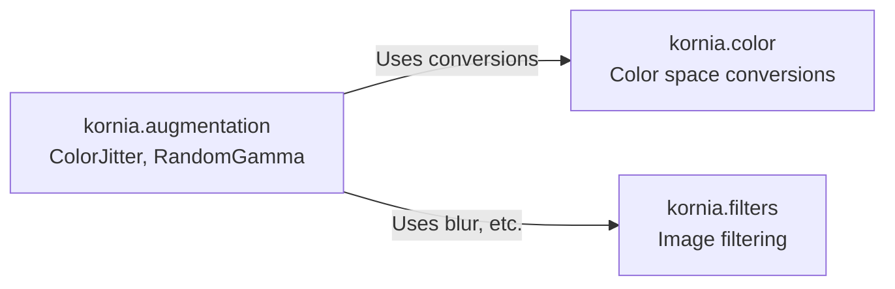
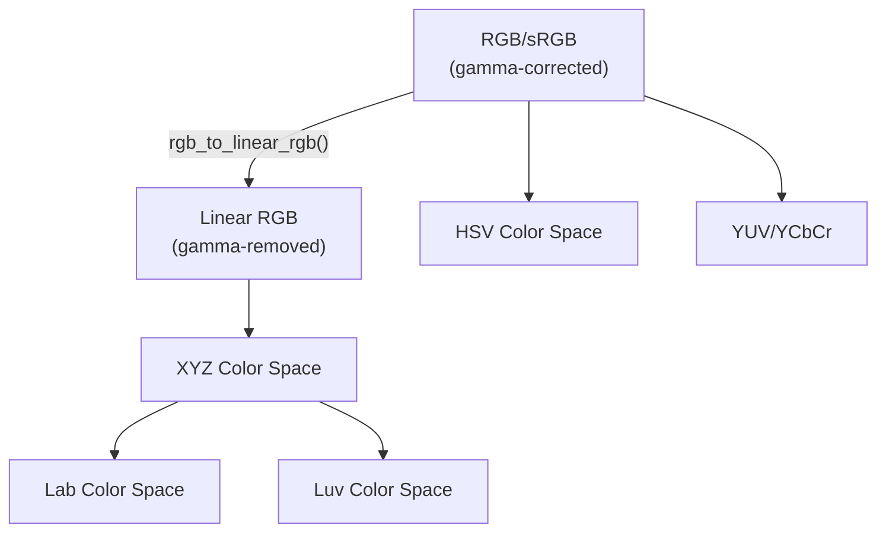

<!-- source: DeepWiki mcp.deepwiki.com · repo kornia/kornia · page 2 Color Space Processing · fetched 2026-10-21 -->

# Color Space Processing

<details>
<summary>Relevant source files</summary>

The following files were used as context for generating this wiki page:

- [docs/source/color.rst](docs/source/color.rst)
- [kornia/__init__.py](kornia/__init__.py)
- [kornia/color/__init__.py](kornia/color/__init__.py)
- [kornia/color/gray.py](kornia/color/gray.py)
- [kornia/color/hls.py](kornia/color/hls.py)
- [kornia/color/hsv.py](kornia/color/hsv.py)
- [kornia/color/lab.py](kornia/color/lab.py)
- [kornia/color/luv.py](kornia/color/luv.py)
- [kornia/color/raw.py](kornia/color/raw.py)
- [kornia/color/rgb.py](kornia/color/rgb.py)
- [kornia/color/xyz.py](kornia/color/xyz.py)
- [kornia/color/ycbcr.py](kornia/color/ycbcr.py)
- [kornia/color/yuv.py](kornia/color/yuv.py)
- [tests/color/test_rgb.py](tests/color/test_rgb.py)

</details>


## Purpose and Scope

This document provides an overview of color space processing capabilities in the `kornia.color` module. The module provides differentiable color space conversions that operate on PyTorch tensors with full GPU acceleration and autograd support. All conversions preserve batch dimensions and support arbitrary leading batch dimensions.

The module covers five main categories of color space operations:

1. **RGB Family** (page 2.1): RGB, BGR, RGBA conversions and channel reordering
2. **Perceptual Color Spaces** (page 2.2): HSV, HLS, Lab, Luv for human-perceptual color manipulation
3. **Video Color Spaces** (page 2.3): YUV, YUV420, YUV422, YCbCr with chroma subsampling
4. **Bayer RAW Processing** (page 2.4): Demosaicing and color filter array handling for camera sensors
5. **Grayscale and Utilities** (page 2.5): Grayscale conversion, gamma correction, linear RGB, and colormaps

All color conversions support:
- Arbitrary batch dimensions `(*, C, H, W)`
- Full autograd/gradient computation
- GPU acceleration
- JIT compilation
- ONNX export (most modules)

**Sources:** [kornia/color/__init__.py:1-160](), [docs/source/color.rst:1-236]()

## Architecture Overview

The color module follows Kornia's dual-API design pattern, providing both functional and Module-based interfaces for all color conversions. Each conversion operation is implemented as:
1. A functional implementation (e.g., `rgb_to_bgr()`, `rgb_to_hsv()`)
2. A corresponding `nn.Module` class (e.g., `RgbToBgr`, `RgbToHsv`)

This architecture enables flexible usage in both imperative code and as part of `nn.Sequential` pipelines. All conversions are fully differentiable and support backpropagation.

### Module Organization

**Color Processing System Structure:**



**Sources:** [kornia/color/__init__.py:1-160](), [docs/source/color.rst:1-236]()

### Dual API Pattern

**Functional API and Module API Correspondence:**



The Module classes are thin wrappers that:
- Store configuration parameters (if any)
- Call the corresponding functional implementation in `forward()`
- Provide ONNX export metadata
- Enable integration with `nn.Sequential`

**Sources:** [kornia/color/hsv.py:119-150](), [kornia/color/rgb.py:359-408]()

## Color Space Categories

### RGB Family (Page 2.1)

The RGB family provides conversions between RGB, BGR, and RGBA color representations, as well as value range transformations and gamma correction.

**Key Operations:**
- **Channel reordering:** `rgb_to_bgr()`, `bgr_to_rgb()` - simple channel flip
- **Alpha channel:** `rgb_to_rgba()`, `rgba_to_rgb()` - add/remove transparency
- **Gamma correction:** `rgb_to_linear_rgb()`, `linear_rgb_to_rgb()` - sRGB transfer functions
- **Value ranges:** `rgb_to_rgb255()`, `rgb255_to_rgb()` - normalize between `[0,1]` and `[0,255]`
- **Surface normals:** `normals_to_rgb255()`, `rgb255_to_normals()` - visualize 3D normal maps

These operations are the most fundamental and are used by many other color space conversions.

**Sources:** [kornia/color/rgb.py:29-684](), [docs/source/color.rst:34-77]()

### Perceptual Color Spaces (Page 2.2)

Perceptual color spaces represent colors in ways that align with human color perception, separating hue, saturation, and lightness/value.

**Available Color Spaces:**

| Color Space | Functions | Use Case |
|-------------|-----------|----------|
| **HSV** | `rgb_to_hsv()`, `hsv_to_rgb()` | Hue-based color selection, color filtering |
| **HLS** | `rgb_to_hls()`, `hls_to_rgb()` | Similar to HSV, alternative lightness definition |
| **Lab** | `rgb_to_lab()`, `lab_to_rgb()` | Perceptually uniform, color difference metrics |
| **Luv** | `rgb_to_luv()`, `luv_to_rgb()` | Perceptually uniform, chromaticity diagrams |

**Conversion Path:**
Most perceptual spaces require linear RGB as an intermediate:
```
RGB (sRGB) → Linear RGB → XYZ → Lab/Luv
```

HSV and HLS convert directly from sRGB without requiring gamma removal.

**Sources:** [kornia/color/hsv.py:28-176](), [kornia/color/hls.py:29-205](), [kornia/color/lab.py:35-213](), [kornia/color/luv.py:35-206](), [docs/source/color.rst:78-125]()

### Video Color Spaces (Page 2.3)

Video color spaces separate luminance (Y) from chrominance (U/V or Cb/Cr) and often use chroma subsampling for compression.

**Available Color Spaces:**

| Color Space | Format | Chroma Subsampling | Functions |
|-------------|--------|-------------------|-----------|
| **YUV** | 4:4:4 | None | `rgb_to_yuv()`, `yuv_to_rgb()` |
| **YUV420** | 4:2:0 | 2× horizontal, 2× vertical | `rgb_to_yuv420()`, `yuv420_to_rgb()` |
| **YUV422** | 4:2:2 | 2× horizontal | `rgb_to_yuv422()`, `yuv422_to_rgb()` |
| **YCbCr** | 4:4:4 | None | `rgb_to_ycbcr()`, `ycbcr_to_rgb()` |

**Subsampled Formats:**
YUV420 and YUV422 return tuples: `(Y_plane, UV_planes)` where chroma planes are downsampled. This reduces data size for video compression.

**Sources:** [kornia/color/yuv.py:28-504](), [kornia/color/ycbcr.py:33-180](), [docs/source/color.rst:126-179]()

### Bayer RAW Processing (Page 2.4)

RAW processing handles Bayer color filter array (CFA) data from camera sensors where each pixel captures only one color.

**Key Components:**
- **CFA Enum:** Four standard Bayer patterns (`CFA.BG`, `CFA.GB`, `CFA.RG`, `CFA.GR`)
- **Demosaicing:** `raw_to_rgb()` - interpolates missing color channels
- **Mosaicing:** `rgb_to_raw()` - extracts sensor pattern from RGB
- **Fast preview:** `raw_to_rgb_2x2_downscaled()` - demosaic and downsample in one operation

**Features:**
- Reversible demosaicing (preserves original sensor samples)
- Bilinear interpolation for R/B channels
- Convolutional interpolation for G channels
- Efficient 2×2 downscaling

**Sources:** [kornia/color/raw.py:30-380](), [docs/source/color.rst:192-209]()

### Grayscale and Utilities (Page 2.5)

Additional color utilities include grayscale conversion, colormaps, and special effects.

**Key Operations:**
- **Grayscale:** `rgb_to_grayscale()`, `grayscale_to_rgb()` - weighted luminance conversion
- **XYZ:** `rgb_to_xyz()`, `xyz_to_rgb()` - CIE XYZ color space (used by Lab/Luv)
- **Colormaps:** `apply_colormap()` - apply scientific colormaps to grayscale
- **Sepia:** `sepia_from_rgb()` - vintage photo effect

**Grayscale Weights:**
By default, grayscale conversion uses ITU-R BT.601 weights:
```
Y = 0.299*R + 0.587*G + 0.114*B
```

Custom weights can be provided for specialized applications.

**Sources:** [kornia/color/gray.py:30-216](), [kornia/color/xyz.py:28-150](), [docs/source/color.rst:16-33]()

## Usage Patterns

### Functional API

```python
import kornia
import torch

# RGB/BGR conversion
rgb_image = torch.rand(2, 3, 256, 256)
bgr_image = kornia.color.rgb_to_bgr(rgb_image)

# Add alpha channel
rgba_image = kornia.color.rgb_to_rgba(rgb_image, alpha_val=1.0)

# Gamma correction
linear_rgb = kornia.color.rgb_to_linear_rgb(rgb_image)
srgb_image = kornia.color.linear_rgb_to_rgb(linear_rgb)

# RAW processing
raw_image = torch.rand(1, 1, 512, 512)
rgb_demosaiced = kornia.color.raw_to_rgb(raw_image, cfa=kornia.color.CFA.RG)
```

### Module API with nn.Sequential

```python
import torch.nn as nn
import kornia

# Build a color processing pipeline
pipeline = nn.Sequential(
    kornia.color.RgbToLinearRgb(),
    # ... other processing ...
    kornia.color.LinearRgbToRgb(),
)

# Or for RAW processing
raw_pipeline = nn.Sequential(
    kornia.color.RawToRgb(cfa=kornia.color.CFA.RG),
    # ... neural network layers ...
    kornia.color.RgbToBgr(),
)
```

### Differentiable Color Processing

All color conversions support autograd for gradient-based optimization:

```python
rgb_image = torch.rand(1, 3, 64, 64, requires_grad=True)

# Forward pass
bgr_image = kornia.color.rgb_to_bgr(rgb_image)
loss = bgr_image.sum()

# Backward pass
loss.backward()
print(rgb_image.grad.shape)  # (1, 3, 64, 64)
```

**Sources:** [tests/color/test_rgb.py:27-118](), [tests/color/test_rgb.py:292-418]()

## Common Implementation Patterns

### Input Validation

All color conversion functions validate input tensors with consistent error checking:

```python
# Type validation
if not isinstance(image, Tensor):
    raise TypeError(f"Input type is not a Tensor. Got {type(image)}")

# Shape validation
if len(image.shape) < 3 or image.shape[-3] != 3:
    raise ValueError(f"Input size must have a shape of (*, 3, H, W). Got {image.shape}")
```

**Sources:** [kornia/color/rgb.py:45-49](), [kornia/color/hsv.py:51-55]()

### Batch Dimension Support

All functions support arbitrary leading batch dimensions through the `(*, C, H, W)` format:

| Shape Pattern | Interpretation |
|---------------|----------------|
| `(3, H, W)` | Single image |
| `(B, 3, H, W)` | Batch of images |
| `(B, T, 3, H, W)` | Batch of video sequences |
| `(B, N, T, 3, H, W)` | Nested batches (e.g., multi-view) |

The `*` notation indicates that operations broadcast correctly over any number of leading dimensions.

**Sources:** [kornia/color/rgb.py:45-49]()

### Differentiability

All color space conversions are fully differentiable and support gradient backpropagation:

```python
# Gradients flow through color conversions
rgb_image = torch.rand(1, 3, 64, 64, requires_grad=True)
hsv_image = rgb_to_hsv(rgb_image)
loss = hsv_image.sum()
loss.backward()
# rgb_image.grad is populated
```

This enables:
- End-to-end training through color transformations
- Color-space-aware loss functions
- Learned color correction pipelines

**Sources:** [tests/color/test_rgb.py:92-95]()

### ONNX Export Support

Most Module classes support ONNX export with shape metadata:

```python
ONNX_DEFAULT_INPUTSHAPE: ClassVar[list[int]] = [-1, 3, -1, -1]
ONNX_DEFAULT_OUTPUTSHAPE: ClassVar[list[int]] = [-1, 3, -1, -1]
```

The `-1` values indicate dynamic dimensions (batch size, height, width). Some operations with multiple outputs (e.g., `RgbToYuv420`) set `ONNX_EXPORTABLE = False`.

**Sources:** [kornia/color/rgb.py:378-379](), [kornia/color/yuv.py:364]()

## Relationship to Other Modules

### Integration with Augmentation

Color space operations are used by augmentation modules for color jittering and transformations:



For details on augmentation operations, see [Data Augmentation System](#6).

### Integration with Standard Color Spaces

The RGB conversions serve as the foundation for other color space transformations:



For complete documentation of these color spaces, see [RGB and Standard Color Spaces](#3.1).

**Sources:** [kornia/color/__init__.py:18-68](), [docs/source/color.rst:1-236]()

---

