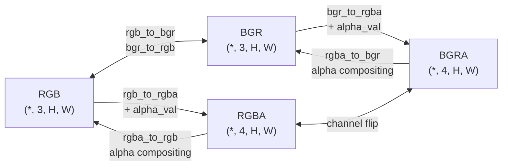
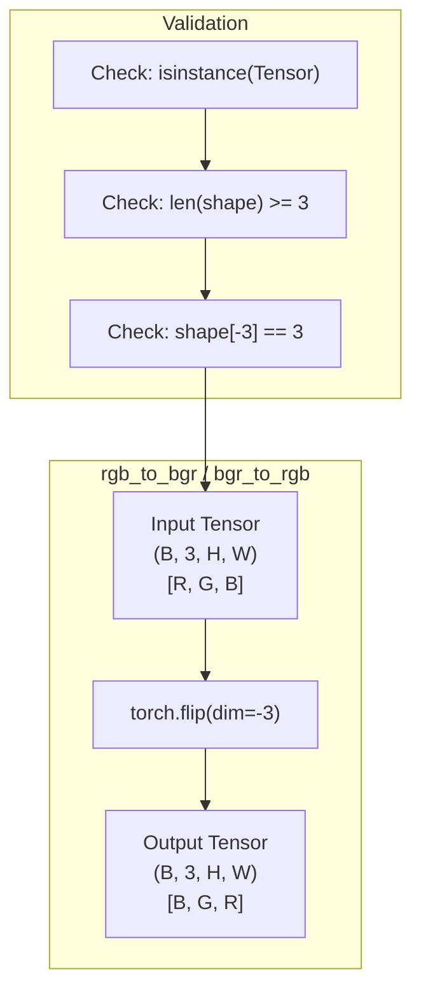
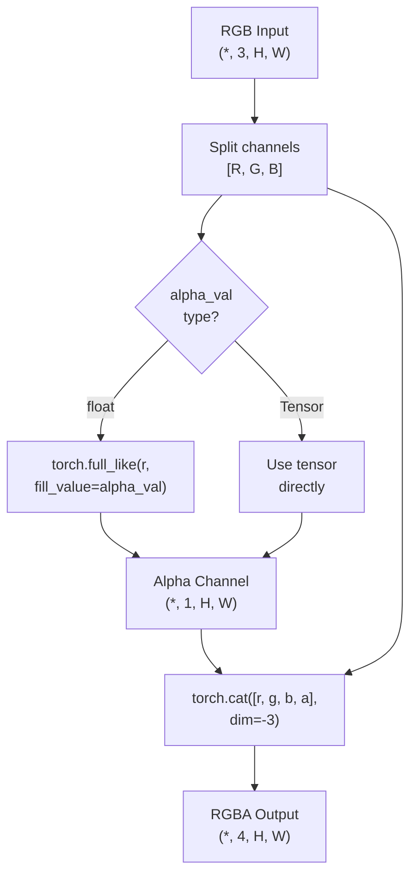
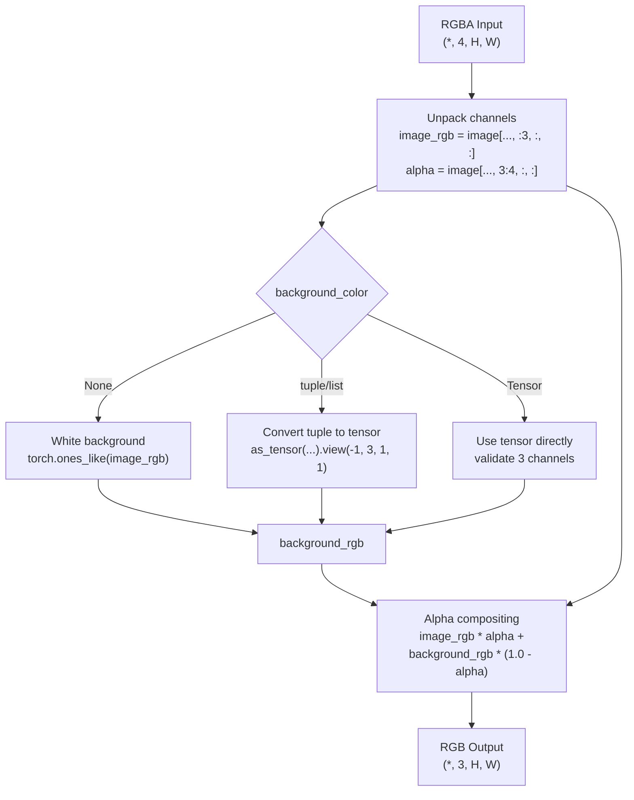
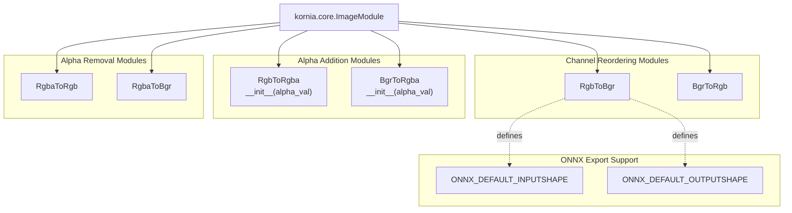

<!-- source: DeepWiki mcp.deepwiki.com · repo kornia/kornia · page 2.1 RGB, BGR, and RGBA Conversions · fetched 2026-10-21 -->

# RGB, BGR, and RGBA Conversions

<details>
<summary>Relevant source files</summary>

The following files were used as context for generating this wiki page:

- [docs/source/color.rst](docs/source/color.rst)
- [kornia/__init__.py](kornia/__init__.py)
- [kornia/color/__init__.py](kornia/color/__init__.py)
- [kornia/color/gray.py](kornia/color/gray.py)
- [kornia/color/hls.py](kornia/color/hls.py)
- [kornia/color/hsv.py](kornia/color/hsv.py)
- [kornia/color/lab.py](kornia/color/lab.py)
- [kornia/color/luv.py](kornia/color/luv.py)
- [kornia/color/raw.py](kornia/color/raw.py)
- [kornia/color/rgb.py](kornia/color/rgb.py)
- [kornia/color/xyz.py](kornia/color/xyz.py)
- [kornia/color/ycbcr.py](kornia/color/ycbcr.py)
- [kornia/color/yuv.py](kornia/color/yuv.py)
- [tests/color/test_rgb.py](tests/color/test_rgb.py)

</details>


## Purpose and Scope

This page documents Kornia's functions and modules for basic color channel reordering and alpha channel manipulation. These operations enable conversion between RGB and BGR color orderings, and adding or removing alpha channels for transparency handling.

**Scope:** This page covers channel-level operations on 3-channel (RGB/BGR) and 4-channel (RGBA/BGRA) images. For color space transformations (HSV, Lab, etc.), see [2.2](#2.2). For grayscale conversions and gamma correction utilities, see [2.5](#2.5).

## Overview of Conversions

The RGB/BGR/RGBA conversion system provides three primary operation categories:

1. **Channel reordering**: Swapping between RGB and BGR channel orders
2. **Alpha addition**: Converting 3-channel images to 4-channel with alpha
3. **Alpha removal**: Converting 4-channel images to 3-channel via compositing



**Diagram: Conversion pathways between RGB, BGR, RGBA, and BGRA formats**

Sources: [kornia/color/rgb.py:29-226]()

## Channel Reordering: RGB and BGR

RGB and BGR represent the same color information with reversed channel ordering. BGR ordering is used by OpenCV and some image codecs, while RGB is the standard representation in most frameworks.

### Functions

**`rgb_to_bgr(image: Tensor) -> Tensor`** and **`bgr_to_rgb(image: Tensor) -> Tensor`**

Both functions perform identical operations—flipping the channel dimension—making them symmetric.

| Aspect | Details |
|--------|---------|
| Input shape | `(*, 3, H, W)` where `*` is any number of batch dimensions |
| Output shape | `(*, 3, H, W)` (same as input) |
| Operation | Reverses dimension -3 using `image.flip(-3)` |
| Data range | Any (operation is value-agnostic) |
| Differentiable | Yes |

**Implementation**: The conversion is implemented as a simple channel flip operation at [kornia/color/rgb.py:74-76](), which reverses the order of the channel dimension.



**Diagram: Channel flip operation for RGB/BGR conversion**

Sources: [kornia/color/rgb.py:29-77]()

### Module Classes

**`RgbToBgr`** and **`BgrToRgb`** ([kornia/color/rgb.py:385-408]()) are `nn.Module` wrappers that can be integrated into PyTorch model pipelines.

```python
# Example usage
transform = kornia.color.RgbToBgr()
bgr_image = transform(rgb_image)

# Equivalent functional call
bgr_image = kornia.color.rgb_to_bgr(rgb_image)
```

Both module classes define ONNX export shapes via class variables:
- `ONNX_DEFAULT_INPUTSHAPE = [-1, 3, -1, -1]`
- `ONNX_DEFAULT_OUTPUTSHAPE = [-1, 3, -1, -1]`

Sources: [kornia/color/rgb.py:359-409](), [tests/color/test_rgb.py:27-118]()

## Alpha Channel Operations

Alpha channel operations enable transparency handling by adding or removing a fourth channel that represents pixel opacity.

### Adding Alpha: RGB/BGR to RGBA/BGRA

**`rgb_to_rgba(image: Tensor, alpha_val: Union[float, Tensor]) -> Tensor`**

Adds an alpha channel to an RGB image with uniform or per-pixel alpha values.

| Parameter | Type | Description |
|-----------|------|-------------|
| `image` | `Tensor` | RGB image with shape `(*, 3, H, W)` |
| `alpha_val` | `float` or `Tensor` | Scalar for uniform alpha, or `(*, 1, H, W)` tensor for per-pixel alpha |
| Returns | `Tensor` | RGBA image with shape `(*, 4, H, W)` |

**Implementation** ([kornia/color/rgb.py:79-114]()):
1. Splits input into R, G, B channels using `torch.chunk`
2. Creates alpha channel from `alpha_val`:
   - If float: creates uniform tensor via `torch.full_like(r, fill_value=alpha_val)`
   - If tensor: uses directly
3. Concatenates `[r, g, b, a]` along channel dimension

**`bgr_to_rgba(image: Tensor, alpha_val: Union[float, Tensor]) -> Tensor`**

Converts BGR to RGBA by first converting to RGB, then adding alpha ([kornia/color/rgb.py:117-146]()).



**Diagram: Adding alpha channel to create RGBA image**

Sources: [kornia/color/rgb.py:79-146](), [tests/color/test_rgb.py:120-276]()

### Removing Alpha: RGBA/BGRA to RGB/BGR

**`rgba_to_rgb(image: Tensor, background_color: Optional[Tensor]) -> Tensor`**

Converts RGBA to RGB using alpha compositing over a background color.

| Parameter | Type | Description |
|-----------|------|-------------|
| `image` | `Tensor` | RGBA image with shape `(*, 4, H, W)` |
| `background_color` | `Optional[Tensor]` | Background color as tuple/list `[R,G,B]`, tensor `(*, 3, H, W)`, or None for white |
| Returns | `Tensor` | RGB image with shape `(*, 3, H, W)` |

**Alpha Compositing Formula** ([kornia/color/rgb.py:198]()):
```
output_rgb = image_rgb * alpha + background_rgb * (1.0 - alpha)
```

Where:
- `image_rgb` = channels `[0:3]` (RGB components)
- `alpha` = channel `[3:4]` (opacity)
- `background_rgb` = background color (defaults to `torch.ones_like(image_rgb)` for white)

**Background Color Handling**:
1. **None**: Creates white background `torch.ones_like(image_rgb)`
2. **Tuple/List**: Converts to tensor via `as_tensor(...).view(-1, 3, 1, 1)` for broadcasting
3. **Tensor**: Uses directly (must have 3 channels in dimension -3)



**Diagram: Alpha compositing process for RGBA to RGB conversion**

**`rgba_to_bgr(image: Tensor) -> Tensor`**

Converts RGBA to BGR by first compositing to RGB, then converting to BGR ([kornia/color/rgb.py:203-225]()).

Sources: [kornia/color/rgb.py:149-226](), [tests/color/test_rgb.py:166-179]()

## Module Class Architecture

All conversion functions have corresponding `nn.Module` classes for integration with PyTorch pipelines.



**Diagram: Module class hierarchy for RGB/BGR/RGBA conversions**

| Module Class | Constructor Arguments | Input Shape | Output Shape |
|--------------|----------------------|-------------|--------------|
| `RgbToBgr` | None | `(*, 3, H, W)` | `(*, 3, H, W)` |
| `BgrToRgb` | None | `(*, 3, H, W)` | `(*, 3, H, W)` |
| `RgbToRgba` | `alpha_val: Union[float, Tensor]` | `(*, 3, H, W)` | `(*, 4, H, W)` |
| `BgrToRgba` | `alpha_val: Union[float, Tensor]` | `(*, 3, H, W)` | `(*, 4, H, W)` |
| `RgbaToRgb` | None | `(*, 4, H, W)` | `(*, 3, H, W)` |
| `RgbaToBgr` | None | `(*, 4, H, W)` | `(*, 3, H, W)` |

All modules inherit from `kornia.core.ImageModule` and implement:
- `forward(self, image: Tensor) -> Tensor`: Main conversion logic
- ONNX export metadata via class variables (where applicable)

Sources: [kornia/color/rgb.py:359-533]()

## Code Entity Reference

### Function and Module Mapping

| Functional API | Module Class | File Location |
|----------------|--------------|---------------|
| `rgb_to_bgr()` | `RgbToBgr` | [kornia/color/rgb.py:29-51]() and [385-408]() |
| `bgr_to_rgb()` | `BgrToRgb` | [kornia/color/rgb.py:54-76]() and [359-382]() |
| `rgb_to_rgba()` | `RgbToRgba` | [kornia/color/rgb.py:79-114]() and [411-444]() |
| `bgr_to_rgba()` | `BgrToRgba` | [kornia/color/rgb.py:117-146]() and [447-480]() |
| `rgba_to_rgb()` | `RgbaToRgb` | [kornia/color/rgb.py:149-200]() and [483-506]() |
| `rgba_to_bgr()` | `RgbaToBgr` | [kornia/color/rgb.py:203-225]() and [509-532]() |

### Exports

All functions and modules are exported through [kornia/color/__init__.py:30-54]() and re-exported at the package level through [kornia/__init__.py:33]().

```python
# Available import patterns
from kornia.color import rgb_to_bgr, RgbToBgr
from kornia import color
import kornia

# Usage
output = kornia.color.rgb_to_bgr(input)
output = kornia.color.bgr_to_rgb(input)
```

Sources: [kornia/color/__init__.py:30-54](), [kornia/__init__.py:31-34]()

## Usage Examples

### Basic Channel Reordering

```python
import torch
import kornia

# Convert RGB to BGR
rgb_image = torch.rand(2, 3, 256, 256)  # Batch of 2 RGB images
bgr_image = kornia.color.rgb_to_bgr(rgb_image)

# Symmetric operation - convert back
rgb_restored = kornia.color.bgr_to_rgb(bgr_image)
assert torch.allclose(rgb_image, rgb_restored)
```

### Adding Alpha Channel

```python
# Add uniform alpha (fully opaque)
rgba_image = kornia.color.rgb_to_rgba(rgb_image, alpha_val=1.0)
# Shape: (2, 4, 256, 256)

# Add per-pixel alpha
alpha_mask = torch.sigmoid(torch.randn(2, 1, 256, 256))
rgba_image = kornia.color.rgb_to_rgba(rgb_image, alpha_val=alpha_mask)
```

### Removing Alpha with Compositing

```python
rgba_image = torch.rand(2, 4, 256, 256)

# Composite over white background (default)
rgb_white = kornia.color.rgba_to_rgb(rgba_image)

# Composite over custom color
rgb_black = kornia.color.rgba_to_rgb(rgba_image, background_color=(0.0, 0.0, 0.0))

# Composite over per-pixel background
background = torch.rand(2, 3, 256, 256)
rgb_custom = kornia.color.rgba_to_rgb(rgba_image, background_color=background)
```

### Module Pipeline Integration

```python
import torch.nn as nn

class ImageProcessor(nn.Module):
    def __init__(self):
        super().__init__()
        self.to_bgr = kornia.color.RgbToBgr()
        self.add_alpha = kornia.color.RgbToRgba(alpha_val=0.8)
        
    def forward(self, x):
        x = self.to_bgr(x)
        # ... processing in BGR space ...
        x = self.add_alpha(x)
        return x
```

Sources: [tests/color/test_rgb.py:27-290]()

## Technical Implementation Details

### Input Validation

All conversion functions perform consistent validation ([kornia/color/rgb.py:45-49](), [68-72](), etc.):

1. **Type check**: `isinstance(image, Tensor)` raises `TypeError` if not a tensor
2. **Dimensionality check**: `len(image.shape) < 3` raises `ValueError` if insufficient dimensions
3. **Channel count check**: `image.shape[-3] != expected` raises `ValueError` if wrong channel count

### Data Type Support

All functions work with arbitrary tensor dtypes and preserve the input dtype in the output. The operations are element-wise or dimension-wise and don't assume specific value ranges.

**Exception**: Alpha compositing in `rgba_to_rgb()` performs arithmetic operations that assume normalized values for correct visual results.

### Differentiability

All conversions are fully differentiable and support automatic differentiation:
- Channel flip operations preserve gradients through the reordering
- Alpha compositing gradients flow through both alpha and RGB channels
- Verified via `gradcheck` in test suite ([tests/color/test_rgb.py:92-95](), [240-250]())

### Performance Characteristics

| Operation | Computational Cost | Memory |
|-----------|-------------------|---------|
| RGB ↔ BGR | O(1) view operation via `flip()` | No copy |
| RGB → RGBA | O(H×W) for alpha creation | Additional channel |
| RGBA → RGB | O(H×W) for compositing arithmetic | Channel reduction |

The `flip()` operation at [kornia/color/rgb.py:75]() creates a view without copying data, making RGB/BGR conversion extremely efficient.

Sources: [kornia/color/rgb.py:29-533](), [tests/color/test_rgb.py:1-484]()

---

