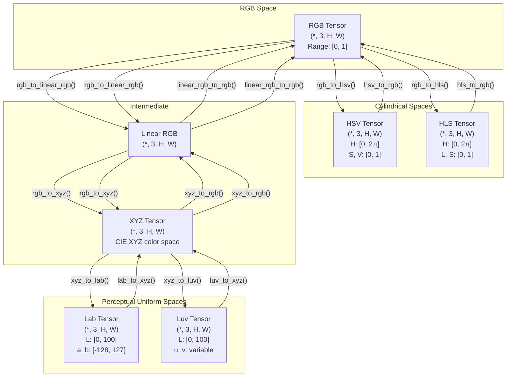
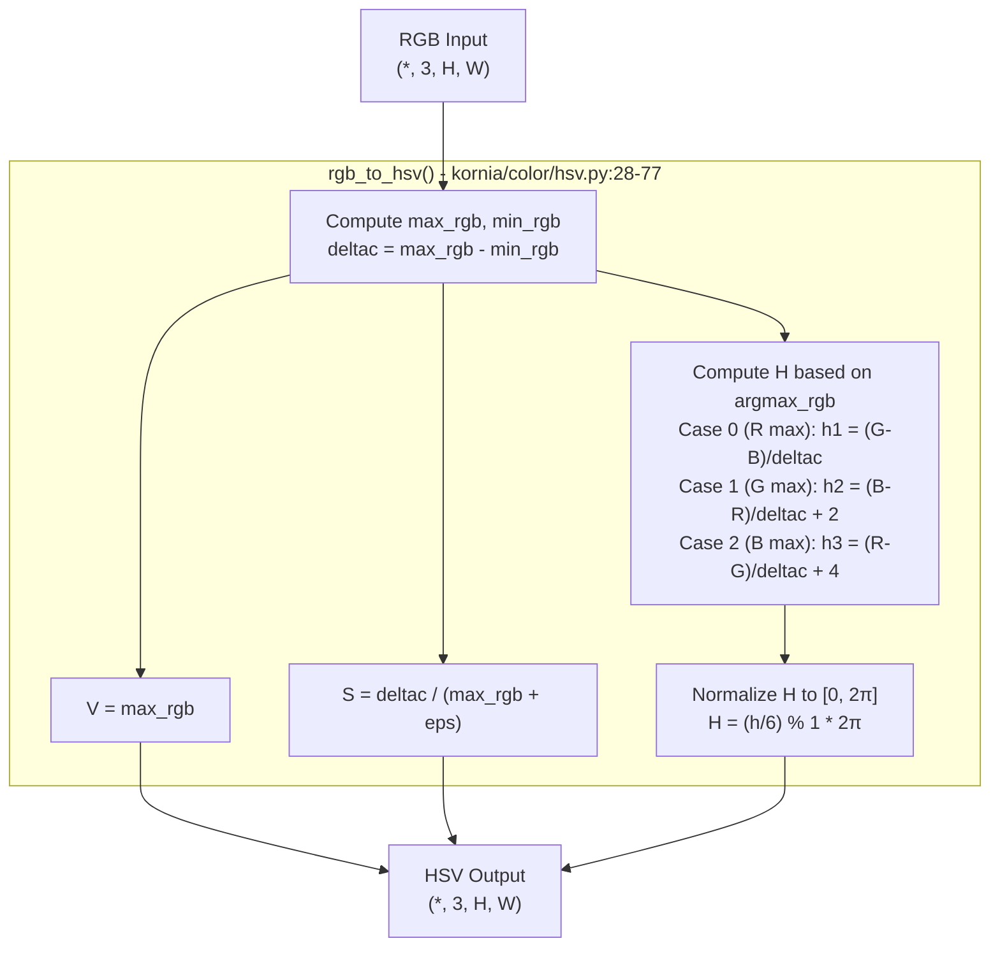
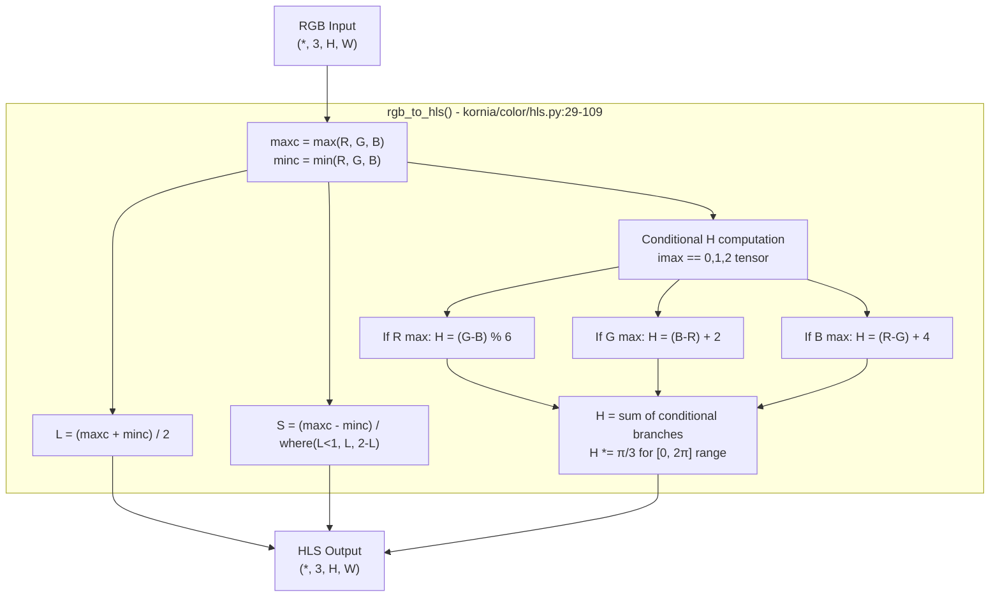
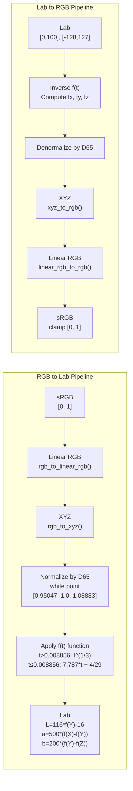
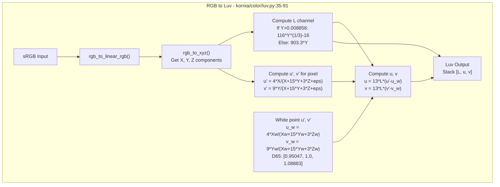
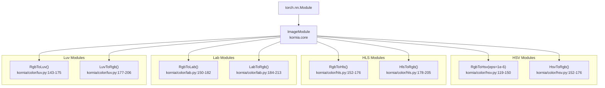
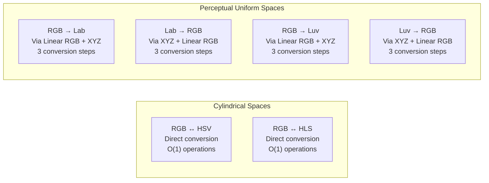

<!-- source: DeepWiki mcp.deepwiki.com · repo kornia/kornia · page 2.2 Perceptual Color Spaces (HSV, HLS, Lab, Luv) · fetched 2026-10-21 -->

# Perceptual Color Spaces (HSV, HLS, Lab, Luv)

<details>
<summary>Relevant source files</summary>

The following files were used as context for generating this wiki page:

- [kornia/color/gray.py](kornia/color/gray.py)
- [kornia/color/hls.py](kornia/color/hls.py)
- [kornia/color/hsv.py](kornia/color/hsv.py)
- [kornia/color/lab.py](kornia/color/lab.py)
- [kornia/color/luv.py](kornia/color/luv.py)
- [kornia/color/xyz.py](kornia/color/xyz.py)
- [kornia/color/ycbcr.py](kornia/color/ycbcr.py)
- [kornia/color/yuv.py](kornia/color/yuv.py)

</details>


## Purpose and Scope

This document describes Kornia's implementation of perceptual color space conversions, including HSV (Hue-Saturation-Value), HLS (Hue-Lightness-Saturation), Lab (L\*a\*b\*), and Luv (L\*u\*v\*). These color spaces separate chromaticity from intensity and are designed to align more closely with human color perception compared to RGB.

For device-dependent color spaces like RGB, BGR, and RGBA, see [2.1](#2.1). For video color spaces including YUV and YCbCr, see [2.3](#2.3). For linear RGB and gamma correction, see [2.5](#2.5).

---

## Overview: Perceptual Color Space Conversions

Kornia provides bidirectional conversions between RGB and four perceptual color spaces. Each conversion is available as both a functional interface and a `torch.nn.Module` wrapper for integration into PyTorch pipelines.

### Conversion Architecture



**Sources**: [kornia/color/hsv.py:28-176](), [kornia/color/hls.py:29-205](), [kornia/color/lab.py:35-213](), [kornia/color/luv.py:35-206](), [kornia/color/xyz.py:28-150]()

---

## HSV Color Space

HSV (Hue-Saturation-Value) is a cylindrical color space that separates color information into three components: hue (color type), saturation (color intensity), and value (brightness). This representation is intuitive for color manipulation tasks.

### HSV Functions and Modules

| Function/Module | Input Shape | Output Shape | Description |
|----------------|-------------|--------------|-------------|
| `rgb_to_hsv(image, eps=1e-8)` | `(*, 3, H, W)` | `(*, 3, H, W)` | Convert RGB to HSV |
| `hsv_to_rgb(image)` | `(*, 3, H, W)` | `(*, 3, H, W)` | Convert HSV to RGB |
| `RgbToHsv(eps=1e-6)` | `(*, 3, H, W)` | `(*, 3, H, W)` | Module wrapper for RGB→HSV |
| `HsvToRgb()` | `(*, 3, H, W)` | `(*, 3, H, W)` | Module wrapper for HSV→RGB |

### HSV Channel Ranges

- **H (Hue)**: Range `[0, 2π]` radians. Represents color type on a circular scale (red=0, green=2π/3, blue=4π/3).
- **S (Saturation)**: Range `[0, 1]`. Represents color intensity (0=grayscale, 1=fully saturated).
- **V (Value)**: Range `[0, 1]`. Represents brightness (0=black, 1=full brightness).

### RGB to HSV Algorithm



The implementation at [kornia/color/hsv.py:57-76]() uses efficient tensor operations to avoid branching:
- Computes all three hue cases in parallel using `torch.stack`
- Uses `torch.gather` to select the correct hue based on `argmax_rgb`
- Handles edge cases where `deltac == 0` by replacing with ones

### HSV to RGB Algorithm

The inverse conversion [kornia/color/hsv.py:79-117]() implements the standard HSV→RGB algorithm:
1. Normalize H from `[0, 2π]` to `[0, 6]` representing the six sextants
2. Compute intermediate values: `p`, `q`, `t` based on saturation
3. Use `torch.gather` to select appropriate RGB values based on hue sextant

**Sources**: [kornia/color/hsv.py:28-176]()

---

## HLS Color Space

HLS (Hue-Lightness-Saturation) is another cylindrical representation similar to HSV but with different perceptual characteristics. The key difference is the "Lightness" component, which represents perceived lightness more accurately than HSV's "Value".

### HLS Functions and Modules

| Function/Module | Input Shape | Output Shape | Description |
|----------------|-------------|--------------|-------------|
| `rgb_to_hls(image, eps=1e-8)` | `(*, 3, H, W)` | `(*, 3, H, W)` | Convert RGB to HLS |
| `hls_to_rgb(image)` | `(*, 3, H, W)` | `(*, 3, H, W)` | Convert HLS to RGB |
| `RgbToHls()` | `(*, 3, H, W)` | `(*, 3, H, W)` | Module wrapper for RGB→HLS |
| `HlsToRgb()` | `(*, 3, H, W)` | `(*, 3, H, W)` | Module wrapper for HLS→RGB |

### HLS Channel Ranges

- **H (Hue)**: Range `[0, 2π]` radians. Same circular color representation as HSV.
- **L (Lightness)**: Range `[0, 1]`. Represents perceived lightness (0=black, 0.5=pure color, 1=white).
- **S (Saturation)**: Range `[0, 1]`. Represents color purity relative to lightness.

### RGB to HLS Implementation



The implementation at [kornia/color/hls.py:56-108]() includes optimizations for gradient computation:
- When `requires_grad=True`, uses `torch.stack` for better gradient flow
- When `requires_grad=False`, uses in-place operations directly into pre-allocated output tensor for efficiency
- Handles the conditional H computation using element-wise multiplication with boolean masks

### HLS to RGB Algorithm

The inverse conversion [kornia/color/hls.py:111-150]() uses a simplified formula:
1. Compute `a = s * min(l, 1-l)` (chroma component)
2. For each RGB channel k, compute: `L - a * max(min(k-3, 9-k), 1)` where k is offset by 0, 8, 4 for R, G, B
3. Uses `torch.addcmul` for efficient fused multiply-add operations

**Sources**: [kornia/color/hls.py:29-205]()

---

## Lab Color Space

Lab (L\*a\*b\* or CIELAB) is a perceptually uniform color space designed to approximate human vision. It is device-independent and widely used in image processing, particularly for color difference calculations and color correction.

### Lab Functions and Modules

| Function/Module | Input Shape | Output Shape | Description |
|----------------|-------------|--------------|-------------|
| `rgb_to_lab(image)` | `(*, 3, H, W)` | `(*, 3, H, W)` | Convert RGB to Lab |
| `lab_to_rgb(image, clip=True)` | `(*, 3, H, W)` | `(*, 3, H, W)` | Convert Lab to RGB |
| `RgbToLab()` | `(*, 3, H, W)` | `(*, 3, H, W)` | Module wrapper for RGB→Lab |
| `LabToRgb()` | `(*, 3, H, W)` | `(*, 3, H, W)` | Module wrapper for Lab→RGB |

### Lab Channel Ranges

- **L (Lightness)**: Range `[0, 100]`. Represents perceptual lightness (0=black, 100=white).
- **a**: Range `[-128, 127]`. Green-red axis (negative=green, positive=red).
- **b**: Range `[-128, 127]`. Blue-yellow axis (negative=blue, positive=yellow).

### Lab Conversion Pipeline

Lab conversions require multiple intermediate steps through linear RGB and XYZ color spaces:



### D65 Illuminant and White Point

Lab conversions use the D65 standard illuminant (daylight at 6500K) with Observer 2° as defined in [kornia/color/lab.py:67-68]():
```
xyz_ref_white = [0.95047, 1.0, 1.08883]
```

This white point normalization ensures perceptual uniformity across different viewing conditions.

### Lab f(t) Function

The Lab conversion applies a piecewise function at [kornia/color/lab.py:70-73]():
- For `t > 0.008856`: `f(t) = t^(1/3)`
- For `t ≤ 0.008856`: `f(t) = 7.787*t + 4/29`

This nonlinearity ensures perceptual uniformity and avoids numerical issues near zero.

**Sources**: [kornia/color/lab.py:35-213](), [kornia/color/xyz.py:28-150](), [kornia/color/rgb.py]() (referenced for linear RGB conversions)

---

## Luv Color Space

Luv (L\*u\*v\* or CIELUV) is another perceptually uniform color space, alternative to Lab. While Lab is optimized for object colors, Luv is better suited for additive color mixing (lights) and has simpler geometric properties.

### Luv Functions and Modules

| Function/Module | Input Shape | Output Shape | Description |
|----------------|-------------|--------------|-------------|
| `rgb_to_luv(image, eps=1e-12)` | `(*, 3, H, W)` | `(*, 3, H, W)` | Convert RGB to Luv |
| `luv_to_rgb(image, eps=1e-12)` | `(*, 3, H, W)` | `(*, 3, H, W)` | Convert Luv to RGB |
| `RgbToLuv()` | `(*, 3, H, W)` | `(*, 3, H, W)` | Module wrapper for RGB→Luv |
| `LuvToRgb()` | `(*, 3, H, W)` | `(*, 3, H, W)` | Module wrapper for Luv→RGB |

### Luv Channel Ranges

- **L (Lightness)**: Range `[0, 100]`. Same perceptual lightness as Lab.
- **u**: Variable range. Represents red-green axis in Luv space.
- **v**: Variable range. Represents yellow-blue axis in Luv space.

### Luv Conversion Algorithm



### Luv u'v' Chromaticity Diagram

The key difference from Lab is the use of u'v' chromaticity coordinates at [kornia/color/luv.py:82-86]():
```
u_p = (4 * x) / (x + 15 * y + 3 * z + eps)
v_p = (9 * y) / (x + 15 * y + 3 * z + eps)
```

These coordinates provide linear relationships for additive color mixing, making Luv preferable for illumination calculations.

### Luv to RGB Inverse

The inverse conversion at [kornia/color/luv.py:93-141]() reverses the process:
1. Compute Y from L using inverse piecewise function
2. Compute u', v' from u, v, L, and white point
3. Solve for X, Z from chromaticity equations
4. Convert XYZ→Linear RGB→sRGB

**Sources**: [kornia/color/luv.py:35-206](), [kornia/color/xyz.py:28-150]()

---

## Module Class Hierarchy

All color conversion modules inherit from `kornia.core.ImageModule` and follow a consistent pattern:



### ONNX Export Support

All modules define `ONNX_DEFAULT_INPUTSHAPE` and `ONNX_DEFAULT_OUTPUTSHAPE` class variables for ONNX export compatibility:
- Input shape: `[-1, 3, -1, -1]` (batch, 3 channels, variable height/width)
- Output shape: `[-1, 3, -1, -1]` (same dimensions)

This is defined at [kornia/color/hsv.py:141-142](), [kornia/color/hls.py:171-172](), [kornia/color/lab.py:177-178](), [kornia/color/luv.py:170-171]().

**Sources**: [kornia/color/hsv.py:119-176](), [kornia/color/hls.py:152-205](), [kornia/color/lab.py:150-213](), [kornia/color/luv.py:143-206]()

---

## Implementation Patterns

### Functional vs Module Interface

Kornia provides both functional and module interfaces for all conversions:

**Functional Interface** (for one-off conversions):
```python
# Direct function calls
hsv_image = rgb_to_hsv(rgb_tensor)
lab_image = rgb_to_lab(rgb_tensor)
```

**Module Interface** (for repeated use in pipelines):
```python
# Create module once, reuse multiple times
converter = RgbToHsv()
hsv_image = converter(rgb_tensor)
```

### Numerical Stability

All conversions include epsilon parameters to prevent division by zero:

| Conversion | Epsilon Parameter | Default Value | Location |
|------------|------------------|---------------|----------|
| `rgb_to_hsv` | `eps` | `1e-8` | [kornia/color/hsv.py:28]() |
| `rgb_to_hls` | `eps` | `1e-8` | [kornia/color/hls.py:29]() |
| `rgb_to_luv` | `eps` | `1e-12` | [kornia/color/luv.py:35]() |
| `luv_to_rgb` | `eps` | `1e-12` | [kornia/color/luv.py:93]() |

### Gradient Flow Optimization

The HLS implementation includes special handling for gradient computation at [kornia/color/hls.py:63-69]():
- When `image.requires_grad=True`: Uses `torch.stack` for better gradient propagation
- When `image.requires_grad=False`: Uses in-place operations for better performance

### Input Validation

All conversion functions perform strict input validation at the start:
1. Type check: Verify input is `torch.Tensor` (e.g., [kornia/color/hsv.py:51-52]())
2. Shape check: Verify shape is `(*, 3, H, W)` (e.g., [kornia/color/hsv.py:54-55]())
3. Raises `TypeError` or `ValueError` with descriptive error messages

**Sources**: [kornia/color/hsv.py:28-117](), [kornia/color/hls.py:29-150](), [kornia/color/lab.py:35-148](), [kornia/color/luv.py:35-141]()

---

## Comparison of Perceptual Color Spaces

### Color Space Selection Guide

| Color Space | Use Cases | Advantages | Disadvantages |
|-------------|-----------|------------|---------------|
| **HSV** | Color selection UI, image segmentation by hue | Intuitive for artists, easy hue isolation | Not perceptually uniform |
| **HLS** | Color adjustments, lightness-based operations | Better lightness representation than HSV | Not perceptually uniform |
| **Lab** | Color difference metrics, object color correction | Perceptually uniform, device-independent | Requires white point reference |
| **Luv** | Illumination calculations, additive color mixing | Better for lights, simpler geometry | Less common than Lab |

### Computational Complexity



- **HSV/HLS**: Direct conversions with minimal overhead
- **Lab/Luv**: Require gamma correction and XYZ intermediate space, approximately 3× slower

### Perceptual Uniformity

Only Lab and Luv provide perceptually uniform color spaces where Euclidean distance approximates perceived color difference:

```python
# ΔE (Delta E) color difference in Lab space
delta_e = torch.sqrt(torch.sum((lab1 - lab2) ** 2, dim=-3))
# Smaller ΔE values indicate perceptually similar colors
```

HSV and HLS do not have this property—equal distances in their color spaces do not correspond to equal perceptual differences.

**Sources**: [kornia/color/hsv.py:1-176](), [kornia/color/hls.py:1-205](), [kornia/color/lab.py:1-213](), [kornia/color/luv.py:1-206]()

---

## Usage Examples

### Basic Color Space Conversion

```python
import torch
from kornia.color import rgb_to_hsv, hsv_to_rgb, rgb_to_lab

# Create sample RGB image (batch=2, channels=3, height=256, width=256)
rgb_image = torch.rand(2, 3, 256, 256)

# Convert to HSV
hsv_image = rgb_to_hsv(rgb_image)
# hsv_image shape: (2, 3, 256, 256)
# Channel 0: Hue [0, 2π]
# Channel 1: Saturation [0, 1]
# Channel 2: Value [0, 1]

# Convert back to RGB
rgb_reconstructed = hsv_to_rgb(hsv_image)

# Convert to Lab for perceptual operations
lab_image = rgb_to_lab(rgb_image)
# lab_image shape: (2, 3, 256, 256)
# Channel 0: Lightness [0, 100]
# Channel 1: a [-128, 127]
# Channel 2: b [-128, 127]
```

### Module Usage in Neural Network

```python
import torch.nn as nn
from kornia.color import RgbToLab, LabToRgb

class ColorAugmentationNetwork(nn.Module):
    def __init__(self):
        super().__init__()
        self.to_lab = RgbToLab()
        self.to_rgb = LabToRgb()
        
    def forward(self, rgb_input):
        # Convert to Lab for perceptual color manipulation
        lab = self.to_lab(rgb_input)
        
        # Manipulate Lab channels
        # Example: Increase lightness by 10%
        lab[:, 0] = lab[:, 0] * 1.1
        
        # Convert back to RGB
        rgb_output = self.to_rgb(lab)
        return rgb_output
```

### Hue-Based Color Filtering

```python
from kornia.color import rgb_to_hsv, hsv_to_rgb
import torch

def filter_by_hue(rgb_image, target_hue, tolerance=0.1):
    """Keep only pixels within a hue range, desaturate others."""
    hsv = rgb_to_hsv(rgb_image)
    
    # Extract hue channel (in radians [0, 2π])
    hue = hsv[:, 0]
    
    # Create mask for pixels near target hue
    hue_diff = torch.abs(hue - target_hue)
    # Handle circular wraparound
    hue_diff = torch.min(hue_diff, 2 * torch.pi - hue_diff)
    mask = (hue_diff < tolerance).float()
    
    # Desaturate pixels outside hue range
    hsv[:, 1] = hsv[:, 1] * mask
    
    return hsv_to_rgb(hsv)
```

**Sources**: [kornia/color/hsv.py:28-176](), [kornia/color/lab.py:35-213]()

---

## Summary of Code Entities

### Function Reference Table

| Function | File | Line Range | Input Range | Output Range |
|----------|------|------------|-------------|--------------|
| `rgb_to_hsv` | `kornia/color/hsv.py` | 28-77 | RGB [0,1] | H [0,2π], S,V [0,1] |
| `hsv_to_rgb` | `kornia/color/hsv.py` | 79-117 | H [0,2π], S,V [0,1] | RGB [0,1] |
| `rgb_to_hls` | `kornia/color/hls.py` | 29-109 | RGB [0,1] | H [0,2π], L,S [0,1] |
| `hls_to_rgb` | `kornia/color/hls.py` | 111-150 | H [0,2π], L,S [0,1] | RGB [0,1] |
| `rgb_to_lab` | `kornia/color/lab.py` | 35-86 | RGB [0,1] | L [0,100], a,b [-128,127] |
| `lab_to_rgb` | `kornia/color/lab.py` | 88-148 | L [0,100], a,b [-128,127] | RGB [0,1] |
| `rgb_to_luv` | `kornia/color/luv.py` | 35-91 | RGB [0,1] | L [0,100], u,v (variable) |
| `luv_to_rgb` | `kornia/color/luv.py` | 93-141 | L [0,100], u,v (variable) | RGB [0,1] |

### Module Reference Table

| Module Class | File | Line Range | Parameters |
|--------------|------|------------|------------|
| `RgbToHsv` | `kornia/color/hsv.py` | 119-150 | `eps=1e-6` |
| `HsvToRgb` | `kornia/color/hsv.py` | 152-176 | None |
| `RgbToHls` | `kornia/color/hls.py` | 152-176 | None |
| `HlsToRgb` | `kornia/color/hls.py` | 178-205 | None |
| `RgbToLab` | `kornia/color/lab.py` | 150-182 | None |
| `LabToRgb` | `kornia/color/lab.py` | 184-213 | `clip=True` |
| `RgbToLuv` | `kornia/color/luv.py` | 143-175 | None |
| `LuvToRgb` | `kornia/color/luv.py` | 177-206 | None |

**Sources**: All files in `kornia/color/` directory

---

