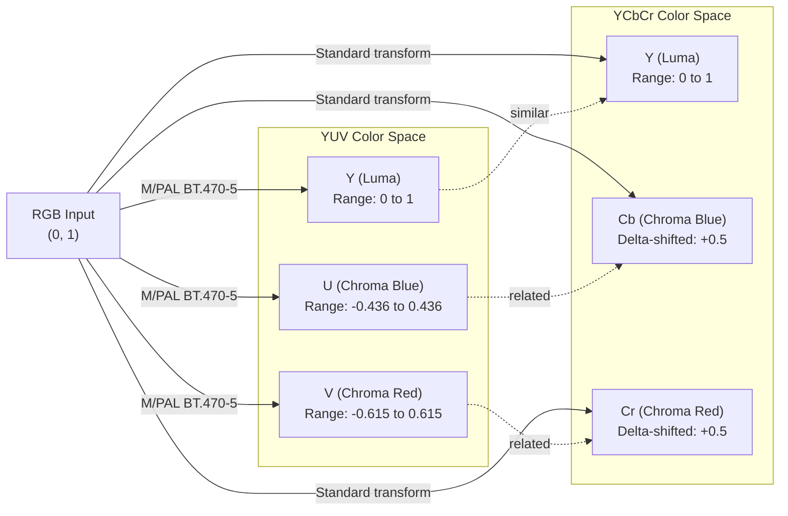
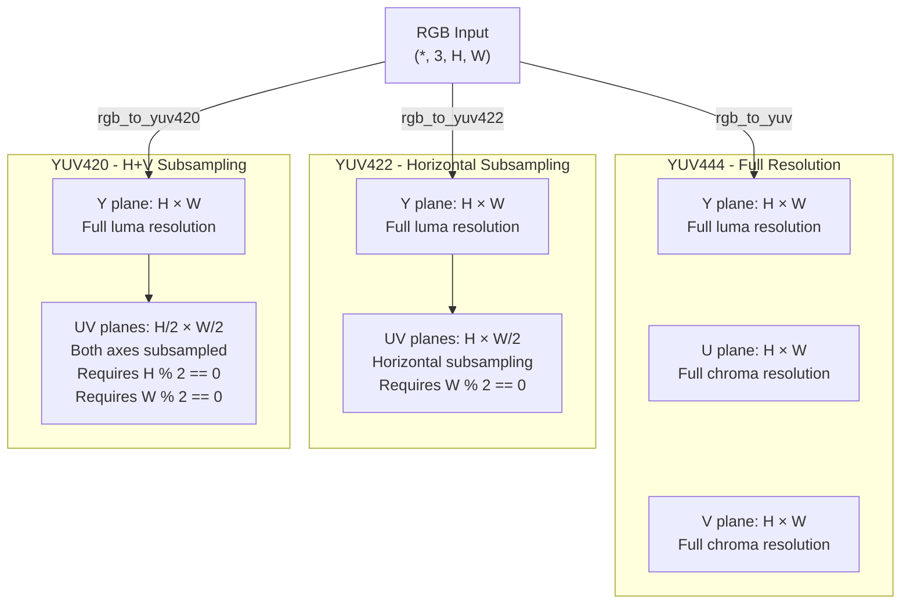
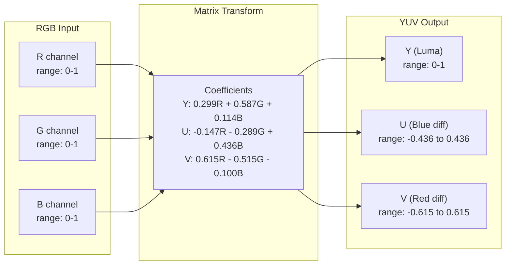
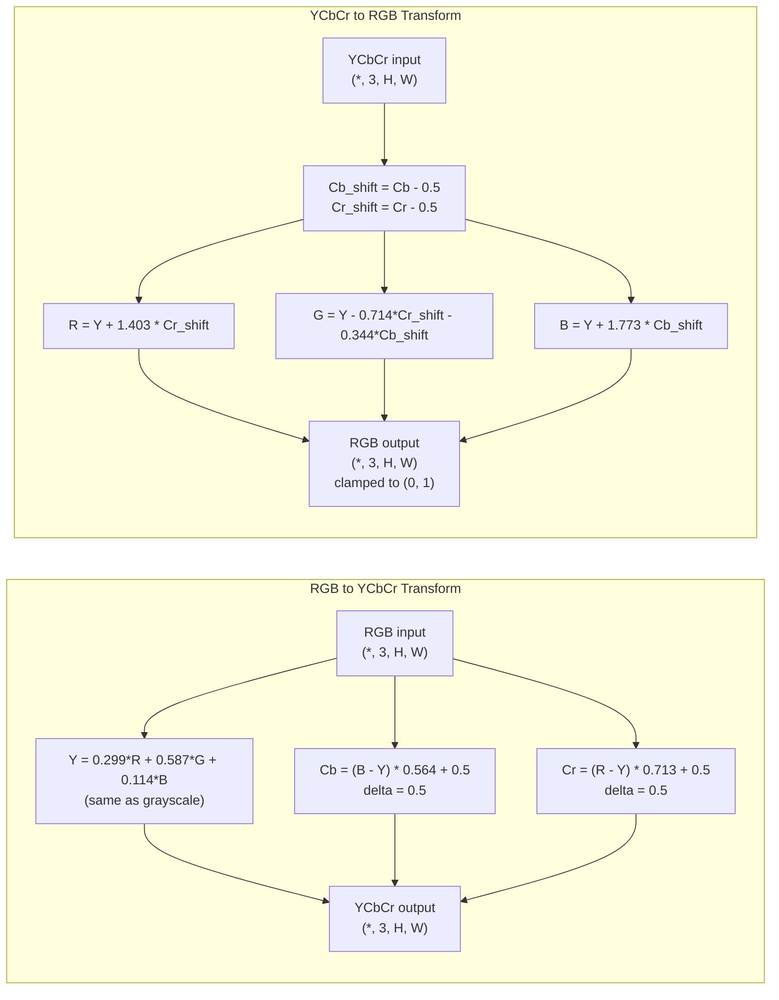
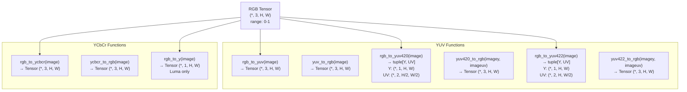
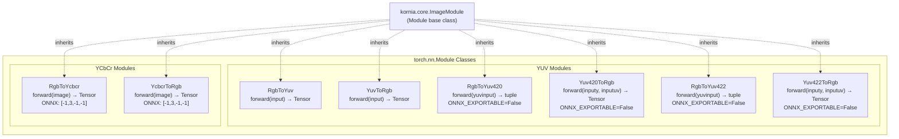
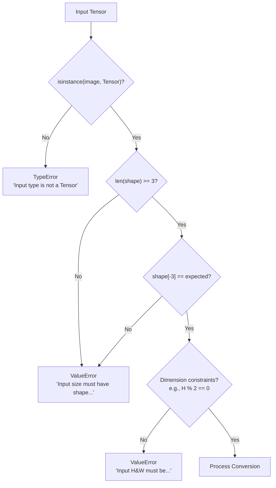
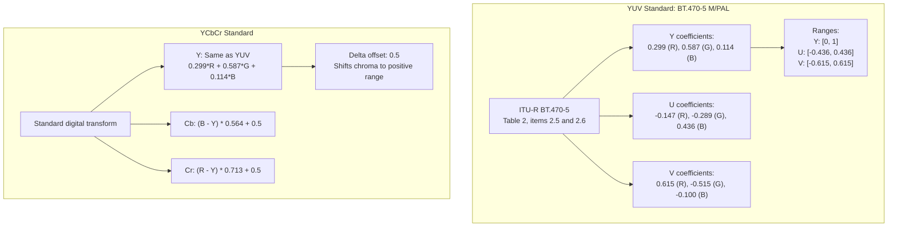

<!-- source: DeepWiki mcp.deepwiki.com · repo kornia/kornia · page 2.3 Video Color Spaces (YUV, YCbCr) · fetched 2026-10-21 -->

# Video Color Spaces (YUV, YCbCr)

<details>
<summary>Relevant source files</summary>

The following files were used as context for generating this wiki page:

- [kornia/color/gray.py](kornia/color/gray.py)
- [kornia/color/hls.py](kornia/color/hls.py)
- [kornia/color/hsv.py](kornia/color/hsv.py)
- [kornia/color/lab.py](kornia/color/lab.py)
- [kornia/color/luv.py](kornia/color/luv.py)
- [kornia/color/xyz.py](kornia/color/xyz.py)
- [kornia/color/ycbcr.py](kornia/color/ycbcr.py)
- [kornia/color/yuv.py](kornia/color/yuv.py)

</details>


This document describes Kornia's support for video-oriented color spaces, specifically YUV and YCbCr. These color spaces separate luminance (brightness) from chrominance (color information), enabling chroma subsampling for efficient video encoding and transmission. For other color spaces like RGB, HSV, and Lab, see [Perceptual Color Spaces (HSV, HLS, Lab, Luv)](#2.2) and [RGB, BGR, and RGBA Conversions](#2.1).

## Purpose and Scope

The `kornia.color` module provides differentiable implementations of YUV and YCbCr color space conversions:

- **YUV**: Analog color encoding system (M/PAL standard per BT.470-5) with support for full resolution (YUV444) and subsampled formats (YUV420, YUV422)
- **YCbCr**: Digital color encoding system commonly used in JPEG and video codecs
- All conversions are implemented as differentiable PyTorch operations for gradient-based optimization
- Both functional and module-based APIs are provided

## YUV vs YCbCr Color Spaces



**Key Differences:**

| Aspect | YUV | YCbCr |
|--------|-----|-------|
| **Origin** | Analog TV (PAL/SECAM) | Digital video/image |
| **Standard** | BT.470-5 M/PAL | ITU-R BT.601 |
| **U/Cb Range** | -0.436 to 0.436 | Shifted by +0.5 delta |
| **V/Cr Range** | -0.615 to 0.615 | Shifted by +0.5 delta |
| **Use Cases** | Video processing, broadcast | JPEG, MPEG, H.264 |

**Sources:** [kornia/color/yuv.py:1-504](), [kornia/color/ycbcr.py:1-180]()

## Chroma Subsampling Patterns

Video color spaces support chroma subsampling to reduce data size by exploiting the human visual system's lower sensitivity to color detail compared to luminance detail.



**Subsampling Implementation:**

| Format | Y Plane | UV Planes | Sampling Method | Data Reduction |
|--------|---------|-----------|-----------------|----------------|
| **YUV444** | `(*, 1, H, W)` | `(*, 2, H, W)` | No subsampling | None (3 channels) |
| **YUV422** | `(*, 1, H, W)` | `(*, 2, H, W/2)` | `unfold(-1, 2, 2).mean(-1)` | 33% reduction |
| **YUV420** | `(*, 1, H, W)` | `(*, 2, H/2, W/2)` | `unfold(-2, 2, 2).unfold(-2, 2, 2).mean((-1, -2))` | 50% reduction |

**Sources:** [kornia/color/yuv.py:71-149]()

## YUV Color Space Conversions

### RGB to YUV Transformation

The YUV color space follows the M/PAL standard defined in ITU-R BT.470-5, Table 2, items 2.5 and 2.6.



**Forward Conversion (RGB → YUV):**

```python
y = 0.299 * r + 0.587 * g + 0.114 * b
u = -0.147 * r - 0.289 * g + 0.436 * b  
v = 0.615 * r - 0.515 * g - 0.100 * b
```

**Inverse Conversion (YUV → RGB):**

```python
r = y + 1.14 * v
g = y - 0.396 * u - 0.581 * v
b = y + 2.029 * u
```

**Sources:** [kornia/color/yuv.py:28-68](), [kornia/color/yuv.py:151-188]()

### YUV Subsampling Implementation

```mermaid
graph TB
    subgraph "RGB to YUV420 Pipeline"
        RGB420["RGB input<br/>(*, 3, H, W)<br/>H % 2 == 0<br/>W % 2 == 0"]
        
        RGB420 -->|"rgb_to_yuv"| YUV444_TEMP["YUV444 tensor<br/>(*, 3, H, W)"]
        
        YUV444_TEMP -->|"slice [:1, :, :]"| Y_PLANE["Y plane<br/>(*, 1, H, W)<br/>No downsampling"]
        
        YUV444_TEMP -->|"slice [1:3, :, :]"| UV_FULL["UV channels<br/>(*, 2, H, W)"]
        
        UV_FULL -->|"unfold(-2, 2, 2)"| UV_UNFOLD_H["Unfold height<br/>(*, 2, H/2, W, 2)"]
        
        UV_UNFOLD_H -->|"unfold(-2, 2, 2)"| UV_UNFOLD_W["Unfold width<br/>(*, 2, H/2, W/2, 2, 2)"]
        
        UV_UNFOLD_W -->|"mean((-1, -2))"| UV_SUB["UV planes<br/>(*, 2, H/2, W/2)<br/>2×2 blocks averaged"]
        
        Y_PLANE --> OUT_Y["Output Y"]
        UV_SUB --> OUT_UV["Output UV"]
    end
    
    subgraph "YUV420 to RGB Pipeline"
        IN_Y["Input Y<br/>(*, 1, H, W)"]
        IN_UV["Input UV<br/>(*, 2, H/2, W/2)"]
        
        IN_UV -->|"repeat_interleave(2, dim=-1)"| UV_W["UV width upsampled<br/>(*, 2, H/2, W)"]
        
        UV_W -->|"repeat_interleave(2, dim=-2)"| UV_FULL2["UV full size<br/>(*, 2, H, W)<br/>Nearest-neighbor upsample"]
        
        IN_Y --> YUV444_2["YUV444 tensor"]
        UV_FULL2 --> YUV444_2
        
        YUV444_2 -->|"yuv_to_rgb"| RGB_OUT["RGB output<br/>(*, 3, H, W)"]
    end
```



**Sources:** [kornia/color/yuv.py:104-109](), [kornia/color/yuv.py:242-248]()

## YCbCr Color Space Conversions

YCbCr is a digital variant of YUV, commonly used in JPEG and video codecs. It differs from YUV primarily in the delta offset applied to chroma channels.



**Key Implementation Details:**

- The Y channel calculation uses the same coefficients as RGB to grayscale conversion [kornia/color/ycbcr.py:28-30]()
- Delta value of 0.5 shifts chroma channels to positive range [kornia/color/ycbcr.py:59]()
- Output RGB is clamped to (0, 1) range [kornia/color/ycbcr.py:127]()
- Provides `rgb_to_y()` function for extracting only the luma channel [kornia/color/ycbcr.py:66-91]()

**Sources:** [kornia/color/ycbcr.py:33-127]()

## API Reference

### Function-Level API



| Function | Input Shape | Output Shape | Description |
|----------|-------------|--------------|-------------|
| `rgb_to_yuv` | `(*, 3, H, W)` | `(*, 3, H, W)` | Full resolution YUV (444) |
| `yuv_to_rgb` | `(*, 3, H, W)` | `(*, 3, H, W)` | YUV to RGB conversion |
| `rgb_to_yuv420` | `(*, 3, H, W)` | `tuple[(*, 1, H, W), (*, 2, H/2, W/2)]` | 4:2:0 subsampling |
| `yuv420_to_rgb` | Y: `(*, 1, H, W)`<br/>UV: `(*, 2, H/2, W/2)` | `(*, 3, H, W)` | Upsample and convert |
| `rgb_to_yuv422` | `(*, 3, H, W)` | `tuple[(*, 1, H, W), (*, 2, H, W/2)]` | 4:2:2 subsampling |
| `yuv422_to_rgb` | Y: `(*, 1, H, W)`<br/>UV: `(*, 2, H, W/2)` | `(*, 3, H, W)` | Upsample and convert |
| `rgb_to_ycbcr` | `(*, 3, H, W)` | `(*, 3, H, W)` | Digital YCbCr |
| `ycbcr_to_rgb` | `(*, 3, H, W)` | `(*, 3, H, W)` | YCbCr to RGB |
| `rgb_to_y` | `(*, 3, H, W)` | `(*, 1, H, W)` | Luma channel only |

**Sources:** [kornia/color/yuv.py:28-299](), [kornia/color/ycbcr.py:33-127]()

### Module-Level API



All module classes inherit from `kornia.core.ImageModule` (alias for `torch.nn.Module`) and can be used in neural network pipelines. 

**ONNX Export Support:**

| Module | ONNX Exportable | Input Shape | Output Shape |
|--------|-----------------|-------------|--------------|
| `RgbToYuv` | ✓ | `[-1, 3, -1, -1]` | `[-1, 3, -1, -1]` |
| `YuvToRgb` | ✓ | `[-1, 3, -1, -1]` | `[-1, 3, -1, -1]` |
| `RgbToYuv420` | ✗ | N/A | Multiple outputs |
| `Yuv420ToRgb` | ✗ | Multiple inputs | N/A |
| `RgbToYuv422` | ✗ | N/A | Multiple outputs |
| `Yuv422ToRgb` | ✗ | Multiple inputs | N/A |
| `RgbToYcbcr` | ✓ | `[-1, 3, -1, -1]` | `[-1, 3, -1, -1]` |
| `YcbcrToRgb` | ✓ | `[-1, 3, -1, -1]` | `[-1, 3, -1, -1]` |

**Note:** Subsampled formats (420, 422) are not ONNX-exportable due to multiple input/output tensors. This limitation is noted in the code with `ONNX_EXPORTABLE = False` [kornia/color/yuv.py:364](), [kornia/color/yuv.py:399](), [kornia/color/yuv.py:465](), [kornia/color/yuv.py:500]().

**Sources:** [kornia/color/yuv.py:302-503](), [kornia/color/ycbcr.py:130-179]()

## Implementation Details

### Input Validation

All conversion functions perform strict input validation:



**YUV420/422 Specific Constraints:**

- **YUV420**: Both height and width must be evenly divisible by 2 [kornia/color/yuv.py:101-102](), [kornia/color/yuv.py:228-229]()
- **YUV422**: Width must be evenly divisible by 2 [kornia/color/yuv.py:143-144](), [kornia/color/yuv.py:288-289]()
- UV plane dimensions must match expected ratios [kornia/color/yuv.py:231-239](), [kornia/color/yuv.py:291-294]()

**Sources:** [kornia/color/yuv.py:52-56](), [kornia/color/yuv.py:95-102](), [kornia/color/ycbcr.py:49-53]()

### Subsampling Mechanics

The subsampling process uses PyTorch's `unfold` operation to create sliding windows over the tensor, then averages within each window:

```python
# YUV420 downsampling (2x2 blocks)
uv_subsampled = yuvimage[..., 1:3, :, :].unfold(-2, 2, 2).unfold(-2, 2, 2).mean((-1, -2))
# Shape: (*, 2, H, W) → (*, 2, H/2, W, 2) → (*, 2, H/2, W/2, 2, 2) → (*, 2, H/2, W/2)

# YUV422 downsampling (1x2 blocks, horizontal only)
uv_subsampled = yuvimage[..., 1:3, :, :].unfold(-1, 2, 2).mean(-1)
# Shape: (*, 2, H, W) → (*, 2, H, W/2, 2) → (*, 2, H, W/2)
```

The upsampling process uses `repeat_interleave` for nearest-neighbor interpolation:

```python
# YUV420 upsampling
yuv444image = torch.cat([
    imagey,  # Y plane unchanged
    imageuv.repeat_interleave(2, dim=-1).repeat_interleave(2, dim=-2)  # UV upsampled
], dim=-3)

# YUV422 upsampling  
yuv444image = torch.cat([
    imagey,  # Y plane unchanged
    imageuv.repeat_interleave(2, dim=-1)  # UV upsampled horizontally only
], dim=-3)
```

**Sources:** [kornia/color/yuv.py:108-109](), [kornia/color/yuv.py:148](), [kornia/color/yuv.py:242-245](), [kornia/color/yuv.py:297]()

### Color Space Standards



The BT.470-5 standard is explicitly referenced in docstrings and defines the precise coefficients used for M/PAL YUV encoding [kornia/color/yuv.py:37-39](), [kornia/color/yuv.py:79-81](), [kornia/color/yuv.py:199-201]().

**Sources:** [kornia/color/yuv.py:28-68](), [kornia/color/ycbcr.py:33-63]()

## Usage Examples

### Basic YUV Conversion

```python
import torch
from kornia.color import rgb_to_yuv, yuv_to_rgb

# Convert RGB to YUV (full resolution)
rgb_image = torch.rand(2, 3, 256, 256)  # Batch of 2 images
yuv_image = rgb_to_yuv(rgb_image)  # Shape: (2, 3, 256, 256)

# Y channel in range [0, 1]
# U channel in range [-0.436, 0.436]  
# V channel in range [-0.615, 0.615]

# Convert back to RGB
rgb_reconstructed = yuv_to_rgb(yuv_image)
```

### Subsampled YUV Formats

```python
from kornia.color import rgb_to_yuv420, yuv420_to_rgb

# YUV420: Most common video format (50% size reduction)
rgb_image = torch.rand(1, 3, 480, 640)  # Must be even dimensions
y_plane, uv_planes = rgb_to_yuv420(rgb_image)

# y_plane shape: (1, 1, 480, 640) - full resolution luma
# uv_planes shape: (1, 2, 240, 320) - half resolution chroma

# Reconstruct RGB from YUV420
rgb_reconstructed = yuv420_to_rgb(y_plane, uv_planes)
```

### Module-Based API

```python
import torch.nn as nn
from kornia.color import RgbToYuv, YuvToRgb

class VideoProcessor(nn.Module):
    def __init__(self):
        super().__init__()
        self.to_yuv = RgbToYuv()
        self.to_rgb = YuvToRgb()
        
    def forward(self, rgb_video):
        # Process in YUV space
        yuv = self.to_yuv(rgb_video)
        
        # Manipulate Y channel (brightness)
        yuv[:, 0:1, :, :] = yuv[:, 0:1, :, :] * 1.2
        
        # Convert back to RGB
        return self.to_rgb(yuv)

processor = VideoProcessor()
```

### YCbCr for JPEG-like Processing

```python
from kornia.color import rgb_to_ycbcr, ycbcr_to_rgb, rgb_to_y

# Convert to YCbCr
rgb_image = torch.rand(1, 3, 512, 512)
ycbcr_image = rgb_to_ycbcr(rgb_image)

# Extract only luma (Y) channel
y_channel = rgb_to_y(rgb_image)  # Shape: (1, 1, 512, 512)

# Convert back with clamping to [0, 1]
rgb_reconstructed = ycbcr_to_rgb(ycbcr_image)
```

**Sources:** [kornia/color/yuv.py:47-49](), [kornia/color/yuv.py:90-92](), [kornia/color/ycbcr.py:44-46]()

## Data Range Summary

| Color Space | Channel | Range | Notes |
|-------------|---------|-------|-------|
| **RGB** | R, G, B | [0, 1] | Standard normalized range |
| **YUV** | Y | [0, 1] | Luma (brightness) |
| | U | [-0.436, 0.436] | Blue difference |
| | V | [-0.615, 0.615] | Red difference |
| **YCbCr** | Y | [0, 1] | Luma (same as YUV) |
| | Cb | [0, 1] | Blue difference (shifted +0.5) |
| | Cr | [0, 1] | Red difference (shifted +0.5) |

The asymmetric ranges for YUV U/V channels reflect the BT.470-5 standard coefficients. YCbCr shifts these ranges by +0.5 for compatibility with digital storage formats [kornia/color/ycbcr.py:59](), [kornia/color/ycbcr.py:120-122]().

**Sources:** [kornia/color/yuv.py:33-35](), [kornia/color/yuv.py:154-155](), [kornia/color/ycbcr.py:59-62]()

---

