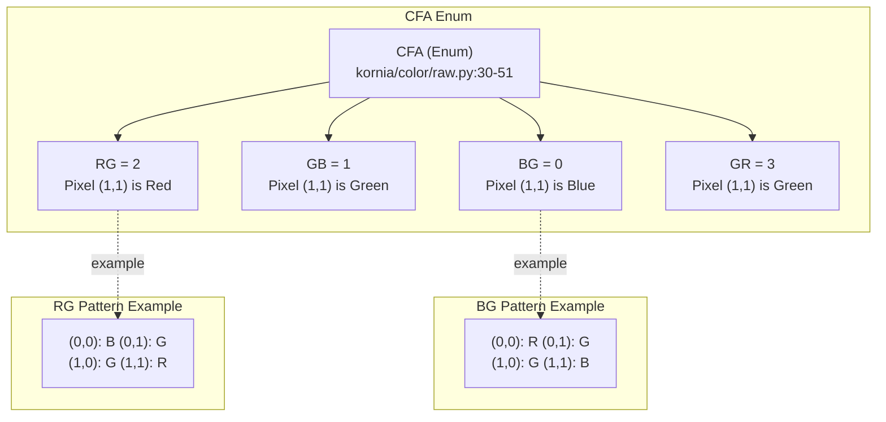
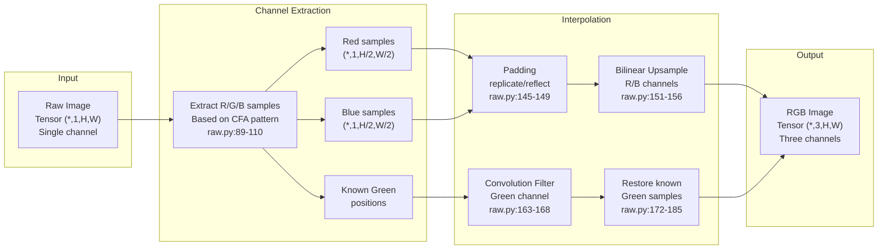
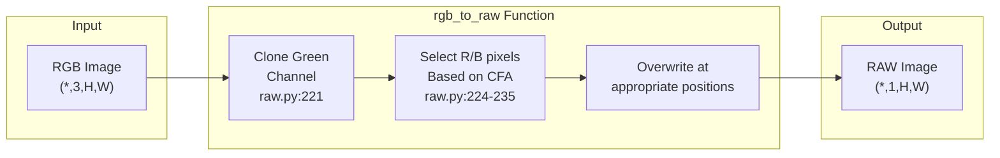
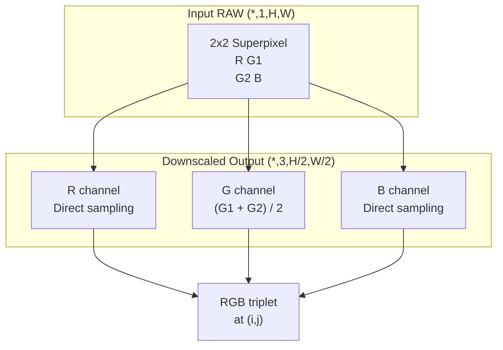
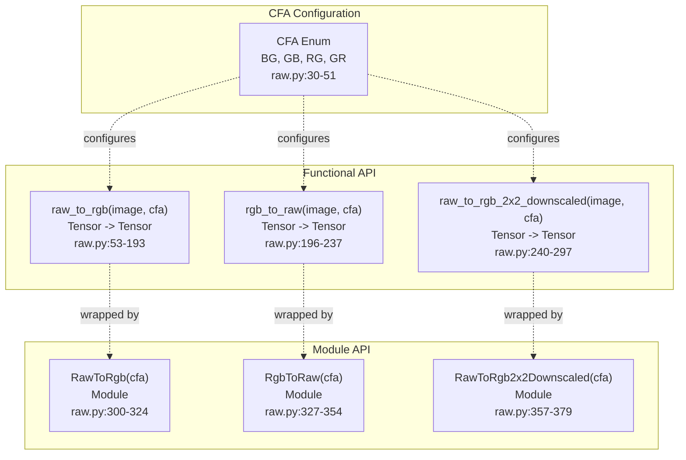

<!-- source: DeepWiki mcp.deepwiki.com · repo kornia/kornia · page 2.4 Bayer RAW Image Processing · fetched 2026-10-21 -->

# Bayer RAW Image Processing

<details>
<summary>Relevant source files</summary>

The following files were used as context for generating this wiki page:

- [docs/source/color.rst](docs/source/color.rst)
- [kornia/__init__.py](kornia/__init__.py)
- [kornia/color/__init__.py](kornia/color/__init__.py)
- [kornia/color/raw.py](kornia/color/raw.py)
- [kornia/color/rgb.py](kornia/color/rgb.py)
- [tests/color/test_rgb.py](tests/color/test_rgb.py)

</details>


## Purpose and Scope

This page documents Kornia's Bayer RAW image processing system, which converts single-channel RAW sensor data captured through a Bayer color filter array (CFA) into full RGB images (demosaicing), and vice versa. The system provides differentiable implementations for integration into PyTorch-based image processing pipelines.

For other color space conversions, see [RGB, BGR, and RGBA Conversions](#2.1), [Perceptual Color Spaces](#2.2), and [Video Color Spaces](#2.3). For grayscale conversions, see [Grayscale, Linear RGB, and Utilities](#2.5).

**Sources:** [kornia/color/raw.py:1-380]()

---

## Bayer Color Filter Array (CFA)

The Bayer filter is a color filter array pattern used in most digital camera sensors. It consists of a 2×2 repeating pattern with 2 green pixels, 1 red pixel, and 1 blue pixel. The `CFA` enum defines the four possible pixel arrangements.

### CFA Pattern Configurations



**Bayer CFA Pattern Configurations**

| CFA Value | Enum Name | Pixel (0,0) | Pixel (0,1) | Pixel (1,0) | Pixel (1,1) | Description |
|-----------|-----------|-------------|-------------|-------------|-------------|-------------|
| 0 | `CFA.BG` | Red | Green | Green | Blue | Pixel (1,1) is Blue |
| 1 | `CFA.GB` | Green | Red | Blue | Green | Pixel (1,1) is Green (bottom-left) |
| 2 | `CFA.RG` | Blue | Green | Green | Red | Pixel (1,1) is Red |
| 3 | `CFA.GR` | Green | Blue | Red | Green | Pixel (1,1) is Green (bottom-right) |

The naming convention follows OpenCV standards: the two-letter code indicates the colors at pixels (1,1) and (0,1) respectively.

**Sources:** [kornia/color/raw.py:30-51](), [docs/source/color.rst:192-209]()

---

## Demosaicing Algorithm Overview



**Demosaicing Pipeline Data Flow**

The `raw_to_rgb()` function implements a bilinear demosaicing algorithm optimized for quality and reversibility:

### Channel-Specific Processing

1. **Red and Blue Channels** ([kornia/color/raw.py:89-160]()):
   - Extract samples from alternating positions based on CFA configuration
   - Apply padding (replicate mode) to handle boundary conditions
   - Upsample using bilinear interpolation with `align_corners=True`
   - Crop to remove extra padding introduced for correct interpolation

2. **Green Channel** ([kornia/color/raw.py:163-185]()):
   - Apply reflection padding to preserve color symmetry
   - Use fixed convolution kernel to compute average of 4 neighboring positions:
     ```
     [[0.0, 0.25, 0.0],
      [0.25, 0.0, 0.25],
      [0.0, 0.25, 0.0]]
     ```
   - Overwrite interpolated values with original known green samples

### Padding Strategy

The padding approach ensures proper interpolation boundaries. For Red/Blue channels with replicate padding:

```
Original:     Padded:        After Interpolation:
B B B         B B B b        B x B x B x b
              B B B b        x x x x x x x
B B B    =>   B B B b   =>   B x B x B x b
              b b b b        x x x x x x x
                             b x b x b x b
```

The algorithm then crops to the original dimensions, preserving the known R/B samples.

**Sources:** [kornia/color/raw.py:53-193](), [kornia/color/raw.py:113-161]()

---

## Reverse Conversion: RGB to RAW



**RGB-to-RAW Conversion Process**

The `rgb_to_raw()` function ([kornia/color/raw.py:196-237]()) performs the inverse operation by sampling the RGB image at positions corresponding to the specified CFA pattern:

1. Start with the green channel as base (contains 50% of pixels in all CFAs)
2. Overwrite positions with red and blue values according to the CFA configuration
3. The result is a single-channel image where each pixel contains the color that would be captured by that sensor position

Example for `CFA.BG`:
- Pixels at even rows, even columns: Red channel values
- Pixels at odd rows, odd columns: Blue channel values  
- Remaining positions: Green channel values (unchanged)

This conversion is **reversible**: `rgb_to_raw()` followed by `raw_to_rgb()` preserves the original RAW samples, with only interpolated pixels potentially differing.

**Sources:** [kornia/color/raw.py:196-237]()

---

## Efficient Downscaled Conversion

The `raw_to_rgb_2x2_downscaled()` function ([kornia/color/raw.py:240-297]()) provides an efficient demosaicing method that produces RGB output at half the spatial resolution:



**Efficient 2x2 Downscaled Demosaicing**

### Algorithm Details

Each 2×2 superpixel in the Bayer pattern contains:
- 1 Red sample
- 2 Green samples  
- 1 Blue sample

The algorithm directly extracts these samples and averages the two green values, producing one RGB pixel per 2×2 block:

```python
# For CFA.RG example:
r = image[..., :, 1::2, 1::2]  # Red at bottom-right
b = image[..., :, ::2, ::2]    # Blue at top-left
g1 = image[..., :, 1::2, ::2]  # Green at bottom-left
g2 = image[..., :, ::2, 1::2]  # Green at top-right
g = (g1 + g2) / 2              # Average the two greens
```

### Advantages

- **No interpolation artifacts**: Uses actual sensor measurements
- **Higher quality**: Better than naive downsampling of demosaiced image
- **Computationally efficient**: Simple extraction and averaging
- **Suitable for preview generation**: Quick RGB rendering at reduced resolution

**Sources:** [kornia/color/raw.py:240-297]()

---

## API Structure



**Bayer RAW API Organization**

### Functions

| Function | Input Shape | Output Shape | Description |
|----------|-------------|--------------|-------------|
| `raw_to_rgb(image, cfa)` | `(*,1,H,W)` | `(*,3,H,W)` | Demosaic RAW to RGB with bilinear interpolation |
| `rgb_to_raw(image, cfa)` | `(*,3,H,W)` | `(*,1,H,W)` | Convert RGB to RAW Bayer pattern |
| `raw_to_rgb_2x2_downscaled(image, cfa)` | `(*,1,H,W)` | `(*,3,H/2,W/2)` | Efficient demosaicing with 2x downscaling |

### Module Classes

All module classes inherit from `kornia.core.ImageModule` and provide:
- **ONNX export support**: With defined input/output shapes
- **Stateful CFA configuration**: CFA pattern stored at initialization
- **Standard PyTorch Module interface**: Compatible with `nn.Sequential`, device/dtype management

Example usage:

```python
import torch
from kornia.color import CFA, RawToRgb, RgbToRaw

# Functional API
raw_image = torch.randn(2, 1, 256, 256)
rgb_image = raw_to_rgb(raw_image, CFA.RG)

# Module API
demosaic = RawToRgb(cfa=CFA.RG).cuda()
rgb_image = demosaic(raw_image.cuda())

# Reverse conversion
bayer = RgbToRaw(cfa=CFA.RG)
reconstructed_raw = bayer(rgb_image)
```

**Sources:** [kornia/color/raw.py:300-379](), [kornia/color/__init__.py:29]()

---

## Implementation Details

### Input Constraints

The implementation enforces several requirements:

1. **Tensor type validation** ([kornia/color/raw.py:74-78]())
   - Input must be `torch.Tensor`
   - Raises `TypeError` for non-tensor inputs

2. **Shape requirements** ([kornia/color/raw.py:77-81]())
   - RAW input: `(*,1,H,W)` - single channel
   - RGB input: `(*,3,H,W)` - three channels
   - Height and Width must be evenly divisible by 2

3. **Value range** ([kornia/color/raw.py:59-60](), [kornia/color/raw.py:199]())
   - Assumed to be in range `[0, 1]`
   - No explicit clamping performed

### Differentiability and Gradient Flow

All operations are implemented using differentiable PyTorch operations:

- **Bilinear interpolation**: `torch.nn.functional.interpolate()` with `align_corners=True`
- **Convolution**: `torch.nn.functional.conv2d()` for green channel averaging
- **Indexing**: Standard tensor slicing preserves gradients
- **Concatenation**: `torch.cat()` for channel stacking

This enables:
- Backpropagation through the demosaicing process
- Integration into end-to-end trainable pipelines
- Use in loss functions or as part of data augmentation

### Numerical Stability

The implementation includes several design choices for numerical robustness:

1. **Padding strategies**:
   - Replicate padding for R/B prevents extrapolation artifacts
   - Reflection padding for G maintains color filter symmetry

2. **Interpolation alignment**:
   - `align_corners=True` ensures interpolation starts from pixel centers
   - Preserves known RAW samples at their exact positions

3. **Green channel restoration** ([kornia/color/raw.py:172-185]()):
   - Known green samples overwrite interpolated values
   - Ensures perfect reconstruction of 50% of input data

### ONNX Export Support

Module classes define explicit ONNX shapes for export:

```python
# RawToRgb
ONNX_DEFAULT_INPUTSHAPE: ClassVar[list[int]] = [-1, 1, -1, -1]
ONNX_DEFAULT_OUTPUTSHAPE: ClassVar[list[int]] = [-1, 3, -1, -1]

# RgbToRaw
ONNX_DEFAULT_INPUTSHAPE: ClassVar[list[int]] = [-1, 3, -1, -1]
ONNX_DEFAULT_OUTPUTSHAPE: ClassVar[list[int]] = [-1, 1, -1, -1]
```

These enable deployment to ONNX-compatible runtimes while maintaining dynamic batch size (`-1` in first dimension).

**Sources:** [kornia/color/raw.py:53-380](), [kornia/color/raw.py:316-317](), [kornia/color/raw.py:346-347]()

---

## Integration Points

The Bayer RAW processing system integrates with other Kornia components:

### Color Module Exports

All RAW processing functions and classes are exported through `kornia.color`:

```python
from kornia.color import (
    CFA,              # Enum for filter patterns
    raw_to_rgb,       # Functional demosaicing
    rgb_to_raw,       # Functional RGB-to-RAW
    raw_to_rgb_2x2_downscaled,  # Efficient downscaled version
    RawToRgb,         # Module wrapper
    RgbToRaw,         # Module wrapper
    RawToRgb2x2Downscaled  # Module wrapper
)
```

### Use in Augmentation Pipelines

RAW processing modules can be integrated into augmentation pipelines (see [Data Augmentation System](#4)):

```python
from kornia.augmentation import AugmentationSequential
from kornia.color import RawToRgb, CFA

pipeline = AugmentationSequential(
    RawToRgb(cfa=CFA.RG),
    # ... other augmentations on RGB data
)
```

### Integration with Image I/O

When working with actual camera RAW files, the workflow typically involves:

1. Load RAW sensor data using external libraries (rawpy, imageio)
2. Convert to PyTorch tensor
3. Apply `raw_to_rgb()` or `RawToRgb` module
4. Continue with standard Kornia color processing (see [#2](#2))

**Sources:** [kornia/color/__init__.py:29](), [kornia/color/__init__.py:74-157]()

---

## Performance Considerations

### Memory Efficiency

- **In-place operations**: Where possible, avoids creating unnecessary copies
- **View reshaping** ([kornia/color/raw.py:85]()): Uses `view()` instead of `reshape()` when safe
- **Channel extraction**: Direct slicing without copying (`::2` stride indexing)

### Computational Complexity

| Operation | Time Complexity | Space Complexity |
|-----------|-----------------|------------------|
| `raw_to_rgb()` | O(H×W) | O(H×W) |
| `rgb_to_raw()` | O(H×W) | O(H×W) |
| `raw_to_rgb_2x2_downscaled()` | O(H×W) | O(H×W/4) |

The downscaled version provides 4× memory reduction for the output and is faster due to avoiding interpolation.

### Device Support

All operations support:
- **CPU tensors**: Standard PyTorch operations
- **CUDA tensors**: GPU acceleration for large images
- **MPS backend**: Apple Silicon support (via PyTorch)
- **XLA devices**: TPU support (via PyTorch/XLA)

**Sources:** [kornia/color/raw.py:53-297]()

---

