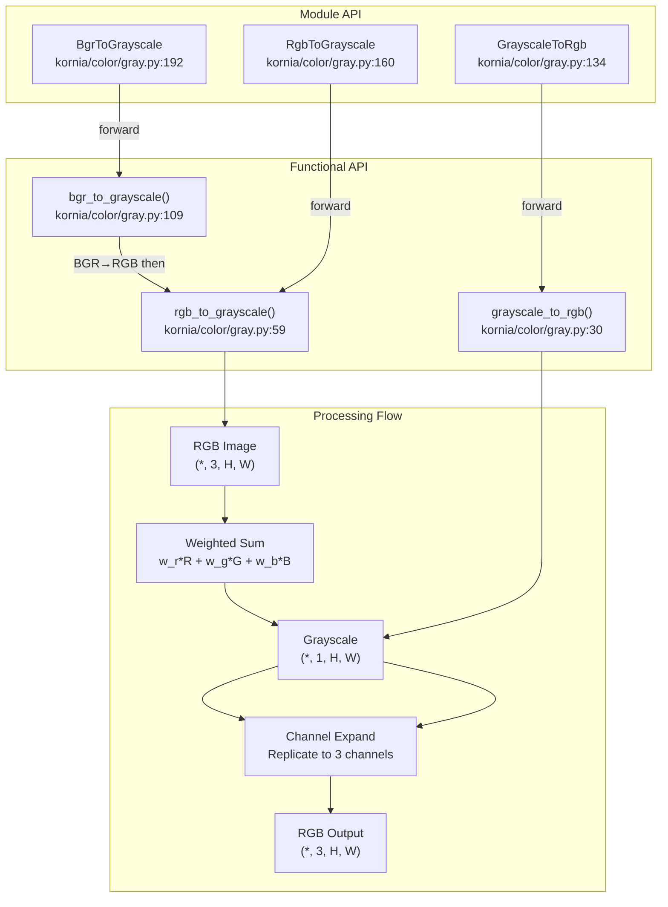
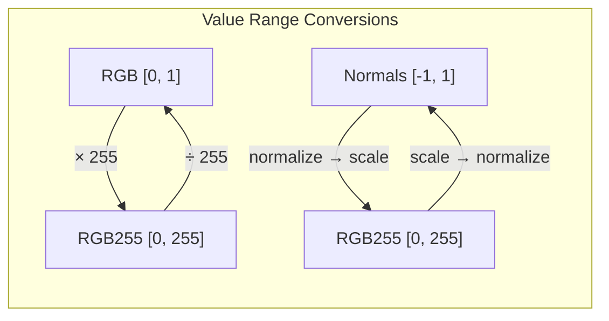

<!-- source: DeepWiki mcp.deepwiki.com · repo kornia/kornia · page 2.5 Grayscale, Linear RGB, and Utilities · fetched 2026-10-21 -->

# Grayscale, Linear RGB, and Utilities

<details>
<summary>Relevant source files</summary>

The following files were used as context for generating this wiki page:

- [docs/source/color.rst](docs/source/color.rst)
- [kornia/__init__.py](kornia/__init__.py)
- [kornia/color/__init__.py](kornia/color/__init__.py)
- [kornia/color/gray.py](kornia/color/gray.py)
- [kornia/color/hls.py](kornia/color/hls.py)
- [kornia/color/hsv.py](kornia/color/hsv.py)
- [kornia/color/lab.py](kornia/color/lab.py)
- [kornia/color/luv.py](kornia/color/luv.py)
- [kornia/color/raw.py](kornia/color/raw.py)
- [kornia/color/rgb.py](kornia/color/rgb.py)
- [kornia/color/xyz.py](kornia/color/xyz.py)
- [kornia/color/ycbcr.py](kornia/color/ycbcr.py)
- [kornia/color/yuv.py](kornia/color/yuv.py)
- [tests/color/test_rgb.py](tests/color/test_rgb.py)

</details>


## Purpose and Scope

This document covers grayscale conversions, linear RGB transformations, and utility functions for color value manipulation in Kornia's color processing module. These operations include:

- **Grayscale conversions**: RGB/BGR to grayscale and vice versa
- **Linear RGB transformations**: Gamma correction and sRGB encoding/decoding
- **Value range utilities**: RGB ↔ RGB255 conversions and surface normal encoding

These functions provide fundamental color space utilities used throughout the library for preprocessing, visualization, and color space transformations.

---

## Grayscale Conversions

Grayscale conversion reduces a 3-channel color image to a single-channel intensity representation. Kornia implements ITU-R BT.601-7 luminance coefficients that weight the RGB channels according to human perception of brightness.

### Conversion Formulas

**RGB/BGR to Grayscale:**
```
Y = 0.299 × R + 0.587 × G + 0.114 × B
```

For `uint8` images, integer coefficients are used:
```
Y = 76 × R + 150 × G + 29 × B  (then scaled by 255)
```

**Grayscale to RGB:**

The reverse conversion simply replicates the single grayscale channel across all three RGB channels without memory overhead (using `torch.expand`).

Sources: [kornia/color/gray.py:30-132]()

### Architecture Overview



Sources: [kornia/color/gray.py:30-216]()

### Function Reference: Grayscale

#### `rgb_to_grayscale`

Converts RGB image to grayscale using luminance weights.

**Location:** [kornia/color/gray.py:59-107]()

**Signature:**
```python
def rgb_to_grayscale(image: Tensor, rgb_weights: Optional[Tensor] = None) -> Tensor
```

**Parameters:**
| Parameter | Type | Description |
|-----------|------|-------------|
| `image` | `Tensor` | RGB image with shape `(*, 3, H, W)` |
| `rgb_weights` | `Optional[Tensor]` | Custom weights for RGB channels. Default uses ITU-R BT.601-7 coefficients |

**Returns:**
| Type | Description |
|------|-------------|
| `Tensor` | Grayscale image with shape `(*, 1, H, W)` |

**Implementation Details:**
- Automatically selects integer weights for `uint8` dtype: `[76, 150, 29]`
- Uses floating point weights for float dtypes: `[0.299, 0.587, 0.114]`
- Supports custom weights that must sum to 1.0
- Fully differentiable

**Example:**
```python
import torch
from kornia.color import rgb_to_grayscale

rgb_image = torch.rand(2, 3, 256, 256)
gray_image = rgb_to_grayscale(rgb_image)  # Shape: (2, 1, 256, 256)

# Custom weights
custom_weights = torch.tensor([0.2126, 0.7152, 0.0722])  # Rec. 709
gray_custom = rgb_to_grayscale(rgb_image, custom_weights)
```

Sources: [kornia/color/gray.py:59-107]()

---

#### `bgr_to_grayscale`

Converts BGR image to grayscale by first flipping to RGB, then converting.

**Location:** [kornia/color/gray.py:109-132]()

**Signature:**
```python
def bgr_to_grayscale(image: Tensor) -> Tensor
```

**Parameters:**
| Parameter | Type | Description |
|-----------|------|-------------|
| `image` | `Tensor` | BGR image with shape `(*, 3, H, W)` |

**Returns:**
| Type | Description |
|------|-------------|
| `Tensor` | Grayscale image with shape `(*, 1, H, W)` |

Sources: [kornia/color/gray.py:109-132]()

---

#### `grayscale_to_rgb`

Converts grayscale image to RGB by replicating the single channel.

**Location:** [kornia/color/gray.py:30-57]()

**Signature:**
```python
def grayscale_to_rgb(image: Tensor) -> Tensor
```

**Parameters:**
| Parameter | Type | Description |
|-----------|------|-------------|
| `image` | `Tensor` | Grayscale image with shape `(*, 1, H, W)` |

**Returns:**
| Type | Description |
|------|-------------|
| `Tensor` | RGB image with shape `(*, 3, H, W)` |

**Implementation Details:**
- Uses `torch.expand()` to create a view without memory overhead
- No actual data duplication occurs
- Values in [0, 1] range are preserved

Sources: [kornia/color/gray.py:30-57]()

---

### Module Classes: Grayscale

#### `RgbToGrayscale`

PyTorch module wrapper for `rgb_to_grayscale()`.

**Location:** [kornia/color/gray.py:160-190]()

**Constructor:**
```python
RgbToGrayscale(rgb_weights: Optional[Tensor] = None)
```

**Properties:**
- `ONNX_DEFAULT_INPUTSHAPE`: `[-1, 3, -1, -1]`
- `ONNX_DEFAULT_OUTPUTSHAPE`: `[-1, 1, -1, -1]`

**Usage:**
```python
from kornia.color import RgbToGrayscale

converter = RgbToGrayscale()
gray = converter(rgb_image)
```

Sources: [kornia/color/gray.py:160-190]()

---

#### `BgrToGrayscale`

PyTorch module wrapper for `bgr_to_grayscale()`.

**Location:** [kornia/color/gray.py:192-216]()

Sources: [kornia/color/gray.py:192-216]()

---

#### `GrayscaleToRgb`

PyTorch module wrapper for `grayscale_to_rgb()`.

**Location:** [kornia/color/gray.py:134-158]()

Sources: [kornia/color/gray.py:134-158]()

---

## Linear RGB and Gamma Correction

Gamma correction is a nonlinear operation for encoding and decoding image luminance. The sRGB color space applies a gamma curve to optimize limited bit depth for human perception. Many color space conversions and image processing operations require linear RGB where light intensity is proportional to numeric values.

### sRGB Transfer Function

**sRGB to Linear RGB (Decoding):**
```
linear = {
    sRGB / 12.92                    if sRGB ≤ 0.04045
    ((sRGB + 0.055) / 1.055)^2.4    if sRGB > 0.04045
}
```

**Linear RGB to sRGB (Encoding):**
```
sRGB = {
    linear × 12.92                  if linear ≤ 0.0031308
    1.055 × linear^(1/2.4) - 0.055  if linear > 0.0031308
}
```

Sources: [kornia/color/rgb.py:228-281]()

### Function Reference: Linear RGB

#### `rgb_to_linear_rgb`

Converts sRGB to linear RGB by removing gamma correction.

**Location:** [kornia/color/rgb.py:228-253]()

**Signature:**
```python
def rgb_to_linear_rgb(image: Tensor) -> Tensor
```

Sources: [kornia/color/rgb.py:228-253]()

---

#### `linear_rgb_to_rgb`

Converts linear RGB to sRGB by applying gamma correction.

**Location:** [kornia/color/rgb.py:255-281]()

**Signature:**
```python
def linear_rgb_to_rgb(image: Tensor) -> Tensor
```

Sources: [kornia/color/rgb.py:255-281]()

### Module Classes: Linear RGB

#### `RgbToLinearRgb`
Module wrapper for `rgb_to_linear_rgb()`.

**Location:** [kornia/color/rgb.py:535-567]()

Sources: [kornia/color/rgb.py:535-567]()

---

#### `LinearRgbToRgb`
Module wrapper for `linear_rgb_to_rgb()`.

**Location:** [kornia/color/rgb.py:569-600]()

Sources: [kornia/color/rgb.py:569-600]()

---

## RGB Value Range Utilities

Kornia provides utilities for converting between normalized RGB values [0, 1] and 8-bit RGB values [0, 255], as well as encoding/decoding surface normals for visualization.

### RGB and RGB255 Conversions



Sources: [kornia/color/rgb.py:283-357]()

### Function Reference: Value Range

#### `rgb_to_rgb255`

Converts RGB values from [0, 1] to [0, 255] range.

**Location:** [kornia/color/rgb.py:302-319]()

**Signature:**
```python
def rgb_to_rgb255(image: Tensor) -> Tensor
```

**Implementation:**
```python
rgb255 = (image * 255).clip(0.0, 255.0)
```

Sources: [kornia/color/rgb.py:302-319]()

---

#### `rgb255_to_rgb`

Converts RGB values from [0, 255] to [0, 1] range.

**Location:** [kornia/color/rgb.py:321-338]()

**Signature:**
```python
def rgb255_to_rgb(image: Tensor) -> Tensor
```

**Implementation:**
```python
rgb = image / 255.0
```

Sources: [kornia/color/rgb.py:321-338]()

---

#### `normals_to_rgb255`

Converts surface normals to RGB [0, 255] for visualization.

**Location:** [kornia/color/rgb.py:283-300]()

**Signature:**
```python
def normals_to_rgb255(image: Tensor) -> Tensor
```

**Implementation:**
```python
rgb255 = (0.5 * (image + 1.0)).clip(0.0, 1.0) * 255
```

Maps normals from [-1, 1] to [0, 255] range.

Sources: [kornia/color/rgb.py:283-300]()

---

#### `rgb255_to_normals`

Converts RGB [0, 255] to normalized surface normals.

**Location:** [kornia/color/rgb.py:340-357]()

**Signature:**
```python
def rgb255_to_normals(image: Tensor) -> Tensor
```

**Implementation:**
```python
normals = normalize((image / 255.0) * 2.0 - 1.0, dim=-3, p=2.0)
```

Maps RGB [0, 255] to normalized normals [-1, 1].

Sources: [kornia/color/rgb.py:340-357]()

---

### Module Classes: Value Range

The following module wrappers are available:

| Module Class | Function | Location |
|-------------|----------|----------|
| `RgbToRgb255` | `rgb_to_rgb255()` | [kornia/color/rgb.py:623-642]() |
| `Rgb255ToRgb` | `rgb255_to_rgb()` | [kornia/color/rgb.py:644-663]() |
| `NormalsToRgb255` | `normals_to_rgb255()` | [kornia/color/rgb.py:602-621]() |
| `Rgb255ToNormals` | `rgb255_to_normals()` | [kornia/color/rgb.py:665-684]() |

Sources: [kornia/color/rgb.py:602-684]()

---

## Use Cases and Integration

### Preprocessing for Visualization

```python
import torch
from kornia.color import rgb_to_rgb255, rgb_to_grayscale

# Convert normalized RGB to displayable format
rgb_normalized = torch.rand(1, 3, 256, 256)  # [0, 1]
rgb_display = rgb_to_rgb255(rgb_normalized)   # [0, 255]

# Convert to grayscale for single-channel processing
gray = rgb_to_grayscale(rgb_normalized)
```

Sources: [kornia/color/gray.py:59-107](), [kornia/color/rgb.py:302-319]()

### Color Space Conversion Pipeline

Linear RGB is used as an intermediate step in many color space conversions (Lab, Luv, XYZ):

```python
from kornia.color import rgb_to_lab, lab_to_rgb

# rgb_to_lab internally: sRGB → Linear RGB → XYZ → Lab
lab_image = rgb_to_lab(srgb_image)

# lab_to_rgb internally: Lab → XYZ → Linear RGB → sRGB
srgb_restored = lab_to_rgb(lab_image)
```

Sources: [kornia/color/lab.py:35-148](), [kornia/color/luv.py:35-141]()

### Surface Normal Visualization

```python
import torch
from kornia.color import normals_to_rgb255, rgb255_to_normals

# Encode normals for visualization
normals = torch.randn(1, 3, 128, 128)
normals = torch.nn.functional.normalize(normals, dim=1)
normal_image = normals_to_rgb255(normals)

# Decode from visualization
normals_decoded = rgb255_to_normals(normal_image)
```

Sources: [kornia/color/rgb.py:283-357]()

---

## Testing and Validation

Comprehensive test coverage ensures correctness and numerical stability across all functions.

### Test Coverage Summary

| Function Group | Test Types | Key Validations |
|---------------|------------|-----------------|
| Grayscale | Smoke, cardinality, round-trip, gradcheck | Weight accuracy, shape preservation |
| Linear RGB | Smoke, cardinality, round-trip, gradcheck, JIT | Threshold correctness, reversibility |
| RGB255/Normals | Smoke, cardinality, round-trip, gradcheck | Value range mapping, normalization |

### Round-Trip Validation Examples

```python
# Grayscale round-trip (lossy - information reduction)
rgb = torch.rand(1, 3, 64, 64)
gray = rgb_to_grayscale(rgb)
rgb_restored = grayscale_to_rgb(gray)  # All channels identical

# Linear RGB round-trip (lossless)
srgb = torch.rand(1, 3, 64, 64)
linear = rgb_to_linear_rgb(srgb)
srgb_restored = linear_rgb_to_rgb(linear)
assert torch.allclose(srgb, srgb_restored, atol=1e-6)

# RGB255 round-trip (lossless)
rgb = torch.rand(1, 3, 64, 64)
rgb255 = rgb_to_rgb255(rgb)
rgb_restored = rgb255_to_rgb(rgb255)
assert torch.allclose(rgb, rgb_restored, atol=1e-4)
```

Sources: [tests/color/test_rgb.py:292-484]()

### Implementation Characteristics

| Aspect | Grayscale | Linear RGB | RGB255/Normals |
|--------|-----------|------------|----------------|
| Differentiable | Yes | Yes | Yes |
| Reversible | No (lossy) | Yes | Yes |
| Memory efficient | Yes (expand) | Yes | Yes |
| JIT compatible | Yes | Yes | Yes |
| ONNX exportable | Yes | Yes | Partial |

Sources: [kornia/color/gray.py:1-216](), [kornia/color/rgb.py:228-684]()

---

## API Summary Table

| Function/Class | Purpose | Input Shape | Output Shape |
|----------------|---------|-------------|--------------|
| `rgb_to_linear_rgb()` | sRGB → Linear RGB | `(*, 3, H, W)` | `(*, 3, H, W)` |
| `linear_rgb_to_rgb()` | Linear RGB → sRGB | `(*, 3, H, W)` | `(*, 3, H, W)` |
| `RgbToLinearRgb` | Module for sRGB → Linear | `(*, 3, H, W)` | `(*, 3, H, W)` |
| `LinearRgbToRgb` | Module for Linear → sRGB | `(*, 3, H, W)` | `(*, 3, H, W)` |

All functions:
- Expect input values in range [0, 1]
- Support arbitrary batch dimensions (denoted by `*`)
- Are fully differentiable
- Support JIT compilation
- Work on all PyTorch-supported devices

Sources: [kornia/color/rgb.py:206-578](), [docs/source/color.rst:43-59]()

---

