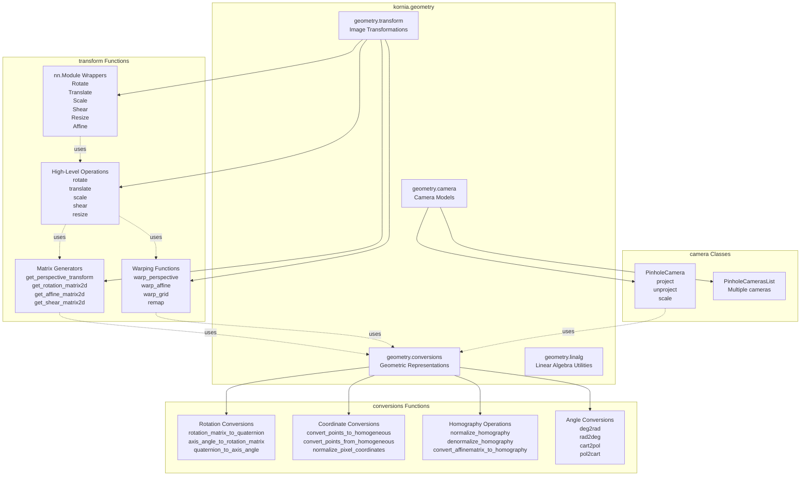
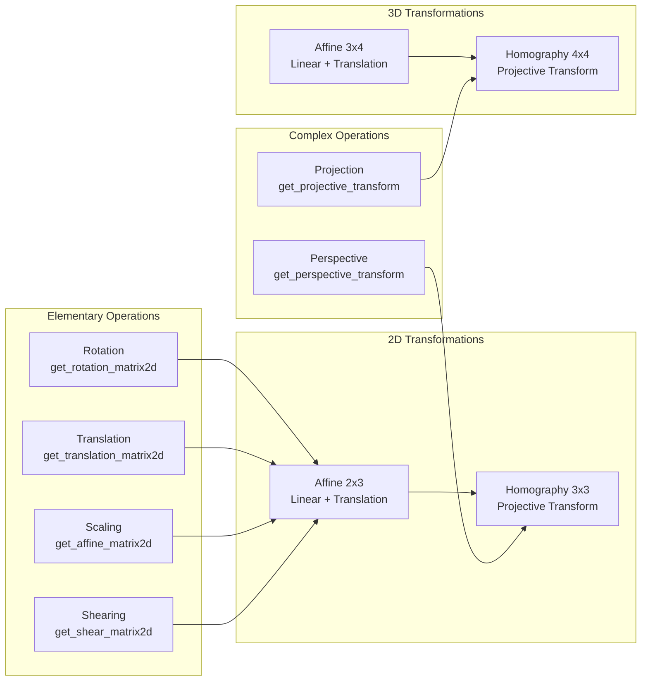
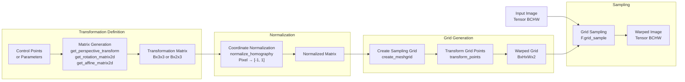
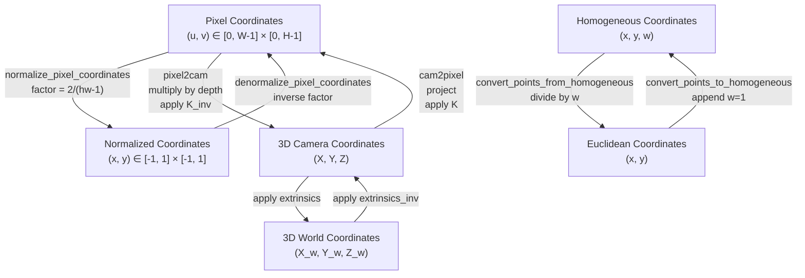
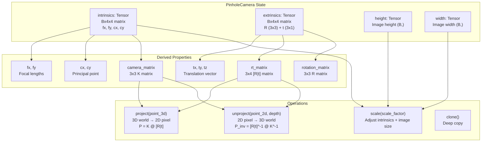
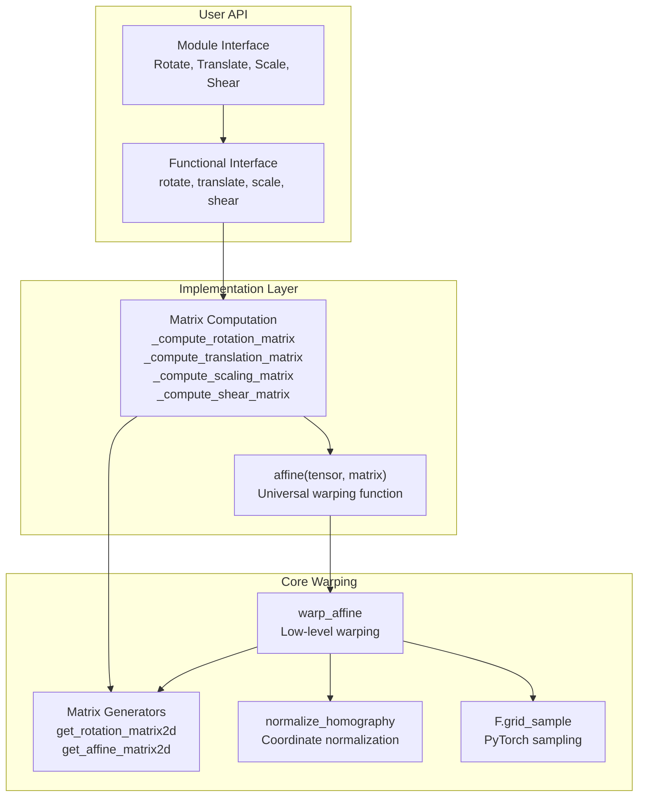

<!-- source: DeepWiki mcp.deepwiki.com · repo kornia/kornia · page 3 Geometry and Transformations · fetched 2026-10-21 -->

# Geometry and Transformations

<details>
<summary>Relevant source files</summary>

The following files were used as context for generating this wiki page:

- [docs/source/geometry.conversions.rst](docs/source/geometry.conversions.rst)
- [docs/source/geometry.transform.rst](docs/source/geometry.transform.rst)
- [kornia/geometry/camera/pinhole.py](kornia/geometry/camera/pinhole.py)
- [kornia/geometry/conversions.py](kornia/geometry/conversions.py)
- [kornia/geometry/transform/affwarp.py](kornia/geometry/transform/affwarp.py)
- [kornia/geometry/transform/imgwarp.py](kornia/geometry/transform/imgwarp.py)

</details>


This document provides an overview of Kornia's geometry and transformation capabilities, which form a core pillar of the library's differentiable computer vision operations. The `kornia.geometry` module provides a comprehensive set of functions and classes for performing geometric transformations on 2D and 3D images, converting between different geometric representations, and working with camera models.

**Scope**: This page covers the overall architecture and organization of the geometry module. For detailed information on specific subsystems, see:
- Geometric representations and conversions between rotation matrices, quaternions, axis-angle, and Euler angles: [3.1](#3.1)
- Image warping operations and transformation matrix generation: [3.2](#3.2)
- Camera models, projection, and unprojection: [3.3](#3.3)
- Coordinate system normalization and homography operations: [3.4](#3.4)
- High-level geometric operations with module wrappers: [3.5](#3.5)

## Module Organization

The geometry module is organized into three main submodules that work together to provide a complete geometric transformation pipeline:

**Diagram: Kornia Geometry Module Structure**



**Sources**: [kornia/geometry/conversions.py:1-1932](), [kornia/geometry/transform/imgwarp.py:1-1350](), [kornia/geometry/transform/affwarp.py:1-937](), [kornia/geometry/camera/pinhole.py:1-787]()

## Core Concepts

### Geometric Representations

Kornia supports multiple representations of 3D rotations, each with specific advantages for different operations:

| Representation | Shape | Use Case | Key Functions |
|----------------|-------|----------|---------------|
| Rotation Matrix | `(*, 3, 3)` | Composing rotations, applying to points | `rotation_matrix_to_quaternion`, `rotation_matrix_to_axis_angle` |
| Quaternion (w,x,y,z) | `(*, 4)` | Interpolation, avoiding gimbal lock | `quaternion_to_rotation_matrix`, `quaternion_to_axis_angle` |
| Axis-Angle (Rodrigues) | `(*, 3)` | Compact rotation representation | `axis_angle_to_rotation_matrix`, `axis_angle_to_quaternion` |
| Euler Angles (roll,pitch,yaw) | `(*, 3)` | Human-readable angles | `euler_from_quaternion`, `quaternion_from_euler` |

All conversion functions in [kornia/geometry/conversions.py:292-889]() are differentiable, enabling gradient-based optimization of geometric parameters.

### Transformation Matrices

Kornia uses homogeneous coordinates and transformation matrices for geometric operations:

- **Affine transformations** (`2×3` or `3×4` matrices): Preserve parallel lines, used for rotation, scaling, translation, shearing
- **Perspective transformations** (`3×3` or `4×4` matrices): Allow projective distortions, used for homographies and camera projection

**Diagram: Transformation Matrix Hierarchy**



**Sources**: [kornia/geometry/transform/imgwarp.py:396-705](), [kornia/geometry/conversions.py:236-289]()

## Image Warping Pipeline

The image warping pipeline in Kornia follows a consistent pattern for applying geometric transformations to images:

**Diagram: Image Warping Data Flow**



**Sources**: [kornia/geometry/transform/imgwarp.py:65-149](), [kornia/geometry/transform/imgwarp.py:255-303]()

### Warping Functions

The core warping functions follow a consistent interface:

```python
# From kornia/geometry/transform/imgwarp.py
warp_perspective(src, M, dsize, mode, padding_mode, align_corners, fill_value)
warp_affine(src, M, dsize, mode, padding_mode, align_corners, fill_value)
remap(image, map_x, map_y, mode, padding_mode, align_corners, normalized_coordinates)
```

All warping functions:
- Accept batched inputs `(B, C, H, W)`
- Support multiple interpolation modes: `'bilinear'`, `'nearest'`
- Support multiple padding modes: `'zeros'`, `'border'`, `'reflection'`, `'fill'`
- Use PyTorch's `grid_sample` internally for differentiable sampling
- Normalize coordinates to `[-1, 1]` range

**Sources**: [kornia/geometry/transform/imgwarp.py:65-225](), [kornia/geometry/transform/imgwarp.py:489-556]()

## Coordinate Systems and Normalization

Kornia operates in multiple coordinate systems depending on the context:

| Coordinate System | Range | Usage |
|-------------------|-------|-------|
| Pixel Coordinates | `[0, W-1]`, `[0, H-1]` | Image indexing, original data |
| Normalized Coordinates | `[-1, 1]` | PyTorch grid_sample, homographies |
| Homogeneous Coordinates | `(x, y, w)` or `(x, y, z, w)` | Projective transformations |
| Camera Coordinates | 3D space relative to camera | 3D geometry, depth |

**Diagram: Coordinate System Conversions**



**Sources**: [kornia/geometry/conversions.py:896-1019](), [kornia/geometry/conversions.py:173-228](), [kornia/geometry/camera/pinhole.py:678-733]()

### Homography Normalization

Homographies in pixel space must be normalized before applying transformations to work with PyTorch's normalized coordinate system:

```python
# From kornia/geometry/conversions.py:1042-1076
normalize_homography(dst_pix_trans_src_pix, dsize_src, dsize_dst)
```

This function:
1. Computes normalization matrices for source and destination images
2. Chains transformations: `dst_norm → dst_pix → src_pix → src_norm`
3. Returns normalized homography operating in `[-1, 1]` space

**Sources**: [kornia/geometry/conversions.py:1042-1108]()

## Camera Model

The `PinholeCamera` class encapsulates the pinhole camera model with intrinsic and extrinsic parameters:

**Diagram: PinholeCamera Architecture**



**Sources**: [kornia/geometry/camera/pinhole.py:29-413]()

The camera projection follows standard computer vision conventions:

```
3D World Point (X_w, Y_w, Z_w)
    ↓ Apply extrinsics [R|t]
3D Camera Point (X_c, Y_c, Z_c)
    ↓ Apply intrinsics K
Homogeneous 2D (u*Z_c, v*Z_c, Z_c)
    ↓ Normalize by Z_c
2D Pixel Point (u, v)
```

**Sources**: [kornia/geometry/camera/pinhole.py:319-376]()

## High-Level Transform API

Kornia provides both functional and module-based APIs for common geometric transformations:

| Operation | Functional API | Module API | Description |
|-----------|---------------|------------|-------------|
| Rotation | `rotate(tensor, angle, center)` | `Rotate(angle)` | Rotate image around center |
| Translation | `translate(tensor, translation)` | `Translate(translation)` | Shift image by offset |
| Scaling | `scale(tensor, scale_factor, center)` | `Scale(scale_factor)` | Scale image around center |
| Shearing | `shear(tensor, shear)` | `Shear(shear)` | Shear transformation |
| Resize | `resize(input, size, interpolation)` | `Resize(size)` | Resize to target size |
| Affine | `affine(tensor, matrix)` | `Affine(angle, translation, scale_factor, shear)` | Composite affine transform |

**Diagram: High-Level Transform Implementation**



**Sources**: [kornia/geometry/transform/affwarp.py:137-537](), [kornia/geometry/transform/affwarp.py:772-937]()

### Example Usage Pattern

The high-level API handles common use cases with minimal code:

```python
# Functional API - stateless, direct application
rotated = rotate(img, angle=torch.tensor([45.0]))

# Module API - stateful, reusable transforms
transform = Rotate(angle=torch.tensor([45.0]))
rotated = transform(img)

# Composite transformations with Affine
transform = Affine(
    angle=torch.tensor([45.0]),
    translation=torch.tensor([[10.0, 20.0]]),
    scale_factor=torch.tensor([[1.5, 1.5]]),
    shear=torch.tensor([[0.1, 0.2]])
)
transformed = transform(img)
```

**Sources**: [kornia/geometry/transform/affwarp.py:248-310](), [kornia/geometry/transform/affwarp.py:808-882]()

## Integration with Other Modules

The geometry module integrates with other Kornia components:

- **Augmentation System** ([4](#4)): Geometric augmentations use `geometry.transform` for warping operations and `geometry.conversions` for parameter generation
- **Feature Detection** ([5](#5)): LAF (Local Affine Frames) use rotation matrices and affine transforms from `geometry.conversions`
- **Deep Learning Models** ([6](#6)): Object detection and segmentation models use geometric transforms for preprocessing and post-processing

**Sources**: [kornia/geometry/transform/imgwarp.py:1-63](), [kornia/geometry/conversions.py:1-77]()

## Performance Considerations

All geometric operations in Kornia are designed for performance:

1. **Batched operations**: All functions support batch processing with shape `(B, ...)` for parallel execution
2. **GPU acceleration**: Operations run on CUDA when input tensors are on GPU
3. **Differentiability**: All operations maintain gradients for end-to-end training
4. **Anti-aliasing**: `resize` function supports Gaussian pre-filtering for high-quality downsampling

**Sources**: [kornia/geometry/transform/affwarp.py:553-635]()

---

