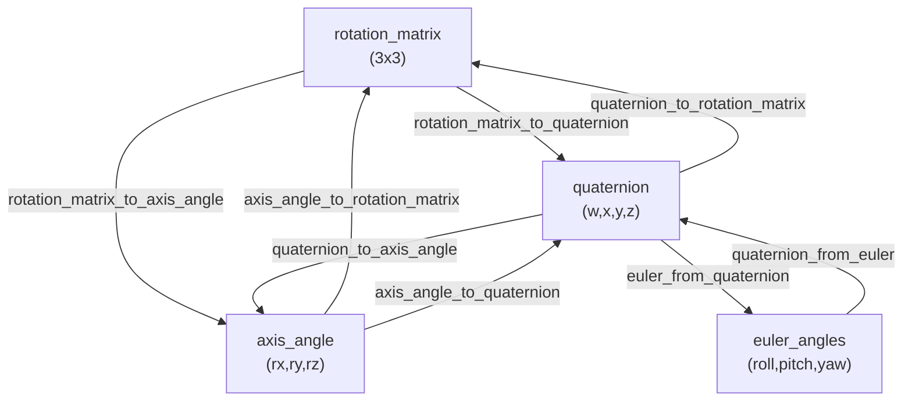
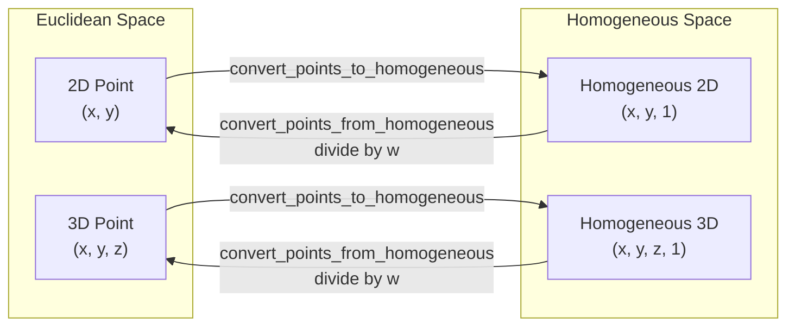
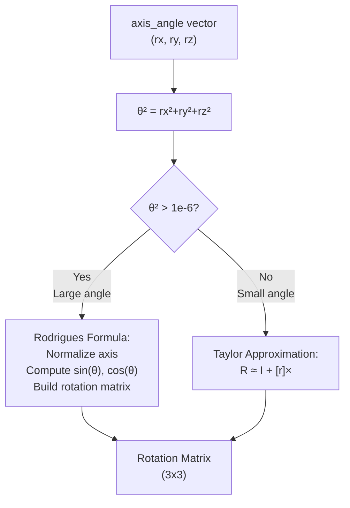
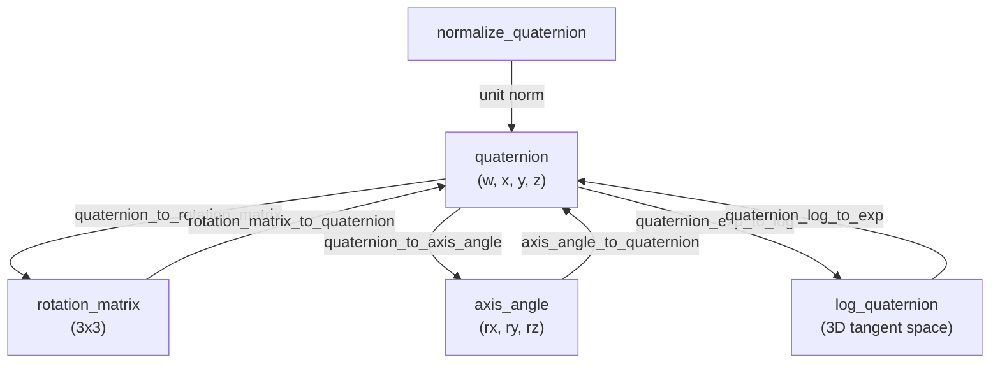
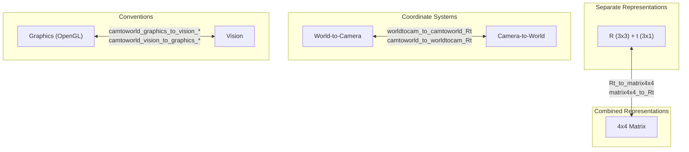
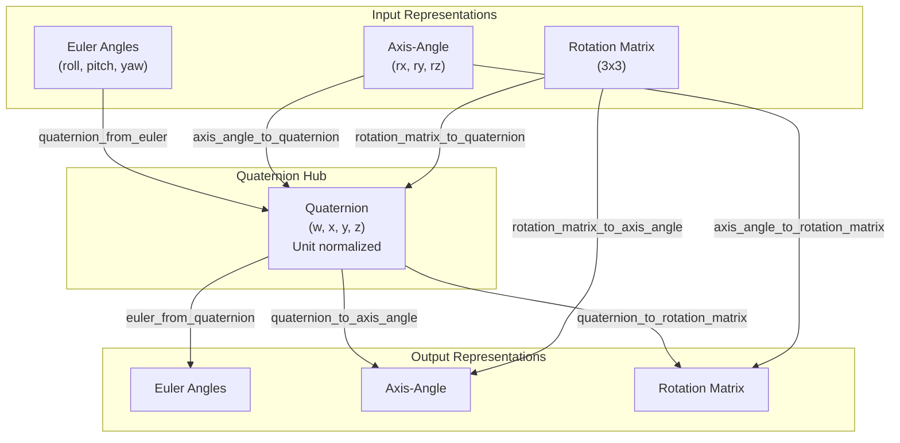

<!-- source: DeepWiki mcp.deepwiki.com · repo kornia/kornia · page 3.1 Geometric Representations and Conversions · fetched 2026-10-21 -->

# Geometric Representations and Conversions

<details>
<summary>Relevant source files</summary>

The following files were used as context for generating this wiki page:

- [docs/source/geometry.conversions.rst](docs/source/geometry.conversions.rst)
- [docs/source/geometry.transform.rst](docs/source/geometry.transform.rst)
- [kornia/geometry/camera/pinhole.py](kornia/geometry/camera/pinhole.py)
- [kornia/geometry/conversions.py](kornia/geometry/conversions.py)
- [kornia/geometry/transform/affwarp.py](kornia/geometry/transform/affwarp.py)
- [kornia/geometry/transform/imgwarp.py](kornia/geometry/transform/imgwarp.py)

</details>


## Purpose and Scope

This document covers Kornia's geometric representation and conversion functions, which provide utilities for working with different mathematical representations of rotations, angles, and coordinate systems. The module includes conversions between rotation matrices, quaternions, axis-angle representations, and Euler angles, as well as utilities for angle conversions and homogeneous coordinate transformations. All operations are differentiable and built on PyTorch tensors.

For information about related functionalities, see:
- Image Warping and Transformation Matrices [#3.2](#3.2)
- Camera Models and Projection [#3.3](#3.3)
- Coordinate System Normalization [#3.4](#3.4)
- High-Level Geometric Operations [#3.5](#3.5)

## Rotation Representations Overview

Kornia supports multiple mathematical representations for 3D rotations, each with different properties and use cases:

**Rotation Representations in kornia.geometry.conversions**

| Representation | Shape | Components | Range | Constraints |
|----------------|-------|------------|-------|-------------|
| Rotation Matrix | `(*, 3, 3)` | 9 values | [-1, 1] | Orthonormal, det=1 |
| Quaternion | `(*, 4)` | w, x, y, z | [-1, 1] | Unit norm |
| Axis-Angle | `(*, 3)` | rx, ry, rz | [-π, π] | Rotation axis (unit) × angle |
| Euler Angles | `(*, 3)` | roll, pitch, yaw | [-π, π] | XYZ convention |

**Representation Conversion Graph**



Sources: [kornia/geometry/conversions.py:31-77]()

Each representation has advantages:
- **Rotation matrices**: Direct application to vectors, no gimbal lock, but 9 parameters with orthonormality constraints
- **Quaternions**: Compact (4 values), smooth interpolation, no gimbal lock, but non-intuitive
- **Axis-angle**: Compact (3 values), intuitive (axis + angle), used in Rodrigues formula
- **Euler angles**: Most intuitive, but suffers from gimbal lock

## Angle and Coordinate Conversions

### Basic Angle Conversions

Kornia provides functions for converting between radians and degrees, as well as between polar and cartesian coordinates.

**rad2deg / deg2rad**

```python
def rad2deg(tensor: Tensor) -> Tensor
def deg2rad(tensor: Tensor) -> Tensor
```

Convert angles between radians and degrees. These functions apply element-wise conversion using the formula:
- `degrees = radians × 180 / π`
- `radians = degrees × π / 180`

Sources: [kornia/geometry/conversions.py:80-120]()

**pol2cart / cart2pol**

```python
def pol2cart(rho: Tensor, phi: Tensor) -> tuple[Tensor, Tensor]
def cart2pol(x: Tensor, y: Tensor, eps: float = 1.0e-8) -> tuple[Tensor, Tensor]
```

Convert between polar coordinates (radius, angle) and cartesian coordinates (x, y):
- `x = rho × cos(phi)`, `y = rho × sin(phi)`
- `rho = sqrt(x² + y²)`, `phi = atan2(y, x)`

Sources: [kornia/geometry/conversions.py:122-171]()

### Homogeneous Coordinates

Homogeneous coordinates add an extra dimension to represent points in projective geometry. This is essential for representing transformations that include perspective effects.

**convert_points_to_homogeneous / convert_points_from_homogeneous**

```python
def convert_points_to_homogeneous(points: Tensor) -> Tensor
def convert_points_from_homogeneous(points: Tensor, eps: float = 1e-8) -> Tensor
```

- **to_homogeneous**: Converts Euclidean coordinates `(*, N, D)` to homogeneous coordinates `(*, N, D+1)` by appending 1
- **from_homogeneous**: Converts homogeneous coordinates `(*, N, D)` to Euclidean `(*, N, D-1)` by dividing by the last coordinate

The conversion handles points at infinity by checking if the homogeneous coordinate is near zero.

Sources: [kornia/geometry/conversions.py:173-228]()

**Homogeneous Coordinate Conversion**



Sources: [kornia/geometry/conversions.py:173-228]()

## Rotation Matrix Representation

A 3D rotation matrix is a 3×3 orthonormal matrix with determinant +1. It represents a rotation in 3D space and can be directly applied to vectors.

### angle_to_rotation_matrix

```python
def angle_to_rotation_matrix(angle: Tensor) -> Tensor
```

Creates a 2D rotation matrix from angles in degrees. The input angle tensor can have any shape `(*)`, and the output will be `(*, 2, 2)`.

The 2D rotation matrix is:
```
R = [cos(θ)  -sin(θ)]
    [sin(θ)   cos(θ)]
```

Sources: [kornia/geometry/conversions.py:1022-1040]()

### rotation_matrix_to_quaternion

```python
def rotation_matrix_to_quaternion(rotation_matrix: Tensor, eps: float = 1.0e-8) -> Tensor
```

Converts a 3×3 rotation matrix to a quaternion in `(w, x, y, z)` format.

- **Input**: Rotation matrix of shape `(*, 3, 3)`
- **Output**: Quaternion of shape `(*, 4)` in `(w, x, y, z)` order

The conversion handles numerical stability by selecting the largest diagonal element to compute the quaternion components.

Sources: [kornia/geometry/conversions.py:432-505]()

### rotation_matrix_to_axis_angle

```python
def rotation_matrix_to_axis_angle(rotation_matrix: Tensor) -> Tensor
```

Converts a 3×3 rotation matrix to axis-angle representation (Rodrigues vector).

- **Input**: Rotation matrix of shape `(*, 3, 3)`
- **Output**: Axis-angle vector of shape `(*, 3)` in radians

The implementation converts first to quaternion, then to axis-angle for numerical stability.

Sources: [kornia/geometry/conversions.py:395-425]()

## Axis-Angle Representation

Axis-angle representation encodes a rotation as a 3D vector where the direction indicates the rotation axis and the magnitude indicates the rotation angle in radians. This is also known as the Rodrigues vector or rotation vector.

### axis_angle_to_rotation_matrix

```python
def axis_angle_to_rotation_matrix(axis_angle: Tensor) -> Tensor
```

Converts a 3D axis-angle rotation vector to a 3×3 rotation matrix using Rodrigues' formula.

- **Input**: Axis-angle vector of shape `(*, 3)` in radians
- **Output**: Rotation matrix of shape `(*, 3, 3)`

The implementation handles two cases:
1. **Large angles** (`θ² > 1e-6`): Uses Rodrigues' rotation formula with trigonometric functions
2. **Small angles** (`θ² ≤ 1e-6`): Uses Taylor series approximation to avoid numerical instability

The rotation matrix is computed as:
```
R = I + sin(θ)/θ × K + (1-cos(θ))/θ² × K²
```
where `K` is the skew-symmetric matrix of the normalized axis and `θ` is the rotation angle.

Sources: [kornia/geometry/conversions.py:292-388]()

**Axis-Angle to Rotation Matrix Computation**



Sources: [kornia/geometry/conversions.py:321-388]()

### axis_angle_to_quaternion

```python
def axis_angle_to_quaternion(axis_angle: Tensor) -> Tensor
```

Converts an axis-angle rotation vector to a quaternion in `(w, x, y, z)` format.

- **Input**: Axis-angle vector of shape `(*, 3)`
- **Output**: Quaternion of shape `(*, 4)`

The conversion uses:
- `w = cos(θ/2)`
- `(x, y, z) = (rx, ry, rz) × sin(θ/2) / θ`

where `θ = sqrt(rx² + ry² + rz²)`.

Sources: [kornia/geometry/conversions.py:758-810]()

## Quaternion Representation

Quaternions provide a compact and numerically stable representation of 3D rotations. A quaternion has four components `(w, x, y, z)` where `w` is the scalar (real) part and `(x, y, z)` is the vector (imaginary) part.

### Quaternion Properties

- **Unit quaternions** represent rotations (norm = 1)
- No gimbal lock
- Smooth interpolation (SLERP)
- Non-commutative multiplication

### normalize_quaternion

```python
def normalize_quaternion(quaternion: Tensor, eps: float = 1.0e-12) -> Tensor
```

Normalizes a quaternion to unit length. The quaternion can be in either `(x, y, z, w)` or `(w, x, y, z)` format.

- **Input**: Quaternion of shape `(*, 4)`
- **Output**: Normalized quaternion of shape `(*, 4)`

Sources: [kornia/geometry/conversions.py:507-532]()

### quaternion_to_rotation_matrix

```python
def quaternion_to_rotation_matrix(quaternion: Tensor) -> Tensor
```

Converts a quaternion to a 3×3 rotation matrix. The quaternion should be in `(w, x, y, z)` format.

- **Input**: Quaternion of shape `(*, 4)`
- **Output**: Rotation matrix of shape `(*, 3, 3)`

The quaternion is first normalized, then the rotation matrix is computed using the formula:

```
R = [1-2(y²+z²)   2(xy-wz)     2(xz+wy)  ]
    [2(xy+wz)     1-2(x²+z²)   2(yz-wx)  ]
    [2(xz-wy)     2(yz+wx)     1-2(x²+y²)]
```

Sources: [kornia/geometry/conversions.py:539-609]()

### quaternion_to_axis_angle

```python
def quaternion_to_axis_angle(quaternion: Tensor) -> Tensor
```

Converts a quaternion to axis-angle representation. The quaternion should be in `(w, x, y, z)` format.

- **Input**: Quaternion of shape `(*, 4)`
- **Output**: Axis-angle vector of shape `(*, 3)` in radians

The conversion extracts the rotation axis from the quaternion's vector part and computes the angle using `atan2`.

Sources: [kornia/geometry/conversions.py:611-667]()

### quaternion_log_to_exp / quaternion_exp_to_log

```python
def quaternion_log_to_exp(quaternion: Tensor, eps: float = 1.0e-8) -> Tensor
def quaternion_exp_to_log(quaternion: Tensor, eps: float = 1.0e-8) -> Tensor
```

These functions implement the exponential and logarithmic maps for quaternions, useful for interpolation and optimization.

- **log_to_exp**: Maps from 3D tangent space to 4D quaternion space
  - Input: Log quaternion of shape `(*, 3)`
  - Output: Quaternion of shape `(*, 4)`

- **exp_to_log**: Maps from 4D quaternion space to 3D tangent space
  - Input: Quaternion of shape `(*, 4)`
  - Output: Log quaternion of shape `(*, 3)`

Sources: [kornia/geometry/conversions.py:674-752]()

**Quaternion Conversions Flow**



Sources: [kornia/geometry/conversions.py:507-752]()

## Euler Angles

Euler angles represent rotations as three sequential rotations around coordinate axes. Kornia uses the XYZ convention (roll, pitch, yaw).

### euler_from_quaternion

```python
def euler_from_quaternion(w: Tensor, x: Tensor, y: Tensor, z: Tensor) -> tuple[Tensor, Tensor, Tensor]
```

Converts quaternion coefficients to Euler angles in XYZ convention.

- **Input**: Four separate tensors for quaternion components `w, x, y, z`
- **Output**: Tuple of `(roll, pitch, yaw)` angles in radians

The conversion formulas are:
```
roll  = atan2(2(wx + yz), 1 - 2(x² + y²))
pitch = asin(clamp(2(wy - zx), -1, 1))
yaw   = atan2(2(wz + xy), 1 - 2(y² + z²))
```

Sources: [kornia/geometry/conversions.py:820-854]()

### quaternion_from_euler

```python
def quaternion_from_euler(roll: Tensor, pitch: Tensor, yaw: Tensor) -> tuple[Tensor, Tensor, Tensor, Tensor]
```

Converts Euler angles (XYZ convention) to quaternion coefficients.

- **Input**: Three tensors for `roll, pitch, yaw` angles in radians
- **Output**: Tuple of quaternion coefficients `(w, x, y, z)`

The conversion uses half-angles and products of trigonometric functions:
```
w = cos(yaw/2)cos(pitch/2)cos(roll/2) + sin(yaw/2)sin(pitch/2)sin(roll/2)
x = cos(yaw/2)cos(pitch/2)sin(roll/2) - sin(yaw/2)sin(pitch/2)cos(roll/2)
y = sin(yaw/2)cos(pitch/2)sin(roll/2) + cos(yaw/2)sin(pitch/2)cos(roll/2)
z = sin(yaw/2)cos(pitch/2)cos(roll/2) - cos(yaw/2)sin(pitch/2)sin(roll/2)
```

Sources: [kornia/geometry/conversions.py:856-890]()

**Gimbal Lock Warning**

Euler angles suffer from gimbal lock when pitch approaches ±90°, causing loss of one degree of freedom. For general 3D rotation representation, quaternions or axis-angle are preferred.

## Affine and Homography Matrix Conversions

### convert_affinematrix_to_homography

```python
def convert_affinematrix_to_homography(A: Tensor) -> Tensor
def convert_affinematrix_to_homography3d(A: Tensor) -> Tensor
```

Converts affine transformation matrices to homography matrices by padding with an extra row.

- **2D**: Converts `(B, 2, 3)` affine matrix to `(B, 3, 3)` homography matrix
- **3D**: Converts `(B, 3, 4)` affine matrix to `(B, 4, 4)` homography matrix

The conversion appends `[0, 0, ..., 1]` as the last row.

Sources: [kornia/geometry/conversions.py:236-290]()

### vector_to_skew_symmetric_matrix

```python
def vector_to_skew_symmetric_matrix(v: Tensor) -> Tensor
```

Converts a 3D vector to its skew-symmetric (cross-product) matrix representation.

- **Input**: Vector of shape `(*, 3)`
- **Output**: Skew-symmetric matrix of shape `(*, 3, 3)`

Given vector `v = (vx, vy, vz)`, the skew-symmetric matrix is:
```
[v]× = [ 0   -vz   vy ]
       [ vz   0   -vx ]
       [-vy   vx   0  ]
```

This matrix satisfies: `[v]× @ u = v × u` (cross product).

Sources: [kornia/geometry/conversions.py:1773-1811]()

## Pose Transformations

Kornia provides utilities for converting between different pose representations, particularly useful when working with camera poses and coordinate frame transformations.

### Rt_to_matrix4x4 / matrix4x4_to_Rt

```python
def Rt_to_matrix4x4(R: Tensor, t: Tensor) -> Tensor
def matrix4x4_to_Rt(matrix: Tensor) -> tuple[Tensor, Tensor]
```

Convert between separate rotation/translation and combined 4×4 transformation matrices.

- **Rt_to_matrix4x4**: Combines rotation matrix `(*, 3, 3)` and translation `(*, 3, 1)` into `(*, 4, 4)` matrix
- **matrix4x4_to_Rt**: Extracts rotation and translation from `(*, 4, 4)` transformation matrix

Sources: [kornia/geometry/conversions.py:1133-1192]()

### Camera Coordinate System Conversions

```python
def worldtocam_to_camtoworld_Rt(R: Tensor, t: Tensor) -> tuple[Tensor, Tensor]
def camtoworld_to_worldtocam_Rt(R: Tensor, t: Tensor) -> tuple[Tensor, Tensor]
```

Converts between world-to-camera and camera-to-world transformations. These are inverse operations.

Sources: [kornia/geometry/conversions.py:1195-1265]()

### Graphics/Vision Convention Conversions

```python
def camtoworld_graphics_to_vision_4x4(T: Tensor) -> Tensor
def camtoworld_vision_to_graphics_4x4(T: Tensor) -> Tensor
def camtoworld_graphics_to_vision_Rt(R: Tensor, t: Tensor) -> tuple[Tensor, Tensor]
def camtoworld_vision_to_graphics_Rt(R: Tensor, t: Tensor) -> tuple[Tensor, Tensor]
```

Converts camera poses between graphics convention (OpenGL: +Y up, -Z forward) and computer vision convention (+Y down, +Z forward).

Sources: [kornia/geometry/conversions.py:1268-1403]()

### ARKit to COLMAP Conversion

```python
def ARKitQTVecs_to_ColmapQTVecs(arkit_qtvecs: Tensor) -> Tensor
```

Converts camera poses from ARKit format to COLMAP format, which is commonly used in structure-from-motion pipelines.

- **Input**: ARKit quaternion-translation vectors of shape `(*, 7)` in format `(qw, qx, qy, qz, tx, ty, tz)`
- **Output**: COLMAP format quaternion-translation vectors of shape `(*, 7)`

Sources: [kornia/geometry/conversions.py:1472-1528]()

**Pose Representation Conversions**



Sources: [kornia/geometry/conversions.py:1133-1403]()

## Practical Conversion Examples

**Complete Rotation Conversion Pipeline**



Sources: [kornia/geometry/conversions.py:31-890]()

### Conversion Function Summary Table

| From → To | Function Name | Input Shape | Output Shape |
|-----------|---------------|-------------|--------------|
| Rotation Matrix → Quaternion | `rotation_matrix_to_quaternion` | `(*, 3, 3)` | `(*, 4)` |
| Quaternion → Rotation Matrix | `quaternion_to_rotation_matrix` | `(*, 4)` | `(*, 3, 3)` |
| Rotation Matrix → Axis-Angle | `rotation_matrix_to_axis_angle` | `(*, 3, 3)` | `(*, 3)` |
| Axis-Angle → Rotation Matrix | `axis_angle_to_rotation_matrix` | `(*, 3)` | `(*, 3, 3)` |
| Quaternion → Axis-Angle | `quaternion_to_axis_angle` | `(*, 4)` | `(*, 3)` |
| Axis-Angle → Quaternion | `axis_angle_to_quaternion` | `(*, 3)` | `(*, 4)` |
| Euler → Quaternion | `quaternion_from_euler` | 3 × `(*)` | 4 × `(*)` |
| Quaternion → Euler | `euler_from_quaternion` | 4 × `(*)` | 3 × `(*)` |
| Angle (deg) → Rotation Matrix 2D | `angle_to_rotation_matrix` | `(*)` | `(*, 2, 2)` |
| Radians ↔ Degrees | `rad2deg` / `deg2rad` | `(*)` | `(*)` |
| Polar ↔ Cartesian | `pol2cart` / `cart2pol` | 2 × `(*)` | 2 × `(*)` |
| Euclidean ↔ Homogeneous | `convert_points_to/from_homogeneous` | `(*, N, D)` | `(*, N, D±1)` |

Sources: [kornia/geometry/conversions.py:31-890]()

## Integration with Deep Learning

All Kornia geometric transformations support automatic differentiation, making them suitable for training neural networks. Each operation can be included in a computational graph and gradients will flow through them properly.

The library provides both functional APIs (e.g., `warp_perspective`, `rotate`) and module-based interfaces (e.g., `kornia.geometry.transform.Rotate`) to fit different usage patterns.

Sources: [kornia/geometry/transform/affwarp.py:32-50](kornia/geometry/transform/affwarp.py:32-50), [docs/source/geometry.transform.rst:73-87](docs/source/geometry.transform.rst:73-87)

## Performance Considerations

- Most operations support batched processing for efficiency
- Supports different interpolation modes ('nearest', 'bilinear', etc.)
- GPU acceleration via PyTorch tensors
- Different padding modes ('zeros', 'border', 'reflection', 'fill')
- Anti-aliasing option for high-quality downscaling

---

