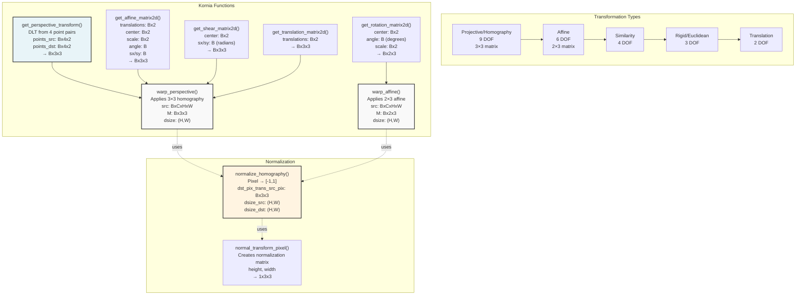
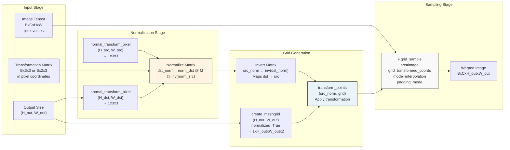

<!-- source: DeepWiki mcp.deepwiki.com · repo kornia/kornia · page 3.2 Image Warping and Transformation Matrices · fetched 2026-10-21 -->

# Image Warping and Transformation Matrices

<details>
<summary>Relevant source files</summary>

The following files were used as context for generating this wiki page:

- [docs/source/geometry.conversions.rst](docs/source/geometry.conversions.rst)
- [docs/source/geometry.transform.rst](docs/source/geometry.transform.rst)
- [kornia/geometry/camera/pinhole.py](kornia/geometry/camera/pinhole.py)
- [kornia/geometry/conversions.py](kornia/geometry/conversions.py)
- [kornia/geometry/transform/affwarp.py](kornia/geometry/transform/affwarp.py)
- [kornia/geometry/transform/imgwarp.py](kornia/geometry/transform/imgwarp.py)

</details>


This document covers Kornia's image warping capabilities and transformation matrix generation. It explains how to apply geometric transformations to images using perspective and affine warping, generate transformation matrices from geometric parameters, and work with coordinate grids. For rotation representations and conversions between quaternions/axis-angle/rotation matrices, see [3.1](#3.1). For camera projection models, see [3.3](#3.3). For pixel coordinate normalization utilities, see [3.4](#3.4). For high-level transformation modules like `Rotate`, `Translate`, and `Scale`, see [3.5](#3.5).

## Overview

Image warping applies geometric transformations to images by mapping pixel coordinates from a destination image to a source image. Kornia implements differentiable warping operations using PyTorch's `grid_sample` function, supporting both 2D and 3D transformations. The library provides two main warping paradigms:

1. **Matrix-based warping**: Apply pre-computed transformation matrices (`warp_perspective`, `warp_affine`)
2. **Direct coordinate mapping**: Specify explicit pixel mappings (`remap`)

All warping operations are fully differentiable, enabling gradient flow through geometric transformations for end-to-end training.

**Sources**: [kornia/geometry/transform/imgwarp.py:1-150]()

## Transformation Hierarchy



**Sources**: [kornia/geometry/transform/imgwarp.py:41-62](), [docs/source/geometry.transform.rst:46-59]()

## Core Warping Functions

### warp_perspective

Applies a perspective (homography) transformation to an image using a 3×3 transformation matrix. The function transforms destination coordinates to source coordinates using the inverse of the provided matrix:

$$\text{dst}(x, y) = \text{src}\left(\frac{M^{-1}_{11} x + M^{-1}_{12} y + M^{-1}_{13}}{M^{-1}_{31} x + M^{-1}_{32} y + M^{-1}_{33}}, \frac{M^{-1}_{21} x + M^{-1}_{22} y + M^{-1}_{23}}{M^{-1}_{31} x + M^{-1}_{32} y + M^{-1}_{33}}\right)$$

**Function signature**: `warp_perspective(src, M, dsize, mode='bilinear', padding_mode='zeros', align_corners=True, fill_value=None)`

**Parameters**:
- `src`: Input image tensor, shape `(B, C, H, W)`
- `M`: Transformation matrix, shape `(B, 3, 3)` in pixel coordinates
- `dsize`: Output size `(height, width)`
- `mode`: Interpolation mode (`'bilinear'` | `'nearest'`)
- `padding_mode`: Padding for out-of-bounds values (`'zeros'` | `'border'` | `'reflection'` | `'fill'`)
- `align_corners`: Whether to align corner pixels
- `fill_value`: Fill color for `padding_mode='fill'`, shape `(3,)` for RGB

**Implementation details**:
1. Normalizes the homography matrix from pixel to normalized [-1, 1] coordinates using `normalize_homography`
2. Inverts the normalized matrix to map destination → source
3. Creates a meshgrid of destination coordinates
4. Applies the transformation using `transform_points`
5. Samples from the source image using `F.grid_sample`

**Sources**: [kornia/geometry/transform/imgwarp.py:65-149]()

### warp_affine

Applies an affine transformation using a 2×3 matrix. Affine transformations preserve parallel lines and include rotation, scaling, translation, and shearing:

$$\text{dst}(x, y) = \text{src}(M_{11} x + M_{12} y + M_{13}, M_{21} x + M_{22} y + M_{23})$$

**Function signature**: `warp_affine(src, M, dsize, mode='bilinear', padding_mode='zeros', align_corners=True, fill_value=None)`

**Parameters**: Similar to `warp_perspective`, but `M` has shape `(B, 2, 3)`

**Implementation details**:
1. Converts the 2×3 affine matrix to a 3×3 homography using `convert_affinematrix_to_homography`
2. Normalizes and inverts as in `warp_perspective`
3. Uses `F.affine_grid` for grid generation (more efficient than full homography grid)

**Sources**: [kornia/geometry/transform/imgwarp.py:151-225]()

### warp_grid and warp_grid3d

Low-level functions that transform coordinate grids by homography matrices without sampling from images. Useful for computing optical flow or understanding the geometric transformation.

**Function signature**: `warp_grid(grid, src_homo_dst)`

**Parameters**:
- `grid`: Coordinate grid, shape `(1, H, W, 2)` 
- `src_homo_dst`: Homography from destination to source, shape `(N, 3, 3)` or `(N, 1, 3, 3)`

**Returns**: Transformed grid, shape `(N, H, W, 2)`

The function broadcasts the grid across the batch dimension and applies `transform_points` to compute the warped coordinates.

**Sources**: [kornia/geometry/transform/imgwarp.py:255-303]()

### remap

Applies arbitrary geometric transformations using explicit coordinate mappings. Unlike matrix-based warping, `remap` directly specifies the source coordinates for each destination pixel.

**Function signature**: `remap(image, map_x, map_y, mode='bilinear', padding_mode='zeros', align_corners=None, normalized_coordinates=False)`

**Parameters**:
- `image`: Input image, shape `(B, C, H, W)`
- `map_x`: Source x-coordinates for each destination pixel, shape `(B, H, W)`
- `map_y`: Source y-coordinates for each destination pixel, shape `(B, H, W)`
- `normalized_coordinates`: Whether input coordinates are in [-1, 1] (default: False, assumes pixel coordinates)

**Implementation**: Stacks `map_x` and `map_y` into a grid, normalizes to [-1, 1] if needed using `normalize_pixel_coordinates`, then calls `F.grid_sample`.

**Sources**: [kornia/geometry/transform/imgwarp.py:489-557]()

## The Warping Pipeline



This diagram shows the complete warping pipeline used by `warp_perspective` and `warp_affine`. The key insight is that transformation matrices in pixel coordinates must be normalized to [-1, 1] coordinates before applying them, since PyTorch's `grid_sample` expects normalized coordinates.

**Sources**: [kornia/geometry/transform/imgwarp.py:65-149](), [kornia/geometry/conversions.py:1042-1108]()

## Transformation Matrix Generation

### get_perspective_transform

Computes a perspective transformation matrix from four pairs of corresponding points using the Direct Linear Transform (DLT) algorithm. This solves the system:

$$\begin{bmatrix} x' \\ y' \\ 1 \end{bmatrix} = \begin{bmatrix} h_1 & h_2 & h_3 \\ h_4 & h_5 & h_6 \\ h_7 & h_8 & h_9 \end{bmatrix} \cdot \begin{bmatrix} x \\ y \\ 1 \end{bmatrix}$$

**Function signature**: `get_perspective_transform(points_src, points_dst)`

**Parameters**:
- `points_src`: Source quadrangle vertices, shape `(B, 4, 2)`
- `points_dst`: Destination quadrangle vertices, shape `(B, 4, 2)`

**Returns**: Perspective matrix, shape `(B, 3, 3)`

**Algorithm**:
1. Constructs an 8×8 system matrix `A` from the point correspondences
2. Constructs the right-hand side vector `b` from destination points
3. Solves `Ax = b` using `torch.linalg.solve` 
4. Assembles the 3×3 matrix from the solution vector

**Sources**: [kornia/geometry/transform/imgwarp.py:312-395]()

### get_rotation_matrix2d

Creates a 2×3 affine matrix for 2D rotation around a center point with optional scaling:

$$\begin{bmatrix} \alpha & \beta & (1 - \alpha) \cdot c_x - \beta \cdot c_y \\ -\beta & \alpha & \beta \cdot c_x + (1 - \alpha) \cdot c_y \end{bmatrix}$$

where $\alpha = s_x \cdot \cos(\theta)$ and $\beta = s_y \cdot \sin(\theta)$.

**Function signature**: `get_rotation_matrix2d(center, angle, scale)`

**Parameters**:
- `center`: Rotation center, shape `(B, 2)` with `(cx, cy)`
- `angle`: Rotation angle in degrees (counter-clockwise), shape `(B,)`
- `scale`: Scale factors, shape `(B, 2)` with `(sx, sy)`

**Implementation**:
1. Creates shift matrices to move center to origin and back
2. Creates scale matrix from scale factors
3. Creates rotation matrix from angle using `angle_to_rotation_matrix`
4. Composes: `shift @ rotation @ scale @ shift_inv`

**Sources**: [kornia/geometry/transform/imgwarp.py:398-487]()

### get_affine_matrix2d

Composes a full 3×3 affine transformation matrix from translation, rotation, scaling, and optional shearing components.

**Function signature**: `get_affine_matrix2d(translations, center, scale, angle, sx=None, sy=None)`

**Parameters**:
- `translations`: Translation vector, shape `(B, 2)` with `(tx, ty)`
- `center`: Transformation center, shape `(B, 2)`
- `scale`: Scale factors, shape `(B, 2)`
- `angle`: Rotation angle in degrees, shape `(B,)`
- `sx`, `sy`: Shear factors in x and y directions, shape `(B,)` (optional)

**Composition order**:
1. Calls `get_rotation_matrix2d` with `-angle` to get rotation+scale matrix
2. Adds translation to the result
3. Converts to 3×3 homography
4. If shear is specified, composes with `get_shear_matrix2d`

**Sources**: [kornia/geometry/transform/imgwarp.py:596-632]()

### get_shear_matrix2d

Generates a 3×3 shear transformation matrix. Shearing is ordered: x-axis first, then y-axis.

$$\begin{bmatrix} 1 & \tan(s_x) & -\tan(s_x) \cdot c_y \\ \tan(s_y) & 1 + \tan(s_x)\tan(s_y) & \tan(s_y) \cdot (c_x - \tan(s_x) \cdot c_y) \\ 0 & 0 & 1 \end{bmatrix}$$

**Function signature**: `get_shear_matrix2d(center, sx=None, sy=None)`

**Parameters**:
- `center`: Shear center, shape `(B, 2)`
- `sx`: Shear angle along x-axis in radians, shape `(B,)`
- `sy`: Shear angle along y-axis in radians, shape `(B,)`

**Sources**: [kornia/geometry/transform/imgwarp.py:656-705]()

### Matrix Utility Functions

| Function | Purpose | Input | Output |
|----------|---------|-------|--------|
| `invert_affine_transform` | Inverts a 2×3 affine matrix | `(B, 2, 3)` | `(B, 2, 3)` |
| `convert_affinematrix_to_homography` | Converts 2×3 affine to 3×3 homography | `(B, 2, 3)` | `(B, 3, 3)` |
| `get_translation_matrix2d` | Creates translation-only matrix | `(B, 2)` | `(B, 3, 3)` |

**Sources**: [kornia/geometry/transform/imgwarp.py:559-654](), [kornia/geometry/conversions.py:236-290]()

## Coordinate Normalization

All warping functions internally normalize transformation matrices from pixel coordinates to normalized [-1, 1] coordinates. This is required because PyTorch's `grid_sample` expects normalized coordinates.

### normalize_homography

Normalizes a homography matrix from pixel space to [-1, 1] normalized space:

$$H_{norm} = T_{dst}^{norm \to pix} \cdot H_{pix} \cdot (T_{src}^{norm \to pix})^{-1}$$

**Function signature**: `normalize_homography(dst_pix_trans_src_pix, dsize_src, dsize_dst)`

**Parameters**:
- `dst_pix_trans_src_pix`: Homography in pixel coordinates, shape `(B, 3, 3)`
- `dsize_src`: Source image size `(height, width)`
- `dsize_dst`: Destination image size `(height, width)`

**Returns**: Normalized homography, shape `(B, 3, 3)`

**Sources**: [kornia/geometry/conversions.py:1042-1076]()

### normal_transform_pixel

Creates a normalization matrix that maps pixel coordinates [0, W-1] × [0, H-1] to normalized coordinates [-1, 1] × [-1, 1]:

$$T = \begin{bmatrix} \frac{2}{W-1} & 0 & -1 \\ 0 & \frac{2}{H-1} & -1 \\ 0 & 0 & 1 \end{bmatrix}$$

**Function signature**: `normal_transform_pixel(height, width, eps=1e-14, device=None, dtype=None)`

**Returns**: Normalization matrix, shape `(1, 3, 3)`

**Sources**: [kornia/geometry/conversions.py:1078-1108]()

## 3D Warping Operations

Kornia extends 2D warping to volumetric 3D data (shape `B×C×D×H×W`).

### warp_perspective3d

Applies a 4×4 homography transformation to 3D volumes.

**Function signature**: `warp_perspective3d(src, M, dsize, mode='bilinear', padding_mode='zeros', align_corners=True)`

**Parameters**:
- `src`: Input volume, shape `(B, C, D, H, W)`
- `M`: 4×4 transformation matrix, shape `(B, 4, 4)`
- `dsize`: Output size `(depth, height, width)`

**Sources**: [kornia/geometry/transform/imgwarp.py:1066-1148]()

### warp_affine3d

Applies a 3×4 affine transformation to 3D volumes.

**Function signature**: `warp_affine3d(src, M, dsize, mode='bilinear', padding_mode='zeros', align_corners=False)`

**Parameters**: 
- `M`: 3×4 affine matrix, shape `(B, 3, 4)`

**Sources**: [kornia/geometry/transform/imgwarp.py:1151-1217]()

### get_affine_matrix3d

Composes a 3D affine transformation from translations, rotations (as axis-angle), scaling, and optional 6-DOF shearing.

**Function signature**: `get_affine_matrix3d(translations, center, scale, angles, sxy=None, sxz=None, syx=None, syz=None, szx=None, szy=None)`

**Parameters**:
- `translations`: Translation vector `(dx, dy, dz)`, shape `(B, 3)`
- `center`: Transformation center `(x, y, z)`, shape `(B, 3)`
- `scale`: Scale factor, shape `(B,)` (isotropic) or `(B, 3)`
- `angles`: Rotation as axis-angle `(rx, ry, rz)` in degrees, shape `(B, 3)`
- Shear parameters for 6 degrees of freedom (optional)

**Returns**: 4×4 transformation matrix, shape `(B, 4, 4)`

**Sources**: [kornia/geometry/transform/imgwarp.py:707-752]()

## Module Wrappers

```mermaid
graph TB
    subgraph "High-Level Modules in affwarp.py"
        AFFINE_MOD["Affine<br/>Composes rotation, translation,<br/>scale, shear"]
        ROTATE_MOD["Rotate<br/>Wraps rotate() function"]
        TRANSLATE_MOD["Translate<br/>Wraps translate() function"]
        SCALE_MOD["Scale<br/>Wraps scale() function"]
        SHEAR_MOD["Shear<br/>Wraps shear() function"]
        RESIZE_MOD["Resize<br/>Interpolation-based resizing"]
        RESCALE_MOD["Rescale<br/>Scale by factor"]
    end
    
    subgraph "Underlying Functions"
        AFFINE_FUNC["affine()<br/>Generic affine transform<br/>Calls warp_affine"]
        ROTATE_FUNC["rotate()<br/>Computes rotation matrix<br/>Calls affine()"]
        TRANSLATE_FUNC["translate()<br/>Computes translation matrix<br/>Calls affine()"]
        SCALE_FUNC["scale()<br/>Computes scaling matrix<br/>Calls affine()"]
        SHEAR_FUNC["shear()<br/>Computes shear matrix<br/>Calls affine()"]
        RESIZE_FUNC["resize()<br/>F.interpolate + optional<br/>Gaussian anti-aliasing"]
    end
    
    subgraph "Matrix Computation"
        COMP_ROT["_compute_rotation_matrix<br/>get_rotation_matrix2d"]
        COMP_TRANS["_compute_translation_matrix<br/>eye(3) + translation"]
        COMP_SCALE["_compute_scaling_matrix<br/>get_rotation_matrix2d<br/>with angle=0"]
        COMP_SHEAR["_compute_shear_matrix<br/>eye(3) + shear"]
        COMP_CENTER["_compute_tensor_center<br/>(W-1)/2, (H-1)/2"]
    end
    
    AFFINE_MOD --> AFFINE_FUNC
    ROTATE_MOD --> ROTATE_FUNC
    TRANSLATE_MOD --> TRANSLATE_FUNC
    SCALE_MOD --> SCALE_FUNC
    SHEAR_MOD --> SHEAR_FUNC
    RESIZE_MOD --> RESIZE_FUNC
    RESCALE_MOD --> RESIZE_FUNC
    
    ROTATE_FUNC --> AFFINE_FUNC
    TRANSLATE_FUNC --> AFFINE_FUNC
    SCALE_FUNC --> AFFINE_FUNC
    SHEAR_FUNC --> AFFINE_FUNC
    
    ROTATE_FUNC --> COMP_ROT
    ROTATE_FUNC --> COMP_CENTER
    TRANSLATE_FUNC --> COMP_TRANS
    SCALE_FUNC --> COMP_SCALE
    SCALE_FUNC --> COMP_CENTER
    SHEAR_FUNC --> COMP_SHEAR
    
    AFFINE_FUNC --> WARP_AFF_CALL["warp_affine<br/>from imgwarp.py"]
    
    style AFFINE_MOD fill:#f9f9f9,stroke:#333,stroke-width:2px
    style AFFINE_FUNC fill:#e8f4f8,stroke:#333,stroke-width:2px
    style COMP_CENTER fill:#fff4e1,stroke:#333,stroke-width:2px
```



The `kornia.geometry.transform.affwarp` module provides high-level wrappers that automatically handle:
- Computing transformation centers from image dimensions
- Broadcasting matrices across batches
- Maintaining original image shape (output size = input size)

**Sources**: [kornia/geometry/transform/affwarp.py:32-50](), [kornia/geometry/transform/affwarp.py:137-242]()

## Implementation Details

### Grid Sampling and Interpolation

All warping operations use `torch.nn.functional.grid_sample` for the actual resampling. The grid must contain normalized coordinates in [-1, 1] where:
- (-1, -1) maps to the top-left corner (0, 0)
- (1, 1) maps to the bottom-right corner (W-1, H-1)

Supported interpolation modes:
- `'bilinear'`: Bilinear interpolation (default)
- `'nearest'`: Nearest-neighbor interpolation

Supported padding modes:
- `'zeros'`: Out-of-bounds pixels are zero
- `'border'`: Out-of-bounds pixels use border values
- `'reflection'`: Out-of-bounds pixels use reflected values
- `'fill'`: Out-of-bounds pixels use a specified fill color

**Sources**: [kornia/geometry/transform/imgwarp.py:65-149]()

### Fill Padding Mode

The `'fill'` padding mode requires special handling since `grid_sample` doesn't directly support it:

1. Create a mask of all ones with the same shape as the input
2. Warp the mask with `padding_mode='zeros'`
3. Invert the mask to identify out-of-bounds regions
4. Multiply by the fill color
5. Add to the regularly-warped image

This is implemented in the `_fill_and_warp` helper function.

**Sources**: [kornia/geometry/transform/imgwarp.py:227-253]()

### Matrix Inversion and Solving

Kornia uses custom wrappers for matrix operations to handle numerical stability and dtype casting:

- `_torch_inverse_cast`: Inverts matrices, casting to float32 if needed for stability
- `_torch_solve_cast`: Solves linear systems, with dtype casting

These are defined in `kornia.utils.helpers` and ensure robustness across different precision levels.

**Sources**: [kornia/geometry/transform/imgwarp.py:39](), [kornia/utils/helpers.py]()

### Batch Broadcasting

Many functions support flexible batching:
- If the image has batch size B=1 but the matrix has batch size N>1, the image is broadcasted to match
- If the matrix has batch size 1 but images have batch size B>1, the matrix is broadcasted

This enables efficient processing of multiple transformations on a single image or a single transformation on multiple images.

**Sources**: [kornia/geometry/transform/affwarp.py:169-177]()

## Common Usage Patterns

### Perspective Warping from Point Correspondences

```python
# Define source and destination quadrangles
points_src = torch.tensor([[[0., 0.], [100., 0.], [100., 100.], [0., 100.]]])
points_dst = torch.tensor([[[10., 10.], [90., 5.], [95., 95.], [5., 90.]]])

# Compute transformation
M = get_perspective_transform(points_src, points_dst)  # (1, 3, 3)

# Apply to image
warped = warp_perspective(image, M, (height, width))
```

### Composed Affine Transformation

```python
# Compose rotation + scaling + shearing around image center
center = torch.tensor([[width/2, height/2]])
angle = torch.tensor([45.0])  # degrees
scale = torch.tensor([[1.2, 1.2]])
translations = torch.tensor([[10., 20.]])
sx = torch.tensor([0.1])  # shear in radians

M = get_affine_matrix2d(translations, center, scale, angle, sx=sx)
warped = warp_perspective(image, M, (height, width))
```

### Inverting Transformations

```python
# Get forward affine transform
M_forward = get_rotation_matrix2d(center, angle, scale)  # (B, 2, 3)

# Invert it
M_inverse = invert_affine_transform(M_forward)  # (B, 2, 3)

# Apply inverse transform
restored = warp_affine(warped_image, M_inverse, original_size)
```

**Sources**: [kornia/geometry/transform/imgwarp.py:312-395](), [kornia/geometry/transform/imgwarp.py:596-632](), [kornia/geometry/transform/imgwarp.py:559-594]()

---

