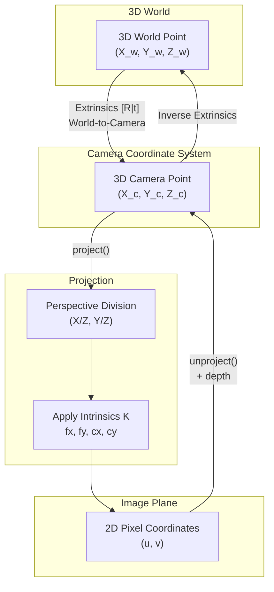
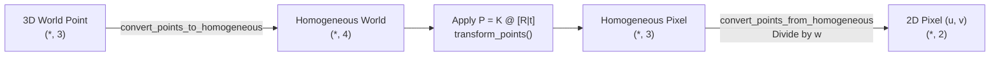
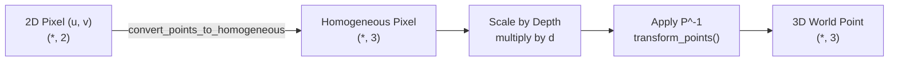
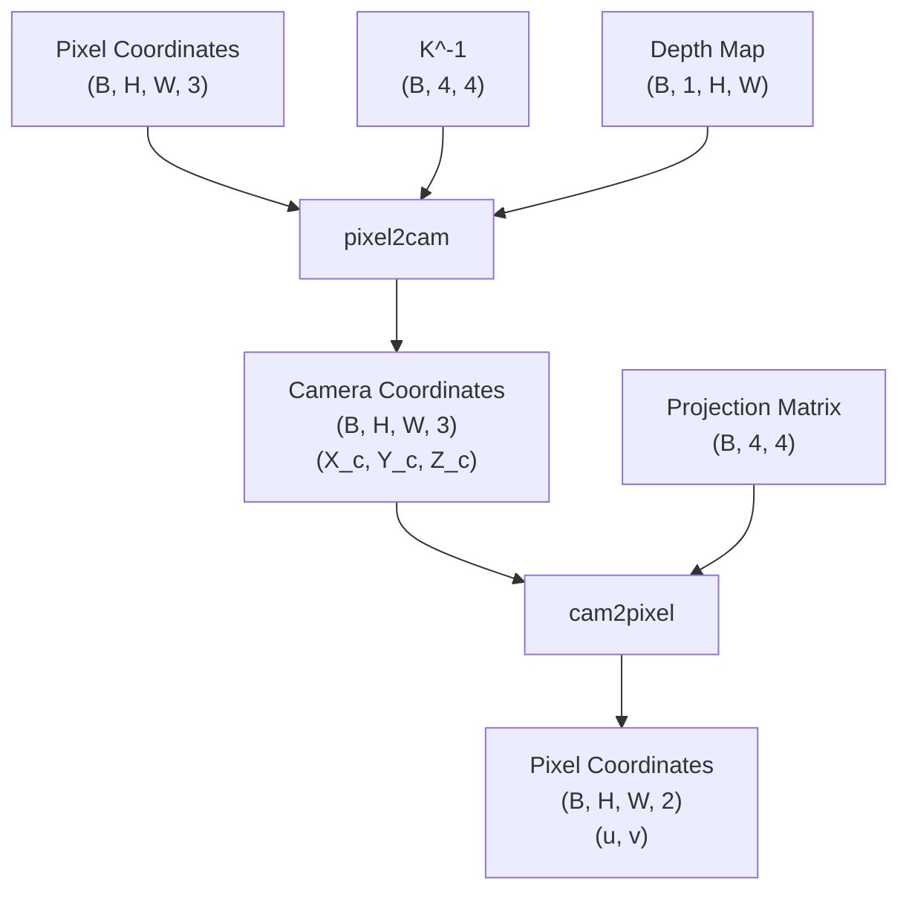
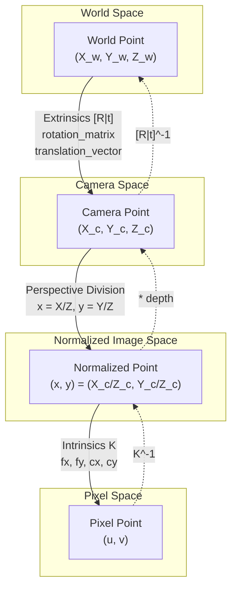
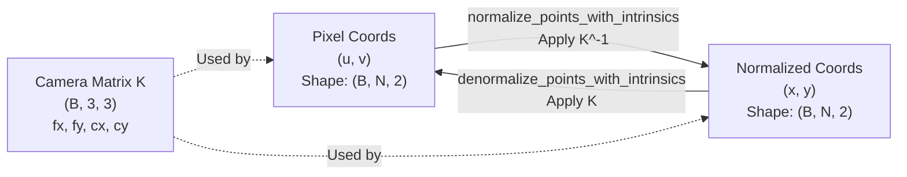
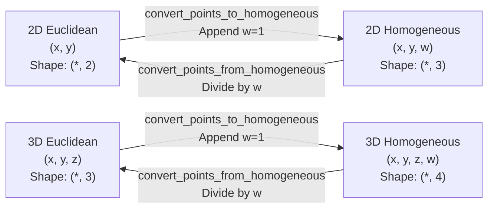
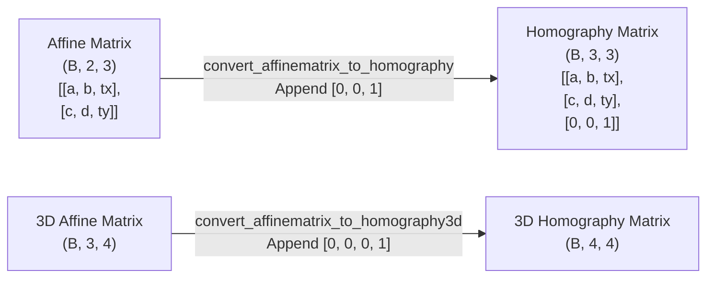

<!-- source: DeepWiki mcp.deepwiki.com · repo kornia/kornia · page 3.3 Camera Models and Projection · fetched 2026-10-21 -->

# Camera Models and Projection

<details>
<summary>Relevant source files</summary>

The following files were used as context for generating this wiki page:

- [docs/source/geometry.conversions.rst](docs/source/geometry.conversions.rst)
- [docs/source/geometry.transform.rst](docs/source/geometry.transform.rst)
- [kornia/geometry/camera/pinhole.py](kornia/geometry/camera/pinhole.py)
- [kornia/geometry/conversions.py](kornia/geometry/conversions.py)
- [kornia/geometry/transform/affwarp.py](kornia/geometry/transform/affwarp.py)
- [kornia/geometry/transform/imgwarp.py](kornia/geometry/transform/imgwarp.py)

</details>


## Purpose and Scope

This page documents Kornia's camera model implementation and projection operations, including:
- Pinhole camera model representation and parameters
- 3D-to-2D projection (world/camera coordinates to image pixels)
- 2D-to-3D unprojection (image pixels to world/camera coordinates with depth)
- Camera intrinsic and extrinsic matrices
- Coordinate transformations between camera, world, and pixel spaces
- Helper functions for camera coordinate conversions

For homography transformations and perspective warping, see [Image Warping and Transformation Matrices](#3.2). For rotation representations (rotation matrices, quaternions, axis-angle), see [Geometric Representations and Conversions](#3.1).

## Overview

The pinhole camera model is the fundamental mathematical abstraction for cameras in computer vision. It describes how 3D points in the world are projected onto a 2D image plane through perspective projection. Kornia provides the `PinholeCamera` class to encapsulate this model along with functions for projecting 3D points to image coordinates and unprojecting 2D pixels back to 3D space.

**Diagram: Pinhole Camera Model Overview**



Sources: [kornia/geometry/camera/pinhole.py:29-414]()

## Pinhole Camera Model

### Mathematical Representation

The pinhole camera model describes the perspective projection from 3D world coordinates to 2D image coordinates using two transformation matrices:

**Extrinsic Matrix [R|t]**: Transforms from world coordinates to camera coordinates

```
[X_c]   [R11 R12 R13 | tx]   [X_w]
[Y_c] = [R21 R22 R23 | ty] * [Y_w]
[Z_c]   [R31 R32 R33 | tz]   [Z_w]
[1  ]   [ 0   0   0  |  1]   [1  ]
```

**Intrinsic Matrix K**: Projects from camera coordinates to pixel coordinates

```
[u]   [fx  0  cx  0]   [X_c]
[v] = [ 0 fy  cy  0] * [Y_c]
[1]   [ 0  0   1  0]   [Z_c]
[0]   [ 0  0   0  1]   [1  ]
```

After projection, the homogeneous coordinates are normalized: `u' = u/w`, `v' = v/w`

**Combined Projection**: P = K @ [R|t]

```
pixel_coords = K @ [R|t] @ world_coords
```

Sources: [kornia/geometry/camera/pinhole.py:319-342]()

### PinholeCamera Class

**Diagram: PinholeCamera Class Structure**

```mermaid
graph TB
    subgraph "PinholeCamera Attributes"
        Intrinsics["intrinsics<br/>Property (B, 4, 4)<br/>Full calibration matrix"]
        Extrinsics["extrinsics<br/>Property (B, 4, 4)<br/>Full pose matrix"]
        Height["height<br/>Tensor (B)<br/>Image height"]
        Width["width<br/>Tensor (B)<br/>Image width"]
    end
    
    subgraph "Intrinsic Parameters"
        FX["fx<br/>Property (B)<br/>Focal length X"]
        FY["fy<br/>Property (B)<br/>Focal length Y"]
        CX["cx<br/>Property (B)<br/>Principal point X"]
        CY["cy<br/>Property (B)<br/>Principal point Y"]
    end
    
    subgraph "Extrinsic Parameters"
        TX["tx<br/>Property (B)<br/>Translation X"]
        TY["ty<br/>Property (B)<br/>Translation Y"]
        TZ["tz<br/>Property (B)<br/>Translation Z"]
        RotMat["rotation_matrix<br/>Property (B, 3, 3)"]
        TransVec["translation_vector<br/>Property (B, 3, 1)"]
    end
    
    subgraph "Core Methods"
        Project["project(point_3d)<br/>3D → 2D"]
        Unproject["unproject(point_2d, depth)<br/>2D → 3D"]
        Scale["scale(scale_factor)<br/>Resize camera"]
        Clone["clone()<br/>Deep copy"]
    end
    
    Intrinsics --> FX
    Intrinsics --> FY
    Intrinsics --> CX
    Intrinsics --> CY
    
    Extrinsics --> TX
    Extrinsics --> TY
    Extrinsics --> TZ
    Extrinsics --> RotMat
    Extrinsics --> TransVec
    
    PinholeCamera["PinholeCamera<br/>Main Class"] --> Intrinsics
    PinholeCamera --> Extrinsics
    PinholeCamera --> Height
    PinholeCamera --> Width
    PinholeCamera --> Project
    PinholeCamera --> Unproject
    PinholeCamera --> Scale
    PinholeCamera --> Clone
```



Sources: [kornia/geometry/camera/pinhole.py:29-296]()

The `PinholeCamera` class encapsulates all camera parameters and provides methods for projection operations:

```python
class PinholeCamera:
    def __init__(
        self,
        intrinsics: Tensor,    # (B, 4, 4) - calibration matrix
        extrinsics: Tensor,    # (B, 4, 4) - pose matrix
        height: Tensor,        # (B,) - image height
        width: Tensor          # (B,) - image width
    ) -> None:
```

**Key Properties:**

| Property | Shape | Description |
|----------|-------|-------------|
| `intrinsics` | `(B, 4, 4)` | Full 4×4 camera calibration matrix |
| `extrinsics` | `(B, 4, 4)` | Full 4×4 rotation-translation matrix |
| `camera_matrix` | `(B, 3, 3)` | Upper-left 3×3 of intrinsics |
| `rt_matrix` | `(B, 3, 4)` | Upper 3×4 of extrinsics [R\|t] |
| `rotation_matrix` | `(B, 3, 3)` | 3×3 rotation from extrinsics |
| `translation_vector` | `(B, 3, 1)` | 3×1 translation from extrinsics |
| `fx`, `fy` | `(B,)` | Focal lengths in x and y directions |
| `cx`, `cy` | `(B,)` | Principal point coordinates |
| `tx`, `ty`, `tz` | `(B,)` | Translation vector components |

Sources: [kornia/geometry/camera/pinhole.py:95-255]()

## 3D-to-2D Projection

### project() Method

The `project` method transforms 3D points in world coordinates to 2D pixel coordinates using the camera's projection matrix `P = K @ [R|t]`:

**Diagram: Projection Pipeline**



Sources: [kornia/geometry/camera/pinhole.py:319-342]()

**Method Signature:**

```python
def project(self, point_3d: Tensor) -> Tensor:
    """Project 3d point in world coordinates onto 2d camera plane.
    
    Args:
        point_3d: 3D points with shape (*, 3)
    
    Returns:
        (u, v) pixel coordinates with shape (*, 2)
    """
```

**Implementation Steps:**

1. Convert 3D points to homogeneous coordinates (append w=1)
2. Compute projection matrix: `P = self.intrinsics @ self.extrinsics`
3. Apply projection: `point_proj = P @ point_3d_homogeneous`
4. Convert from homogeneous to Euclidean coordinates (divide by w)

**Example:**

```python
import torch
from kornia.geometry.camera import PinholeCamera

# Create camera
K = torch.eye(4)[None]  # Identity intrinsics
E = torch.eye(4)[None]  # Identity extrinsics
h = torch.ones(1)
w = torch.ones(1)
camera = PinholeCamera(K, E, h, w)

# Project 3D point
point_3d = torch.tensor([[1.0, 2.0, 3.0]])
pixel = camera.project(point_3d)  # Returns (u, v) coordinates
```

Sources: [kornia/geometry/camera/pinhole.py:319-342]()

## 2D-to-3D Unprojection

### unproject() Method

The `unproject` method transforms 2D pixel coordinates back to 3D world coordinates given depth information. This is the inverse operation of projection.

**Diagram: Unprojection Pipeline**



Sources: [kornia/geometry/camera/pinhole.py:344-376]()

**Method Signature:**

```python
def unproject(self, point_2d: Tensor, depth: Tensor) -> Tensor:
    """Unproject 2D point to 3D.
    
    Transform coordinates in pixel frame to world frame.
    
    Args:
        point_2d: 2D points to project with shape (*, 2)
        depth: depth value for each 2D point with shape (*, 1)
    
    Returns:
        (x, y, z) world coordinates with shape (*, 3)
    """
```

**Implementation Steps:**

1. Compute projection matrix: `P = self.intrinsics @ self.extrinsics`
2. Invert projection matrix: `P_inv = inverse(P)`
3. Convert 2D points to homogeneous coordinates: append w=1
4. Scale by depth: multiply homogeneous coordinates by depth value
5. Apply inverse projection: `point_3d = P_inv @ (point_2d_homogeneous * depth)`

**Example:**

```python
import torch
from kornia.geometry.camera import PinholeCamera

# Create camera
K = torch.eye(4)[None]
E = torch.eye(4)[None]
h = torch.ones(1)
w = torch.ones(1)
camera = PinholeCamera(K, E, h, w)

# Unproject pixel with known depth
pixel = torch.tensor([[100.0, 150.0]])
depth = torch.ones(1, 1) * 5.0  # 5 meters
point_3d = camera.unproject(pixel, depth)  # Returns (X, Y, Z)
```

Sources: [kornia/geometry/camera/pinhole.py:344-376]()

### pixel2cam and cam2pixel Functions

These helper functions provide lower-level coordinate transformations between pixel and camera coordinate systems.

**pixel2cam**: Transform from pixel frame to camera frame

```python
def pixel2cam(
    depth: Tensor,            # Source depth maps (B, 1, H, W)
    intrinsics_inv: Tensor,   # Inverse intrinsics K^-1 (B, 4, 4)
    pixel_coords: Tensor      # Pixel grid with (u, v, 1) (B, H, W, 3)
) -> Tensor:                  # Camera coordinates (B, H, W, 3)
```

**cam2pixel**: Transform from camera frame to pixel frame

```python
def cam2pixel(
    cam_coords_src: Tensor,   # Camera coordinates (B, H, W, 3)
    dst_proj_src: Tensor,     # Projection matrix (B, 4, 4)
    eps: float = 1e-12        # Small value for division safety
) -> Tensor:                  # Pixel coordinates (B, H, W, 2)
```

**Diagram: pixel2cam and cam2pixel Flow**



Sources: [kornia/geometry/camera/pinhole.py:678-733]()

These functions are useful for:
- Dense depth map processing
- Multi-view geometry
- Novel view synthesis
- 3D reconstruction workflows

Sources: [kornia/geometry/camera/pinhole.py:678-733]()

## Camera Scaling and Manipulation

### Scaling Camera Parameters

The `scale` method adjusts camera parameters to match a resized image:

```python
def scale(self, scale_factor: Tensor) -> PinholeCamera:
    """Scale the pinhole model.
    
    Args:
        scale_factor: scale factor with shape (B,) or (1,)
    
    Returns:
        New camera with scaled parameters
    """
```

**What Gets Scaled:**

| Parameter | Scaling Behavior |
|-----------|-----------------|
| `fx`, `fy` | Multiplied by scale_factor |
| `cx`, `cy` | Multiplied by scale_factor |
| `height`, `width` | Multiplied by scale_factor |
| Extrinsics | Unchanged (world geometry) |

**Use Case:** When resizing images, the camera intrinsics must be updated to match:

```python
# Original image 640x480
camera = PinholeCamera(K, E, torch.tensor([480.]), torch.tensor([640.]))

# Resize image to 320x240 (scale = 0.5)
camera_resized = camera.scale(torch.tensor([0.5]))

# camera_resized now has updated fx, fy, cx, cy, height, width
```

Sources: [kornia/geometry/camera/pinhole.py:274-317]()

### In-Place Scaling

For memory-efficient operations, use `scale_` (in-place version):

```python
def scale_(self, scale_factor: Union[float, Tensor]) -> PinholeCamera:
    """Scale the pinhole model in-place."""
```

Sources: [kornia/geometry/camera/pinhole.py:297-317]()

## Camera Coordinate Systems

### Camera Intrinsic Matrix Structure

The full 4×4 intrinsic matrix **K** has the following structure:

```
[fx  0  cx  0]
[ 0 fy  cy  0]
[ 0  0   1  0]
[ 0  0   0  1]
```

**Intrinsic Parameters:**

| Parameter | Description |
|-----------|-------------|
| `fx`, `fy` | Focal lengths in pixel units (horizontal and vertical) |
| `cx`, `cy` | Principal point coordinates (typically image center) |

**Accessing Parameters:**

```python
camera = PinholeCamera(K, E, h, w)

# Individual parameters
focal_x = camera.fx       # (B,)
focal_y = camera.fy       # (B,)
principal_x = camera.cx   # (B,)
principal_y = camera.cy   # (B,)

# Matrix forms
K_3x3 = camera.camera_matrix       # (B, 3, 3) - upper-left 3x3
K_4x4 = camera.intrinsics          # (B, 4, 4) - full matrix
K_inv = camera.intrinsics_inverse() # (B, 4, 4) - inverse
```

Sources: [kornia/geometry/camera/pinhole.py:95-272]()

### Camera Extrinsic Matrix Structure

The full 4×4 extrinsic matrix contains rotation and translation:

```
[R11 R12 R13 tx]
[R21 R22 R23 ty]
[R31 R32 R33 tz]
[ 0   0   0   1]
```

**Accessing Extrinsic Components:**

```python
camera = PinholeCamera(K, E, h, w)

# Translation components
trans_x = camera.tx  # (B,)
trans_y = camera.ty  # (B,)
trans_z = camera.tz  # (B,)

# Matrix forms
R = camera.rotation_matrix      # (B, 3, 3) - rotation only
t = camera.translation_vector   # (B, 3, 1) - translation only
Rt = camera.rt_matrix          # (B, 3, 4) - [R|t] combined
E_full = camera.extrinsics     # (B, 4, 4) - full 4x4
```

Sources: [kornia/geometry/camera/pinhole.py:170-255]()

**Diagram: Coordinate System Transformations**



Sources: [kornia/geometry/camera/pinhole.py:29-376]()

## Coordinate Normalization with Intrinsics

### normalize_points_with_intrinsics

Converts pixel coordinates to normalized image coordinates (metric coordinates) using the inverse of the camera intrinsic matrix:

```python
def normalize_points_with_intrinsics(
    point_2d: Tensor,      # Pixel coordinates (B, N, 2)
    camera_matrix: Tensor  # Intrinsic matrix K (B, 3, 3)
) -> Tensor:               # Normalized coordinates (B, N, 2)
```

**Mathematical Operation:**

```
[x]       [u]
[y] = K^-1 [v]
[1]       [1]
```

The normalized coordinates `(x, y)` represent the direction of the ray from the camera center through the pixel, with focal length factored out.

**Example:**

```python
from kornia.geometry.conversions import normalize_points_with_intrinsics

# Camera intrinsics
K = torch.tensor([[[500., 0., 320.],
                   [0., 500., 240.],
                   [0., 0., 1.]]])

# Pixel coordinates
pixels = torch.tensor([[[320., 240.], [400., 300.]]])  # (1, 2, 2)

# Normalize to metric coordinates
normalized = normalize_points_with_intrinsics(pixels, K)
# Result: [[0.0, 0.0], [0.16, 0.12]] - ray directions
```

Sources: [kornia/geometry/conversions.py:1166-1210]()

### denormalize_points_with_intrinsics

Inverse operation that converts normalized coordinates back to pixel coordinates by applying the intrinsic matrix:

```python
def denormalize_points_with_intrinsics(
    point_2d: Tensor,      # Normalized coordinates (B, N, 2)
    camera_matrix: Tensor  # Intrinsic matrix K (B, 3, 3)
) -> Tensor:               # Pixel coordinates (B, N, 2)
```

**Use Case:** After computing 3D points in camera coordinates and projecting to normalized image coordinates, use this function to convert to actual pixel locations.

Sources: [kornia/geometry/conversions.py:1212-1244]()

**Diagram: Intrinsics-Based Coordinate Pipeline**



Sources: [kornia/geometry/conversions.py:1166-1244]()

## Pixel Coordinate Normalization (Grid-Sample Compatible)

For operations that work with PyTorch's `grid_sample` (which expects `[-1, 1]` normalized coordinates), use these functions:

| Function | Input | Output | Description |
|----------|-------|--------|-------------|
| `normalize_pixel_coordinates` | `(*, 2)` | `(*, 2)` | Map `[0, W-1] × [0, H-1]` to `[-1, 1]²` |
| `denormalize_pixel_coordinates` | `(*, 2)` | `(*, 2)` | Map `[-1, 1]²` to `[0, W-1] × [0, H-1]` |
| `normalize_pixel_coordinates3d` | `(*, 3)` | `(*, 3)` | 3D version for volumetric data |
| `denormalize_pixel_coordinates3d` | `(*, 3)` | `(*, 3)` | 3D inverse normalization |

**Normalization Formula:**

```
normalized = 2 * pixel / (size - 1) - 1
```

**Note:** These functions are different from `normalize_points_with_intrinsics`:
- `normalize_pixel_coordinates`: Maps to `[-1, 1]` for grid sampling (no camera model)
- `normalize_points_with_intrinsics`: Maps to metric coordinates using camera intrinsics K

Sources: [kornia/geometry/conversions.py:896-1020]()

## Homogeneous Coordinates

### Coordinate Representation

Homogeneous coordinates add an extra dimension to represent points in projective geometry, enabling affine and projective transformations to be represented as matrix multiplications.

**Diagram: Homogeneous Coordinate Conversion**



Sources: [kornia/geometry/conversions.py:173-228]()

### Conversion Functions

#### `convert_points_to_homogeneous`

Converts Euclidean coordinates to homogeneous coordinates by appending a homogeneous coordinate (typically `w = 1`):

```python
def convert_points_to_homogeneous(points: Tensor) -> Tensor:
    # Input:  (*, N, D)
    # Output: (*, N, D+1)
```

**Example:**
```python
points = torch.tensor([[0., 0.]])
homogeneous = convert_points_to_homogeneous(points)
# Result: tensor([[0., 0., 1.]])
```

Sources: [kornia/geometry/conversions.py:207-228]()

#### `convert_points_from_homogeneous`

Converts homogeneous coordinates to Euclidean coordinates by dividing by the last coordinate (w):

```python
def convert_points_from_homogeneous(
    points: Tensor,
    eps: float = 1e-8
) -> Tensor:
    # Input:  (B, N, D+1)
    # Output: (B, N, D)
```

**Numerical Stability:** The function handles division by zero/near-zero by checking if `|w| > eps`:
- If `|w| > eps`: compute `scale = 1/w` and divide
- If `|w| <= eps`: set `scale = 1` (treats as point at infinity)

Sources: [kornia/geometry/conversions.py:173-205]()

## Affine to Homography Conversion

### 2D Affine Matrix Conversion

**Diagram: Affine to Homography Conversion**



Sources: [kornia/geometry/conversions.py:230-290]()

### Conversion Functions

#### `convert_affinematrix_to_homography`

Converts a batch of 2×3 affine transformation matrices to 3×3 homography matrices by appending a row `[0, 0, 1]`:

```python
def convert_affinematrix_to_homography(A: Tensor) -> Tensor:
    # Input:  (B, 2, 3) - affine matrix
    # Output: (B, 3, 3) - homography matrix
```

Sources: [kornia/geometry/conversions.py:236-261]()

#### `convert_affinematrix_to_homography3d`

3D version that converts 3×4 affine matrices to 4×4 homography matrices:

```python
def convert_affinematrix_to_homography3d(A: Tensor) -> Tensor:
    # Input:  (B, 3, 4) - 3D affine matrix
    # Output: (B, 4, 4) - 3D homography matrix
```

Sources: [kornia/geometry/conversions.py:263-290]()

## Helper Functions and Legacy API

### Building Projection Matrices

#### projection_from_Rt

Constructs a 3×4 camera projection matrix from rotation and translation components:

```
P = [R | t]
```

```python
def projection_from_Rt(
    rmat: Tensor,  # Rotation matrix (*, 3, 3)
    tvec: Tensor   # Translation vector (*, 3, 1)
) -> Tensor:       # Projection matrix (*, 3, 4)
```

This helper function creates the [R|t] matrix from separate rotation and translation tensors, useful when constructing extrinsics.

Sources: [kornia/geometry/transform/imgwarp.py:913-935]()

### Legacy Pinhole Functions

For backward compatibility, Kornia provides legacy functions that operate on flat pinhole representations:

| Function | Input Shape | Output Shape | Description |
|----------|-------------|--------------|-------------|
| `pinhole_matrix` | `(N, 12)` | `(N, 4, 4)` | Create 4×4 matrix from flat representation |
| `inverse_pinhole_matrix` | `(N, 12)` | `(N, 4, 4)` | Create inverse intrinsics matrix |
| `scale_pinhole` | `(N, 12)`, `(N, 1)` | `(N, 12)` | Scale pinhole parameters |

**Flat Pinhole Representation:** `[fx, fy, cx, cy, h, w, rx, ry, rz, tx, ty, tz]`

**Note:** These functions are deprecated in favor of the `PinholeCamera` class which provides a cleaner API and better encapsulation.

Sources: [kornia/geometry/camera/pinhole.py:473-602]()

### PinholeCamerasList

For managing multiple cameras per batch, use `PinholeCamerasList`:

```python
class PinholeCamerasList(PinholeCamera):
    """Represents a list of pinhole cameras.
    
    Stacks multiple PinholeCamera instances in dimension 1.
    Resulting shapes: (B, N, 4, 4) where N is number of cameras.
    """
    
    def __init__(self, pinholes_list: Iterable[PinholeCamera]) -> None:
    
    @property
    def num_cameras(self) -> int:
        """Return number of cameras per batch."""
    
    def get_pinhole(self, idx: int) -> PinholeCamera:
        """Return individual PinholeCamera at index."""
```

**Use Case:** Multi-camera setups, stereo vision, or camera rigs where you need to manage multiple synchronized cameras.

Sources: [kornia/geometry/camera/pinhole.py:416-471]()

## Core Functions Reference

### PinholeCamera Class

| Property/Method | Return Shape | Purpose |
|----------------|--------------|---------|
| `intrinsics` | `(B, 4, 4)` | Full 4×4 camera calibration matrix |
| `extrinsics` | `(B, 4, 4)` | Full 4×4 pose matrix [R\|t] |
| `camera_matrix` | `(B, 3, 3)` | Upper-left 3×3 of intrinsics |
| `rt_matrix` | `(B, 3, 4)` | Upper 3×4 of extrinsics |
| `rotation_matrix` | `(B, 3, 3)` | 3×3 rotation from extrinsics |
| `translation_vector` | `(B, 3, 1)` | 3×1 translation from extrinsics |
| `fx`, `fy`, `cx`, `cy` | `(B,)` | Individual intrinsic parameters |
| `tx`, `ty`, `tz` | `(B,)` | Individual translation components |
| `project(point_3d)` | `(*, 2)` | Project 3D world points to pixels |
| `unproject(point_2d, depth)` | `(*, 3)` | Unproject pixels to 3D world |
| `scale(factor)` | `PinholeCamera` | Return scaled camera |
| `scale_(factor)` | `PinholeCamera` | Scale camera in-place |
| `clone()` | `PinholeCamera` | Deep copy of camera |

Sources: [kornia/geometry/camera/pinhole.py:29-414]()

### Camera Coordinate Conversions

| Function | Module | Input Shapes | Output Shape | Purpose |
|----------|--------|--------------|--------------|---------|
| `pixel2cam` | `pinhole` | depth: `(B,1,H,W)`, K_inv: `(B,4,4)`, grid: `(B,H,W,3)` | `(B,H,W,3)` | Pixel to camera coords |
| `cam2pixel` | `pinhole` | cam: `(B,H,W,3)`, proj: `(B,4,4)` | `(B,H,W,2)` | Camera to pixel coords |
| `normalize_points_with_intrinsics` | `conversions` | pts: `(B,N,2)`, K: `(B,3,3)` | `(B,N,2)` | Apply K^-1 to pixels |
| `denormalize_points_with_intrinsics` | `conversions` | pts: `(B,N,2)`, K: `(B,3,3)` | `(B,N,2)` | Apply K to normalized |
| `normalize_pixel_coordinates` | `conversions` | pts: `(*,2)`, H, W: int | `(*,2)` | Pixels → `[-1,1]` |
| `denormalize_pixel_coordinates` | `conversions` | pts: `(*,2)`, H, W: int | `(*,2)` | `[-1,1]` → pixels |

Sources: [kornia/geometry/camera/pinhole.py:678-733](), [kornia/geometry/conversions.py:896-1244]()

### Homogeneous Coordinates

| Function | Module | Input Shape | Output Shape | Purpose |
|----------|--------|-------------|--------------|---------|
| `convert_points_to_homogeneous` | `conversions` | `(*,N,D)` | `(*,N,D+1)` | Add w=1 coordinate |
| `convert_points_from_homogeneous` | `conversions` | `(B,N,D+1)` | `(B,N,D)` | Divide by w coordinate |

Sources: [kornia/geometry/conversions.py:173-228]()

### Projection Matrix Construction

| Function | Module | Input Shapes | Output Shape | Purpose |
|----------|--------|--------------|--------------|---------|
| `projection_from_Rt` | `imgwarp` | R: `(*,3,3)`, t: `(*,3,1)` | `(*,3,4)` | Build [R\|t] matrix |

Sources: [kornia/geometry/transform/imgwarp.py:913-935]()

## Integration with Other Systems

### Image Warping Module (Page 3.2)

Camera projection integrates with image warping operations:
- `warp_perspective` can apply camera projection matrices for view synthesis
- Extrinsic matrices define coordinate transformations for multi-view geometry
- Unprojection creates 3D coordinate grids for novel view generation

Sources: [kornia/geometry/transform/imgwarp.py]()

### Coordinate System Normalization (Page 3.4)

Camera models rely on coordinate conversions:
- `normalize_pixel_coordinates` prepares coordinates for `grid_sample` operations
- `normalize_points_with_intrinsics` converts between pixel and metric coordinates
- Homogeneous coordinate conversions handle perspective division in projection

Sources: [kornia/geometry/conversions.py:173-228](), [kornia/geometry/conversions.py:896-1020]()

### Augmentation System (Page 4)

Camera parameters are adjusted during data augmentation:
- `camera.scale()` updates intrinsics when images are resized
- Geometric augmentations modify extrinsics for synthetic view generation
- Multi-modal augmentation maintains camera consistency across modalities

Sources: High-level architecture Diagram 4

### Feature Detection (Page 5)

Camera models enable 3D feature localization:
- Feature keypoints can be unprojected to 3D rays using camera intrinsics
- Multi-view feature matching uses camera extrinsics for epipolar geometry
- Structure-from-motion pipelines recover camera parameters from features

Sources: High-level architecture Diagram 3

## Usage Examples

### Creating and Using a Pinhole Camera

```python
import torch
from kornia.geometry.camera import PinholeCamera

# Define camera intrinsics (4x4 matrix)
fx, fy, cx, cy = 500.0, 500.0, 320.0, 240.0
K = torch.tensor([[
    [fx, 0., cx, 0.],
    [0., fy, cy, 0.],
    [0., 0., 1., 0.],
    [0., 0., 0., 1.]
]])

# Define camera extrinsics (identity = camera at origin)
E = torch.eye(4).unsqueeze(0)

# Image dimensions
height = torch.tensor([480.])
width = torch.tensor([640.])

# Create camera
camera = PinholeCamera(K, E, height, width)

# Access parameters
print(f"Focal lengths: fx={camera.fx}, fy={camera.fy}")
print(f"Principal point: cx={camera.cx}, cy={camera.cy}")
```

Sources: [kornia/geometry/camera/pinhole.py:29-127]()

### Projecting 3D Points to Image

```python
from kornia.geometry.camera import PinholeCamera

# Create camera (as above)
camera = PinholeCamera(K, E, height, width)

# 3D points in world coordinates
points_3d = torch.tensor([
    [1.0, 2.0, 5.0],   # Point 1
    [0.5, -1.0, 3.0],  # Point 2
    [-0.5, 0.0, 4.0]   # Point 3
])  # Shape: (3, 3)

# Project to image plane
pixels = camera.project(points_3d)  # Shape: (3, 2)
print(f"Pixel coordinates: {pixels}")
# Each row contains (u, v) pixel coordinates
```

Sources: [kornia/geometry/camera/pinhole.py:319-342]()

### Unprojecting Pixels to 3D

```python
from kornia.geometry.camera import PinholeCamera

# Create camera
camera = PinholeCamera(K, E, height, width)

# 2D pixel coordinates
pixels = torch.tensor([[320., 240.], [400., 300.]])  # (2, 2)

# Known depth for each pixel (in meters)
depth = torch.tensor([[5.0], [3.0]])  # (2, 1)

# Unproject to 3D world coordinates
points_3d = camera.unproject(pixels, depth)  # (2, 3)
print(f"3D points: {points_3d}")
# Each row contains (X, Y, Z) world coordinates
```

Sources: [kornia/geometry/camera/pinhole.py:344-376]()

### Scaling Camera for Resized Images

```python
from kornia.geometry.camera import PinholeCamera

# Original camera for 640x480 image
camera = PinholeCamera(K, E, torch.tensor([480.]), torch.tensor([640.]))

# Image is resized to 320x240 (scale factor = 0.5)
scale_factor = torch.tensor([0.5])
camera_resized = camera.scale(scale_factor)

# All intrinsic parameters are now scaled
print(f"Original fx: {camera.fx}, Scaled fx: {camera_resized.fx}")
print(f"Original size: {camera.width}x{camera.height}")
print(f"Scaled size: {camera_resized.width}x{camera_resized.height}")
```

Sources: [kornia/geometry/camera/pinhole.py:274-296]()

### Using Normalized Coordinates

```python
from kornia.geometry.conversions import (
    normalize_points_with_intrinsics,
    denormalize_points_with_intrinsics
)

# Camera intrinsics (3x3 matrix)
K = torch.tensor([[[500., 0., 320.],
                   [0., 500., 240.],
                   [0., 0., 1.]]])

# Pixel coordinates
pixels = torch.tensor([[[320., 240.], [400., 300.]]])  # Center and offset

# Convert to normalized camera coordinates (metric space)
normalized = normalize_points_with_intrinsics(pixels, K)
print(f"Normalized: {normalized}")
# Result: [[0.0, 0.0], [0.16, 0.12]] - directions in camera space

# Convert back to pixels
pixels_back = denormalize_points_with_intrinsics(normalized, K)
print(f"Reconstructed: {pixels_back}")
```

Sources: [kornia/geometry/conversions.py:1166-1244]()

## Implementation Details

### Numerical Stability

Kornia implements several safeguards for numerical stability:

1. **Division by Zero Protection**: `convert_points_from_homogeneous` checks if `|w| > eps` before dividing, treating near-zero denominators as points at infinity with scale=1

2. **Epsilon Clamping**: Normalization functions use `eps` parameter to prevent division by zero when image dimensions are small

3. **Safe Matrix Inversion**: `_torch_inverse_cast` handles matrix inversion with proper dtype casting to avoid precision loss

Sources: [kornia/geometry/conversions.py:173-205](), [kornia/utils/helpers.py]()

### Grid Sampling Requirements

`warp_perspective` uses PyTorch's `F.grid_sample` which requires:

- **Normalized coordinates**: Grid must be in `[-1, 1]` range
- **Backward mapping**: Transformation maps from destination to source (hence the inverse)
- **Interpolation modes**: `'bilinear'` for smooth results, `'nearest'` for discrete data
- **Padding modes**: Handle out-of-bounds pixels with `'zeros'`, `'border'`, `'reflection'`, or `'fill'`

Sources: [kornia/geometry/transform/imgwarp.py:140-149]()

### Batching and Broadcasting

All functions support batched operations with automatic broadcasting where appropriate:

- **Homography matrices**: `(B, 3, 3)` or `(B, 4, 4)` for 3D
- **Images**: `(B, C, H, W)` or `(B, C, D, H, W)` for 3D
- **Points**: `(B, N, 2)` or `(B, N, 3)` for 3D
- **Single-element batches**: Automatically broadcast to match batch size

Sources: [kornia/geometry/transform/imgwarp.py:65-149]()

### Differentiability

All homography operations are fully differentiable through PyTorch's autograd:

- **DLT algorithm**: Differentiable least-squares solve using `_torch_solve_cast`
- **Grid transformations**: Differentiable through matrix multiplication
- **Image warping**: Differentiable bilinear interpolation via `grid_sample`

This enables end-to-end learning of geometric transformations and integration into neural network training pipelines.

Sources: [kornia/geometry/transform/imgwarp.py](), [kornia/geometry/conversions.py]()

## Advanced Topics

### Homography Decomposition

While not directly implemented in the core functions, homographies can be decomposed into rotation, translation, and plane normal components for further analysis in structure-from-motion applications.

### Multiple Homography Composition

Homographies can be composed by matrix multiplication:
```
H_total = H3 @ H2 @ H1
```

When composing normalized homographies, denormalize the result if needed for final application.

### Local vs. Global Homographies

- **Global homography**: Single 3×3 matrix applies to entire image
- **Local homographies**: Different homographies for different spatial regions (supported by expanding batch dimension)

Sources: [kornia/geometry/transform/imgwarp.py:250-273]()

---

