<!-- source: DeepWiki mcp.deepwiki.com · repo kornia/kornia · page 3.4 Coordinate System Normalization · fetched 2026-10-21 -->

# Coordinate System Normalization

<details>
<summary>Relevant source files</summary>

The following files were used as context for generating this wiki page:

- [docs/source/geometry.conversions.rst](docs/source/geometry.conversions.rst)
- [docs/source/geometry.transform.rst](docs/source/geometry.transform.rst)
- [kornia/geometry/camera/pinhole.py](kornia/geometry/camera/pinhole.py)
- [kornia/geometry/conversions.py](kornia/geometry/conversions.py)
- [kornia/geometry/transform/affwarp.py](kornia/geometry/transform/affwarp.py)
- [kornia/geometry/transform/imgwarp.py](kornia/geometry/transform/imgwarp.py)

</details>


## Purpose and Scope

This document explains coordinate system normalization in Kornia's geometry module. Coordinate normalization is the process of converting between different coordinate representations: pixel coordinates (in image space) and normalized coordinates (in the range [-1, 1]). This normalization is essential for geometric transformations, homography operations, and neural network-based spatial transformers that expect inputs in a standardized range.

For information about geometric transformations that use these normalized coordinates, see [Image Warping and Transformation Matrices](#3.2). For camera projection operations, see [Camera Models and Projection](#3.3).

---

## Overview: Coordinate Spaces

Kornia operates with multiple coordinate systems that need to be converted between each other:

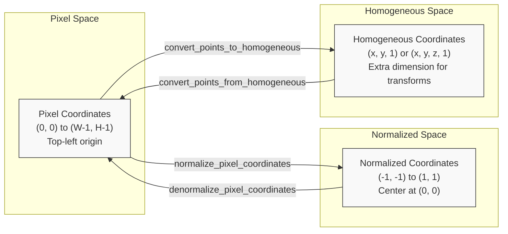

**Key Concepts:**

- **Pixel Coordinates**: Integer or float coordinates in image space, where (0, 0) is the top-left corner and (W-1, H-1) is the bottom-right
- **Normalized Coordinates**: Floating-point coordinates in [-1, 1] range, where (-1, -1) represents the top-left and (1, 1) represents the bottom-right
- **Homogeneous Coordinates**: Projective coordinates with an extra dimension, enabling linear representation of perspective transforms

**Sources:** [kornia/geometry/conversions.py:896-1019]()

---

## Pixel Coordinate Normalization (2D)

### Function: `normalize_pixel_coordinates`

Converts pixel coordinates from image space to normalized [-1, 1] space.

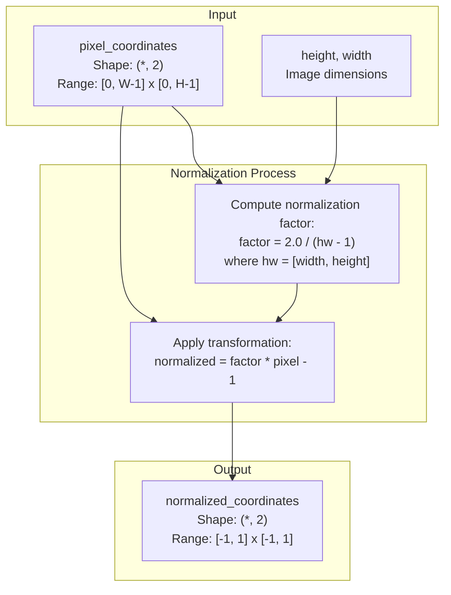

**Mathematical Formula:**

Given pixel coordinates `(u, v)` in an image of size `(H, W)`:

```
normalized_x = 2 * u / (W - 1) - 1
normalized_y = 2 * v / (H - 1) - 1
```

**Key Properties:**
- Top-left pixel (0, 0) maps to (-1, -1)
- Bottom-right pixel (W-1, H-1) maps to (1, 1)
- Center pixel ((W-1)/2, (H-1)/2) maps to (0, 0)

**Implementation:** [kornia/geometry/conversions.py:896-929]()

| Parameter | Type | Description |
|-----------|------|-------------|
| `pixel_coordinates` | Tensor | Pixel coordinates with shape `(*, 2)` |
| `height` | int | Image height |
| `width` | int | Image width |
| `eps` | float | Safe division epsilon (default: 1e-8) |
| **Returns** | Tensor | Normalized coordinates with shape `(*, 2)` |

**Sources:** [kornia/geometry/conversions.py:896-929]()

---

### Function: `denormalize_pixel_coordinates`

Inverse operation that converts normalized coordinates back to pixel space.

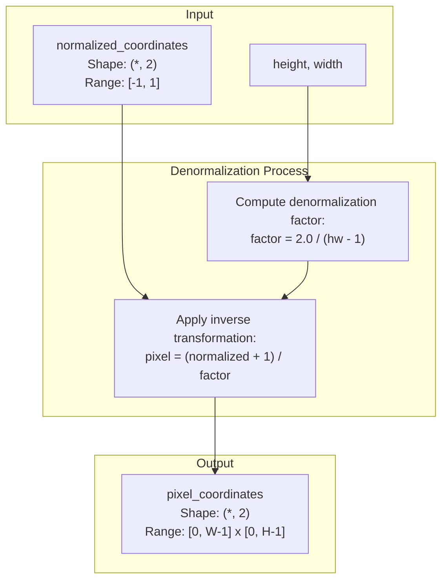

**Mathematical Formula:**

```
pixel_x = (normalized_x + 1) * (W - 1) / 2
pixel_y = (normalized_y + 1) * (H - 1) / 2
```

**Implementation:** [kornia/geometry/conversions.py:932-959]()

**Sources:** [kornia/geometry/conversions.py:932-959]()

---

## 3D Pixel Coordinate Normalization

### Functions: `normalize_pixel_coordinates3d` and `denormalize_pixel_coordinates3d`

Extended versions for 3D volumetric data (e.g., medical imaging, video volumes).

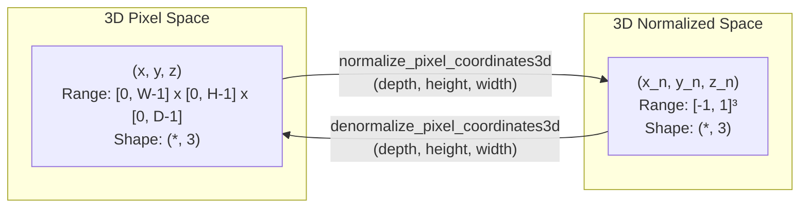

**Key Differences from 2D:**
- Operates on 3D coordinates with shape `(*, 3)` instead of `(*, 2)`
- Requires depth parameter in addition to height and width
- Normalizes z-coordinate using depth dimension

**Implementation:** [kornia/geometry/conversions.py:962-1019]()

| Function | Input Shape | Output Shape | Parameters |
|----------|-------------|--------------|------------|
| `normalize_pixel_coordinates3d` | `(*, 3)` | `(*, 3)` | `depth, height, width, eps` |
| `denormalize_pixel_coordinates3d` | `(*, 3)` | `(*, 3)` | `depth, height, width, eps` |

**Sources:** [kornia/geometry/conversions.py:962-1019]()

---

## Homography Normalization

### Function: `normalize_homography`

Normalizes a homography matrix from pixel space to normalized coordinate space. This is critical for operations like `warp_perspective` and `warp_affine`.

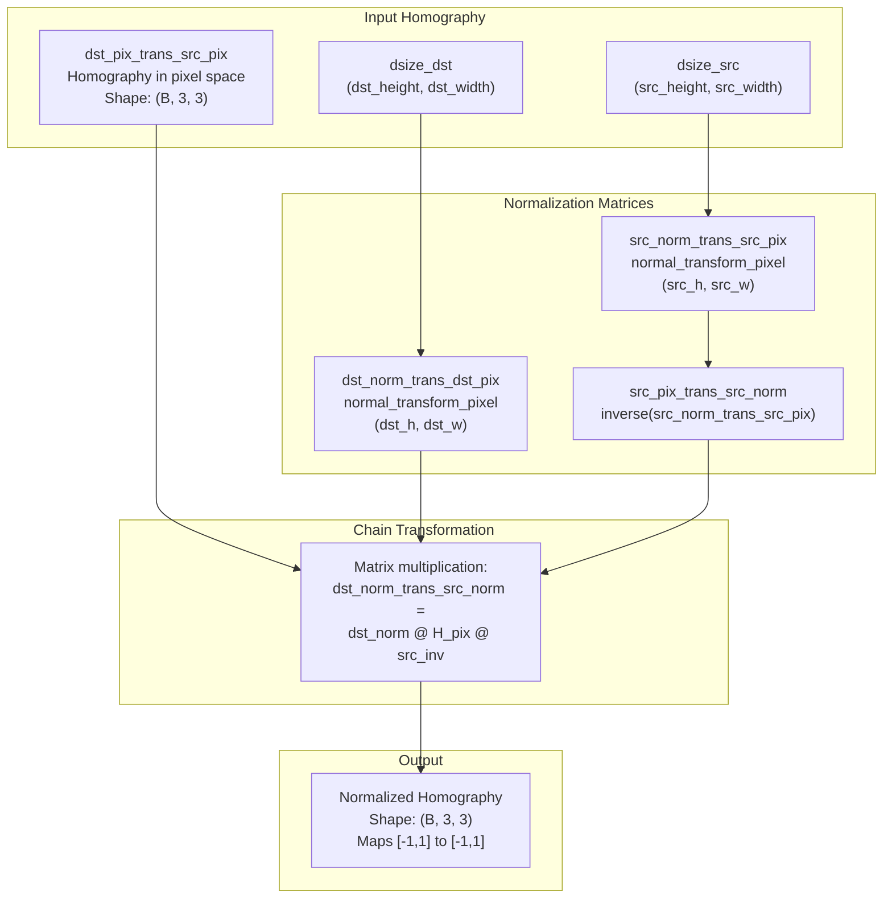

**Mathematical Formulation:**

Given a homography `H_pix` that transforms from source to destination in pixel space:

```
H_norm = T_dst_norm_to_pix @ H_pix @ T_src_pix_to_norm
```

Where:
- `T_src_pix_to_norm` converts source pixels to normalized coordinates
- `T_dst_norm_to_pix` converts normalized coordinates to destination pixels

**Implementation:** [kornia/geometry/conversions.py:1042-1075]()

**Sources:** [kornia/geometry/conversions.py:1042-1075]()

---

## Transformation Matrix Generation

### Function: `normal_transform_pixel`

Generates the transformation matrix that converts from pixel coordinates to normalized [-1, 1] space.

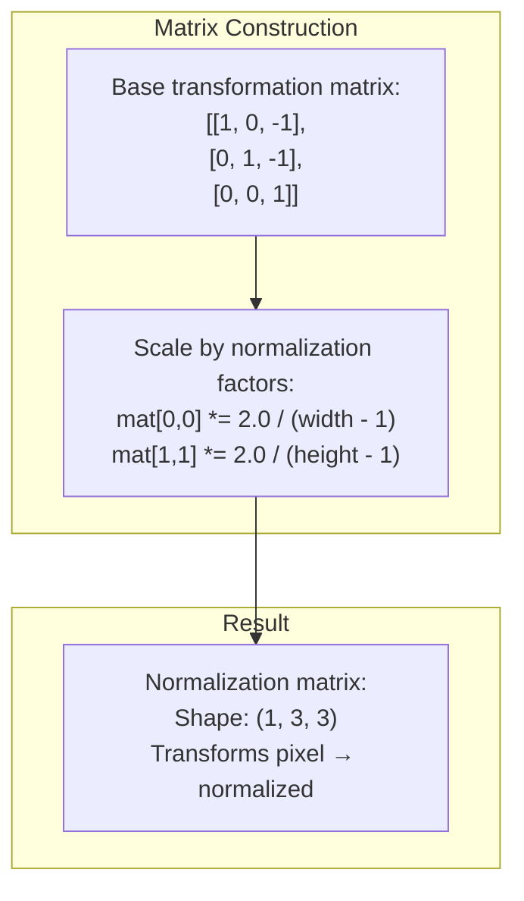

**Resulting Matrix:**

```
[2/(W-1),    0,      -1]
[   0,    2/(H-1),   -1]
[   0,       0,       1]
```

This matrix performs the transformation:
1. Scales coordinates by `2/(dimension-1)`
2. Shifts by -1 to center the range at 0

**Implementation:** [kornia/geometry/conversions.py:1078-1107]()

**Edge Case Handling:**
- When `width == 1` or `height == 1`, uses `eps` parameter to prevent division by zero
- Returns a batch of size 1 with shape `(1, 3, 3)` for broadcasting

**Sources:** [kornia/geometry/conversions.py:1078-1107]()

---

### Function: `normal_transform_pixel3d`

3D extension that generates a 4x4 transformation matrix for volumetric data.

**Resulting Matrix:**

```
[2/(W-1),    0,       0,      -1]
[   0,    2/(H-1),    0,      -1]
[   0,       0,    2/(D-1),   -1]
[   0,       0,       0,       1]
```

**Implementation:** [kornia/geometry/conversions.py:1110-1138]()

**Sources:** [kornia/geometry/conversions.py:1110-1138]()

---

## Camera Intrinsics-based Normalization

### Functions: `normalize_points_with_intrinsics` and `denormalize_points_with_intrinsics`

These functions normalize/denormalize points using camera intrinsic parameters instead of image dimensions. This is useful in 3D computer vision tasks.

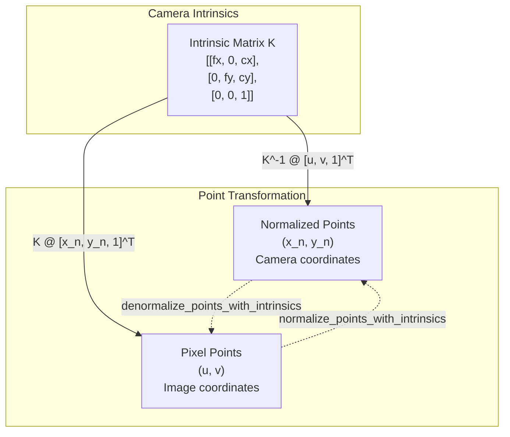

**Use Cases:**
- Converting pixel coordinates to ray directions in camera space
- Preparing points for 3D reconstruction
- Multi-view geometry operations
- Camera calibration workflows

**Implementation:** Referenced in [kornia/geometry/conversions.py:31-77]() exports

**Sources:** [kornia/geometry/conversions.py:31-77]()

---

## Integration with Warping Operations

### Usage in `warp_perspective`

The coordinate normalization system is essential for perspective warping operations.

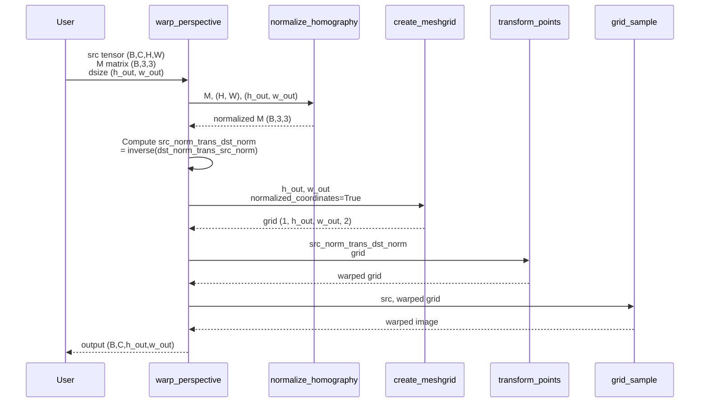

**Why Normalization is Required:**

1. **PyTorch Compatibility**: `F.grid_sample` expects grid values in [-1, 1] range
2. **Numerical Stability**: Normalized coordinates have smaller magnitude, reducing floating-point errors
3. **Resolution Independence**: Transformations can be defined independently of image size
4. **Composability**: Normalized homographies can be composed naturally

**Implementation Flow:** [kornia/geometry/transform/imgwarp.py:65-148]()

**Sources:** [kornia/geometry/transform/imgwarp.py:65-148]()

---

### Usage in `warp_affine`

Similar normalization occurs for affine transformations:

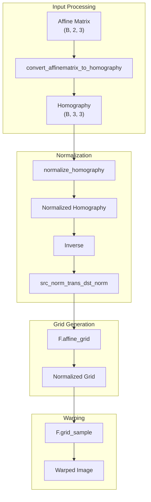

**Key Steps:**

1. Convert 2x3 affine matrix to 3x3 homography
2. Normalize homography using source and destination sizes
3. Invert to get sampling transformation
4. Generate normalized grid using `F.affine_grid`
5. Sample image using `F.grid_sample`

**Implementation:** [kornia/geometry/transform/imgwarp.py:151-224]()

**Sources:** [kornia/geometry/transform/imgwarp.py:151-224]()

---

## Coordinate Normalization in Remap Operations

### Function: `remap`

The `remap` function uses coordinate normalization when raw pixel coordinates are provided.

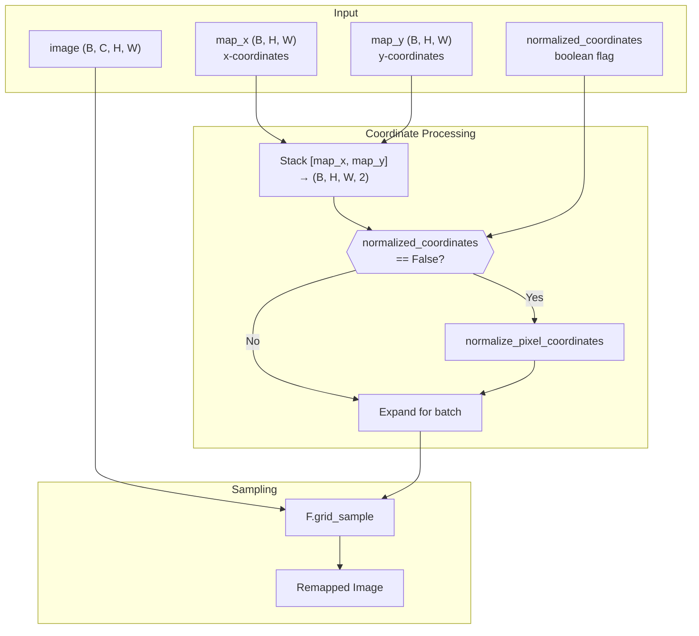

**Use Case Example:**

```python
# Raw pixel coordinates from optical flow or dense correspondence
map_x = flow_field[:, :, :, 0]  # x-displacements
map_y = flow_field[:, :, :, 1]  # y-displacements

# Remap will normalize these internally before calling grid_sample
output = remap(image, map_x, map_y, normalized_coordinates=False)
```

**Implementation:** [kornia/geometry/transform/imgwarp.py:489-556]()

**Sources:** [kornia/geometry/transform/imgwarp.py:489-556]()

---

## Summary: Normalization Function Relationships

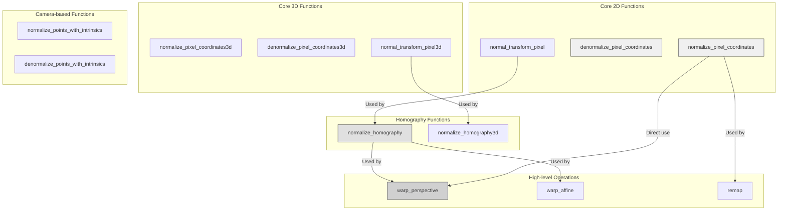

**Function Categories:**

| Category | Functions | Purpose |
|----------|-----------|---------|
| **Point Normalization** | `normalize_pixel_coordinates`, `denormalize_pixel_coordinates` | Convert individual points between pixel and normalized space |
| **3D Point Normalization** | `normalize_pixel_coordinates3d`, `denormalize_pixel_coordinates3d` | Convert 3D volume coordinates |
| **Matrix Generation** | `normal_transform_pixel`, `normal_transform_pixel3d` | Generate transformation matrices for normalization |
| **Homography Normalization** | `normalize_homography`, `normalize_homography3d` | Normalize transformation matrices between coordinate systems |
| **Camera-based** | `normalize_points_with_intrinsics`, `denormalize_points_with_intrinsics` | Use camera intrinsics for normalization |

**Sources:** [kornia/geometry/conversions.py:31-77](), [kornia/geometry/conversions.py:896-1138](), [kornia/geometry/transform/imgwarp.py:65-556]()

---

