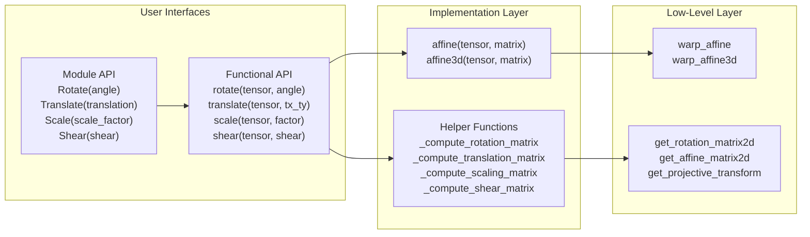
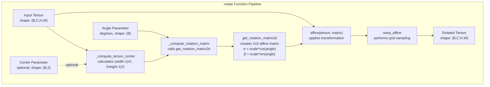
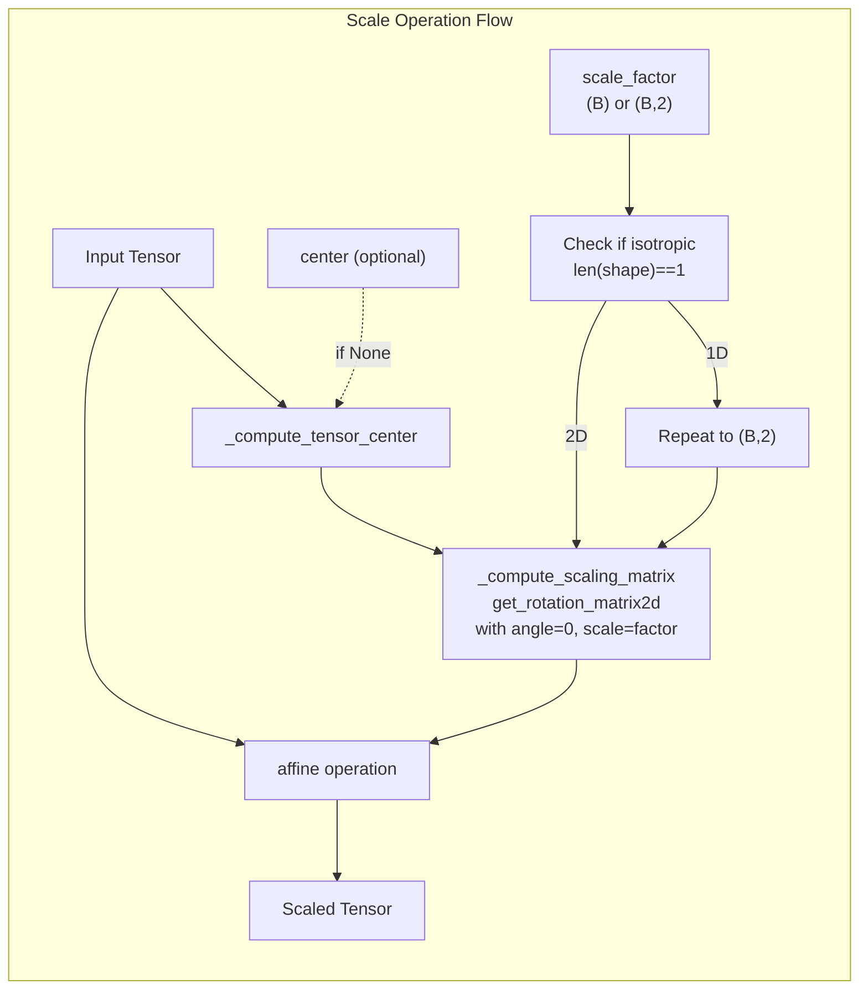
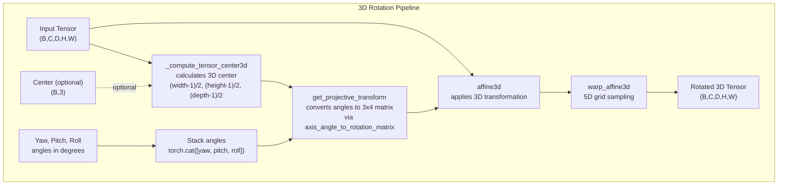
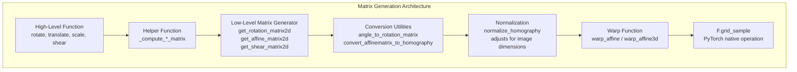

<!-- source: DeepWiki mcp.deepwiki.com · repo kornia/kornia · page 3.5 High-Level Geometric Operations · fetched 2026-10-21 -->

# High-Level Geometric Operations

<details>
<summary>Relevant source files</summary>

The following files were used as context for generating this wiki page:

- [docs/source/geometry.conversions.rst](docs/source/geometry.conversions.rst)
- [docs/source/geometry.transform.rst](docs/source/geometry.transform.rst)
- [kornia/geometry/camera/pinhole.py](kornia/geometry/camera/pinhole.py)
- [kornia/geometry/conversions.py](kornia/geometry/conversions.py)
- [kornia/geometry/transform/affwarp.py](kornia/geometry/transform/affwarp.py)
- [kornia/geometry/transform/imgwarp.py](kornia/geometry/transform/imgwarp.py)

</details>


## Purpose and Scope

This page documents Kornia's high-level geometric transformation operations that provide user-friendly interfaces for common image manipulation tasks. These operations include rotation, translation, scaling, shearing, and resizing of 2D and 3D tensors.

These high-level operations wrap lower-level primitives to provide:
- Simplified parameter interfaces (e.g., angle in degrees instead of rotation matrices)
- Automatic center computation for transformations
- Both functional and module-based APIs for flexibility
- Consistent handling of batch dimensions and input shapes

For low-level geometric conversions (rotation matrices, quaternions, axis-angle), see [Geometric Representations and Conversions](#3.1). For warping and transformation matrix generation, see [Image Warping and Transformation Matrices](#3.2).

**Sources:** [kornia/geometry/transform/affwarp.py:1-50](), [docs/source/geometry.transform.rst:26-45]()

## Functional vs Module APIs

Kornia provides two complementary interfaces for geometric operations:

**Functional API**: Pure functions that take tensors and parameters, returning transformed tensors. These are stateless and composable.

**Module API**: `nn.Module` subclasses that encapsulate transformation parameters and can be used in neural network pipelines. These maintain state and integrate with PyTorch's training mechanisms.



**Sources:** [kornia/geometry/transform/affwarp.py:137-242](), [kornia/geometry/transform/affwarp.py:772-886]()

## 2D Affine Transformations

### Rotation

The `rotate` function rotates images counter-clockwise about a specified center point. If no center is provided, it defaults to the image center.



**Implementation Details:**
- [kornia/geometry/transform/affwarp.py:248-310]() defines the `rotate()` function
- [kornia/geometry/transform/affwarp.py:55-63]() defines `_compute_tensor_center()` which computes `(width-1)/2, (height-1)/2`
- [kornia/geometry/transform/affwarp.py:78-82]() defines `_compute_rotation_matrix()` which wraps `get_rotation_matrix2d`
- [kornia/geometry/transform/imgwarp.py:398-486]() defines `get_rotation_matrix2d()` which creates the full transformation matrix

**Module Interface:**
The `Rotate` class provides a stateful wrapper that stores rotation parameters.

**Sources:** [kornia/geometry/transform/affwarp.py:248-310](), [kornia/geometry/transform/imgwarp.py:398-486]()

### Translation

The `translate` function shifts images by specified pixel amounts in x and y directions.

| Parameter | Type | Shape | Description |
|-----------|------|-------|-------------|
| `tensor` | Tensor | `(B,C,H,W)` | Input image |
| `translation` | Tensor | `(B,2)` | Shift amounts [dx, dy] |
| `mode` | str | - | Interpolation: 'bilinear' or 'nearest' |
| `padding_mode` | str | - | 'zeros', 'border', or 'reflection' |
| `align_corners` | bool | - | Grid sampling flag |

**Implementation:**
- [kornia/geometry/transform/affwarp.py:380-426]() defines `translate()`
- [kornia/geometry/transform/affwarp.py:106-113]() defines `_compute_translation_matrix()` which creates identity matrix and modifies translation components

The translation matrix has the form:
```
[[1, 0, dx],
 [0, 1, dy],
 [0, 0,  1]]
```

**Sources:** [kornia/geometry/transform/affwarp.py:380-426](), [kornia/geometry/transform/affwarp.py:106-113]()

### Scaling

The `scale` function resizes images by specified factors while maintaining the transformation center.



**Key Features:**
- Supports isotropic scaling (single factor) or anisotropic scaling (separate x, y factors)
- Scaling is centered at specified point (default: image center)
- Implemented via rotation matrix with zero angle but non-unit scale

**Sources:** [kornia/geometry/transform/affwarp.py:429-488](), [kornia/geometry/transform/affwarp.py:116-120]()

### Shearing

The `shear` function applies shear transformations in x and y directions.

The shear matrix has the form:
```
[[1,  shx, 0],
 [shy,  1, 0],
 [0,    0, 1]]
```

Where `shx` and `shy` are shear factors along x and y axes respectively.

**Implementation:**
- [kornia/geometry/transform/affwarp.py:491-537]() defines `shear()`
- [kornia/geometry/transform/affwarp.py:123-130]() defines `_compute_shear_matrix()` which constructs the shear matrix from `shear` parameter of shape `(B, 2)`

**Sources:** [kornia/geometry/transform/affwarp.py:491-537](), [kornia/geometry/transform/affwarp.py:123-130]()

### Combined Affine Transformation

The `Affine` module allows combining multiple elementary transformations (rotation, translation, scaling, shearing) into a single operation.

```mermaid
graph TB
    subgraph "Affine Module Composition"
        PARAMS["Parameters<br/>angle: (B)<br/>translation: (B,2)<br/>scale_factor: (B,2)<br/>shear: (B,2)<br/>center: (B,2)"]
        
        INIT["Affine.__init__<br/>stores parameters"]
        
        FORWARD["forward method"]
        
        GET_ROT["get_rotation_matrix2d<br/>creates rotation+scale matrix"]
        ADD_TRANS["Add translation<br/>transform[...,2] += translations"]
        CONVERT["convert_affinematrix_to_homography<br/>2x3 -> 3x3"]
        
        SHEAR_CHECK{{"any shear<br/>parameters?"}}
        GET_SHEAR["get_shear_matrix2d<br/>creates shear matrix"]
        MATMUL["Matrix multiplication<br/>transform @ shear"]
        
        WARP_CALL["warp_affine called<br/>with final matrix"]
    end
    
    PARAMS --> INIT
    INIT --> FORWARD
    FORWARD --> GET_ROT
    GET_ROT --> ADD_TRANS
    ADD_TRANS --> CONVERT
    CONVERT --> SHEAR_CHECK
    SHEAR_CHECK -->|"yes"| GET_SHEAR
    GET_SHEAR --> MATMUL
    MATMUL --> WARP_CALL
    SHEAR_CHECK -->|"no"| WARP_CALL
```



**Transformation Order:**
1. Rotation (around center with negative angle)
2. Scaling (applied during rotation step)
3. Translation added
4. Shearing (if specified) multiplied with result

**Sources:** [kornia/geometry/transform/affwarp.py:772-886](), [kornia/geometry/transform/imgwarp.py:596-632]()

## Resize and Rescale Operations

### Resize

The `resize` function changes image dimensions to specified target sizes with optional anti-aliasing.

| Feature | Description |
|---------|-------------|
| **Input Shape** | `(..., H, W)` - arbitrary leading dimensions |
| **Size Specification** | `int` (for shorter side) or `(height, width)` tuple |
| **Side Selection** | `'short'`, `'long'`, `'vert'`, `'horz'` |
| **Interpolation** | `'nearest'`, `'linear'`, `'bilinear'`, `'bicubic'`, `'trilinear'`, `'area'` |
| **Anti-aliasing** | Gaussian blur before downscaling when `antialias=True` |

**Anti-aliasing Implementation:**
When downscaling (factor > 1), applies Gaussian blur with:
- Sigma: `max((factor - 1.0) / 2.0, 0.001)` for each dimension
- Kernel size: `max(2.0 * 2 * sigma, 3)`, forced to odd
- Uses [kornia/filters.gaussian_blur2d]()

**Sources:** [kornia/geometry/transform/affwarp.py:552-635](), [kornia/geometry/transform/affwarp.py:715-770]()

### Rescale

The `rescale` function resizes images by a scaling factor rather than absolute dimensions.

```python
# Rescale by factor 2x in both directions
rescale(image, factor=2.0)

# Rescale by different factors per axis
rescale(image, factor=(2.0, 1.5))  # height*2, width*1.5
```

**Implementation:**
- [kornia/geometry/transform/affwarp.py:672-712]() defines `rescale()`
- Converts factor to absolute size: `(int(height * factor_vert), int(width * factor_horz))`
- Delegates to `resize()` with computed size

**Sources:** [kornia/geometry/transform/affwarp.py:672-712]()

## 3D Geometric Operations

### rotate3d

Applies 3D rotation using yaw, pitch, and roll angles.



**Implementation:**
- [kornia/geometry/transform/affwarp.py:313-377]() defines `rotate3d()`
- [kornia/geometry/transform/affwarp.py:66-75]() defines `_compute_tensor_center3d()` for 3D center computation
- [kornia/geometry/transform/affwarp.py:85-103]() defines `_compute_rotation_matrix3d()` which uses `get_projective_transform()`

**Sources:** [kornia/geometry/transform/affwarp.py:313-377](), [kornia/geometry/transform/affwarp.py:85-103]()

### affine3d

Applies generic 3D affine transformations using a 3x4 transformation matrix.

**Parameters:**
- `tensor`: Input of shape `(D,H,W)`, `(C,D,H,W)`, or `(B,C,D,H,W)`
- `matrix`: Transformation matrix of shape `(B,3,4)`
- Interpolation and padding parameters same as 2D version

**Implementation:**
- [kornia/geometry/transform/affwarp.py:192-241]() defines `affine3d()`
- Handles unbatched inputs by adding batch dimension
- Calls [kornia/geometry/transform/imgwarp.warp_affine3d]() for actual warping

**Sources:** [kornia/geometry/transform/affwarp.py:192-241](), [kornia/geometry/transform/imgwarp.py:1432-1506]()

## Architecture and Implementation Details

### Transformation Matrix Generation

High-level operations generate transformation matrices through a consistent pipeline:



**Key Components:**

1. **Helper Functions** ([kornia/geometry/transform/affwarp.py:78-130]()):
   - `_compute_rotation_matrix()`: Creates 2D rotation matrix
   - `_compute_translation_matrix()`: Creates translation matrix
   - `_compute_scaling_matrix()`: Creates scaling matrix via rotation with zero angle
   - `_compute_shear_matrix()`: Creates shear matrix

2. **Matrix Generators** ([kornia/geometry/transform/imgwarp.py:398-814]()):
   - `get_rotation_matrix2d()`: Combines rotation, scaling, and centering
   - `get_affine_matrix2d()`: Full 2D affine matrix with optional shear
   - `get_affine_matrix3d()`: Full 3D affine matrix
   - `get_shear_matrix2d()` / `get_shear_matrix3d()`: Shear matrices

3. **Coordinate Normalization** ([kornia/geometry/conversions.py:1042-1108]()):
   - `normalize_homography()`: Converts pixel-space homography to normalized [-1,1] space
   - `normal_transform_pixel()`: Creates normalization transform matrix

**Sources:** [kornia/geometry/transform/affwarp.py:78-130](), [kornia/geometry/transform/imgwarp.py:398-814](), [kornia/geometry/conversions.py:1042-1108]()

### Batch Processing and Broadcasting

All high-level operations support flexible batch processing:

| Input Pattern | Handling |
|---------------|----------|
| Unbatched `(C,H,W)` | Add batch dim, process, remove batch dim |
| Batched `(B,C,H,W)` | Process directly |
| Single image, multiple transforms | Broadcast tensor to match transform batch size |
| Multiple images, single transform | Broadcast transform to match image batch size |

**Implementation:**
- [kornia/geometry/transform/affwarp.py:169-177]() handles broadcasting for `affine()`
- Matrices expanded using `.expand()` to match batch sizes before warping

**Sources:** [kornia/geometry/transform/affwarp.py:169-177]()

### Interpolation and Padding Modes

All transformation functions support consistent interpolation and padding:

**Interpolation Modes:**
- `'bilinear'`: Default, smooth interpolation
- `'nearest'`: Nearest neighbor, preserves sharp edges

**Padding Modes:**
- `'zeros'`: Fill with zeros (black)
- `'border'`: Replicate edge pixels
- `'reflection'`: Mirror reflect across boundaries
- `'fill'`: Custom fill value (for affine operations with RGB tensors)

**Implementation Note:**
The `'fill'` padding mode uses a special implementation in [kornia/geometry/transform/imgwarp.py:227-252]() that warps a mask and composites the fill color.

**Sources:** [kornia/geometry/transform/imgwarp.py:65-149](), [kornia/geometry/transform/imgwarp.py:227-252]()

## Usage Patterns and Best Practices

### When to Use Functional vs Module APIs

**Functional API:**
```python
# One-time transformations
rotated = rotate(image, angle=torch.tensor([45.0]))
translated = translate(rotated, translation=torch.tensor([[10.0, 20.0]]))
```

**Benefits:**
- Explicit control over parameters
- Easy to compose multiple operations
- No state management required

**Module API:**
```python
# Define transformation pipeline
transform = nn.Sequential(
    Rotate(angle=torch.tensor([45.0])),
    Translate(translation=torch.tensor([[10.0, 20.0]])),
    Resize(size=(224, 224))
)

# Apply to multiple images
output = transform(image)
```

**Benefits:**
- Integrates with PyTorch modules and training loops
- Parameters can be learned or optimized
- Cleaner pipeline definition

**Sources:** [kornia/geometry/transform/affwarp.py:137-189](), [kornia/geometry/transform/affwarp.py:772-886]()

### Performance Considerations

1. **Matrix Precomputation**: For repeated transformations with same parameters, compute matrices once and reuse via `affine()` or `warp_affine()`.

2. **Batch Processing**: Process multiple images simultaneously by stacking them into batch dimension - much faster than sequential processing.

3. **Anti-aliasing Trade-off**: `resize()` with `antialias=True` applies Gaussian blur before downsampling, increasing quality but reducing speed.

4. **Interpolation Choice**: `'nearest'` is faster than `'bilinear'` but produces lower quality results.

**Sources:** [kornia/geometry/transform/affwarp.py:552-635]()

### Transformation Center Selection

For rotation, scaling, and shearing, the center point significantly affects results:

- **Default (image center)**: Most common, preserves content in center
- **Custom center**: Useful for rotating around specific features
- **Corner (0,0)**: Simplifies composition with translations

**Example:**
```python
# Rotate around top-left corner
center = torch.tensor([[0.0, 0.0]])
rotated = rotate(image, angle, center=center)

# Rotate around custom point (e.g., detected face center)
face_center = torch.tensor([[cx, cy]])
rotated = rotate(image, angle, center=face_center)
```

**Sources:** [kornia/geometry/transform/affwarp.py:248-310](), [kornia/geometry/transform/affwarp.py:55-63]()

---

