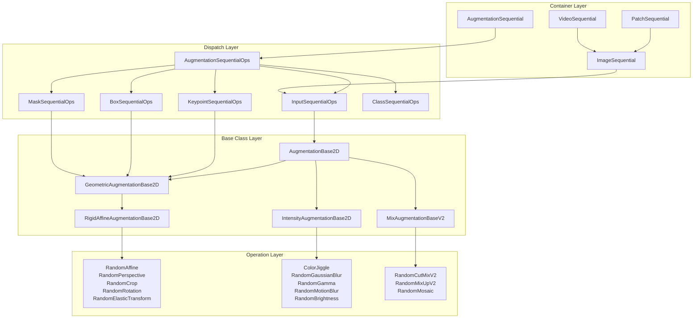
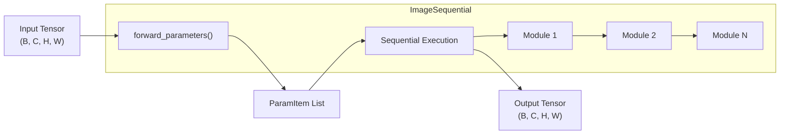
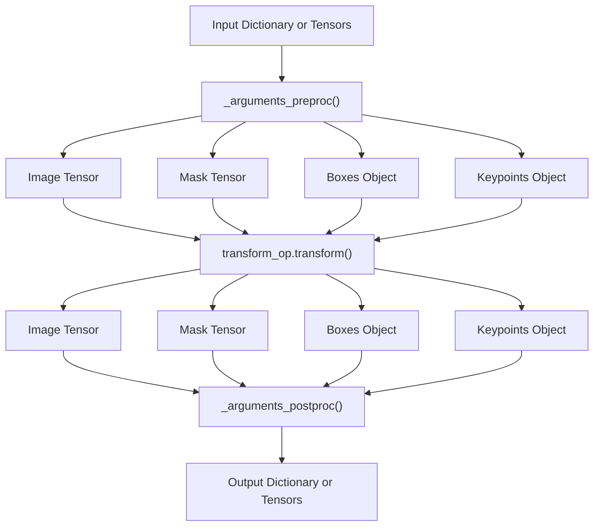
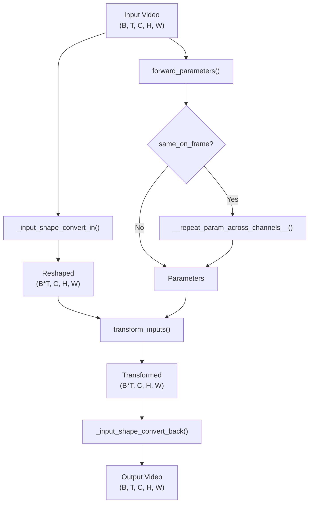
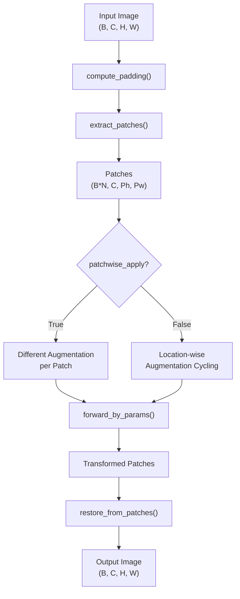
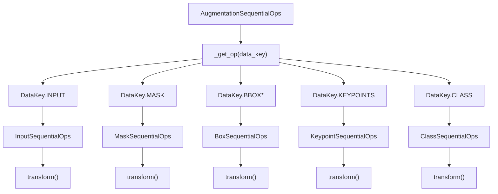
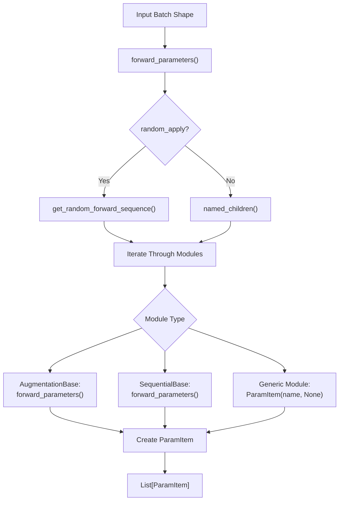
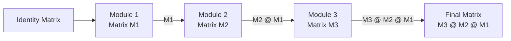
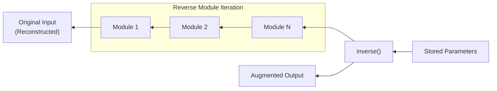

<!-- source: DeepWiki mcp.deepwiki.com · repo kornia/kornia · page 4 Data Augmentation System · fetched 2026-10-21 -->

# Data Augmentation System

<details>
<summary>Relevant source files</summary>

The following files were used as context for generating this wiki page:

- [docs/source/augmentation.rst](docs/source/augmentation.rst)
- [kornia/augmentation/__init__.py](kornia/augmentation/__init__.py)
- [kornia/augmentation/container/augment.py](kornia/augmentation/container/augment.py)
- [kornia/augmentation/container/base.py](kornia/augmentation/container/base.py)
- [kornia/augmentation/container/image.py](kornia/augmentation/container/image.py)
- [kornia/augmentation/container/ops.py](kornia/augmentation/container/ops.py)
- [kornia/augmentation/container/patch.py](kornia/augmentation/container/patch.py)
- [kornia/augmentation/container/video.py](kornia/augmentation/container/video.py)
- [tests/augmentation/container/test_video_sequential.py](tests/augmentation/container/test_video_sequential.py)

</details>


## Purpose and Scope

The Data Augmentation System provides a composable, differentiable framework for applying transformations to computer vision data. This system enables users to construct complex augmentation pipelines that can handle multiple data types simultaneously (images, masks, bounding boxes, keypoints) while maintaining transformation consistency across all inputs. The system supports batch processing, GPU acceleration, parameter reproducibility, and inverse transformations.

This document covers the augmentation container architecture and operation dispatch mechanisms. For individual augmentation operations, see [2D Geometric Augmentations](#6.2), [2D Intensity Augmentations](#6.3), and [Mix Augmentations](#6.4). For the underlying geometric transformations, see [Geometry and Transformations](#2).

**Sources:** [kornia/augmentation/__init__.py:1-200](), [docs/source/augmentation.rst:1-77]()

## System Architecture

The augmentation system implements a four-layer architecture: container layer, dispatch layer, base class layer, and operation layer.



**Sources:** [kornia/augmentation/container/augment.py:1-680](), [kornia/augmentation/container/ops.py:1-616](), [kornia/augmentation/__init__.py:18-199]()

## Container Classes

### ImageSequential

`ImageSequential` is the base container for composing image processing operations. It processes 4D tensors (B, C, H, W) and supports random application of transformations.

**Key Features:**
- Sequential composition of augmentation modules
- Random apply support with configurable selection weights
- Parameter tracking for reproducibility
- Transformation matrix computation

**Class Location:** [kornia/augmentation/container/image.py:52-368]()



**Example Usage:**

```python
aug_list = ImageSequential(
    K.ColorJiggle(0.1, 0.1, 0.1, 0.1, p=1.0),
    K.filters.MedianBlur((3, 3)),
    K.RandomAffine(360, p=1.0),
    same_on_batch=True,
    random_apply=10,
)
```

**Sources:** [kornia/augmentation/container/image.py:52-368]()

### AugmentationSequential

`AugmentationSequential` extends `ImageSequential` to handle multiple data types simultaneously. It orchestrates transformations across images, masks, bounding boxes, keypoints, and class labels while maintaining consistency.

**Key Features:**
- Multi-data-type orchestration via `data_keys` parameter
- Type-specific operation dispatch through `AugmentationSequentialOps`
- Transformation matrix tracking for geometric operations
- Dictionary input support for flexible data passing

**Class Location:** [kornia/augmentation/container/augment.py:50-680]()



**Data Keys:** [kornia/augmentation/container/augment.py:41-45]()
- `DataKey.INPUT` / `DataKey.IMAGE`: Image tensors
- `DataKey.MASK`: Mask tensors (single or list)
- `DataKey.BBOX` / `DataKey.BBOX_XYXY` / `DataKey.BBOX_XYWH`: Bounding boxes
- `DataKey.KEYPOINTS`: Keypoint coordinates
- `DataKey.CLASS` / `DataKey.LABEL`: Class labels

**Example Usage:**

```python
aug_list = AugmentationSequential(
    K.ColorJiggle(0.1, 0.1, 0.1, 0.1, p=1.0),
    K.RandomAffine(360, p=1.0),
    data_keys=["input", "mask", "bbox", "keypoints"],
    same_on_batch=False,
    random_apply=10,
)
out_img, out_mask, out_bbox, out_pts = aug_list(input, mask, bbox, points)
```

**Sources:** [kornia/augmentation/container/augment.py:50-680]()

### VideoSequential

`VideoSequential` processes 5D video tensors (B, T, C, H, W or B, C, T, H, W) with temporal consistency control via `same_on_frame` parameter.

**Key Features:**
- Support for `BTCHW` and `BCTHW` data formats
- `same_on_frame` ensures identical transformations across temporal dimension
- Parameter repetition mechanism for frame-wise consistency
- Shape conversion utilities for internal processing

**Class Location:** [kornia/augmentation/container/video.py:35-375]()



**Example Usage:**

```python
aug_list = VideoSequential(
    K.ColorJiggle(0.1, 0.1, 0.1, 0.1, p=1.0),
    K.RandomAffine(360, p=1.0),
    data_format="BCTHW",
    same_on_frame=True
)
output = aug_list(input)  # Same augmentation per frame
```

**Sources:** [kornia/augmentation/container/video.py:35-375]()

### PatchSequential

`PatchSequential` performs patch-level augmentation by dividing images into a grid and applying transformations to each patch independently or location-wise.

**Key Features:**
- Grid-based patch extraction via `extract_patches()`
- Two modes: `patchwise_apply` (different aug per patch) or location-wise (cycling augmentations)
- Same/valid padding strategies
- Patch restoration via `restore_from_patches()`
- Limitation: Only supports intensity transformations for multi-data scenarios

**Class Location:** [kornia/augmentation/container/patch.py:39-427]()



**Example Usage:**

```python
seq = PatchSequential(
    K.ColorJiggle(0.1, 0.1, 0.1, 0.1, p=0.5),
    K.RandomAffine(360, p=1.0),
    K.RandomSolarize(0.1, 0.1, p=0.1),
    grid_size=(2, 2),
    patchwise_apply=True,
    same_on_batch=True,
)
out = seq(input)
```

**Sources:** [kornia/augmentation/container/patch.py:39-427]()

## Operation Dispatch System

The dispatch system routes transformations to type-specific handlers based on `DataKey` values. `AugmentationSequentialOps` acts as the orchestrator.



**Sources:** [kornia/augmentation/container/ops.py:89-177]()

### InputSequentialOps

Handles image tensor transformations. Dispatches to augmentation modules, sequential containers, or generic torch modules.

**Class Location:** [kornia/augmentation/container/ops.py:202-240]()

| Module Type | Transform Method | Inverse Method |
|-------------|------------------|----------------|
| `_AugmentationBase` | `module(input, params=...)` | Not applicable (intensity only) |
| `MixAugmentationBaseV2` | `module(input, params=...)` | Not applicable |
| `GeometricAugmentationBase2D` | `module(input, params=...)` | `module.inverse(input, params=...)` |
| `ImageSequentialBase` | `module.transform_inputs(...)` | `module.inverse_inputs(...)` |
| Generic `Module` | `module(input)` | Not applicable |

**Sources:** [kornia/augmentation/container/ops.py:202-240]()

### MaskSequentialOps

Handles mask tensor transformations with special support for list-of-masks scenarios. Applies nearest-neighbor interpolation by default.

**Class Location:** [kornia/augmentation/container/ops.py:262-419]()

**Key Methods:**
- `transform()`: [kornia/augmentation/container/ops.py:265-313]() - Single mask transformation
- `transform_list()`: [kornia/augmentation/container/ops.py:315-377]() - List of masks transformation with per-batch parameter handling
- `inverse()`: [kornia/augmentation/container/ops.py:379-419]() - Inverse transformation using computed inverse matrix

**Sources:** [kornia/augmentation/container/ops.py:262-419]()

### BoxSequentialOps

Handles bounding box transformations using the `Boxes` class. Applies geometric transformations to box vertices.

**Class Location:** [kornia/augmentation/container/ops.py:421-516]()

**Transform Pipeline:**
1. Clone input boxes to prevent in-place modification
2. Check if module is `GeometricAugmentationBase2D`
3. Call `module.transform_boxes(input, params, flags, transform=...)`
4. Pass through non-geometric operations unchanged

**Sources:** [kornia/augmentation/container/ops.py:421-516]()

### KeypointSequentialOps

Handles keypoint transformations using the `Keypoints` class. Applies geometric transformations to point coordinates.

**Class Location:** [kornia/augmentation/container/ops.py:518-616]()

**Transform Pipeline:**
1. Clone input keypoints
2. Check if module is `GeometricAugmentationBase2D`
3. Call `module.transform_keypoints(input, params, flags, transform=...)`
4. For inverse, compute inverse transformation matrix first

**Sources:** [kornia/augmentation/container/ops.py:518-616]()

## Parameter Management and Reproducibility

### ParamItem Structure

The `ParamItem` class stores augmentation parameters for reproducibility and inverse transformations.

**Structure:**
```python
ParamItem(name: str, data: Optional[Union[Dict[str, Tensor], List[ParamItem]]])
```

**Sources:** [kornia/augmentation/container/params.py]()

### Parameter Generation Flow



**Sources:** [kornia/augmentation/container/image.py:235-249]()

### Reproducibility

Augmentations can be reproduced by passing saved parameters:

```python
# First pass - generates parameters
output = aug_list(input)
params = aug_list._params

# Reproduce exact transformation
output_reproduced = aug_list(input, params=params)
```

**Sources:** [kornia/augmentation/container/augment.py:113-116](), [kornia/augmentation/container/image.py:94-96]()

## Transformation Matrix Tracking

For geometric augmentations, `AugmentationSequential` tracks transformation matrices to enable inverse operations and metadata transformation.

### TransformMatrixMinIn Mixin

**Class Location:** [kornia/augmentation/container/base.py:312-365]()

**Key Attributes:**
- `_transform_matrix`: Accumulated transformation matrix
- `_transform_matrices`: List of individual transformation matrices
- `_transformation_matrix_arg`: Computation mode (`silent`, `rigid`, or `skip`)

**Computation Modes:**

| Mode | Behavior |
|------|----------|
| `silent` | Compute matrices silently; ignore non-rigid modules |
| `rigid` | Compute matrices; raise error on non-rigid modules |
| `skip` | Do not compute transformation matrices |

**Sources:** [kornia/augmentation/container/base.py:312-365](), [kornia/augmentation/container/augment.py:74-80]()

### Matrix Accumulation



**Matrix Update:** [kornia/augmentation/container/base.py:356-361]()

Matrices are multiplied in right-to-left order: `new_matrix @ accumulated_matrix`

**Sources:** [kornia/augmentation/container/base.py:356-361](), [kornia/augmentation/container/augment.py:290-291]()

## Multi-Data-Type Support

### Dictionary Input Mode

`AugmentationSequential` supports dictionary inputs where keys are automatically mapped to data types.

**Mapping Rules:** [kornia/augmentation/container/augment.py:558-584]()
- Keys starting with `"input"` or `"image"` → `DataKey.INPUT`
- Keys starting with `"mask"` → `DataKey.MASK`
- Keys starting with `"bbox"` (with format suffix) → Appropriate `DataKey.BBOX*`
- Keys starting with `"keypoints"` → `DataKey.KEYPOINTS`
- Keys not matching → Passed through unchanged

**Example:**

```python
aug_dict = AugmentationSequential(
    K.ColorJiggle(0.1, 0.1, 0.1, 0.1, p=1.0),
    K.RandomHorizontalFlip(p=1.0),
    data_keys=None,  # Auto-detect from dict keys
)

data = {
    'image': img,
    'mask': mask,
    'bbox': bbox,
    'other_data': other  # Passed through unchanged
}
out = aug_dict(data)
```

**Sources:** [kornia/augmentation/container/augment.py:195-220](), [kornia/augmentation/container/augment.py:544-584]()

### List-of-Tensors Support

Masks and bounding boxes support list inputs for handling variable numbers of objects per batch item.

**List Handling:** [kornia/augmentation/container/augment.py:586-608]()
- Masks: Converted to list of tensors, each with potentially different shapes
- Boxes: List of `Boxes` objects with different numbers of boxes per item

**Example:**

```python
mask = [
    torch.ones(1, 3, 256, 256),  # First image: 3 masks
    torch.ones(1, 2, 256, 256)   # Second image: 2 masks
]
bbox = [
    Boxes.from_tensor(torch.tensor([[28, 53, 143, 164], ...])),  # 3 boxes
    Boxes.from_tensor(torch.tensor([[254, 158, 364, 290], ...]))  # 2 boxes
]

aug_list = AugmentationSequential(
    K.ColorJiggle(0.1, 0.1, 0.1, 0.1, p=1.0),
    K.RandomHorizontalFlip(p=1.0),
    data_keys=["input", "mask", "bbox"],
)
out_img, out_mask, out_bbox = aug_list(input, mask, bbox)
```

**Sources:** [kornia/augmentation/container/augment.py:173-194](), [kornia/augmentation/container/ops.py:315-377]()

## Advanced Features

### Random Apply and OneOf

`random_apply` parameter enables stochastic selection of augmentations.

**Random Apply Modes:** [kornia/augmentation/container/image.py:142-171]()

| Input Value | Behavior |
|-------------|----------|
| `False` | Apply all augmentations in order |
| `True` | Apply all augmentations in random order |
| `int` (e.g., `3`) | Apply exactly 3 randomly selected augmentations |
| `(a,)` (e.g., `(2,)`) | Apply 2 to N augmentations (N = total) |
| `(a, b)` (e.g., `(2, 4)`) | Apply 2 to 4 augmentations |

**OneOf Implementation:**
Set `random_apply=1` with `random_apply_weights` to implement weighted selection:

```python
aug = ImageSequential(
    K.RandomAffine(360, p=1.0),
    K.ColorJiggle(0.1, 0.1, 0.1, 0.1, p=1.0),
    K.RandomGaussianBlur((3, 3), (0.1, 2.0), p=1.0),
    random_apply=1,
    random_apply_weights=[0.5, 0.3, 0.2]  # Weighted selection
)
```

**Sources:** [kornia/augmentation/container/image.py:142-171](), [kornia/augmentation/container/image.py:172-207]()

### Mix Augmentation Handling

Mix augmentations (e.g., `RandomMixUpV2`, `RandomCutMixV2`) can only be applied once per forward pass due to label dependencies.

**Enforcement Mechanisms:**
1. **Without random_apply:** [kornia/augmentation/container/image.py:220-230]() - Raises error if multiple mix augmentations detected
2. **With random_apply:** [kornia/augmentation/container/image.py:189-206]() - Automatically ensures at most one mix augmentation is selected

**Sources:** [kornia/augmentation/container/image.py:209-216](), [kornia/augmentation/container/image.py:220-230]()

### Inverse Transformations

Geometric augmentations support inverse transformations to undo applied transformations.

**Inverse Flow:**



**Implementation:** [kornia/augmentation/container/augment.py:300-354]()

**Example:**

```python
# Apply augmentation
out_img, out_mask, out_bbox, out_pts = aug_list(input, mask, bbox, points)

# Inverse transformation
inv_img, inv_mask, inv_bbox, inv_pts = aug_list.inverse(
    out_img, out_mask, out_bbox, out_pts
)
```

**Limitations:**
- Only geometric augmentations support inverse operations
- Intensity-only augmentations are not invertible
- `PatchSequential` does not support inverse with geometric transforms

**Sources:** [kornia/augmentation/container/augment.py:300-354](), [kornia/augmentation/container/ops.py:222-240]()

### Extra Arguments for Data Types

The `extra_args` parameter provides data-type-specific transformation options.

**Default Configuration:** [kornia/augmentation/container/augment.py:284]()
```python
extra_args = {
    DataKey.MASK: {
        "resample": Resample.NEAREST,
        "align_corners": None
    }
}
```

This ensures masks use nearest-neighbor interpolation instead of bilinear interpolation to preserve discrete labels.

**Sources:** [kornia/augmentation/container/augment.py:234-235](), [kornia/augmentation/container/augment.py:284]()

## Integration with Other Systems

The augmentation system integrates with several other Kornia subsystems:

**Geometry Module:** [Geometry and Transformations](#2)
- Geometric augmentations use `kornia.geometry.transform.imgwarp.warp_perspective()` and `warp_affine()`
- Rotation matrices and transformation computations from `kornia.geometry.conversions`

**Filters Module:** [Image Filtering and Processing](#4)
- Intensity augmentations use `kornia.filters` for blur operations
- Filter kernels generated via `kornia.filters.kernels`

**Color Module:** [Color Space Processing](#3)
- Color augmentations may use color space conversions
- RGB/HSV transformations for hue/saturation adjustments

**Feature Module:** [Feature Detection and Description](#5)
- LAF (Local Affine Frames) can be augmented via `PatchSequential`
- Keypoint transformations use geometric transformation matrices

**Sources:** [kornia/augmentation/container/augment.py:1-680](), [kornia/augmentation/container/ops.py:1-616]()

---

