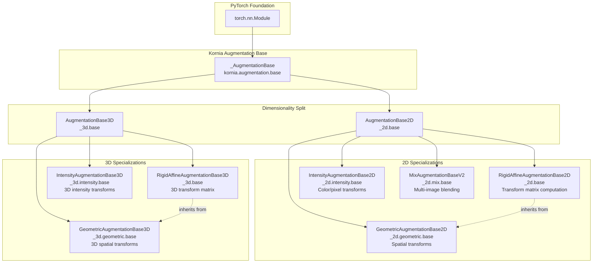
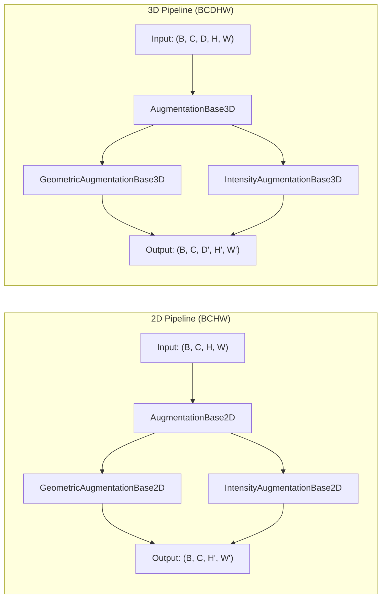
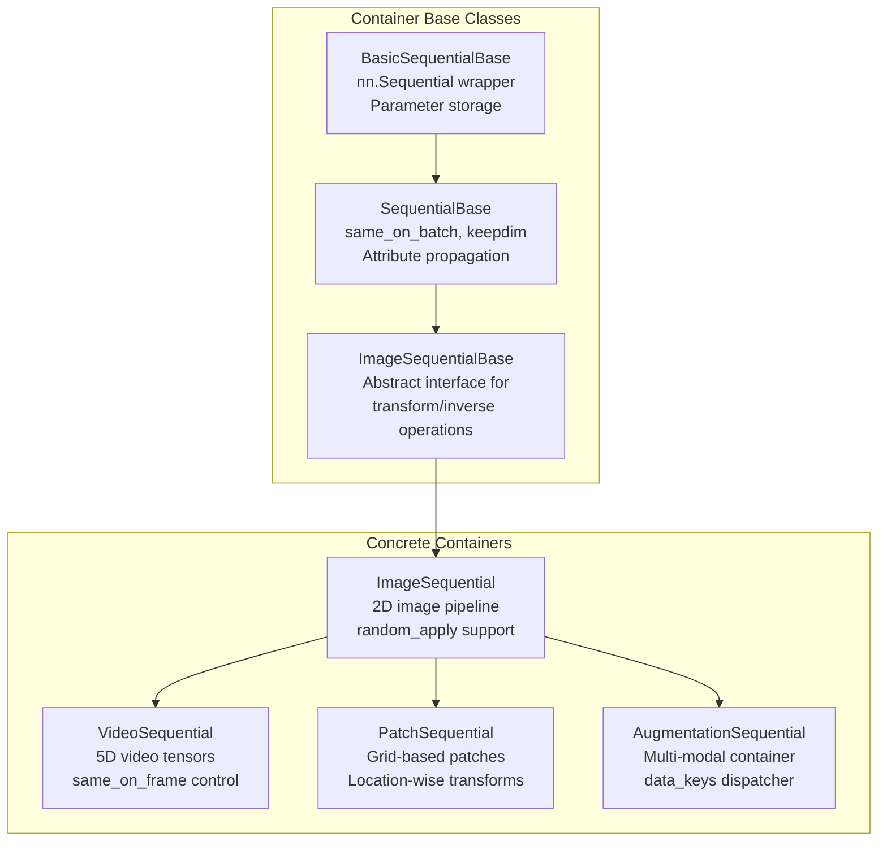
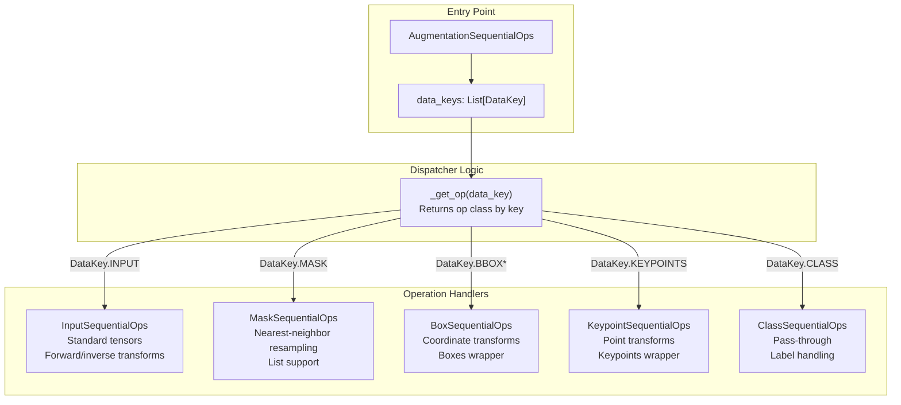
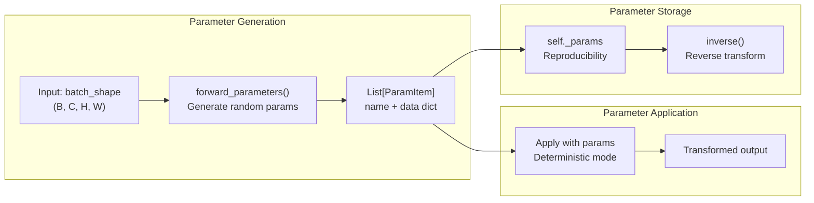
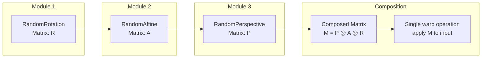

<!-- source: DeepWiki mcp.deepwiki.com · repo kornia/kornia · page 4.1 Augmentation Base Classes and Architecture · fetched 2026-10-21 -->

# Augmentation Base Classes and Architecture

<details>
<summary>Relevant source files</summary>

The following files were used as context for generating this wiki page:

- [docs/source/augmentation.rst](docs/source/augmentation.rst)
- [kornia/augmentation/__init__.py](kornia/augmentation/__init__.py)
- [kornia/augmentation/container/augment.py](kornia/augmentation/container/augment.py)
- [kornia/augmentation/container/base.py](kornia/augmentation/container/base.py)
- [kornia/augmentation/container/image.py](kornia/augmentation/container/image.py)
- [kornia/augmentation/container/ops.py](kornia/augmentation/container/ops.py)
- [kornia/augmentation/container/patch.py](kornia/augmentation/container/patch.py)
- [kornia/augmentation/container/video.py](kornia/augmentation/container/video.py)
- [tests/augmentation/container/test_video_sequential.py](tests/augmentation/container/test_video_sequential.py)

</details>


## Purpose and Scope

This document describes the foundational class hierarchy and architectural patterns that power Kornia's augmentation system. It covers the base classes from which all augmentation modules inherit, the container classes that compose augmentations into pipelines, and the parameter management system that enables reproducibility and inverse transformations.

For specific 2D augmentation implementations, see [4.2](#4.2), [4.3](#4.3), and [4.4](#4.4). For container usage patterns, see [4.6](#4.6), [4.7](#4.7), and [4.8](#4.8).

**Sources:** [kornia/augmentation/__init__.py:1-205](), [docs/source/augmentation.rst:1-77]()

---

## Augmentation Base Class Hierarchy

### Overview

Kornia's augmentation system is built on a multi-level inheritance hierarchy that separates concerns by dimensionality (2D/3D), augmentation type (geometric/intensity/mix), and transformation rigidity (rigid-affine vs non-rigid).

### Class Hierarchy Diagram



**Sources:** [kornia/augmentation/__init__.py:88-107](), [kornia/augmentation/container/augment.py:23-24]()

### Base Class Responsibilities

| Class | File Location | Purpose |
|-------|---------------|---------|
| `_AugmentationBase` | `kornia.augmentation.base` | Root class with parameter generation, forward/inverse interface |
| `AugmentationBase2D` | `kornia.augmentation._2d.base` | 2D tensor handling, batch/keepdim logic |
| `AugmentationBase3D` | `kornia.augmentation._3d.base` | 3D/volumetric tensor handling |
| `GeometricAugmentationBase2D` | `kornia.augmentation._2d.geometric.base` | Spatial transformations (rotation, affine, perspective) |
| `IntensityAugmentationBase2D` | `kornia.augmentation._2d.intensity.base` | Pixel-level transformations (brightness, blur, noise) |
| `MixAugmentationBaseV2` | `kornia.augmentation._2d.mix.base` | Multi-image mixing (CutMix, MixUp, Mosaic) |
| `RigidAffineAugmentationBase2D` | `kornia.augmentation._2d.base` | Transform matrix computation for invertible operations |

**Sources:** [kornia/augmentation/__init__.py:88-91](), [kornia/augmentation/__init__.py:105-107]()

---

## 2D vs 3D Architecture

### Dimensionality Differences

The augmentation system separates 2D image processing from 3D volumetric processing through parallel inheritance paths:



| Aspect | 2D Implementation | 3D Implementation |
|--------|-------------------|-------------------|
| **Tensor Shape** | `(B, C, H, W)` | `(B, C, D, H, W)` |
| **Transform Matrix** | 3×3 homogeneous | 4×4 homogeneous |
| **Geometric Base** | `GeometricAugmentationBase2D` | `GeometricAugmentationBase3D` |
| **Intensity Base** | `IntensityAugmentationBase2D` | `IntensityAugmentationBase3D` |
| **Mix Support** | Yes (`MixAugmentationBaseV2`) | No (not yet supported) |
| **Inverse Ops** | Fully supported | Limited support |

**Sources:** [kornia/augmentation/__init__.py:92-104](), [kornia/augmentation/container/augment.py:281-282]()

---

## Augmentation Categories

### Geometric Augmentations

Geometric augmentations inherit from `GeometricAugmentationBase2D` or `GeometricAugmentationBase3D` and apply spatial transformations that can be represented as matrix operations.

**Key Characteristics:**
- Compute transformation matrices via `generate_transformation_matrix()`
- Support inverse transformations via `inverse()`
- Transform masks, bounding boxes, and keypoints in addition to images
- Use grid sampling for differentiable warping

**Common Operations:** Affine, Perspective, Rotation, Crop, Flip, Translation, Shearing, Elastic deformation

**Sources:** [kornia/augmentation/__init__.py:89](), [kornia/augmentation/container/ops.py:227-239]()

### Intensity Augmentations

Intensity augmentations inherit from `IntensityAugmentationBase2D` or `IntensityAugmentationBase3D` and modify pixel values without changing spatial layout.

**Key Characteristics:**
- Operate independently on each pixel or local neighborhood
- Do not affect masks, bounding boxes, or keypoints
- No transformation matrix generated
- Generally faster than geometric operations

**Common Operations:** Brightness, Contrast, Color jitter, Blur, Noise, Gamma correction, Histogram equalization

**Sources:** [kornia/augmentation/__init__.py:90](), [kornia/augmentation/container/image.py:312-334]()

### Mix Augmentations

Mix augmentations inherit from `MixAugmentationBaseV2` and combine multiple images within a batch.

**Key Characteristics:**
- Require access to multiple batch samples
- May modify class labels (not fully supported yet)
- Applied at most once per forward pass in containers
- Special handling in `ImageSequential` and `AugmentationSequential`

**Common Operations:** CutMix, MixUp, Mosaic

**Sources:** [kornia/augmentation/__init__.py:91](), [kornia/augmentation/container/image.py:189-215]()

---

## Container System Architecture

### Container Hierarchy

Kornia provides multiple container classes for composing augmentations into pipelines with different behaviors:



**Sources:** [kornia/augmentation/container/base.py:34-365](), [kornia/augmentation/container/image.py:52-368]()

### Container Features Comparison

| Feature | `ImageSequential` | `VideoSequential` | `PatchSequential` | `AugmentationSequential` |
|---------|-------------------|-------------------|-------------------|--------------------------|
| **Input Shape** | `(B, C, H, W)` | `(B, T, C, H, W)` or `(B, C, T, H, W)` | `(B, C, H, W)` | Multiple tensors |
| **random_apply** | ✓ Boolean or tuple | ✓ Boolean or tuple | ✓ Boolean or tuple | ✓ Boolean or tuple |
| **same_on_batch** | ✓ | N/A (uses same_on_frame) | ✓ | ✓ |
| **Multi-modal** | ✗ | ✗ | ✗ | ✓ (images, masks, boxes, keypoints) |
| **Transform Matrix** | ✓ | ✓ | ✓ | ✓ |
| **Inverse** | ✓ | ✓ | Limited | ✓ |

**Sources:** [kornia/augmentation/container/__init__.py:1-40](), [kornia/augmentation/container/augment.py:50-220]()

### ImageSequential

`ImageSequential` is the core container for 2D image augmentation pipelines.

**Key Methods:**
- `forward_parameters(batch_shape)` - Generate random parameters for all modules [kornia/augmentation/container/image.py:235-248]()
- `get_forward_sequence()` - Determine execution order (respects `random_apply`) [kornia/augmentation/container/image.py:217-233]()
- `transform_inputs()` - Apply transformations in sequence [kornia/augmentation/container/base.py:216-222]()
- `inverse_inputs()` - Reverse transformations [kornia/augmentation/container/base.py:224-229]()

**Sources:** [kornia/augmentation/container/image.py:52-368]()

### VideoSequential

`VideoSequential` extends `ImageSequential` for temporal consistency in video data.

**Key Parameters:**
- `data_format` - Either `"BCTHW"` or `"BTCHW"` [kornia/augmentation/container/video.py:136-142]()
- `same_on_frame` - Apply same augmentation across time dimension [kornia/augmentation/container/video.py:123]()

**Parameter Broadcasting:** [kornia/augmentation/container/video.py:160-172]()

The `__broadcast_param__` method handles parameter replication:
- If `same_on_frame=True`, repeats parameters across temporal dimension
- If `same_on_batch=True`, broadcasts across batch dimension
- Handles combinations of both flags

**Sources:** [kornia/augmentation/container/video.py:35-398]()

### PatchSequential

`PatchSequential` applies transformations to grid-based image patches.

**Architecture:**
1. **Extract patches** - `extract_patches()` splits image into grid [kornia/augmentation/container/patch.py:186-231]()
2. **Transform patches** - Apply augmentations patch-wise [kornia/augmentation/container/patch.py:321-332]()
3. **Restore image** - `restore_from_patches()` reassembles [kornia/augmentation/container/patch.py:233-257]()

**Key Parameters:**
- `grid_size` - Tuple defining patch grid (e.g., `(4, 4)` for 16 patches)
- `padding` - `"same"` (pad to include all pixels) or `"valid"` (crop boundaries)
- `patchwise_apply` - If True, requires one augmentation per patch

**Sources:** [kornia/augmentation/container/patch.py:39-427]()

### AugmentationSequential

`AugmentationSequential` handles synchronized transformation of multiple data types (images, masks, boxes, keypoints).

**Data Keys:**
```python
data_keys = ["input", "mask", "bbox", "keypoints"]
```

Maps to `DataKey` enum: `INPUT`, `MASK`, `BBOX`, `BBOX_XYXY`, `BBOX_XYWH`, `KEYPOINTS`, `CLASS`, `LABEL` [kornia/augmentation/container/augment.py:41-45]()

**Sources:** [kornia/augmentation/container/augment.py:50-680]()

---

## Operation Dispatch System

### AugmentationSequentialOps Architecture

The `AugmentationSequentialOps` class routes transformations to type-specific operation handlers based on `DataKey`:



**Sources:** [kornia/augmentation/container/ops.py:89-177]()

### Operation Handler Interface

All operation handlers implement `SequentialOpsInterface[T]`:

```python
class SequentialOpsInterface(Generic[T], metaclass=ABCMeta):
    @classmethod
    @abstractmethod
    def transform(cls, input: T, module: Module, param: ParamItem, 
                  extra_args: Optional[Dict[str, Any]] = None) -> T:
        ...
    
    @classmethod
    @abstractmethod
    def inverse(cls, input: T, module: Module, param: ParamItem,
                extra_args: Optional[Dict[str, Any]] = None) -> T:
        ...
```

**Sources:** [kornia/augmentation/container/ops.py:41-87]()

### Handler Specializations

| Handler | Type Parameter | Transform Behavior | Inverse Support |
|---------|----------------|-------------------|-----------------|
| `InputSequentialOps` | `Tensor` | Apply module forward | Geometric only |
| `MaskSequentialOps` | `Tensor` | Nearest-neighbor interpolation | Geometric only |
| `BoxSequentialOps` | `Boxes` | Transform coordinates | Geometric only |
| `KeypointSequentialOps` | `Keypoints` | Transform points | Geometric only |
| `ClassSequentialOps` | `Tensor` | Pass-through (no-op) | Pass-through |

**Mask List Support:** [kornia/augmentation/container/ops.py:315-377]()

`MaskSequentialOps.transform_list()` handles `List[Tensor]` by iterating with per-item `batch_prob` parameter adjustment.

**Sources:** [kornia/augmentation/container/ops.py:202-616]()

---

## Parameter Management System

### Parameter Generation Flow



**Sources:** [kornia/augmentation/container/image.py:235-248](), [kornia/augmentation/container/base.py:93-116]()

### ParamItem Structure

`ParamItem` stores parameters for each augmentation module:

```python
@dataclass
class ParamItem:
    name: str  # Module name (e.g., "RandomAffine_0")
    data: Union[Dict[str, Tensor], List[ParamItem], None]
```

**Nested Structure:** For sequential containers, `data` is `List[ParamItem]` enabling nested parameter trees [kornia/augmentation/container/ops.py:52-58]()

**Sources:** [kornia/augmentation/container/params.py:1-50]() (implied, not in provided files)

### Reproducibility Pattern

All containers support deterministic re-execution:

```python
# First pass: generate parameters
output = aug_list(input)
params = aug_list._params

# Reproduce: use stored parameters
output_reproduced = aug_list(input, params=params)
```

**Example from VideoSequential:** [tests/augmentation/container/test_video_sequential.py:94-96]()

**Sources:** [kornia/augmentation/container/image.py:94-96](), [kornia/augmentation/container/augment.py:114-116]()

### Inverse Transformation

Geometric augmentations support inverse operations:

```python
# Forward pass
output = aug_list(input)

# Inverse transformation
restored = aug_list.inverse(output)
```

**Implementation:** [kornia/augmentation/container/augment.py:300-354]()

The `inverse()` method:
1. Retrieves stored parameters from `self._params`
2. Reverses parameter order
3. Applies each module's `inverse()` in reverse sequence
4. Uses precomputed inverse transformation matrices

**Sources:** [kornia/augmentation/container/base.py:276-294](), [kornia/augmentation/container/augment.py:300-354]()

---

## Transform Matrix Computation

### TransformMatrixMinIn Mixin

The `TransformMatrixMinIn` class enables chained transformation matrix computation for sequences of geometric augmentations:



**Sources:** [kornia/augmentation/container/base.py:312-365](), [kornia/augmentation/container/augment.py:250-254]()

### Transformation Matrix Modes

The `transformation_matrix_mode` parameter controls matrix computation behavior:

| Mode | Behavior | Use Case |
|------|----------|----------|
| `"silent"` | Compute matrices, skip non-rigid ops | Most flexible (default) |
| `"rigid"` | Compute matrices, error on non-rigid ops | Strict geometric pipelines |
| `"skip"` | Do not compute matrices | Pure intensity pipelines |

**Implementation:** [kornia/augmentation/container/base.py:323-330]()

**Sources:** [kornia/augmentation/container/augment.py:74-80](), [kornia/augmentation/container/base.py:312-365]()

### Valid Operations for Matrix Computation

Only specific augmentations support transformation matrix composition:

```python
_valid_ops_for_transform_computation = (
    RigidAffineAugmentationBase2D,
    RigidAffineAugmentationBase3D,
    AugmentationSequential,
)
```

**Matrix Update Logic:** [kornia/augmentation/container/base.py:345-355]()

When a module produces a transformation matrix:
1. Check if module is in valid ops tuple
2. If valid, multiply with accumulated matrix: `M_new = M_module @ M_accumulated`
3. If invalid and mode is `"rigid"`, raise error
4. If invalid and mode is `"silent"`, skip (treat as identity)

**Sources:** [kornia/augmentation/container/augment.py:250-254](), [kornia/augmentation/container/base.py:345-355]()

### Identity Matrix Generation

Each container provides dimension-appropriate identity matrices:

```python
# ImageSequential: 3x3 identity for 2D
def identity_matrix(self, input: Tensor) -> Tensor:
    return eye_like(3, input)

# AugmentationSequential: 3x3 or 4x4 based on content
def identity_matrix(self, input: Tensor) -> Tensor:
    if self.contains_3d_augmentation:
        return eye_like(4, input)
    else:
        return eye_like(3, input)
```

**Sources:** [kornia/augmentation/container/image.py:250-252](), [kornia/augmentation/container/augment.py:293-298]()

---

## Summary Table: Key Classes and Their Roles

| Class | Module Path | Primary Responsibility |
|-------|-------------|------------------------|
| `_AugmentationBase` | `kornia.augmentation.base` | Root augmentation class with parameter generation interface |
| `AugmentationBase2D` | `kornia.augmentation._2d.base` | 2D tensor handling and batch management |
| `AugmentationBase3D` | `kornia.augmentation._3d.base` | 3D/volumetric tensor handling |
| `GeometricAugmentationBase2D` | `kornia.augmentation._2d.geometric.base` | Spatial transformations with matrix computation |
| `IntensityAugmentationBase2D` | `kornia.augmentation._2d.intensity.base` | Pixel-level intensity modifications |
| `MixAugmentationBaseV2` | `kornia.augmentation._2d.mix.base` | Multi-image batch mixing operations |
| `RigidAffineAugmentationBase2D` | `kornia.augmentation._2d.base` | Invertible rigid/affine transformations |
| `ImageSequential` | `kornia.augmentation.container.image` | 2D augmentation pipeline with random_apply |
| `VideoSequential` | `kornia.augmentation.container.video` | Temporal consistency for video augmentation |
| `PatchSequential` | `kornia.augmentation.container.patch` | Grid-based location-aware augmentation |
| `AugmentationSequential` | `kornia.augmentation.container.augment` | Multi-modal synchronized augmentation |
| `AugmentationSequentialOps` | `kornia.augmentation.container.ops` | Type-based operation dispatcher |
| `TransformMatrixMinIn` | `kornia.augmentation.container.base` | Chained transformation matrix computation |

**Sources:** [kornia/augmentation/__init__.py:1-205](), [kornia/augmentation/container/base.py:1-365](), [kornia/augmentation/container/ops.py:1-616]()

---

