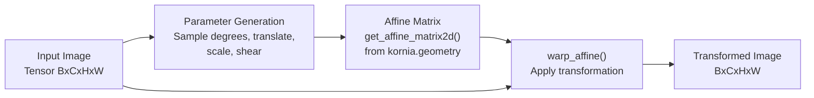
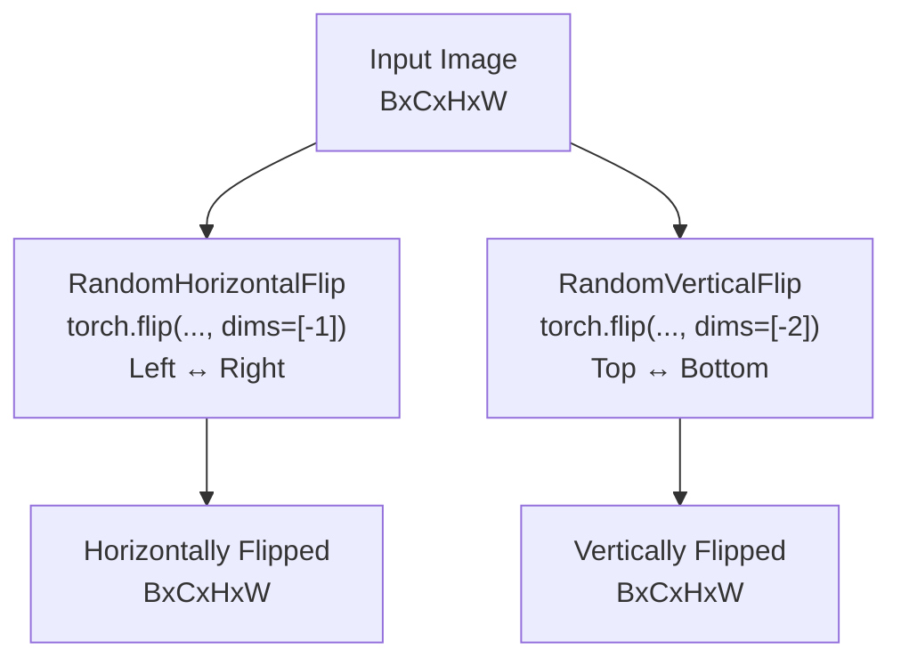
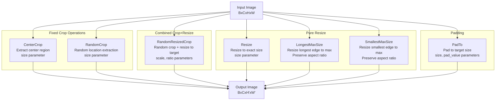
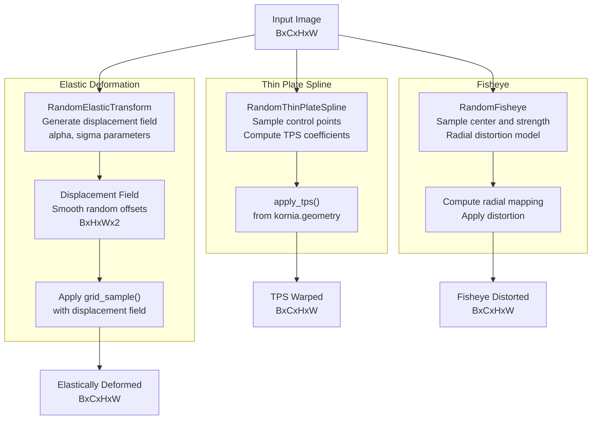
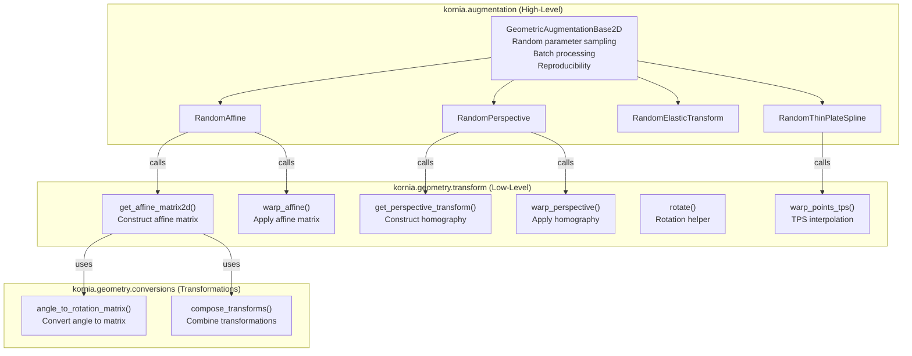

<!-- source: DeepWiki mcp.deepwiki.com · repo kornia/kornia · page 4.2 2D Geometric Augmentations · fetched 2026-10-21 -->

# 2D Geometric Augmentations

<details>
<summary>Relevant source files</summary>

The following files were used as context for generating this wiki page:

- [docs/source/augmentation.rst](docs/source/augmentation.rst)
- [kornia/augmentation/__init__.py](kornia/augmentation/__init__.py)

</details>


## Purpose and Scope

This document covers the 2D geometric augmentation modules in Kornia that transform spatial properties of images, including rotation, translation, scaling, cropping, flipping, and non-linear warping. These augmentations modify the spatial layout of pixels while preserving intensity values.

For information about:
- Base class architecture and inheritance hierarchy, see [Augmentation Base Classes and Architecture](#4.1)
- Color and intensity-based augmentations, see [2D Intensity Augmentations](#4.3)
- Container systems for chaining augmentations, see [ImageSequential and VideoSequential Containers](#4.6) and [AugmentationSequential for Multi-Modal Data](#4.7)
- 3D volumetric geometric augmentations, see [3D and Video Augmentations](#4.5)

Geometric augmentations in Kornia are differentiable, GPU-accelerated, and support batch processing. They leverage the low-level geometric transformation primitives from `kornia.geometry.transform` and can be applied to images, masks, bounding boxes, and keypoints simultaneously through container classes.

**Sources**: [kornia/augmentation/__init__.py:1-205](), [docs/source/augmentation.rst:1-77]()

---

## Augmentation Class Hierarchy

All 2D geometric augmentations inherit from `GeometricAugmentationBase2D`, which provides common spatial transformation functionality. The hierarchy flows from the base `AugmentationBase` through dimensionality-specific bases.

```mermaid
graph TB
    AugBase["AugmentationBase<br/>(kornia.augmentation.base)"]
    AugBase2D["AugmentationBase2D<br/>(kornia.augmentation._2d.base)"]
    RigidAffine["RigidAffineAugmentationBase2D<br/>For affine-compatible transforms"]
    GeomBase["GeometricAugmentationBase2D<br/>(kornia.augmentation._2d.geometric.base)<br/>Spatial transformations"]
    
    subgraph "Affine & Perspective"
        Affine["RandomAffine"]
        Perspective["RandomPerspective"]
        Shear["RandomShear"]
        Translate["RandomTranslate"]
    end
    
    subgraph "Rotation"
        Rotation["RandomRotation"]
        Rotation90["RandomRotation90"]
    end
    
    subgraph "Flip"
        HFlip["RandomHorizontalFlip"]
        VFlip["RandomVerticalFlip"]
    end
    
    subgraph "Crop & Resize"
        CenterCrop["CenterCrop"]
        RandomCrop["RandomCrop"]
        ResizedCrop["RandomResizedCrop"]
        Resize["Resize"]
        LongestMax["LongestMaxSize"]
        SmallestMax["SmallestMaxSize"]
        PadTo["PadTo"]
    end
    
    subgraph "Non-Linear"
        Elastic["RandomElasticTransform"]
        TPS["RandomThinPlateSpline"]
        Fisheye["RandomFisheye"]
    end
    
    AugBase --> AugBase2D
    AugBase2D --> RigidAffine
    AugBase2D --> GeomBase
    
    GeomBase --> Affine
    GeomBase --> Perspective
    GeomBase --> Shear
    GeomBase --> Translate
    GeomBase --> Rotation
    GeomBase --> Rotation90
    GeomBase --> HFlip
    GeomBase --> VFlip
    GeomBase --> CenterCrop
    GeomBase --> RandomCrop
    GeomBase --> ResizedCrop
    GeomBase --> Resize
    GeomBase --> LongestMax
    GeomBase --> SmallestMax
    GeomBase --> PadTo
    GeomBase --> Elastic
    GeomBase --> TPS
    GeomBase --> Fisheye
```

**Sources**: [kornia/augmentation/__init__.py:88-90](), [kornia/augmentation/__init__.py:25-87]()

---

## Affine and Perspective Transformations

Affine and perspective transformations apply linear and projective geometric transformations to images. These transformations preserve parallel lines (affine) or simulate viewpoint changes (perspective).

### Transformation Types Overview

| Augmentation Class | Transformation Type | Parameters | Use Case |
|-------------------|---------------------|------------|----------|
| `RandomAffine` | 2D affine (6 DOF) | degrees, translate, scale, shear | Combined affine operations |
| `RandomPerspective` | Perspective (8 DOF) | distortion_scale | Simulate camera viewpoint changes |
| `RandomShear` | Shear affine | shear_x, shear_y | Horizontal/vertical skewing |
| `RandomTranslate` | Translation | translate | Spatial shifting |

### RandomAffine

Applies a random affine transformation combining rotation, translation, scaling, and shearing. This is a compound transformation that can simulate multiple camera and object variations in a single operation.



**Parameters**:
- `degrees`: Range for rotation angle sampling (float or tuple)
- `translate`: Max translation percentage (tuple of 2 floats, 0.0-1.0)
- `scale`: Range for scale factor sampling (tuple of 2 floats)
- `shear`: Range for shear angle sampling (float or tuple)
- `same_on_batch`: Apply same transformation to all batch elements
- `keepdim`: Maintain input dimensions

**Sources**: [kornia/augmentation/__init__.py:33]()

### RandomPerspective

Applies random perspective transformation by perturbing the four corners of the image. This simulates changes in camera viewpoint and is useful for training models robust to viewing angle variations.

**Parameters**:
- `distortion_scale`: Magnitude of corner perturbations (0.0-1.0)
- `same_on_batch`: Apply same transformation across batch
- `keepdim`: Maintain input dimensions

The transformation internally uses `kornia.geometry.transform.get_perspective_transform()` to compute the homography matrix from the perturbed corners.

**Sources**: [kornia/augmentation/__init__.py:64]()

### RandomShear

Applies random shearing transformation along horizontal or vertical axes. Shearing preserves area but skews the image.

**Parameters**:
- `shear`: Shear angle range in degrees (float or tuple for x and y)
- `same_on_batch`: Consistent shearing across batch

**Sources**: [kornia/augmentation/__init__.py:78]()

### RandomTranslate

Applies random translation (spatial shifting) without rotation or scaling. Useful for position invariance.

**Parameters**:
- `translate`: Max translation as fraction of image size (tuple of 2 floats)
- `same_on_batch`: Same translation for all batch elements

**Sources**: [kornia/augmentation/__init__.py:82]()

---

## Rotation Transformations

Rotation augmentations change the angular orientation of images around their center point.

### RandomRotation

Applies random rotation by a continuous angle sampled from a specified range. This is the most flexible rotation augmentation.

**Parameters**:
- `degrees`: Rotation angle range (float for symmetric ±range, or tuple for [min, max])
- `same_on_batch`: Apply same angle to entire batch
- `keepdim`: Maintain original dimensions (may crop corners)

The transformation uses `kornia.geometry.transform.rotate()` internally, which applies a rotation matrix derived from the sampled angle.

**Sources**: [kornia/augmentation/__init__.py:73]()

### RandomRotation90

Applies random 90-degree rotations (0°, 90°, 180°, 270°). This is more efficient than `RandomRotation` when only orthogonal rotations are needed, as it can use optimized tensor operations.

**Parameters**:
- `same_on_batch`: Apply same rotation to all images in batch

Useful for datasets where orientation has discrete symmetries (e.g., satellite imagery, microscopy).

**Sources**: [kornia/augmentation/__init__.py:74]()

---

## Flip Operations

Flip augmentations provide mirror reflections along horizontal or vertical axes. These are computationally efficient and create perfectly symmetric variants.

### Flip Augmentation Comparison



### RandomHorizontalFlip

Flips the image horizontally with a specified probability. This is one of the most commonly used augmentations as many natural image categories have left-right symmetry.

**Parameters**:
- `p`: Probability of applying the flip (default: 0.5)
- `same_on_batch`: Apply same flip decision to all batch elements

**Sources**: [kornia/augmentation/__init__.py:53]()

### RandomVerticalFlip

Flips the image vertically with a specified probability. Less commonly used than horizontal flip but useful for certain domains (e.g., satellite imagery, medical imaging).

**Parameters**:
- `p`: Probability of applying the flip (default: 0.5)
- `same_on_batch`: Apply same flip decision to all batch elements

**Sources**: [kornia/augmentation/__init__.py:84]()

---

## Crop and Resize Operations

Crop and resize augmentations change the spatial extent and resolution of images. These are essential for training models at different scales and for handling variable input sizes.

### Crop and Resize Operations Overview



### CenterCrop

Extracts a fixed-size region from the center of the image. This is deterministic (non-random) and commonly used for validation/testing.

**Parameters**:
- `size`: Output size as int (square) or tuple (height, width)
- `cropping_mode`: How to handle size mismatches ("resample" or "slice")

**Sources**: [kornia/augmentation/__init__.py:26]()

### RandomCrop

Extracts a fixed-size region from a random location in the image. The crop position is uniformly sampled.

**Parameters**:
- `size`: Output size as int or tuple
- `padding`: Optional padding before cropping
- `pad_if_needed`: Pad if image is smaller than crop size
- `fill`: Value for padding
- `same_on_batch`: Use same crop location for entire batch

**Sources**: [kornia/augmentation/__init__.py:41]()

### RandomResizedCrop

Performs a random crop followed by resizing to a target size. This combines scale variation with spatial cropping and is widely used in image classification training (e.g., ImageNet training).

**Parameters**:
- `size`: Target output size
- `scale`: Range of crop area as fraction of original (tuple of 2 floats)
- `ratio`: Range of aspect ratios (tuple of 2 floats)
- `same_on_batch`: Consistent crop across batch

The augmentation first samples a crop area and aspect ratio, extracts the crop, then resizes it to the target size using `kornia.geometry.transform.resize()`.

**Sources**: [kornia/augmentation/__init__.py:71]()

### Resize

Resizes the image to a specified size. This is deterministic and used for preprocessing.

**Parameters**:
- `size`: Target size as int or tuple
- `interpolation`: Interpolation mode (e.g., "bilinear", "nearest")
- `antialias`: Apply anti-aliasing for downsampling

**Sources**: [kornia/augmentation/__init__.py:85]()

### LongestMaxSize

Resizes the image so that the longest edge matches a specified maximum size while preserving the aspect ratio. The shorter edge is scaled proportionally.

**Parameters**:
- `max_size`: Maximum size for the longest edge

**Sources**: [kornia/augmentation/__init__.py:30]()

### SmallestMaxSize

Resizes the image so that the smallest edge matches a specified maximum size while preserving the aspect ratio. The longer edge is scaled proportionally.

**Parameters**:
- `max_size`: Maximum size for the smallest edge

**Sources**: [kornia/augmentation/__init__.py:86]()

### PadTo

Pads the image to reach a target size. If the image is already larger than the target size, no padding is applied.

**Parameters**:
- `size`: Target size after padding
- `pad_value`: Value to use for padding (default: 0)
- `padding_mode`: Padding mode (e.g., "constant", "reflect")

**Sources**: [kornia/augmentation/__init__.py:32]()

---

## Elastic and Non-Linear Deformations

Non-linear deformations apply smooth, spatially-varying transformations that cannot be represented by affine or perspective matrices. These augmentations simulate material deformations and lens distortions.

### Non-Linear Transformation Architecture



### RandomElasticTransform

Applies elastic deformation by generating a smooth random displacement field and warping the image accordingly. This simulates non-rigid material deformations and is particularly useful for medical image analysis.

**Parameters**:
- `alpha`: Magnitude of displacement (controls deformation strength)
- `sigma`: Standard deviation for Gaussian smoothing of displacement field (controls smoothness)
- `same_on_batch`: Apply same deformation to entire batch

The implementation generates random displacement fields, applies Gaussian smoothing, scales by `alpha`, and uses `torch.nn.functional.grid_sample()` for interpolation.

**Sources**: [kornia/augmentation/__init__.py:44]()

### RandomThinPlateSpline

Applies thin-plate spline (TPS) warping by randomly perturbing control points. TPS produces smooth interpolations between control points and is commonly used for shape variation.

**Parameters**:
- `scale`: Magnitude of control point perturbations (0.0-1.0)
- `same_on_batch`: Apply same TPS warp to batch

The transformation uses `kornia.geometry.transform.warp_points_tps()` internally to compute the smooth warping function.

**Sources**: [kornia/augmentation/__init__.py:81]()

### RandomFisheye

Applies fisheye (barrel) distortion by simulating wide-angle lens effects. This uses a radial distortion model where distortion increases with distance from a center point.

**Parameters**:
- `center_x`: Range for distortion center x-coordinate
- `center_y`: Range for distortion center y-coordinate
- `gamma`: Strength of fisheye effect
- `same_on_batch`: Apply same distortion to batch

Fisheye distortion maps pixel coordinates using: `r' = r * (1 + γ * r²)` where `r` is the distance from the center.

**Sources**: [kornia/augmentation/__init__.py:47]()

---

## Integration with Geometry Module

Geometric augmentations are built on top of low-level primitives from `kornia.geometry`. This design separates the random parameter generation and augmentation logic from the core geometric transformation operations.

### Dependency Structure



### Key Functional Dependencies

| Augmentation | Geometry Functions Used | Purpose |
|--------------|------------------------|---------|
| `RandomAffine` | `get_affine_matrix2d()`, `warp_affine()` | Matrix construction and application |
| `RandomPerspective` | `get_perspective_transform()`, `warp_perspective()` | Homography from corner points |
| `RandomRotation` | `rotate()` or `get_rotation_matrix2d()`, `warp_affine()` | Rotation matrix and warping |
| `RandomElasticTransform` | `torch.nn.functional.grid_sample()` | Grid-based interpolation |
| `RandomThinPlateSpline` | `warp_points_tps()` | TPS coefficient computation and warping |
| `RandomCrop`, `Resize` | `crop_by_indices()`, `resize()` | Tensor slicing and interpolation |

The separation allows:
1. **Reusability**: Geometry functions can be used independently outside augmentation pipelines
2. **Differentiability**: All operations support gradient flow through transformations
3. **Testability**: Low-level functions can be tested independently
4. **Flexibility**: Users can build custom augmentations using geometry primitives

**Sources**: [kornia/augmentation/__init__.py:25-87]()

---

## Usage Patterns and Best Practices

### Basic Usage

Geometric augmentations can be used individually or composed in containers:

```python
# Individual augmentation
aug = RandomRotation(degrees=30.0, p=0.5)
output = aug(input_tensor)

# Access transformation parameters
params = aug._params  # Stores transformation details

# Sequential composition
from kornia.augmentation import ImageSequential
pipeline = ImageSequential(
    RandomHorizontalFlip(p=0.5),
    RandomRotation(degrees=15.0),
    RandomResizedCrop(size=(224, 224), scale=(0.8, 1.0))
)
output = pipeline(input_tensor)
```

### Multi-Modal Augmentation

For synchronized augmentation of images and labels, use `AugmentationSequential` (see [AugmentationSequential for Multi-Modal Data](#4.7)):

```python
from kornia.augmentation import AugmentationSequential, RandomAffine
from kornia.constants import DataKey

pipeline = AugmentationSequential(
    RandomAffine(degrees=30, translate=(0.1, 0.1)),
    data_keys=[DataKey.INPUT, DataKey.MASK, DataKey.BBOX]
)

output_dict = pipeline(input_dict)
# Same transformation applied to image, mask, and bounding boxes
```

### Common Parameter Patterns

| Parameter | Purpose | Typical Values |
|-----------|---------|----------------|
| `p` | Probability of applying augmentation | 0.5 for training, 0.0 for validation |
| `same_on_batch` | Apply same transform to all batch elements | `False` for independent, `True` for video frames |
| `keepdim` | Maintain input dimensions | `True` to preserve size |
| `degrees` | Rotation angle range | 15-45 for moderate, 90+ for aggressive |
| `scale` | Scale factor range | (0.8, 1.2) typical |
| `translate` | Translation range | (0.1, 0.1) as fraction of size |

### Performance Considerations

1. **Batch Processing**: All augmentations support batched inputs (BxCxHxW), providing GPU parallelism
2. **In-Place Operations**: Flips are extremely fast as they use tensor view operations
3. **Interpolation Overhead**: Warping operations (affine, perspective) require interpolation; use `"nearest"` for masks
4. **Parameter Caching**: Set `same_on_batch=True` when processing video frames to maintain temporal consistency

**Sources**: [kornia/augmentation/__init__.py:108-115](), [docs/source/augmentation.rst:6-18]()

---

