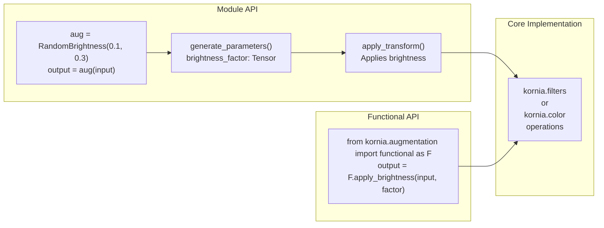
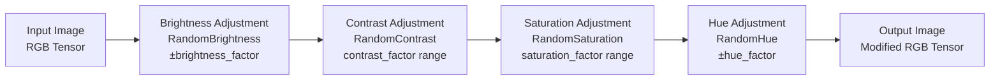
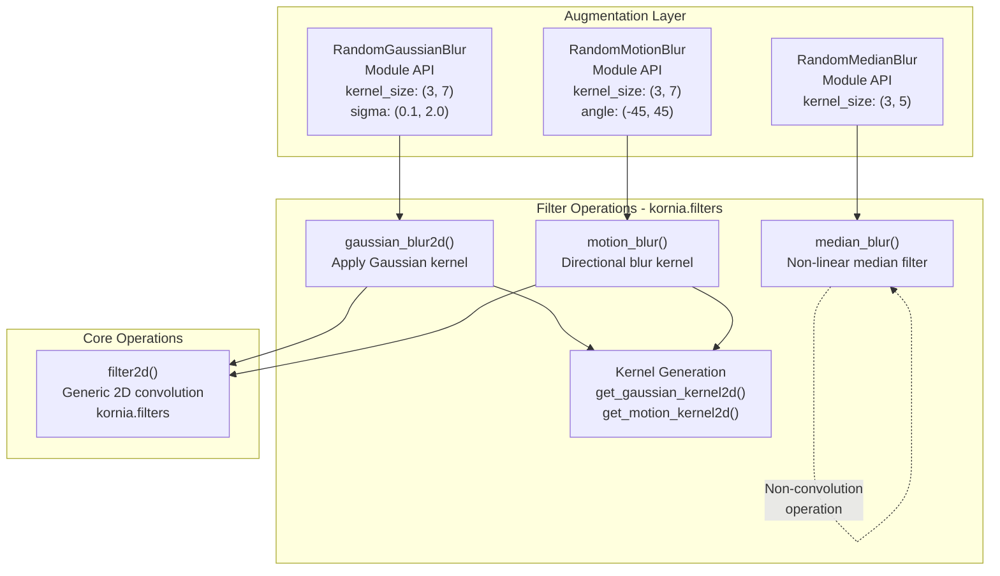
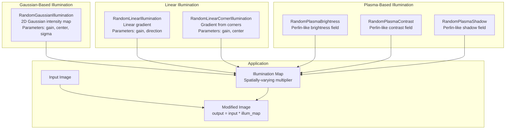
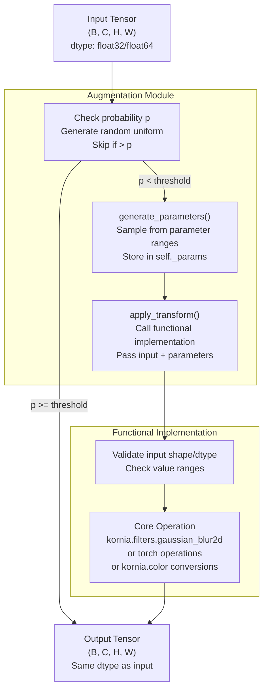

<!-- source: DeepWiki mcp.deepwiki.com · repo kornia/kornia · page 4.3 2D Intensity Augmentations · fetched 2026-10-21 -->

# 2D Intensity Augmentations

<details>
<summary>Relevant source files</summary>

The following files were used as context for generating this wiki page:

- [docs/source/augmentation.rst](docs/source/augmentation.rst)
- [kornia/augmentation/__init__.py](kornia/augmentation/__init__.py)

</details>


## Purpose and Scope

This page documents intensity augmentations for 2D images in Kornia's augmentation system. Intensity augmentations modify pixel values without altering spatial structure—they change colors, add noise, apply blur, or simulate environmental effects like weather and lighting conditions. These operations complement geometric augmentations and are essential for training robust computer vision models.

For geometric transformations (rotation, affine, perspective, etc.), see page 4.2 (2D Geometric Augmentations). For multi-image mixing operations, see page 4.4 (Mix and Advanced Augmentations). For the container system that sequences these augmentations, see page 4.7 (AugmentationSequential for Multi-Modal Data).

## Architecture Overview

All 2D intensity augmentations inherit from `IntensityAugmentationBase2D` [kornia/augmentation/_2d/intensity/base.py](), which itself derives from `AugmentationBase2D` [kornia/augmentation/_2d/base.py](). The base class provides:

- `generate_parameters()`: Samples random parameters from configured ranges
- `apply_transform()`: Applies the transformation using generated parameters
- `transform_tensor()`: Core transformation logic specific to each augmentation
- Integration hooks for `ImageSequential` and `AugmentationSequential` containers

```mermaid
graph TB
    subgraph "Base Class Hierarchy"
        AugBase2D["AugmentationBase2D<br/>kornia.augmentation._2d.base"]
        IntensityBase["IntensityAugmentationBase2D<br/>kornia.augmentation._2d.intensity.base"]
    end
    
    subgraph "Color Adjustments"
        Brightness["RandomBrightness"]
        Contrast["RandomContrast"]
        Saturation["RandomSaturation"]
        Hue["RandomHue"]
        Gamma["RandomGamma"]
        ColorJitter["ColorJitter<br/>Combined color ops"]
    end
    
    subgraph "Blur Operations"
        GaussianBlur["RandomGaussianBlur"]
        MotionBlur["RandomMotionBlur"]
        MedianBlur["RandomMedianBlur"]
        BoxBlur["RandomBoxBlur"]
    end
    
    subgraph "Noise Operations"
        GaussianNoise["RandomGaussianNoise"]
        SaltPepper["RandomSaltAndPepperNoise"]
    end
    
    subgraph "Illumination Effects"
        GaussianIllum["RandomGaussianIllumination"]
        LinearIllum["RandomLinearIllumination"]
        LinearCornerIllum["RandomLinearCornerIllumination"]
        PlasmaBright["RandomPlasmaBrightness"]
        PlasmaContrast["RandomPlasmaContrast"]
        PlasmaShadow["RandomPlasmaShadow"]
    end
    
    subgraph "Weather Effects"
        Rain["RandomRain"]
        Snow["RandomSnow"]
    end
    
    subgraph "Other Effects"
        AutoContrast["RandomAutoContrast"]
        Clahe["RandomClahe"]
        Equalize["RandomEqualize"]
        Grayscale["RandomGrayscale"]
        Invert["RandomInvert"]
        JPEG["RandomJPEG"]
        Posterize["RandomPosterize"]
        RGBShift["RandomRGBShift"]
        Sharpness["RandomSharpness"]
        Solarize["RandomSolarize"]
        PlanckianJitter["RandomPlanckianJitter"]
        ChannelDropout["RandomChannelDropout"]
        ChannelShuffle["RandomChannelShuffle"]
    end
    
    AugBase2D --> IntensityBase
    
    IntensityBase --> Brightness
    IntensityBase --> Contrast
    IntensityBase --> Saturation
    IntensityBase --> Hue
    IntensityBase --> Gamma
    IntensityBase --> ColorJitter
    
    IntensityBase --> GaussianBlur
    IntensityBase --> MotionBlur
    IntensityBase --> MedianBlur
    IntensityBase --> BoxBlur
    
    IntensityBase --> GaussianNoise
    IntensityBase --> SaltPepper
    
    IntensityBase --> GaussianIllum
    IntensityBase --> LinearIllum
    IntensityBase --> LinearCornerIllum
    IntensityBase --> PlasmaBright
    IntensityBase --> PlasmaContrast
    IntensityBase --> PlasmaShadow
    
    IntensityBase --> Rain
    IntensityBase --> Snow
    
    IntensityBase --> AutoContrast
    IntensityBase --> Clahe
    IntensityBase --> Equalize
    IntensityBase --> Grayscale
    IntensityBase --> Invert
    IntensityBase --> JPEG
    IntensityBase --> Posterize
    IntensityBase --> RGBShift
    IntensityBase --> Sharpness
    IntensityBase --> Solarize
    IntensityBase --> PlanckianJitter
    IntensityBase --> ChannelDropout
    IntensityBase --> ChannelShuffle
```



**Diagram: Complete intensity augmentation class hierarchy**

Sources: [kornia/augmentation/__init__.py:25-87](), [kornia/augmentation/_2d/intensity/base.py]()

### Dual API Pattern

Like all Kornia augmentations, intensity operations follow a dual API design:

1. **Module API**: Stateful `nn.Module` classes (e.g., `RandomBrightness`, `RandomGaussianBlur`) with parameter ranges configured at initialization
2. **Functional API**: Pure functions in `kornia.augmentation.functional` (e.g., `apply_brightness()`, `apply_gaussian_blur()`) for direct transformations with explicit parameters

The Module API generates random parameters in `forward_parameters()` on each forward pass, while the functional API requires explicit parameter tensors. Both APIs delegate to the same core implementations in `kornia.filters`, `kornia.color`, and `kornia.enhance`.



**Diagram: Dual API pattern for intensity augmentations**

Sources: [kornia/augmentation/_2d/intensity/base.py](), [kornia/augmentation/functional/]()

## Color Space Adjustments

Color adjustment augmentations modify pixel intensities in various color spaces to change brightness, contrast, saturation, hue, or apply gamma correction. These are among the most commonly used intensity augmentations.

| Augmentation | File | Parameters | Effect |
|--------------|------|------------|--------|
| `RandomBrightness` | [kornia/augmentation/_2d/intensity/brightness.py]() | `brightness: float \| tuple` | Adds constant: `output = input + brightness_factor` |
| `RandomContrast` | [kornia/augmentation/_2d/intensity/contrast.py]() | `contrast: float \| tuple` | Scales around mean: `output = (input - mean) * factor + mean` |
| `RandomSaturation` | [kornia/augmentation/_2d/intensity/saturation.py]() | `saturation: float \| tuple` | Adjusts color intensity in HSV space via `adjust_saturation()` |
| `RandomHue` | [kornia/augmentation/_2d/intensity/hue.py]() | `hue: float \| tuple` | Shifts hue channel: `hue = (hue + shift) % 360` |
| `RandomGamma` | [kornia/augmentation/_2d/intensity/gamma.py]() | `gamma: float \| tuple` | Power-law: `output = input^gamma` via `adjust_gamma()` |
| `ColorJitter` | [kornia/augmentation/_2d/intensity/color_jitter.py]() | `brightness, contrast, saturation, hue` | Sequential application of above transforms |

### ColorJitter: Combined Color Augmentation

`ColorJitter` [kornia/augmentation/_2d/intensity/color_jitter.py]() applies multiple color transformations in a randomized order. Unlike applying four separate augmentations, `ColorJitter`:

- Samples all parameters once per forward pass
- Applies transformations in random order to avoid systematic bias
- More efficient than composing four separate modules
- Commonly used in self-supervised learning (SimCLR, MoCo, BYOL)



**Diagram: ColorJitter operation sequence**

Sources: [kornia/augmentation/__init__.py:27-28](), [kornia/augmentation/_2d/intensity/color_jitter.py]()

### Gamma Correction

`RandomGamma` [kornia/augmentation/_2d/intensity/gamma.py]() applies power-law transformation: `output = input^gamma`. This is particularly useful for:

- Simulating different camera gamma curves
- Correcting for display characteristics
- Adjusting image brightness non-linearly
- Common range: `gamma ∈ [0.5, 2.0]` where `gamma < 1` brightens and `gamma > 1` darkens

The implementation uses `kornia.enhance.adjust_gamma()` which handles both float and uint8 inputs with proper value clamping.

Sources: [kornia/augmentation/__init__.py:48](), [kornia/augmentation/_2d/intensity/gamma.py](), [kornia/enhance/adjust.py]()

## Blur Operations

Blur augmentations apply various smoothing filters to simulate camera effects, motion, or focus variations. These operations build directly on `kornia.filters` implementations.

| Augmentation | File | Kernel Type | Parameters |
|--------------|------|-------------|------------|
| `RandomGaussianBlur` | [kornia/augmentation/_2d/intensity/gaussian_blur.py]() | Gaussian | `kernel_size: tuple[int, int]`, `sigma: tuple[float, float]` |
| `RandomMotionBlur` | [kornia/augmentation/_2d/intensity/motion_blur.py]() | Directional | `kernel_size: int`, `angle: float`, `direction: float` |
| `RandomMedianBlur` | [kornia/augmentation/_2d/intensity/median_blur.py]() | Median (non-linear) | `kernel_size: tuple[int, int]` |
| `RandomBoxBlur` | [kornia/augmentation/_2d/intensity/box_blur.py]() | Box/Uniform | `kernel_size: tuple[int, int]` |

### Integration with kornia.filters

Blur augmentations wrap filter operations with random parameter generation:



**Diagram: Blur augmentations and their filter dependencies**

Sources: [kornia/augmentation/__init__.py:49](), [kornia/augmentation/__init__.py:63](), [kornia/augmentation/__init__.py:60](), [kornia/augmentation/__init__.py:35]()

### Motion Blur Characteristics

`RandomMotionBlur` [kornia/augmentation/_2d/intensity/motion_blur.py]() simulates camera or object motion by applying directional blur kernels. The augmentation randomly samples:
- `kernel_size`: Length of motion blur (must be odd integer)
- `angle`: Rotation of motion direction in degrees (typically `[-45, 45]`)
- `direction`: Interpolation between horizontal (-1.0) and vertical (1.0) motion

The implementation uses `kornia.filters.motion_blur()` which generates a 1D kernel and rotates it to the specified angle using `kornia.filters.get_motion_kernel2d()`.

Sources: [kornia/augmentation/__init__.py:63](), [kornia/augmentation/_2d/intensity/motion_blur.py](), [kornia/filters/motion.py]()

## Noise Operations

Noise augmentations add random perturbations to simulate sensor noise, transmission errors, or to improve model robustness.

| Augmentation | File | Noise Type | Parameters |
|--------------|------|------------|------------|
| `RandomGaussianNoise` | [kornia/augmentation/_2d/intensity/gaussian_noise.py]() | Additive Gaussian | `mean: float`, `std: float` |
| `RandomSaltAndPepperNoise` | [kornia/augmentation/_2d/intensity/salt_pepper.py]() | Impulse noise | `amount: float`, `salt_vs_pepper: float` |

### Gaussian Noise

`RandomGaussianNoise` [kornia/augmentation/_2d/intensity/gaussian_noise.py]() adds independent Gaussian noise to each pixel:

```
noise ~ N(mean, std^2)
output = input + noise
```

This simulates:
- Sensor noise in low-light conditions
- Thermal noise in imaging sensors
- Transmission noise in digital channels

The noise is generated using `torch.randn()` and scaled appropriately per the input's value range.

### Salt and Pepper Noise

`RandomSaltAndPepperNoise` [kornia/augmentation/_2d/intensity/salt_pepper.py]() randomly replaces pixels with minimum (pepper=0) or maximum (salt=1) values:

- `amount`: Fraction of pixels to corrupt (e.g., 0.05 = 5%)
- `salt_vs_pepper`: Ratio between salt and pepper (0.5 = equal distribution)

This simulates:
- Bit errors in digital transmission
- Dead or hot pixels in sensors
- Impulse noise in analog systems

Sources: [kornia/augmentation/__init__.py:51](), [kornia/augmentation/__init__.py:75]()

## Illumination Effects

Illumination augmentations simulate varying lighting conditions by applying spatially-varying brightness adjustments. These are critical for training models robust to lighting changes.



**Diagram: Illumination effect types and application**

### Gaussian Illumination

`RandomGaussianIllumination` [kornia/augmentation/_2d/intensity/gaussian_illumination.py]() creates a 2D Gaussian intensity distribution:

```
G(x,y) = gain * exp(-((x-cx)^2 + (y-cy)^2) / (2*sigma^2))
output = input * (1 + G(x,y))
```

Parameters:
- `gain`: Intensity of the effect (typically 0.5 to 2.0)
- `center`: Random center position (cx, cy)
- `sigma`: Spatial spread of the Gaussian

Simulates spotlight effects, vignetting, or localized illumination changes.

### Linear Illumination

`RandomLinearIllumination` [kornia/augmentation/_2d/intensity/linear_illumination.py]() applies a linear gradient:

```
L(x,y) = gain * (dx*x + dy*y) / sqrt(dx^2 + dy^2)
output = input * (1 + L(x,y))
```

`RandomLinearCornerIllumination` [kornia/augmentation/_2d/intensity/linear_corner_illumination.py]() creates gradients emanating from randomly selected corners, simulating angled lighting or shadow casting.

### Plasma-Based Effects

Plasma illumination effects [kornia/augmentation/_2d/intensity/plasma_*.py]() use Perlin-noise-like fields generated via fractal summation:

- `RandomPlasmaBrightness`: Adds spatially-varying brightness field
- `RandomPlasmaContrast`: Applies spatially-varying contrast field
- `RandomPlasmaShadow`: Creates naturalistic shadow patterns

These effects use recursive midpoint displacement or similar algorithms to generate smooth, natural-looking spatial variations.

Sources: [kornia/augmentation/__init__.py:50](), [kornia/augmentation/__init__.py:58-59](), [kornia/augmentation/__init__.py:66-68]()

## Weather Effects

Weather augmentations simulate rain and snow to improve model robustness to adverse conditions.

| Augmentation | File | Effect | Key Parameters |
|--------------|------|--------|----------------|
| `RandomRain` | [kornia/augmentation/_2d/intensity/rain.py]() | Rain streaks | `drop_height`, `drop_width`, `rain_type` |
| `RandomSnow` | [kornia/augmentation/_2d/intensity/snow.py]() | Snowflakes | `snow_coefficient`, `brightness_coefficient` |

### RandomRain

`RandomRain` [kornia/augmentation/_2d/intensity/rain.py]() simulates rain by adding semi-transparent diagonal streaks with directional blur:

- `drop_height`, `drop_width`: Dimensions of rain drops
- `rain_type`: Style variation (e.g., "drizzle", "heavy", "torrential")
- Uses additive blending with motion blur to create realistic streaks

Implementation generates random line segments and applies directional motion blur along the fall angle.

### RandomSnow

`RandomSnow` [kornia/augmentation/_2d/intensity/snow.py]() simulates snowfall by adding bright particles of varying sizes:

- `snow_coefficient`: Density of snowflakes (0.0 to 1.0)
- `brightness_coefficient`: How bright the snow appears
- Uses circular or irregular particle shapes with Gaussian blur for soft edges

Sources: [kornia/augmentation/__init__.py:70](), [kornia/augmentation/__init__.py:79]()

## Channel Operations

Channel-level augmentations manipulate individual color channels independently.

| Augmentation | File | Operation | Effect |
|--------------|------|-----------|--------|
| `RandomChannelShuffle` | [kornia/augmentation/_2d/intensity/channel_shuffle.py]() | Permutes channels | `output[:, perm] = input` |
| `RandomChannelDropout` | [kornia/augmentation/_2d/intensity/channel_dropout.py]() | Zeros channels | `output[:, dropped_channels] = 0` |
| `RandomRGBShift` | [kornia/augmentation/_2d/intensity/rgb_shift.py]() | Shifts per channel | `output[:, i] = input[:, i] + shift[i]` |

### RandomChannelShuffle

`RandomChannelShuffle` [kornia/augmentation/_2d/intensity/channel_shuffle.py]() randomly permutes color channels using `torch.randperm()`:

- All 6 permutations of RGB are equally likely
- Helps models learn channel-invariant features
- Useful for robustness to different camera Bayer patterns

### RandomChannelDropout

`RandomChannelDropout` [kornia/augmentation/_2d/intensity/channel_dropout.py]() zeros out random channels:

- Can drop 1, 2, or all 3 channels
- `fill_value` parameter allows using values other than zero
- Encourages models to learn robust single-channel features
- Simulates sensor failures or missing data

### RandomRGBShift

`RandomRGBShift` [kornia/augmentation/_2d/intensity/rgb_shift.py]() independently shifts each RGB channel by a random offset:

- Simulates chromatic aberration in lenses
- Models sensor misalignment or color registration errors
- Each channel gets independent shift: `r_shift`, `g_shift`, `b_shift`

Sources: [kornia/augmentation/__init__.py:38](), [kornia/augmentation/__init__.py:37](), [kornia/augmentation/__init__.py:72]()

## Adaptive Histogram Operations

Histogram-based augmentations adjust pixel distributions for contrast enhancement.

| Augmentation | File | Method | Effect |
|--------------|------|--------|--------|
| `RandomAutoContrast` | [kornia/augmentation/_2d/intensity/auto_contrast.py]() | Histogram stretching | Maps `[min, max]` to `[0, 1]` |
| `RandomEqualize` | [kornia/augmentation/_2d/intensity/equalize.py]() | Histogram equalization | Redistributes intensities uniformly |
| `RandomClahe` | [kornia/augmentation/_2d/intensity/clahe.py]() | CLAHE | Local adaptive equalization |

### RandomAutoContrast

`RandomAutoContrast` [kornia/augmentation/_2d/intensity/auto_contrast.py]() automatically adjusts contrast by histogram stretching:

```
min_val, max_val = input.min(), input.max()
output = (input - min_val) / (max_val - min_val)
```

Uses `kornia.enhance.autocontrast()` which operates per-channel or per-image depending on configuration.

### RandomEqualize

`RandomEqualize` [kornia/augmentation/_2d/intensity/equalize.py]() applies histogram equalization via `kornia.enhance.equalize()`:

1. Computes cumulative distribution function (CDF) of intensities
2. Maps input intensities through CDF to achieve uniform distribution
3. Significantly enhances contrast in low-contrast regions

### RandomClahe

`RandomClahe` [kornia/augmentation/_2d/intensity/clahe.py]() applies Contrast Limited Adaptive Histogram Equalization:

- `clip_limit`: Maximum slope of CDF (prevents noise amplification)
- `grid_size`: Size of local tiles for adaptive equalization
- Uses `kornia.enhance.clahe()` which divides image into tiles and equalizes each independently

CLAHE avoids the over-amplification of noise that standard equalization can produce in homogeneous regions.

Sources: [kornia/augmentation/__init__.py:34](), [kornia/augmentation/__init__.py:45](), [kornia/augmentation/__init__.py:39]()

## Specialized Effects

Several augmentations provide specialized effects for specific use cases.

### RandomSolarize

`RandomSolarize` [kornia/augmentation/_2d/intensity/solarize.py]() inverts pixel values above a threshold:

```
output = input if input < threshold else (1 - input)
```

- `thresholds`: Value above which to invert (typically 0.5)
- `additions`: Optional constant to add before inversion
- Common in self-supervised learning (SimCLR, BYOL, SwAV)
- Uses `kornia.enhance.solarize()`

### RandomPosterize

`RandomPosterize` [kornia/augmentation/_2d/intensity/posterize.py]() reduces bit depth per channel:

```
output = floor(input * 2^bits) / 2^bits
```

- `bits`: Number of bits to keep (e.g., 3 bits = 8 levels per channel)
- Creates quantized, poster-like appearance
- Uses `kornia.enhance.posterize()`

### RandomSharpness

`RandomSharpness` [kornia/augmentation/_2d/intensity/sharpness.py]() adjusts image sharpness:

```
blurred = gaussian_blur(input)
output = input + sharpness_factor * (input - blurred)
```

- `sharpness`: Factor for unsharp masking (typically 0.0 to 2.0)
- Uses `kornia.enhance.sharpness()` with unsharp masking

### RandomGrayscale

`RandomGrayscale` [kornia/augmentation/_2d/intensity/grayscale.py]() converts to grayscale:

- Uses `kornia.color.rgb_to_grayscale()` with standard luminance weights: `0.299*R + 0.587*G + 0.114*B`
- Output maintains 3 channels (replicated grayscale value)
- Helps models learn luminance-based features independent of color

### RandomInvert

`RandomInvert` [kornia/augmentation/_2d/intensity/invert.py]() inverts all pixel values:

```
output = max_val - input
```

For normalized images (0-1 range): `output = 1 - input`

### RandomJPEG

`RandomJPEG` [kornia/augmentation/_2d/intensity/jpeg.py]() simulates JPEG compression artifacts:

1. Encodes image to JPEG with random quality factor (0-100)
2. Decodes back to tensor
3. Introduces blocking artifacts, quantization, and color subsampling effects
4. Helps models become robust to compression artifacts

Requires PIL or similar library for JPEG codec access.

### RandomPlanckianJitter

`RandomPlanckianJitter` [kornia/augmentation/_2d/intensity/planckian_jitter.py]() simulates different color temperatures:

- Shifts colors along the Planckian locus (blackbody radiation curve)
- More physically accurate than simple RGB shifts
- `mode`: Temperature range or specific Kelvin values
- Models different lighting conditions (tungsten, daylight, cloudy, etc.)

Uses lookup tables or analytical approximations of the Planckian locus to compute RGB multipliers for given color temperatures.

Sources: [kornia/augmentation/__init__.py:80](), [kornia/augmentation/__init__.py:69](), [kornia/augmentation/__init__.py:77](), [kornia/augmentation/__init__.py:52](), [kornia/augmentation/__init__.py:55](), [kornia/augmentation/__init__.py:57](), [kornia/augmentation/__init__.py:65]()

## Usage Patterns

### Standalone Usage

Each intensity augmentation can be used independently as an `nn.Module`:

```python
import kornia.augmentation as K

# Initialize augmentation with parameter ranges
brightness_aug = K.RandomBrightness(brightness=(0.8, 1.2), p=0.5)

# Apply to batch of images (B, C, H, W)
input_tensor = torch.rand(4, 3, 256, 256)
output = brightness_aug(input_tensor)

# Access generated transformation parameters
params = brightness_aug._params  # List of ParamItem objects
brightness_factor = params[0].data['brightness_factor']  # Tensor of shape (B,)
```

The parameter ranges can be specified as:
- Single value: Fixed parameter (no randomness)
- Tuple `(min, max)`: Uniform sampling
- Tensor: Per-batch or per-sample values

### Sequential Composition

Intensity augmentations compose naturally in `AugmentationSequential` [kornia/augmentation/container/augment.py]():

```python
from kornia.augmentation import AugmentationSequential
import kornia.augmentation as K

aug_pipeline = AugmentationSequential(
    K.RandomBrightness(0.2, p=0.5),
    K.RandomContrast((0.8, 1.2), p=0.5),
    K.RandomGaussianBlur((3, 3), (0.1, 2.0), p=0.3),
    K.RandomGaussianNoise(mean=0., std=0.1, p=0.3),
    data_keys=["input"],
    same_on_batch=False,  # Different augmentations per batch item
)

# Apply pipeline
output = aug_pipeline(input_tensor)
```

Each augmentation in the sequence maintains independent parameter generation controlled by its own probability `p`.

### Integration with Geometric Augmentations

Intensity and geometric augmentations can be freely mixed in `AugmentationSequential` [kornia/augmentation/container/augment.py]():

```python
from kornia.augmentation import AugmentationSequential
import kornia.augmentation as K

full_pipeline = AugmentationSequential(
    # Geometric augmentations first (modify spatial structure)
    K.RandomAffine(degrees=30, translate=(0.1, 0.1), p=0.7),
    K.RandomPerspective(distortion_scale=0.2, p=0.5),
    
    # Then intensity augmentations (modify pixel values)
    K.ColorJitter(0.2, 0.2, 0.2, 0.1, p=0.8),
    K.RandomGaussianBlur((3, 3), (0.1, 2.0), p=0.3),
    K.RandomMotionBlur((3, 7), 35., 0.5, p=0.3),
    
    data_keys=["input", "mask"],
    same_on_batch=False,
)

# Apply to image and segmentation mask
outputs = full_pipeline(input_image, mask)
```

**Important**: Geometric augmentations apply to masks with nearest-neighbor resampling (to preserve label values), while intensity augmentations typically only apply to `data_keys=["input"]` since they shouldn't modify discrete labels.

For multi-modal pipelines with bounding boxes and keypoints, see page 4.7 (AugmentationSequential for Multi-Modal Data).

Sources: [kornia/augmentation/__init__.py:109](), [kornia/augmentation/container/augment.py]()

## Data Flow Through Intensity Augmentations



**Diagram: Complete data flow through an intensity augmentation**

### Key Characteristics

1. **Preserves Spatial Dimensions**: Unlike geometric augmentations, intensity operations maintain `(H, W)` dimensions exactly
2. **No Geometric Parameters**: Does not generate or use transformation matrices—only per-image scalar/tensor parameters
3. **Batch Processing**: All operations are fully batched with shape `(B, C, H, W)` and parallelized across GPU
4. **Differentiable**: All operations support backpropagation for end-to-end training and adversarial augmentation
5. **Device Agnostic**: Works on CPU, CUDA, MPS, and other PyTorch-supported devices
6. **Type Preservation**: Maintains input dtype (float32/float64) unless explicitly converting (e.g., `RandomGrayscale`)

Sources: [kornia/augmentation/_2d/intensity/base.py](), [kornia/augmentation/_2d/base.py]()

## Relationship to Other Modules

```mermaid
graph TB
    subgraph "kornia.filters"
        GaussKernel["get_gaussian_kernel2d<br/>kornia/filters/kernels.py"]
        MotionKernel["get_motion_kernel2d<br/>kornia/filters/motion.py"]
        Filter2D["filter2d<br/>kornia/filters/filter.py"]
        GaussBlur["gaussian_blur2d<br/>kornia/filters/gaussian.py"]
        MedianBlur["median_blur<br/>kornia/filters/median.py"]
        BoxBlur["box_blur<br/>kornia/filters/blur.py"]
    end
    
    subgraph "kornia.color"
        RGB2HSV["rgb_to_hsv<br/>kornia/color/hsv.py"]
        HSV2RGB["hsv_to_rgb<br/>kornia/color/hsv.py"]
        RGB2Grayscale["rgb_to_grayscale<br/>kornia/color/gray.py"]
    end
    
    subgraph "kornia.enhance"
        AdjustBrightness["adjust_brightness<br/>kornia/enhance/adjust.py"]
        AdjustContrast["adjust_contrast<br/>kornia/enhance/adjust.py"]
        AdjustGamma["adjust_gamma<br/>kornia/enhance/adjust.py"]
        AdjustSaturation["adjust_saturation<br/>kornia/enhance/adjust.py"]
        AdjustHue["adjust_hue<br/>kornia/enhance/adjust.py"]
        Equalize["equalize<br/>kornia/enhance/equalize.py"]
        Posterize["posterize<br/>kornia/enhance/posterize.py"]
        Sharpness["sharpness<br/>kornia/enhance/sharpness.py"]
        Solarize["solarize<br/>kornia/enhance/solarize.py"]
        Clahe["clahe<br/>kornia/enhance/clahe.py"]
    end
    
    subgraph "Intensity Augmentations - kornia/augmentation/_2d/intensity/"
        RandBright["RandomBrightness<br/>brightness.py"]
        RandContrast["RandomContrast<br/>contrast.py"]
        RandGamma["RandomGamma<br/>gamma.py"]
        RandGaussBlur["RandomGaussianBlur<br/>gaussian_blur.py"]
        RandMotionBlur["RandomMotionBlur<br/>motion_blur.py"]
        RandMedianBlur["RandomMedianBlur<br/>median_blur.py"]
        RandBoxBlur["RandomBoxBlur<br/>box_blur.py"]
        RandGrayscale["RandomGrayscale<br/>grayscale.py"]
        RandSat["RandomSaturation<br/>saturation.py"]
        RandHue["RandomHue<br/>hue.py"]
        RandEqualize["RandomEqualize<br/>equalize.py"]
        RandPosterize["RandomPosterize<br/>posterize.py"]
        RandSharpness["RandomSharpness<br/>sharpness.py"]
        RandSolarize["RandomSolarize<br/>solarize.py"]
        RandClahe["RandomClahe<br/>clahe.py"]
    end
    
    GaussBlur --> RandGaussBlur
    MedianBlur --> RandMedianBlur
    BoxBlur --> RandBoxBlur
    GaussKernel --> GaussBlur
    MotionKernel --> RandMotionBlur
    Filter2D --> GaussBlur
    Filter2D --> MotionKernel
    
    RGB2HSV --> RandSat
    RGB2HSV --> RandHue
    HSV2RGB --> RandSat
    HSV2RGB --> RandHue
    RGB2Grayscale --> RandGrayscale
    
    AdjustBrightness --> RandBright
    AdjustContrast --> RandContrast
    AdjustGamma --> RandGamma
    AdjustSaturation --> RandSat
    AdjustHue --> RandHue
    Equalize --> RandEqualize
    Posterize --> RandPosterize
    Sharpness --> RandSharpness
    Solarize --> RandSolarize
    Clahe --> RandClahe
```



**Diagram: Intensity augmentations build on kornia.filters, kornia.color, and kornia.enhance**

Intensity augmentations serve as the randomized, trainable wrappers around deterministic operations in other Kornia modules:

- **kornia.filters**: Provides blur kernels and convolution operations
- **kornia.color**: Provides color space conversions (RGB ↔ HSV for saturation/hue)
- **kornia.enhance**: Provides deterministic adjustment functions

This layered architecture promotes code reuse and maintains a clear separation between deterministic image processing (lower layers) and stochastic data augmentation (augmentation layer).

Sources: [kornia/augmentation/_2d/intensity/](), [kornia/filters/](), [kornia/color/](), [kornia/enhance/]()

## Performance Considerations

### GPU Acceleration

All intensity augmentations are GPU-accelerated and show significant speedup with larger batch sizes. From the benchmark table in [docs/source/augmentation.rst:40-66]():

- **ColorJiggle** (batch=128): 0.83ms vs 4.40ms CPU (5.3× speedup)
- **RandomGaussianBlur**: Fully batched convolution operations

### Memory Efficiency

Intensity augmentations generally have lower memory overhead than geometric augmentations because they:
- Don't require grid generation for warping
- Don't store transformation matrices
- Operate in-place when possible

### Computational Cost

Blur operations (especially large kernels) are the most expensive intensity augmentations. Consider:
- Using separable convolutions where possible (Gaussian blur)
- Limiting kernel sizes for real-time applications
- Adjusting augmentation probability based on computational budget

Sources: [docs/source/augmentation.rst:32-66]()

## Common Augmentation Recipes

### Basic Color Augmentation
```python
K.AugmentationSequential(
    K.ColorJitter(0.2, 0.2, 0.2, 0.1, p=0.8),
    K.RandomGrayscale(p=0.2),
)
```

### Robustness to Blur and Noise
```python
K.AugmentationSequential(
    K.RandomGaussianBlur((3, 7), (0.1, 2.0), p=0.5),
    K.RandomGaussianNoise(mean=0., std=0.1, p=0.3),
    K.RandomMotionBlur((3, 7), 35., 0.5, p=0.3),
)
```

### Illumination Robustness
```python
K.AugmentationSequential(
    K.RandomBrightness((-0.2, 0.2), p=0.5),
    K.RandomContrast((0.7, 1.3), p=0.5),
    K.RandomGaussianIllumination(gain=(0.5, 1.5), p=0.3),
)
```

### Weather and Environmental Effects
```python
K.AugmentationSequential(
    K.RandomRain(p=0.2),
    K.RandomSnow(p=0.2),
    K.RandomGaussianIllumination(p=0.3),
)
```

### Self-Supervised Learning (SimCLR-style)
```python
K.AugmentationSequential(
    K.ColorJitter(0.4, 0.4, 0.4, 0.1, p=0.8),
    K.RandomGrayscale(p=0.2),
    K.RandomGaussianBlur((3, 3), (0.1, 2.0), p=0.5),
    K.RandomSolarize(p=0.2),
)
```

Sources: [kornia/augmentation/__init__.py:20-82]()

---

