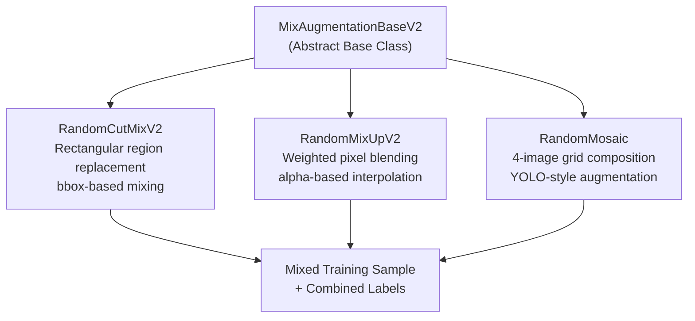
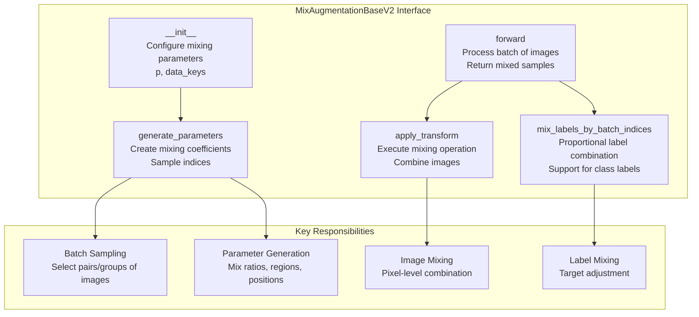
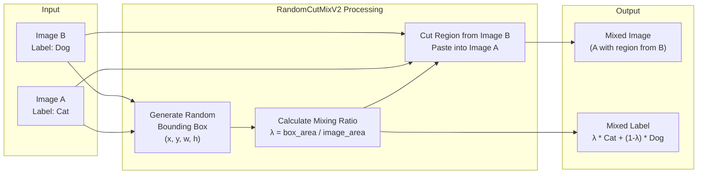
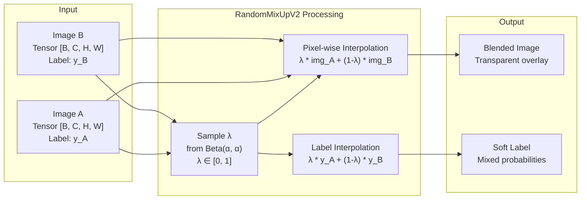
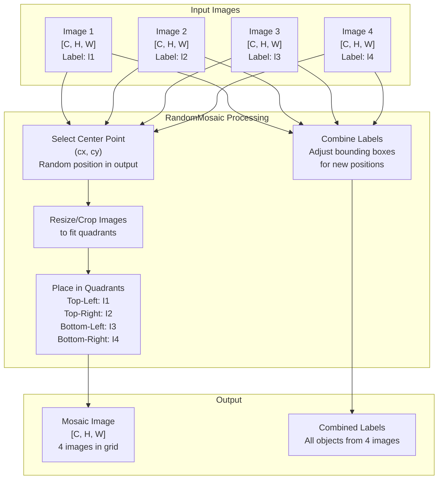
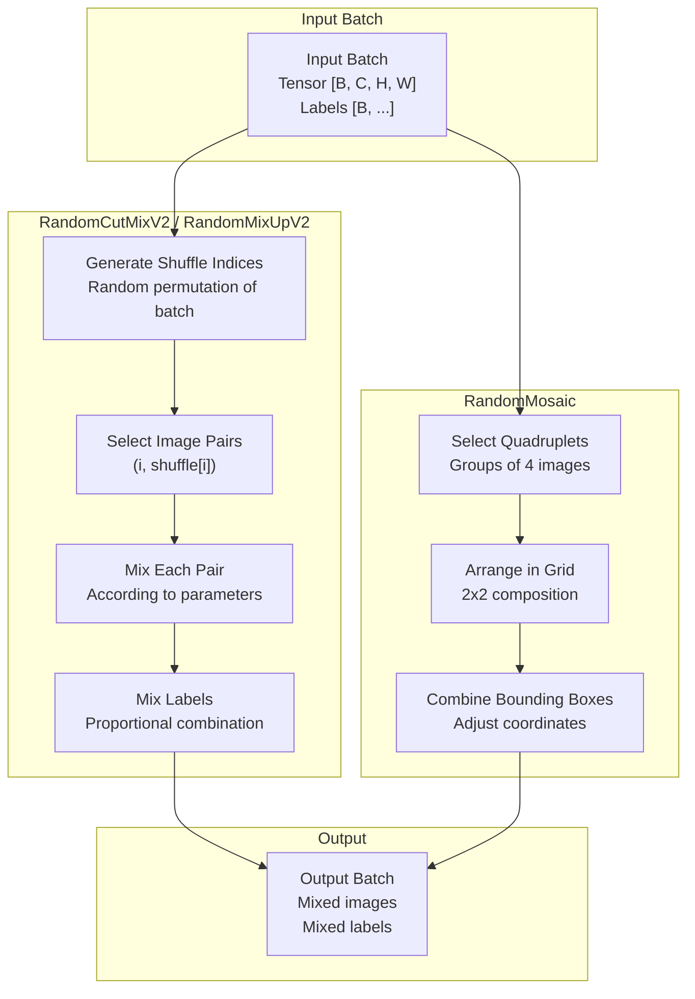
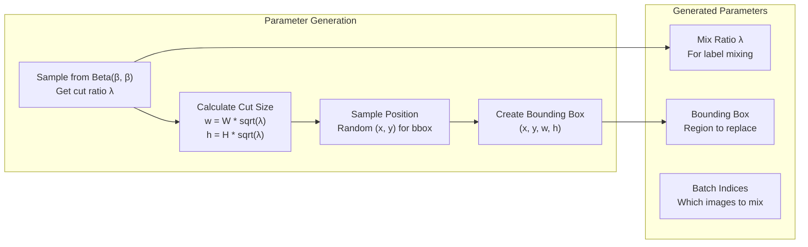

<!-- source: DeepWiki mcp.deepwiki.com · repo kornia/kornia · page 4.4 Mix and Advanced Augmentations · fetched 2026-10-21 -->

# Mix and Advanced Augmentations

<details>
<summary>Relevant source files</summary>

The following files were used as context for generating this wiki page:

- [docs/source/augmentation.rst](docs/source/augmentation.rst)
- [kornia/augmentation/__init__.py](kornia/augmentation/__init__.py)

</details>


## Purpose and Scope

This document explains mix augmentations in Kornia, which are multi-image augmentation techniques that combine multiple input images to generate a single output image. These augmentations differ from geometric augmentations (page 4.2) and intensity augmentations (page 4.3) in that they require multiple source images rather than operating on a single image.

Mix augmentations include `RandomCutMixV2`, `RandomMixUpV2`, and `RandomMosaic`, all inheriting from `MixAugmentationBaseV2`. These techniques are particularly effective for improving model generalization and robustness in classification and detection tasks.

For information about the base augmentation architecture, see page 4.1. For sequential composition of augmentations, see page 4.7.

## Overview of Mix Augmentations

Mix augmentations combine multiple images during training to create synthetic training samples. Unlike traditional single-image augmentations, these operations require access to multiple images from a batch simultaneously, necessitating special handling in the augmentation pipeline.

### Key Characteristics

| Characteristic | Description |
|---------------|-------------|
| **Multi-Image Input** | Requires 2 or more images as input |
| **Label Mixing** | Combines labels proportionally to image mixing ratios |
| **Batch-Level Operation** | Operates on batches rather than individual images |
| **Regularization Effect** | Reduces overfitting by creating harder training examples |
| **Non-Invertible** | Cannot be meaningfully inverted due to information from multiple sources |

### Available Mix Augmentations



**Sources:** [kornia/augmentation/__init__.py:42](), [kornia/augmentation/__init__.py:61-62](), [kornia/augmentation/__init__.py:91]()

## MixAugmentationBaseV2 Base Class

`MixAugmentationBaseV2` provides the foundation for all multi-image mixing augmentations. This base class handles the complexities of managing multiple input images, generating mixing parameters, and ensuring proper label combination.

### Architecture



### Core Functionality

The base class provides several critical functions:

1. **Batch Index Sampling**: Randomly selects which images to mix together
2. **Parameter Generation**: Creates mixing-specific parameters (ratios, bounding boxes, etc.)
3. **Label Mixing**: Combines labels proportionally based on mixing ratio
4. **Probability Control**: Applies mixing with probability `p`

**Sources:** [kornia/augmentation/_2d/mix/base.py](), [kornia/augmentation/_2d/base.py]()

## RandomCutMixV2

`RandomCutMixV2` implements the CutMix augmentation technique, which replaces a rectangular region in one image with the corresponding region from another image. The labels are mixed proportionally to the area of the replaced region.

### CutMix Operation



### Key Parameters

| Parameter | Type | Description |
|-----------|------|-------------|
| `cut_size` | tuple or Tensor | Height and width of the cut region (h, w) |
| `beta` | float or Tensor | Beta distribution parameter for sampling cut size |
| `num_mix` | int | Number of images to mix (typically 2) |
| `p` | float | Probability of applying the augmentation |

### Usage Pattern

The mixing ratio λ is determined by the area of the cut region:

```
λ = (cut_height * cut_width) / (image_height * image_width)
mixed_label = λ * label_A + (1 - λ) * label_B
```

**Sources:** [kornia/augmentation/__init__.py:42](), [kornia/augmentation/_2d/mix/]()

## RandomMixUpV2

`RandomMixUpV2` implements the MixUp augmentation technique, which creates linear interpolations between pairs of images and their labels. Unlike CutMix, MixUp blends entire images pixel-by-pixel using a mixing coefficient.

### MixUp Operation



### Key Parameters

| Parameter | Type | Description |
|-----------|------|-------------|
| `lambda_val` | float or Tensor | Mixing coefficient; if None, sampled from Beta distribution |
| `alpha` | float | Beta distribution parameter (α = β for symmetric distribution) |
| `p` | float | Probability of applying the augmentation |
| `same_on_batch` | bool | Use same λ for entire batch |

### Mathematical Formulation

MixUp creates a convex combination of two samples:

```
x_mixed = λ * x_i + (1 - λ) * x_j
y_mixed = λ * y_i + (1 - λ) * y_j

where λ ~ Beta(α, α)
```

The symmetric Beta distribution ensures that extreme mixing ratios (close to 0 or 1) are less likely when α > 1, promoting balanced mixing.

**Sources:** [kornia/augmentation/__init__.py:61](), [kornia/augmentation/_2d/mix/]()

## RandomMosaic

`RandomMosaic` implements mosaic augmentation, popularized by YOLO object detection models. This technique combines four images into a single training sample arranged in a 2×2 grid, with random positioning of the center point.

### Mosaic Operation



### Key Parameters

| Parameter | Type | Description |
|-----------|------|-------------|
| `output_size` | tuple | Output image size (H, W) |
| `mosaic_grid` | tuple | Grid size (default: (2, 2) for 4 images) |
| `start_ratio_range` | tuple | Range for center point placement (min, max) |
| `p` | float | Probability of applying the augmentation |
| `padding_mode` | str | Padding mode for images ('constant', 'reflect', etc.) |

### Grid Construction

1. **Center Point Selection**: Randomly sample center coordinates within bounds
2. **Image Placement**: Position four images in quadrants around center
3. **Boundary Handling**: Crop or pad images to fit within output dimensions
4. **Label Transformation**: Update bounding boxes and keypoints for new positions

### Comparison with Other Mixing Techniques

| Technique | Images Combined | Mixing Method | Label Mixing | Use Case |
|-----------|----------------|---------------|--------------|----------|
| `RandomCutMixV2` | 2 | Regional replacement | By area ratio | Classification, Detection |
| `RandomMixUpV2` | 2 | Pixel-wise blending | Linear interpolation | Classification |
| `RandomMosaic` | 4 | Grid composition | Position-based | Object Detection |

**Sources:** [kornia/augmentation/__init__.py:62](), [kornia/augmentation/_2d/mix/]()

## Implementation Details and Multi-Image Processing

### Batch Processing Architecture

Mix augmentations require special batch handling to access multiple images simultaneously:



### Label Mixing Strategy

Mix augmentations must handle different label formats:

#### Classification Labels

For one-hot or class indices, labels are mixed proportionally:

```
# For CutMix with λ = 0.7
mixed_label = 0.7 * label_A + 0.3 * label_B

# For MixUp with λ ~ Beta(α, α)
mixed_label = λ * label_A + (1 - λ) * label_B
```

#### Detection Labels (Bounding Boxes)

For object detection, bounding boxes from both images are combined:

```
# CutMix: Keep boxes that overlap with cut region
boxes_A_in_region = filter_boxes_by_region(boxes_A, cut_bbox)
boxes_B_in_region = transform_boxes(boxes_B, cut_bbox)
mixed_boxes = concatenate(boxes_A_in_region, boxes_B_in_region)

# Mosaic: Transform boxes to new positions in grid
boxes_quadrant_i = transform_to_quadrant(boxes_i, quadrant_position)
mixed_boxes = concatenate(boxes_1, boxes_2, boxes_3, boxes_4)
```

### Integration with AugmentationSequential

Mix augmentations can be used within `AugmentationSequential` containers, but require special consideration:

| Aspect | Consideration |
|--------|--------------|
| **Position in Pipeline** | Typically placed near the end, after geometric/intensity augmentations |
| **Batch Size Requirement** | Requires batch size ≥ 2 (for CutMix/MixUp) or ≥ 4 (for Mosaic) |
| **Label Handling** | Must use `data_keys` to specify labels for mixing |
| **same_on_batch** | Usually set to `False` to maximize diversity |

### Usage Example Structure

```python
# Typical usage pattern (conceptual)
aug_pipeline = AugmentationSequential(
    RandomHorizontalFlip(p=0.5),
    RandomRotation(degrees=10, p=0.5),
    ColorJitter(brightness=0.2, contrast=0.2, p=0.5),
    RandomCutMixV2(p=0.5),  # Applied with 50% probability
    data_keys=["input", "class_labels"],
    same_on_batch=False
)

# Mix augmentations will automatically:
# 1. Sample pairs/groups from the batch
# 2. Generate mixing parameters
# 3. Combine images according to technique
# 4. Mix labels proportionally
```

**Sources:** [kornia/augmentation/_2d/mix/base.py](), [kornia/augmentation/container/]()

## Parameter Generation and Randomization

### RandomCutMixV2 Parameters



### RandomMixUpV2 Parameters

| Parameter | Generation Method | Purpose |
|-----------|------------------|---------|
| `lambda_val` | Sampled from Beta(α, α) if not provided | Controls blending ratio between images |
| `batch_indices` | Random permutation of batch indices | Determines which images to pair |
| `mix_pairs` | Zip(batch, shuffled_batch) | Creates pairs for mixing |

### RandomMosaic Parameters

| Parameter | Generation Method | Purpose |
|-----------|------------------|---------|
| `center_x`, `center_y` | Uniform sampling within `start_ratio_range` | Position of grid center point |
| `image_indices` | Random quadruplets from batch | Which 4 images to combine |
| `quadrant_positions` | Computed from center point | Where to place each image |

## Performance Considerations

### Computational Complexity

| Augmentation | Time Complexity | Memory Overhead |
|--------------|----------------|-----------------|
| `RandomCutMixV2` | O(N) | Minimal (only cut region) |
| `RandomMixUpV2` | O(N) | 2x input (two full images) |
| `RandomMosaic` | O(4N) | 4x input (four images + resize) |

Where N is the number of pixels per image.

### Memory-Efficient Strategies

1. **In-place Operations**: Directly modify input tensors when possible
2. **Batch Slicing**: Process subsets of batch for very large batches
3. **Lazy Sampling**: Generate mixing parameters on-demand rather than pre-computing

### GPU Optimization

Mix augmentations benefit significantly from GPU acceleration:

- Parallel processing of all image pairs in batch
- Efficient tensor indexing and slicing operations
- Vectorized pixel-wise operations for MixUp
- Simultaneous label mixing computations

**Sources:** [kornia/augmentation/_2d/mix/]()

## Advanced Topics

### Custom Mix Augmentations

To implement custom mix augmentations, subclass `MixAugmentationBaseV2`:

1. Override `generate_parameters()` to define mixing logic
2. Implement `apply_transform()` for image combination
3. Handle label mixing via `mix_labels_by_batch_indices()`
4. Ensure proper parameter caching for reproducibility

### Multi-Stage Mixing

Mix augmentations can be combined (though typically only one is used per pipeline):

- Sequential application may create overly complex samples
- Probability control (`p` parameter) helps manage mixing frequency
- Monitor training metrics when using multiple mix augmentations

### Detection-Specific Considerations

For object detection tasks using mix augmentations:

1. **Bounding Box Transformation**: Boxes must be updated for new positions
2. **Small Object Handling**: Mosaic helps by including objects at multiple scales
3. **Class Imbalance**: Mix augmentations can help balance rare classes
4. **NMS Overlap**: Mixed samples may create challenging overlapping scenarios

**Sources:** [kornia/augmentation/_2d/mix/base.py]()

---

