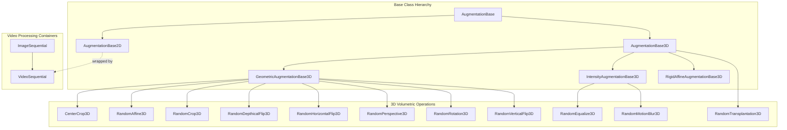
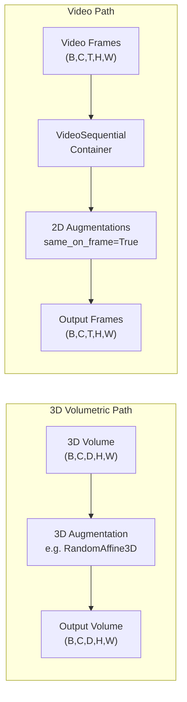
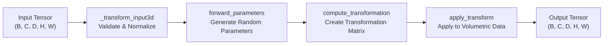
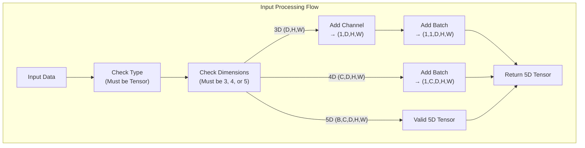
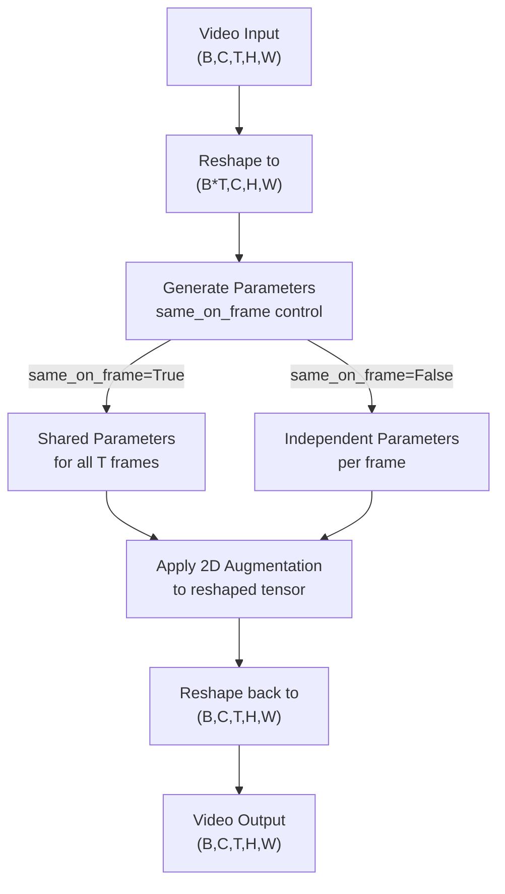

<!-- source: DeepWiki mcp.deepwiki.com · repo kornia/kornia · page 4.5 3D and Video Augmentations · fetched 2026-10-21 -->

# 3D and Video Augmentations

<details>
<summary>Relevant source files</summary>

The following files were used as context for generating this wiki page:

- [docs/source/augmentation.rst](docs/source/augmentation.rst)
- [kornia/augmentation/__init__.py](kornia/augmentation/__init__.py)

</details>


The 3D and Video Augmentations module provides differentiable data augmentation operations for both volumetric data and video sequences in Kornia. These operations work with 5D tensors in the format `(B, C, D, H, W)`, where:
- For **3D volumetric data**: D represents spatial depth (e.g., medical imaging, 3D scans)
- For **video data**: D represents temporal frames (often denoted as T)

Despite sharing the same tensor format, 3D volumetric and video augmentations have different requirements. Video augmentations must maintain temporal consistency across frames, while 3D volumetric augmentations treat all spatial dimensions uniformly. This page documents the architecture, available transformations, and usage patterns for both types of augmentations.

Sources: [kornia/augmentation/__init__.py:87-110]()

## Architecture Overview

The 3D and video augmentation system extends the core augmentation framework with specialized components for 5D tensor data. The system provides two main pathways:

1. **3D Volumetric Augmentations**: Direct transformations on 5D tensors treating all spatial dimensions uniformly
2. **Video Augmentations**: Temporal-aware transformations via the `VideoSequential` container

### 3D and Video Augmentation Class Hierarchy



Sources: [kornia/augmentation/__init__.py:87-110](), [kornia/augmentation/_3d/base.py:1-50]()

### Data Flow Comparison



Sources: [kornia/augmentation/container/video.py:1-100](), [kornia/augmentation/_3d/base.py:1-50]()

## Base Classes

3D augmentations build upon a set of base classes that provide the core functionality for transforming volumetric data.

### AugmentationBase3D

`AugmentationBase3D` is the foundation for all 3D augmentation operations. It extends the functionality of the generic `AugmentationBase` to specifically handle 5D tensors (including the depth dimension). This class provides methods for:

- Validating input tensors with shape (B, C, D, H, W)
- Forward pass processing for volumetric data
- Computing transformations in 3D space
- Applying transformations to input volumes

Sources: [kornia/augmentation/__init__.py:100]()

### GeometricAugmentationBase3D

This base class specifically handles spatial/geometric transformations for volumetric data, such as rotations, flips, and crops in 3D space.

Sources: [kornia/augmentation/__init__.py:101]()

### IntensityAugmentationBase3D

This base class handles transformations that modify pixel intensity values without affecting spatial arrangements in volumetric data.

Sources: [kornia/augmentation/__init__.py:102]()

### RigidAffineAugmentationBase3D

A specialized base class for rigid affine transformations in 3D space (rotations, translations without scaling or shearing).

Sources: [kornia/augmentation/__init__.py:100]()

## Data Flow and Processing

The 3D augmentation pipeline follows a similar pattern to 2D augmentations but operates on 5D tensors.



Sources: [kornia/augmentation/utils/helpers.py:92-101](), [kornia/augmentation/utils/helpers.py:187-211]()

## Available 3D Augmentations

### Geometric Transformations

#### CenterCrop3D

Crops the center part of a 3D volume with a specified size.

Example usage:
```python
aug = CenterCrop3D((16, 224, 224))
volume = torch.rand(1, 3, 32, 256, 256)  # (B, C, D, H, W)
output = aug(volume)  # Shape: (1, 3, 16, 224, 224)
```

#### RandomAffine3D

Applies random 3D affine transformations to a volume, including rotation, translation, scale, and shear.

Example usage:
```python
aug = RandomAffine3D(degrees=15, translate=(0.1, 0.1, 0.1), 
                    scale=(0.8, 1.2), shear=10, p=0.5)
volume = torch.rand(1, 3, 32, 224, 224)
output = aug(volume)
```

#### RandomCrop3D

Crops random portions of a 3D volume with a specified size.

#### RandomDepthicalFlip3D

Randomly flips a volume along the depth dimension.

#### RandomHorizontalFlip3D

Randomly flips a volume horizontally (along the width dimension).

#### RandomVerticalFlip3D

Randomly flips a volume vertically (along the height dimension).

#### RandomPerspective3D

Applies random 3D perspective transformations to a volume.

#### RandomRotation3D

Applies random rotations to a volume in 3D space.

Sources: [kornia/augmentation/__init__.py:88-98]()

### Intensity Transformations

#### RandomEqualize3D

Randomly equalizes the histogram of a 3D volume.

#### RandomMotionBlur3D

Applies random motion blur to a 3D volume.

Sources: [kornia/augmentation/__init__.py:92-95]()

### Mix Transformations

#### RandomTransplantation3D

Performs random transplantation operations on 3D volumes, combining parts from different volumes.

Sources: [kornia/augmentation/__init__.py:97]()

## Input/Output Handling

3D augmentations include specialized functions to handle 5D tensor inputs:

- `_transform_input3d`: Reshapes inputs to the required (B, C, D, H, W) format
- `_validate_input3d`: Validates that the input is a valid 5D tensor
- `_infer_batch_shape3d`: Determines the batch shape for 3D inputs



Sources: [kornia/augmentation/utils/helpers.py:54-77](), [kornia/augmentation/utils/helpers.py:187-211]()

## Parameter Generation

3D augmentations use parameter generators that are specifically adapted for volumetric data:

1. Each augmentation type uses a dedicated random parameter generator
2. Parameters can be controlled by:
   - Probability of applying the transformation (`p`)
   - Whether the same transformation is applied to all samples in a batch (`same_on_batch`)
   - Specific parameters for each transformation type (e.g., degrees for rotation)

## Video Augmentations

Video augmentations handle temporal sequences of frames (5D tensors with shape `(B, C, T, H, W)` where T is the number of frames). The key challenge in video augmentation is maintaining **temporal consistency**: the same transformation must be applied to all frames in a sequence.

### VideoSequential Container

The `VideoSequential` container wraps 2D augmentations to make them video-compatible by applying the same transformation parameters across all frames in a sequence.

**Key Features:**
- Inherits from `ImageSequential`
- Applies 2D augmentations frame-by-frame with shared parameters
- Supports `same_on_frame` parameter for temporal consistency
- Automatically handles 5D tensor reshaping

**Usage Pattern:**

```python
import torch
import kornia.augmentation as K

# Create a video augmentation pipeline
video_aug = K.VideoSequential(
    K.RandomAffine(degrees=15, p=0.5),
    K.ColorJitter(brightness=0.2, contrast=0.2, p=0.5),
    K.RandomHorizontalFlip(p=0.5),
    same_on_frame=True  # Apply same transform to all frames
)

# Input video: (batch, channels, temporal, height, width)
video = torch.rand(2, 3, 10, 224, 224)  # 2 videos, 3 channels, 10 frames
augmented = video_aug(video)
```

### Temporal Consistency

The `same_on_frame` parameter ensures that all frames in a video receive identical transformations:

| same_on_frame | Behavior | Use Case |
|---------------|----------|----------|
| `True` | Same parameters for all frames | Standard video augmentation, maintains temporal coherence |
| `False` | Independent parameters per frame | Creating temporal variations, frame-level diversity |

Sources: [kornia/augmentation/container/video.py:1-100](), [kornia/augmentation/container/__init__.py:1-30]()

### Video Data Processing Flow



Sources: [kornia/augmentation/container/video.py:1-100]()

## Comparison: 2D vs 3D vs Video Augmentations

| Feature | 2D Augmentations | 3D Volumetric | Video Augmentations |
|---------|------------------|---------------|---------------------|
| Input Shape | (B, C, H, W) | (B, C, D, H, W) | (B, C, T, H, W) |
| Base Class | `AugmentationBase2D` | `AugmentationBase3D` | `VideoSequential` |
| Container | `AugmentationSequential` | `AugmentationSequential` | `VideoSequential` |
| Dimensions | Height and Width | Depth, Height, Width (spatial) | Time, Height, Width |
| Temporal Consistency | N/A | N/A | Controlled by `same_on_frame` |
| Input Validation | `_validate_input` | `_validate_input3d` | `_validate_input` (after reshape) |
| Shape Transformation | `_transform_input` | `_transform_input3d` | Reshape (B,C,T,H,W) → (B*T,C,H,W) |
| Number of Operations | 60+ | 11 | Reuses 2D operations |
| Typical Use Case | Images | Medical volumes, 3D scans | Video sequences, action recognition |

Sources: [kornia/augmentation/__init__.py:20-110](), [kornia/augmentation/container/video.py:1-100]()

## Usage Examples

### Basic 3D Volumetric Augmentation

```python
import torch
import kornia.augmentation as K

# Create a random 3D volume (e.g., CT scan)
volume = torch.rand(2, 3, 16, 32, 32)  # (B, C, D, H, W)

# Apply a single 3D augmentation
aug = K.RandomRotation3D(degrees=15, p=1.0)
output = aug(volume)

# Access the transformation matrix
transform_matrix = aug.transform_matrix  # Shape: (2, 4, 4)
```

### 3D Volumetric Augmentation Pipeline

```python
import torch
import kornia.augmentation as K

# Create an augmentation sequence for volumetric data
aug_list = K.AugmentationSequential(
    K.RandomAffine3D(degrees=10, p=0.5),
    K.RandomHorizontalFlip3D(p=0.5),
    K.RandomMotionBlur3D(kernel_size=3, angle=35, direction=0.5, p=0.5),
    data_keys=["input"]
)

# Apply to a volume
volume = torch.rand(1, 1, 16, 64, 64)
output = aug_list(volume)
```

### Basic Video Augmentation

```python
import torch
import kornia.augmentation as K

# Create video data: (batch, channels, frames, height, width)
video = torch.rand(4, 3, 16, 224, 224)  # 4 videos, 3 channels, 16 frames

# Create video augmentation with temporal consistency
video_aug = K.VideoSequential(
    K.RandomAffine(degrees=10, translate=(0.1, 0.1)),
    K.ColorJitter(brightness=0.2, contrast=0.2),
    K.RandomGaussianBlur(kernel_size=(5, 5), sigma=(0.1, 2.0)),
    same_on_frame=True  # Same augmentation for all frames
)

# Apply augmentation
augmented_video = video_aug(video)
```

### Video Augmentation with Frame-Level Variations

```python
import torch
import kornia.augmentation as K

# For creating temporal diversity (e.g., data augmentation for frame-by-frame tasks)
video_aug_diverse = K.VideoSequential(
    K.ColorJitter(brightness=0.3, contrast=0.3, p=0.7),
    K.RandomGaussianNoise(mean=0., std=0.01, p=0.5),
    same_on_frame=False  # Different augmentation per frame
)

video = torch.rand(2, 3, 8, 128, 128)
augmented = video_aug_diverse(video)
```

### Mixed 2D and 3D Augmentation Strategy

```python
import torch
import kornia.augmentation as K

# For video data, combine VideoSequential with specific transformations
video_pipeline = K.VideoSequential(
    K.Normalize(mean=torch.tensor([0.485, 0.456, 0.406]),
                std=torch.tensor([0.229, 0.224, 0.225])),
    K.RandomResizedCrop(size=(224, 224), scale=(0.8, 1.0)),
    K.RandomHorizontalFlip(p=0.5),
    K.ColorJitter(brightness=0.4, contrast=0.4, saturation=0.4, hue=0.1),
    same_on_frame=True
)

# For 3D volumetric data, use 3D-specific operations
volume_pipeline = K.AugmentationSequential(
    K.RandomAffine3D(degrees=15, translate=(0.1, 0.1, 0.1)),
    K.RandomDepthicalFlip3D(p=0.3),
    K.RandomMotionBlur3D(kernel_size=3, angle=35, direction=0.5),
    data_keys=["input"]
)
```

Sources: [kornia/augmentation/container/video.py:1-100](), [kornia/augmentation/_3d/]()

## Implementation Details

### Input Validation

3D augmentations validate inputs using the `_validate_input3d` decorator, which checks:

1. Input is a PyTorch tensor
2. Input has 5 dimensions (B, C, D, H, W)
3. Input has a valid dtype (float16, float32, or float64)

Sources: [kornia/augmentation/utils/helpers.py:54-77]()

### Tensor Transformation

The `_transform_input3d` function handles reshaping inputs to the required 5D format:

```python
# If input is (D, H, W), it becomes (1, 1, D, H, W)
# If input is (C, D, H, W), it becomes (1, C, D, H, W)
# If input is already (B, C, D, H, W), it remains unchanged
```

Sources: [kornia/augmentation/utils/helpers.py:187-211]()

## Performance Considerations

### Computational Complexity

| Operation Type | Relative Cost | Memory Usage | Recommendation |
|----------------|---------------|--------------|----------------|
| 2D Augmentation | 1x | Low | Standard batch sizes |
| Video (VideoSequential) | Tx (T=frames) | Medium | Moderate batch sizes |
| 3D Volumetric | D×H×W/H×W | High | Smaller batch sizes |

### Optimization Strategies

1. **3D Volumetric Data:**
   - Most computationally expensive due to true 3D transformations
   - Consider using smaller batch sizes to avoid memory issues
   - Patch-based processing for large volumes

2. **Video Data:**
   - VideoSequential reshapes to (B*T, C, H, W) internally
   - Memory scales linearly with number of frames
   - GPU acceleration provides significant speedup
   - Use `same_on_frame=True` for consistent transformations

3. **General:**
   - All operations are differentiable, enabling end-to-end training
   - Move augmentation pipeline to GPU for faster processing
   - Consider using mixed precision (float16) for large-scale processing

Sources: [kornia/augmentation/container/video.py:1-100](), [kornia/augmentation/_3d/]()

## Advanced Features

### Custom 3D Augmentations

You can create custom 3D augmentations by extending the appropriate base classes:

- Extend `GeometricAugmentationBase3D` for spatial transformations
- Extend `IntensityAugmentationBase3D` for pixel value transformations
- Implement the required methods: `compute_transformation` and `apply_transform`

### Device Support

3D augmentations can run on both CPU and GPU. Moving your augmentation pipeline to the same device as your data can significantly improve performance:

```python
device = torch.device('cuda' if torch.cuda.is_available() else 'cpu')
volume = volume.to(device)
aug = K.RandomRotation3D(degrees=15).to(device)
output = aug(volume)  # Runs on the specified device
```

---

